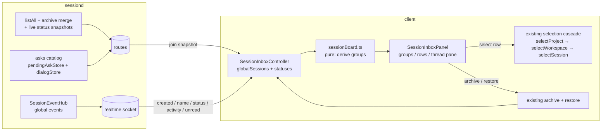

# feat: Session inbox as primary navigation

## Summary

Replace Forgerie's project → workspace → session drill-down with a machine-global session inbox as the primary navigation surface: one list of all sessions grouped by six states (Blocked on you, Errored, Working, Unread, Open, Archived), backed by a new machine-scoped listing endpoint with embedded status snapshots, a new asks catalog endpoint, and a client-side global session store that survives workspace switching. The prototype at `prototypes/session-board/` is the validated design target.

---

## Problem Frame

Forgerie's navigation is location-first: sessions are leaves reached by drilling machine → project → workspace, and the client's session list is torn down on every selection change. The user's actual workflow is inbox-shaped — work through sessions, optimistically archive when done, let the rest hang — and the current UI decomposes that inbox into per-workspace fragments with presence dots. A working prototype validated the inbox design across all four Fold 8 postures; this plan makes it real.

---

## Requirements

- R1. All sessions on the machine appear in one list, regardless of project or workspace.
- R2. Sessions are grouped by state with fixed precedence: Archived > Blocked on you > Errored > Working > Unread > Open. Each session appears in exactly one group.
- R3. Blocked on you (pending ask or extension dialog), Working, and Errored classifications are correct at page load, not only after live events trickle in.
- R4. Location (project · branch) is metadata on the row; a "Group by: Project" toggle provides the hierarchy as an alternate view.
- R5. Archive is the primary verb: inline archive per row, "Archive & next" in the thread view, undo via the existing restore path.
- R6. Selecting an inbox row in a different workspace navigates there through the existing selection cascade (chat, files, git, terminals follow).
- R7. The board stays current while open: new sessions, renames, status/activity changes, unread changes, and archive/restore all update the list live.
- R8. A new session can be started from the inbox via a workspace picker, including in workspaces that currently have no sessions.
- R9. The UX is seamless across the four Fold 8 postures per AGENTS.md: docked two-pane at ≥820px container width, overlay below, no new viewport breakpoints in the 499–979px range, state preserved across posture changes.
- R10. Open and Archived groups are collapsed by default; visual density follows the prototype's calm pass (no group hint prose, quiet location chips, type floor ≥13px).
- R11. `npm run verify` passes; no regressions in existing workspace/session controller behavior.

---

## Scope Boundaries

- No search over session content or titles (known gap; separate work).
- No snooze/hold with persisted state — "Hold" semantics beyond skip-to-next are out.
- No multi-machine inbox merging; the inbox is per selected machine. The machine switcher stays as-is.
- No persistence of pending asks across sessiond restarts (in-memory stores accepted; see Key Technical Decisions).
- No dedicated full-screen triage mode (concept 2); "Archive & next" in the thread view is the only triage affordance this round.
- No read-only transcript view for sessions whose workspace was deleted (row shows a disabled state instead; full recovery UX deferred).
- No attempt to keep upstream (jmfederico/pi-web) mergeability — the fork diverges by design.

### Deferred to Follow-Up Work

- Full keyboard-driven triage mode walking the queue one session at a time: future iteration layered on `triageQueue()`.
- Read-only transcript access for deleted-workspace sessions: future iteration.
- Group-by-project sub-grouping by state within each project group: start with flat rows + state markers, revisit after use.
- Notification-catalog client controller sophistication (snapshot+delta+generation like unread): only if the inbox's status handling proves insufficient.

---

## Context & Research

### Relevant Code and Patterns

- `prototypes/session-board/sessionBoard.js` — pure board derivation, designed to graduate; `prototypes/session-board/README.md` documents what is faked and why.
- `src/client/src/sessionUnread.ts` — `SessionUnreadController`: HTTP snapshot at join + contiguous socket deltas + stale status + generation counter. The template for the inbox store's data discipline.
- `src/client/src/controllers/workspaceController.ts` — the selection cascade and the `refreshSelectedProjectTopology` comment documenting why refreshes must not route through `selectWorkspace`. The core landmine.
- `src/client/src/controllers/sessionController.ts` — `applyCreatedSession` (cross-workspace gap), `archiveSession`/`restoreSession` (server-first archive + existing undo path), `isSessionSeen` (unread acknowledgement gate).
- `src/client/src/components/PiWebApp.ts` — owner of the `goToParentSession` cross-workspace navigation flow (wired through `AppNavigationPanel`); the precedent U6 generalizes lives at this composition root, not in `sessionController`.
- `src/client/src/appState.ts` — `AppState`, `resetWorkspaceScopedState()`, `WorkspaceScopedStateReset` Pick type. `sessionStatuses`/`sessionActivities` already survive workspace switches — the precedent for `globalSessions`.
- `src/server/sessions/sessionRoutes.ts` — catalog endpoint registration precedent (`GET /sessions/notifications`, `GET /sessions/unread`) and validation helper conventions.
- `src/server/sessions/piSessionService.ts` — `sessionManager.listAll()` (exists, used only by `cleanupPlan`), `statusFromSession`, the `active` runtime set, `withRelatedSessionsElsewhere`.
- `src/server/sessions/pendingAskStore.ts`, `src/server/sessions/pendingExtensionDialogStore.ts` — daemon-level stores keyed by sessionId; the asks catalog reads these.
- `src/server/sessiond/sessionProxyRoutes.ts` — catch-all proxy; daemon-side routes are reachable through it without server changes.
- `src/server/realtime/sessionEventHub.ts` + `src/client/src/sessionSocket.ts` — machine-global event fanout: `session.created`, `session.name`, `status.update`, `activity.update`, `sessions.unread`.
- `src/client/src/sessionForkGrouping.ts`, `src/client/src/sessionOrphanGroups.ts` — recent pure-derivation modules; the pattern for `sessionBoard.ts` structure and node-env tests.
- `src/client/src/components/SessionList.ts`, `ProjectList.ts`, `AppNavigationPanel.ts` — Lit component conventions: function props, theme tokens, `KeyboardNavigableSection`, `listStyles`.
- `src/client/src/appShell/shellLayoutMode.ts` — `NAVIGATION_DOCK_MIN_WIDTH = 820` (content-derived); reuse the constant, do not hardcode.
- `.agents/skills/testing-guide/SKILL.md` — test layer order, happy-dom per-file opt-in, TemplateResult extraction rules.

### Institutional Learnings

- `docs/solutions/` does not exist; learnings live in `AGENTS.md`, code comments, and `prototypes/session-board/README.md`.
- Container-query gotcha (from prototype work): an element cannot query the container it establishes — the container goes on the parent frame; pane-level containers make rows respond to pane width.
- The shell layout paradigm-cliff fix (commit `8e53866`): layout mode from measured container width via ResizeObserver, never viewport media queries.
- `docs/testing-skill-compliance-audit.md`: use the shared TemplateResult test-support helper; do not add per-file copies.

### External References

- None needed — all new pieces have 3+ direct local precedents.

---

## Key Technical Decisions

- **Machine-scoped listing embeds live status snapshots**: the new listing response carries, alongside `SessionInfo[]`, a status snapshot for every session with a live runtime (computed via the existing `statusFromSession` over the daemon's active set — no runtime boots). This makes Blocked/Working/Errored correct at page load in one request (R3) instead of waiting for socket events. Rationale: an atomic join snapshot; mirrors what the client needs, avoids a second round trip and a race between two catalogs.
- **Asks catalog is a separate endpoint** following the `unreadCatalog`/`notificationCatalog` precedent, because pending asks/dialogs survive browser reloads independent of listing calls and other clients (or future surfaces) may want asks without the full listing. In-memory only; a sessiond restart clears it — accepted, with reconciliation below.
- **Reconnect = re-snapshot**: on realtime socket (re)connect, the inbox store re-fetches the listing snapshot and replaces its status-derived data, following the `SessionUnreadController` refresh-on-connect pattern. This is the stale-status policy after sessiond restarts: stale Blocked/Working classifications are corrected by the snapshot, not by per-session detection.
- **`globalSessions` is a new machine-scoped AppState slice** outside `WorkspaceScopedStateReset`, owned by a new inbox controller (pattern: `SessionNotificationController`). The workspace-scoped `sessions` field remains for existing surfaces during the transition; the two are different projections of the same server data.
- **Inbox selection routes through the full existing selection cascade** (`goToParentSession` precedent generalized): clicking a row in another workspace performs project/workspace/session selection with the normal teardown. Rationale: reuses the unread acknowledgement gate, composer, file/git/terminal wiring unchanged; triage speed is bounded by local network, acceptable for single-user use. A transcript-only fast path is explicitly rejected this round.
- **The board derivation is a pure typed module** (`sessionBoard.ts`) graduated from the prototype: no I/O, no DOM, injected clock. `BOARD_GROUPS` stays the single source of truth for the case list; UI, counts, and tests all read from it.
- **Hierarchy demoted, not deleted**: `AppNavigationPanel`'s four-section funnel is replaced by the inbox panel as primary nav-pane content. Project/workspace browsing survives as the "Group by: Project" board view plus a workspace picker dialog (reusing existing list components) for new-session targeting and worktree management entry points.
- **Archive stays server-first** with the undo toast calling the existing `restoreSession` path (5s window; navigating away lets the archive stand). No optimistic-archive rewrite. Archiving a Working session warns first; archiving a Blocked session does not (dismissal is a valid answer).
- **Selection follows live group moves**: when the selected session changes group, the destination group auto-expands and the selection is preserved (generalizing `clearSelectionAfterArchivedCollapse`).
- **View preferences persist** (group-by mode, show-archived, collapsed groups) in localStorage, machine-scoped, non-sensitive per the storage-seam rule.
- **Deleted-workspace rows are disabled** with a "workspace removed" label and an archive affordance — no silent no-op click.

---

## Open Questions

### Resolved During Planning

- Where do page-load statuses come from? — Embedded in the machine-scoped listing response (see Key Technical Decisions).
- Does inbox selection switch workspaces? — Yes, full cascade; transcript-only view rejected this round.
- Undo contract? — Existing `restoreSession`, 5s toast, expires silently on navigation.
- New-session entry point? — Inbox header action → workspace picker → existing `startSession`.
- Sort churn within groups? — Sort by `modified` descending; `modified` only changes on listing refresh/creation events, not on `status.update`, so live shuffle risk is low. Re-sort eagerly; revisit only if real churn appears.
- Fork display in the global list? — Flat rows with a fork marker (prototype behavior); workspace-local fork subtree collapsing stays a `SessionList` concern and is not ported to the board.

### Deferred to Implementation

- Exact wire shape/field names of the listing + statuses response and asks catalog snapshot: settle against `src/shared/apiTypes.ts` conventions during U1/U2.
- Whether `GET /sessions` grows an optional-cwd mode or a new `/sessions/all` path is registered beside the catalog routes: decide against Fastify route-precedence reality in U1 (both are compatible with the proxy).
- Whether the inbox panel reuses `NavigationSection` machinery or replaces it with a simpler view state: decide when touching `navigationState.ts` in U6.
- Precise behavior of keyboard focus after archiving the last actionable session (inbox-zero focus target): pick during U8 against the real DOM.

---

## High-Level Technical Design

> *This illustrates the intended approach and is directional guidance for review, not implementation specification. The implementing agent should treat it as context, not code to reproduce.*

Join order: snapshot establishes state; socket deltas keep it current; reconnect re-snapshots (unread-controller discipline).

---

## Implementation Units

### U1. Machine-scoped session listing endpoint with status snapshots

**Goal:** The daemon can return every session on the machine (archived included) plus a status snapshot for each session with a live runtime, in one response.

**Requirements:** R1, R3

**Dependencies:** None

**Files:**
- Modify: `src/shared/apiTypes.ts` (listing response + embedded statuses types)
- Modify: `src/server/sessions/sessionService.ts` (extend `SessionRouteService`)
- Modify: `src/server/sessions/piSessionService.ts` (machine listing: `sessionManager.listAll()` + archive merge + statuses from the active runtime set)
- Modify: `src/server/sessions/sessionRoutes.ts` (route registration beside the catalog endpoints)
- Modify: `src/shared/federatedRoutes.ts` (allowlist entry — without it the route works locally but 404s for remote machines)
- Test: `src/server/sessions/piSessionService.machineListing.test.ts`
- Test: `src/client/src/api/federatedRouteContract.test.ts` (route-contract coverage for the new method)

**Approach:**
- Follow the `list(cwd)` merge logic (archived records, parent annotations) but without cwd filtering; reuse the memoized `SessionSummaryScanner` via `listAll()`.
- Statuses come only from already-live runtimes (`statusFromSession` over the active set) — never boot a runtime to answer a listing.
- Register the route following the `GET /sessions/notifications` / `GET /sessions/unread` catalog precedent so it wins over any `:sessionId` param routes and flows through the sessiond proxy untouched.

**Patterns to follow:**
- `src/server/sessions/piSessionService.ts` `list()` and `cleanupPlan()` (the only current `listAll()` caller)
- Catalog route registration + error-code conventions in `src/server/sessions/sessionRoutes.ts`

**Test scenarios:**
- Happy path: sessions across three cwds (two projects, one with a worktree) → all returned with correct cwds; archived session included with `archived: true`.
- Happy path: a session with a live runtime holding a pending ask → its status snapshot appears in the response; sessions without live runtimes have no status entry.
- Edge case: zero sessions on the machine → empty listing, empty statuses, 200.
- Edge case: session file present but archive store has a record for a missing file → merge behaves as `list(cwd)` does today (no crash, consistent flags).
- Error path: scanner failure on one directory → endpoint returns the error status the catalog endpoints use, not a partial silent success.
- Integration: route reachable through the sessiond proxy path exactly as `GET /sessions/unread` is (route-contract test).

**Verification:**
- New endpoint returns the full machine inventory + live statuses in one request against a seeded temp session store; `npm run verify` green.

---

### U2. Asks catalog endpoint

**Goal:** A global catalog of pending asks and extension dialogs across all live sessions, so "Blocked on you" is queryable without opening sessions.

**Requirements:** R3

**Dependencies:** None

**Files:**
- Modify: `src/shared/apiTypes.ts` (asks catalog snapshot type)
- Modify: `src/server/sessions/sessionService.ts` (extend `SessionRouteService`)
- Modify: `src/server/sessions/piSessionService.ts` (collect from `pendingAskStore` + `pendingExtensionDialogStore` across active sessions)
- Modify: `src/server/sessions/sessionRoutes.ts` (route beside `GET /sessions/unread`)
- Modify: `src/shared/federatedRoutes.ts` (allowlist entry, as U1)
- Test: `src/server/sessions/piSessionService.asksCatalog.test.ts`
- Test: `src/client/src/api/federatedRouteContract.test.ts` (route-contract coverage for the new method)

**Approach:**
- Mirror `notificationCatalog()`/`unreadCatalog()` exactly: snapshot shape with session refs (`id`, `cwd`), no per-session boot, bounded sizes per the existing constants conventions.
- In-memory only; document in the type's doc comment that a sessiond restart clears the catalog and the client reconciles via re-snapshot.

**Patterns to follow:**
- `notificationCatalog()` service + route + `SessionNotificationCatalogSnapshot` type shape

**Test scenarios:**
- Happy path: two sessions with open asks, one with an open dialog, others idle → catalog lists exactly those three with refs.
- Edge case: ask answered/superseded → subsequent catalog omits it.
- Edge case: no live runtimes → empty catalog, 200.
- Error path: malformed request handled per catalog conventions (route-contract parity with unread).
- Integration: ask opened via the extension path appears in the catalog without the session ever being fetched by a browser.

**Verification:**
- Catalog reflects open/close of asks and dialogs in service-level tests; `npm run verify` green.

---

### U3. Graduate the board derivation to a typed core module

**Goal:** `sessionBoard.ts` — the pure six-state derivation — lives in the client source with strict types and node-env unit tests.

**Requirements:** R2, R10

**Dependencies:** None (types align with U1/U2 shapes when those land; keep the module's inputs structural)

**Files:**
- Create: `src/client/src/sessionBoard.ts`
- Test: `src/client/src/sessionBoard.test.ts`

**Approach:**
- Port `BOARD_GROUPS`, `sessionBoardState`, `deriveSessionBoard`, `groupSessionsByProject`, `triageQueue`, `attentionCount`, `relativeTime` from `prototypes/session-board/sessionBoard.js` with types over `SessionInfo`/`SessionStatus`/`SessionActivity` and an injected `now`.
- Keep `BOARD_GROUPS` the single source of truth for the case list; export the state union as a tagged type per the state-modeling standards.

**Execution note:** Test-first — the prototype's behavior is the spec; write the scenarios below before porting.

**Patterns to follow:**
- `src/client/src/sessionForkGrouping.ts` / `sessionOrphanGroups.ts` (pure module + node-env test structure)

**Test scenarios:**
- Happy path: one session per state → each lands in its group; groups come back in `BOARD_GROUPS` order including empty ones.
- Precedence: archived session with a live streaming status → Archived wins; pending ask + error phase → Blocked wins; streaming + unread → Working wins.
- Edge case: unread session with no status/activity entries → Unread; nothing at all → Open.
- Edge case: `isCompacting`/`isBashRunning`/`isStreaming` each classify as Working with the right detail; `phase: "active"` with no flags is Working.
- Group-by-project: cross-project rows group by project, ordered by attention weight; archived excluded unless requested.
- Triage queue: contains exactly Blocked+Errored+Unread rows in group order, recency within groups.
- `relativeTime`: boundaries at 60s/60m/24h/7d; UTC-only arithmetic (no local-time accessors).

**Verification:**
- Node-env tests pass; module has no DOM/network imports; `npm run verify` green.

---

### U4. Client inbox store and controller

**Goal:** A machine-scoped `globalSessions` + statuses store that populates from the join snapshot, stays current from realtime events, survives workspace switching, and re-snapshots on reconnect.

**Requirements:** R1, R3, R7

**Dependencies:** U1, U2

**Files:**
- Modify: `src/client/src/appState.ts` (new machine-scoped slice; explicitly NOT in `WorkspaceScopedStateReset`)
- Create: `src/client/src/controllers/sessionInboxController.ts`
- Modify: `src/client/src/api.ts` / `src/client/src/api/` (listing + asks catalog calls)
- Modify: `src/client/src/components/PiWebApp.ts` (construct + wire the controller)
- Modify: `src/client/src/controllers/sessionController.ts` (cross-workspace `session.created`, archive/restore/archive-with-descendants also update the global store)
- Test: `src/client/src/controllers/sessionInboxController.test.ts`

**Approach:**
- Controller pattern: `SessionNotificationController` (separate class, injected, owns its slice); data discipline: `SessionUnreadController` (snapshot on socket connect, deltas between, generation guard on machine switch, `stale` tolerance on snapshot failure).
- Fix the `applyCreatedSession` gap: `session.created`/`session.name` events update `globalSessions` regardless of selected workspace.
- Archive/restore/bulk-archive paths update both projections (workspace `sessions` when applicable, `globalSessions` always) — closes the cross-workspace descendant-archive gap.
- Machine switch: clear and re-snapshot under the new machine's generation.

**Test scenarios:**
- Happy path: snapshot with sessions from three workspaces → store holds all; switching workspace does not clear it (`resetWorkspaceScopedState` regression test).
- Happy path: `session.created` for an unselected workspace appears in the store; rename event updates its title.
- Happy path: `status.update` flips a session's derived group (via U3) without a re-fetch.
- Edge case: snapshot fails → store marked stale, last data retained; next successful snapshot clears stale.
- Edge case: reconnect after sessiond restart → re-snapshot drops stale Blocked classifications (session that had a pending ask now has none).
- Edge case: machine switch mid-flight → late response for the old machine is discarded (generation guard).
- Integration: archive from the store's API updates `globalSessions` immediately after server confirm; undo/restore returns it; descendants in other workspaces reflect archived state after bulk archive.

**Verification:**
- Controller tests green with the existing `FakeSocket`-style test support; workspace switching in `PiWebApp`-level tests leaves the global slice intact; `npm run verify` green.

---

### U5. Inbox board UI

**Goal:** The inbox panel — grouped list, group-by-project toggle, collapsed defaults, empty states, calm visual density — as Lit components rendering the U3 derivation from the U4 store.

**Requirements:** R2, R4, R10

**Dependencies:** U3, U4

**Files:**
- Create: `src/client/src/components/SessionInboxPanel.ts`
- Create: `src/client/src/components/SessionInboxRow.ts` (if row complexity warrants its own element; otherwise keep in panel)
- Modify: `src/client/src/components/shared.ts` (only if a shared style genuinely fits)
- Test: `src/client/src/components/SessionInboxPanel.test.ts` (happy-dom)
- Test: pure view-model helpers split into node-env tests where extraction is natural

**Approach:**
- Reproduce the prototype's calm pass: state groups with counts, no hint prose, quiet location chips, 7px state markers, Open/Archived collapsed by default, type floor ≥13px via the theme's fluid scale, glyph archive action with ≥44px hit area (fix the prototype's 30px target).
- Theme tokens only (`--pi-*`); pane-level container so rows respond to pane width; no viewport queries.
- Group-by-project view: flat rows with state markers, project groups ordered by attention weight; persisted view prefs (localStorage, machine-scoped).
- Empty states distinguish "no sessions yet" (points at new-session action, U7) from "inbox clear" from "all archived".
- Selection-follows-group-moves: destination group auto-expands when the selected session lands in it.

**Patterns to follow:**
- `SessionList.ts` (list component structure, `KeyboardNavigableSection`, action menus), `listStyles` in `shared.ts`, `AskUserCard.ts` (container query on `:host`)
- Shared TemplateResult test-support helper per `docs/testing-skill-compliance-audit.md` — no new per-file copies

**Test scenarios:**
- Happy path: rows render into correct groups with counts; Open/Archived collapsed by default; expanding persists.
- Happy path: group-by toggle swaps views and persists across component re-creation (localStorage).
- Edge case: selected session's group collapses via live move → group auto-expands, selection retained.
- Edge case: empty machine → "no sessions" empty state with new-session affordance; all-clear state when only Open/Archived have rows.
- Edge case: deleted-workspace row renders disabled with label; click does not fire selection.
- Integration (happy-dom): clicking a row fires the selection callback with the session ref; archive glyph fires archive callback and not selection.

**Verification:**
- Component tests green; visual pass against the prototype captures for parity; `npm run verify` green.

---

### U6. Shell integration and cross-workspace selection

**Goal:** The inbox replaces the four-section navigation funnel as the nav-pane content; selecting any row navigates through the existing cascade, including across workspaces and into unloaded projects.

**Requirements:** R1, R6, R9

**Dependencies:** U4, U5

**Files:**
- Modify: `src/client/src/components/PiWebApp.ts` (panel composition; selection routing)
- Modify: `src/client/src/components/appShell/AppNavigationPanel.ts` (replace/retire the four-section funnel as primary content)
- Modify: `src/client/src/appShell/navigationState.ts` (section model reflects the new surface; simplify if the funnel machinery is no longer needed)
- Modify: `src/client/src/components/PiWebApp.ts` and/or a controller extracted from it (the `goToParentSession` flow being generalized lives in `PiWebApp`, not `sessionController` — extract it into an inbox navigation helper wired from the composition root)
- Test: `src/client/src/controllers/sessionController.inboxNavigation.test.ts`
- Test: update affected `PiWebApp.*.test.ts` / navigation tests

**Approach:**
- Generalize the `goToParentSession` flow: resolve row cwd → workspace (loading the project's workspaces if needed) → `selectProject`/`selectWorkspace`/`selectSession` with target sessionId. Never bypass the cascade — the teardown is intentional (unread gate, sockets, composer all depend on it).
- Same-workspace selection short-circuits to `selectSession` without workspace teardown.
- Deleted-workspace resolution failure sets the row's disabled state rather than silently returning.
- Keep the machine switcher in the panel header; workspace management (worktree create/delete) reachable from the workspace picker surface, not lost with the funnel.
- Do not touch `refreshSelectedProjectTopology` semantics; its invariant (data refresh without selection teardown) is load-bearing for browser resume.

**Test scenarios:**
- Happy path: select row in current workspace → `selectSession` only; chat identity switches; no `resetWorkspaceScopedState` call.
- Happy path: select row in another workspace of the same project → workspace switch, then target session selected (not the workspace's default preferred session).
- Happy path: select row in a not-currently-loaded project → project workspaces load, then cascade completes.
- Edge case: row whose cwd resolves to no workspace → navigation declines, row flagged; no state teardown.
- Edge case: rapid successive row selections across workspaces → last selection wins (guards consistent with existing machineId/project guards in `workspaceController`).
- Integration: unread session opened via the inbox becomes read through the existing `isSessionSeen` gate (regression: the full-cascade decision keeps this working).

**Verification:**
- Existing workspace/session controller test suites stay green (the cascade is untouched for non-inbox paths); new navigation tests green; `npm run verify` green.

---

### U7. New-session entry from the inbox

**Goal:** Starting a session in any workspace — including empty ones — from the inbox header via a workspace picker.

**Requirements:** R8

**Dependencies:** U6

**Files:**
- Create: `src/client/src/components/SessionInboxNewSessionDialog.ts` (or extend an existing dialog pattern)
- Modify: `src/client/src/components/PiWebApp.ts` (action wiring)
- Test: `src/client/src/components/SessionInboxNewSessionDialog.test.ts`

**Approach:**
- Picker lists projects → workspaces (reusing `ProjectList`/`WorkspaceList` or their data, whichever composes cleanly), then runs `selectWorkspace` + existing `startSession` — satisfying `startSession`'s `selectedWorkspace` requirement by construction.
- The "no sessions yet" empty state (U5) deep-links to this dialog.

**Test scenarios:**
- Happy path: pick project + workspace → workspace selected, session started, new session appears in the inbox (Working/startup) via U4 events.
- Edge case: workspace with zero existing sessions → flow works (the original trap this unit exists to avoid).
- Edge case: cancel at either step → no selection change, no session started.
- Error path: `startSession` failure surfaces the existing error handling; dialog does not silently swallow it.

**Verification:**
- A session can be started in a fresh worktree with no prior sessions entirely from the inbox; `npm run verify` green.

---

### U8. Archive workflow: row action, Archive & next, undo

**Goal:** Archive as the primary verb with safe semantics: inline archive, thread-pane "Archive & next" walking the triage queue, undo toast on the restore path, warning when archiving a Working session.

**Requirements:** R5

**Dependencies:** U4, U5, U6

**Files:**
- Modify: `src/client/src/components/SessionInboxPanel.ts` (row action, toast)
- Modify: `src/client/src/components/PiWebApp.ts` or thread-pane header component (Archive & next placement)
- Modify: `src/client/src/controllers/sessionInboxController.ts` (queue advance, undo orchestration)
- Test: `src/client/src/controllers/sessionInboxController.archive.test.ts`

**Approach:**
- Server-first archive (existing `archiveSession`), then toast with Undo → existing `restoreSession`; 5s window; navigation lets the archive stand; a second archive before the first toast expires replaces the toast (single-undo, matching the prototype).
- "Archive & next": archive current, advance to `triageQueue()` head; if next is cross-workspace, route through U6 navigation; queue empty → return focus to the board with the all-clear state.
- Working sessions get a confirm step; Blocked sessions archive without warning; keyboard `E` follows the same rules.
- Archive-with-descendants uses the existing tree endpoint and relies on U4's global-store update for cross-workspace descendants.

**Test scenarios:**
- Happy path: row archive → session moves to Archived group after server confirm; undo within window restores it to its prior group.
- Happy path: Archive & next from thread → next queue session selected, including a cross-workspace next.
- Edge case: archive last queue item → board shows all-clear, focus lands on a real element (not a collapsed-group ghost).
- Edge case: undo after navigating away → toast gone, archive stands (no dangling restore).
- Edge case: archive B while A's toast is open → A's undo is forfeited, B's toast shows.
- Error path: archive API failure → session stays in place, error surfaced, no phantom Archived entry.
- Integration: archiving a Working session prompts; confirming aborts/archives per existing server semantics; declining leaves it untouched.

**Verification:**
- Triage loop (open → act → Archive & next → … → all-clear) works end-to-end against a live dev server; `npm run verify` green.

---

### U9. Posture matrix validation and layout hardening

**Goal:** The inbox meets the AGENTS.md acceptance bar: correct docked/overlay behavior from container width, state preserved across fold/rotate, all four Fold 8 postures captured and reviewed.

**Requirements:** R9, R10, R11

**Dependencies:** U5, U6, U7, U8

**Files:**
- Modify: `src/client/src/components/SessionInboxPanel.ts` / shell CSS as findings dictate
- Modify: `src/client/src/appShell/` only if measurement wiring needs the new panel registered
- Test: posture captures via the existing screenshot tooling (`scripts/capture-screenshots.mjs` or the prototype's compensated capture approach)

**Approach:**
- Docked at ≥`NAVIGATION_DOCK_MIN_WIDTH` from measured container width (reuse the constant); overlay below; list↔thread overlay state, scroll position, collapsed groups, and composer draft survive posture transitions.
- Note: chromium `--window-size` includes ~87px of window chrome — the capture path must compensate (as `prototypes/capture.sh` does) or the postures are invalid.
- Review every capture; judge, don't just collect.

**Test scenarios:**
- Test expectation: none beyond capture review — this unit is visual acceptance plus any regressions it forces back into U5/U6 (which carry the automated coverage).

**Verification:**
- Four posture captures reviewed at true CSS viewports (739×979, 979×739, 499×789, 789×499); no layout paradigm flip between adjacent postures; state survives simulated posture swap; `npm run verify` green.

---

## System-Wide Impact

- **Interaction graph:** `PiWebApp` composition, all four selection controllers, the realtime socket connect path (now also triggering inbox snapshot), archive/restore paths (now dual-projection), `startSession` (new caller via picker). The sessiond proxy is untouched — new routes ride the existing catch-all.
- **Error propagation:** listing/asks snapshot failures degrade to `stale` board data (unread-controller convention), never a blank inbox; archive failures surface through existing error state.
- **State lifecycle risks:** the split between workspace-scoped `sessions` and machine-scoped `globalSessions` is the core invariant — a future contributor adding a field to `WorkspaceScopedStateReset` could silently kill the inbox; guard with an explicit regression test (U4) and a comment at the type.
- **API surface parity:** the machine listing must stay shape-consistent with `list(cwd)` rows (same `SessionInfo` semantics) so both projections agree; asks catalog refs use the same `{id, cwd}` ref convention as bulk mutations.
- **Integration coverage:** cross-workspace selection, cross-workspace descendant archive, and reconnect-after-daemon-restart are the three scenarios unit tests alone will not prove — each has a dedicated integration-flavored test in U4/U6/U8.
- **Unchanged invariants:** `refreshSelectedProjectTopology`'s no-teardown refresh; the selection cascade's teardown semantics for genuine workspace switches; `list(cwd)` behavior for existing callers; the unread acknowledgement gate; upstream-fork policy (client divergence is expected, daemon/session changes are the high-value upstream sync surface — new endpoints are additive and do not conflict).

---

## Risks & Dependencies

| Risk | Mitigation |
|------|------------|
| Selection-cascade regressions (the most fragile code in the client) | U6 never bypasses the cascade; existing controller suites are the regression net; `refreshSelectedProjectTopology` untouched |
| `listAll()` cost on machines with many sessions | Memoized `SessionSummaryScanner`; snapshot only on connect/reconnect/explicit refresh, deltas otherwise; measure during U1 with a large seeded store |
| Stale Blocked/Working classifications after daemon restart | Reconnect re-snapshot policy (U4); accepted residual: staleness window while disconnected |
| Inbox replaces navigation users (and tests) rely on | Hierarchy survives as picker + group-by-project; navigation tests updated in U6 rather than deleted |
| Two session projections drift (workspace list vs global store) | Both fed by the same server rows and the same mutation paths (U4); drift caught by dual-projection tests |
| Fold 8 posture regressions land late | U9 is a gate, not a cleanup; capture tooling compensates for window chrome so postures are true |
| Toast/undo races (archive, navigate, restore) | Single-undo model, explicit expiry rules, scenarios enumerated in U8 |

---

## Documentation / Operational Notes

- Update `AGENTS.md` product-facts section if the primary-navigation change alters the acceptance workflow description.
- Per `AGENTS.local.md`: after landing on `main`, restart the local systemd user units so the running instance picks up the change.
- `prototypes/session-board/` stays as the design reference; add a note to its README pointing at this plan once implementation starts.
- Changeset required (user-visible feature) per the changeset-changelog skill.

---

## Sources & References

- Prototype: `prototypes/session-board/` (design target + README documenting fakes/blockers)
- Related code: `src/client/src/sessionUnread.ts`, `src/client/src/controllers/workspaceController.ts`, `src/server/sessions/sessionRoutes.ts`, `src/server/sessions/piSessionService.ts`
- Repo guidance: `AGENTS.md` (acceptance matrix, intrinsic design rules, fork policy), `.agents/skills/testing-guide/SKILL.md`
