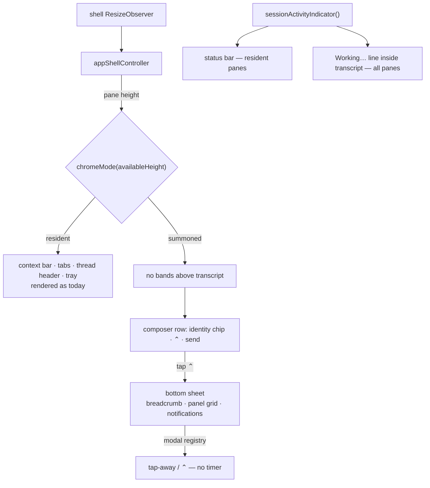

# feat: Content-first mobile chat chrome

## Summary

Remove all resident chrome above the chat transcript wherever the shell is already in overlay layout: liveness renders inside the transcript, session identity and archive move into the composer row, and the breadcrumb, panel tabs, and notifications collapse into a bottom sheet opened on request. The decision reuses the shell's existing docked/overlay axis rather than adding a new one, so docked panes keep today's layout untouched.

---

## Problem Frame

On the Fold 8 cover screen (499 × 789 CSS px), four permanent chrome bands (~189px) plus the composer (~110px) leave the transcript ~151px with the keyboard open — the smallest region on a screen whose job is reading. The full accounting, the rejected alternatives (hairline bar, scroll-driven chrome), and the accepted design are recorded in `prototypes/mobile-chrome/README.md`.

---

## Requirements

- R1. On constrained panes at rest, no resident chrome renders above the transcript — no context bar, tab strip, thread header, or notification tray band.
- R2. Whenever the agent is working, a quiet liveness indicator is visible inside the transcript scroll area at the foot of the live turn. This lands **before** any chrome is removed.
- R3. The composer row carries quiet session identity and a summon control (`⌃`) on constrained panes.
- R4. Tapping `⌃` opens a bottom sheet containing location breadcrumb, the full panel grid, and a notifications summary. It dismisses by tap-away or `⌃` again — never by timer.
- R5. Resident-vs-summoned reuses the shell's existing layout decision (`isMobileNavigationLayout`, derived from `NAVIGATION_PANEL_MIN_WIDTH + SESSION_COMFORTABLE_WIDTH`). No new threshold, constant, or axis is introduced, and no new viewport `@media` breakpoints anywhere in this work.
- R6. Panes that afford resident chrome keep today's layout unchanged — desktop and tall tablet postures are not degraded.
- R7. Scroll position, composer draft, and sheet openness survive mode transitions (fold, unfold, rotate, keyboard open/close).
- R8. Notification arrivals remain accessible on constrained panes (live-region announcement preserved) even though the tray band is gone; the count is visible in the sheet.
- R9. `npm run verify` passes; all four Fold 8 postures are captured and visually reviewed per AGENTS.md before the work is called done.
- R10. On constrained panes the composer rests as a single line and expands on focus or non-empty draft, losing no capability (attachments, steer, model/thinking, slash commands all remain reachable when expanded).

---

## Scope Boundaries

- No change to desktop / roomy-pane layout or behavior.
- No retirement of existing width breakpoints (`1180px`, `520px`, `430px`) and no fix for the Fold posture cliff — backlogged as `01KZKS6M89CS8JKQSN32JHXG1D`.
- No swipe-down-to-dismiss gesture for the sheet in v1 — tap-away and `⌃` suffice.
- No scroll-driven chrome. Mode is height-driven only; `pinnedToBottom` plays no role in chrome visibility.
- No Calm transcript typography work (card removal, role headers, reading column, error voice).
- No changes to upstream-adoption surfaces (`src/server/sessiond*`); this is client-only.

### Deferred to Follow-Up Work

- Calm Conversation typography port (transcript cards, role headers, reading column, error voice): separate plan; this plan's design record notes it as the tail phases.
- Sheet swipe-down dismissal and open/close animation polish: future iteration.
- Sheet swipe-down dismissal and open/close animation polish: future iteration.
- Width-breakpoint retirement: backlog `01KZKS6M89CS8JKQSN32JHXG1D`.

---

## Context & Research

### Relevant Code and Patterns

- `src/client/src/appShell/shellLayoutMode.ts` — the pattern to mirror: content-derived constants (`NAVIGATION_PANEL_MIN_WIDTH + SESSION_COMFORTABLE_WIDTH`), pure function, unit-tested. The new height rule is its vertical twin.
- `src/client/src/appShell/appShellController.ts` — owns the shell `ResizeObserver` and recomputes `shellLayoutMode` on resize; the chrome mode wires in here.
- `src/client/src/appShell/onScreenKeyboardController.ts` — keyboard-open detection with fold/rotate edge cases handled; the pane-height rule inherits keyboard behavior for free because the Android viewport policy shrinks layout height when the keyboard opens.
- `src/client/src/components/PiWebApp.ts` — `renderContextBar()`, `renderMobileMainTabs()`, `renderThreadHeader()` (~line 2454), `renderStatusBar()` (already gated on `onScreenKeyboard.isOpen`), `mobileMainTabs()` (tab model the sheet reuses), main render column (~line 2545).
- `src/client/src/sessionStatusStrip.ts` — `sessionActivityIndicator()` pure helper already fusing status/activity/sending into `{ text, active }`; the in-transcript liveness line consumes this instead of inventing a second derivation.
- `src/client/src/components/ChatView.ts` — transcript scroll container; `renderSessionActivity()` (compaction aside) shows the in-scroll-area aside pattern; notification tray (`renderNotificationTray`, `renderNotificationLiveRegions`) with `notificationTrayIsCollapsed` state.
- `src/client/src/components/PromptEditor.ts` — composer; `compact-status` row (~line 167) already hosts model/thinking chips, the natural home for the session chip and `⌃`.
- `src/client/src/components/modalLayerRegistry.ts` + `ModalSurface.ts` — modal layering, focus, and dismissal conventions the sheet must follow.
- `src/client/src/chatScrollPosition.ts` — `ChatScrollController` save/restore; the mechanism that must keep scroll stable across mode flips.
- `src/client/src/components/appShell/AppContextBar.ts` / `AppMobileMainTabs.ts` — existing chrome components whose content the sheet absorbs; naming pattern for the new sheet component.
- `work/items/active/01KZFG0Y7GKA8H2XGYDE6WPSCM-session-inbox-primary-navigation/plan.md` — active sibling initiative; owns the thread header's `Archive & next` and inbox flows this plan relocates. R9 of that plan ("no new viewport breakpoints in the 499–979px range") is honored here.
- `prototypes/mobile-chrome/README.md` — design record: decision, numbers, rejected alternatives, constraints.

### Institutional Learnings

- `docs/solutions/` does not exist in this repo; the design record and AGENTS.md are the institutional memory.
- AGENTS.md: acceptance device is the Fold 8; all four postures must be captured headless and **visually reviewed**; chromium is on PATH on zao.
- AGENTS.local.md: user-facing changes on `main` require rebuild + systemd user-unit restart on zao.

### External References

- None needed — local patterns are strong (`shellLayoutMode`, modal registry, keyboard controller all exist as direct precedents).

---

## Key Technical Decisions

- **Height-driven mode, not scroll-driven**: chrome visibility is a pure function of available pane height. The earlier scroll-linked design was rejected because transcript streaming makes scroll direction a noisy signal; the decision record covers this. `pinnedToBottom` is untouched.
- **No new axis — reuse `isMobileNavigationLayout`**: the height-starvation problem exists only in overlay layout, because the height-eating bands already do not render when navigation docks (`.context-bar` is gated on `.shell.overlay-navigation`; `app-mobile-main-tabs` on the existing 1180px rule; the notification tray on having notifications). Computing a new height threshold would answer a question the existing layout decision already answers, and would add a constant to maintain. The keyboard case still resolves correctly: the keyboard shrinks height but the layout stays overlay.
- **Rejected: observing flex overflow to decide fit**: maximally intrinsic (zero constants — the layout engine answers "does it fit?"), but collapsing chrome frees the height that triggered the collapse, which restores the chrome. Damping that loop needs hysteresis constants, reintroducing the numbers it was meant to remove in a harder place to reason about.
- **Delete a band rather than conditionally hide it**: the thread header is always-on chrome carrying a single button. Moving `Archive & next` into the composer row makes the band stop existing at every size, so no mode is needed to hide something that is not there. Preferring deletion over conditional rendering is what keeps the mode surface small.
- **Liveness lands first**: with zero chrome, an idle screen and a dead screen look identical unless the transcript itself reports work. U1 is a hard prerequisite for U5.
- **Liveness reuses `sessionActivityIndicator`**: one derivation of "what is the session doing" — the status bar and the in-transcript line render the same pure output, so they can never disagree.
- **Archive lives in the composer row, not the sheet**: this reverses the earlier sheet-only deferral. The reason is structural rather than ergonomic — putting archive in the composer is what allows the thread-header band to be deleted outright. Keeping the triage loop at one tap is the bonus, not the justification.
- **Sheet uses the modal registry**: `registerRenderedModal` handles focus trapping, escape, and layering that a hand-rolled overlay would get wrong; the sheet is a modal in every behavioral sense.
- **Bands are removed by mode, not deleted from code**: resident panes keep rendering today's chrome from the same render methods; the mode only gates the constrained-pane path. Desktop risk stays near zero.
- **Keyboard handling is free**: keyboard-open shrinks the pane height below the resident threshold, so the same rule that removes chrome on the cover screen removes it while typing everywhere constrained. `renderStatusBar`'s existing `onScreenKeyboard.isOpen` guard remains as a belt-and-suspenders for resident panes.

---

## Open Questions

### Resolved During Planning

- Where does the mode threshold live: in `shellLayoutMode.ts` as a sibling export, or a new module? — New module `chromeMode.ts` in the same folder; same file would conflate two independent axes (width→layout, height→chrome).
- Does the notification tray survive on constrained panes? — The band does not; the live-region announcements do (R8), and the count renders in the sheet.

### Deferred to Implementation

- Whether any docked-but-short surface still starves the transcript in practice: the height-eating bands do not render in docked layout, so this is expected to be a non-problem. Confirm against a short desktop window during posture review rather than pre-emptively adding a height rule.
- Whether the sheet needs its own scroll when notification counts or future content grow: decide when the sheet exists.
- Exact liveness copy (`Working…` vs activity label passthrough): `sessionActivityIndicator` already produces text; pick during implementation with the captures in hand.

---

## High-Level Technical Design

> *This illustrates the intended approach and is directional guidance for review, not implementation specification. The implementing agent should treat it as context, not code to reproduce.*



Threshold shape (directional):

```
CHROME_RESIDENT_MIN_HEIGHT =
    TRANSCRIPT_COMFORTABLE_HEIGHT   // minimum readable transcript
  + COMPOSER_RESTING_HEIGHT
  + RESIDENT_CHROME_HEIGHT          // bands the mode would keep

chromeMode(availableHeight) = availableHeight >= CHROME_RESIDENT_MIN_HEIGHT
  ? "resident" : "summoned"
```

---

## Implementation Units

### U1. Liveness inside the transcript

**Goal:** A quiet working line renders at the foot of the transcript scroll area whenever the session is active, on all panes. The prerequisite that makes chrome removal safe.

**Requirements:** R2

**Dependencies:** None

**Files:**
- Modify: `src/client/src/components/ChatView.ts`
- Modify: `src/client/src/components/shared.ts` (style for the line)
- Modify: `src/client/src/components/PiWebApp.ts` (pass status/activity into ChatView if not already sufficient)
- Test: `src/client/src/components/ChatView.test.ts`

**Approach:**
- Render a new aside at the end of the scroll column (after queued messages / session activity), driven by `sessionActivityIndicator()` from `src/client/src/sessionStatusStrip.ts` — no second status derivation.
- Follow the existing `renderSessionActivity()` (compaction aside) pattern for placement; visually quieter: small italic line with a live dot, `aria-live="polite"`.
- Render only when the indicator is `active`; idle sessions show nothing.

**Patterns to follow:**
- `renderSessionActivity()` in `ChatView.ts` for an in-scroll-area aside.
- `StatusBar.renderActivity()` for consuming `sessionActivityIndicator`.

**Test scenarios:**
- Happy path: streaming status → the working line renders inside the scroll container with the indicator text.
- Happy path: `isSendingPrompt` → line renders with sending text.
- Edge case: idle status and idle activity → no line rendered.
- Edge case: compaction active → compaction aside and working line do not duplicate each other (one coherent aside).
- Integration: line presence does not change scroll pinning behavior — with `pinnedToBottom`, new tokens keep the view at bottom with the line visible.
- Edge case: line appears while the user is scrolled up reading history → no scroll jump (the aside is below the viewport; anchoring is unaffected).

**Verification:**
- With a live session running a tool, the transcript shows the working line on all four Fold postures; when the turn ends, it disappears.

---

### U2. Name the chrome decision on the existing layout axis

**Goal:** A single named accessor answering "is chrome summoned here?", delegating to the shell's existing overlay/docked decision. No new constant, threshold, or measurement.

**Requirements:** R5, R6

**Dependencies:** None

**Files:**
- Modify: `src/client/src/appShell/appShellController.ts` (add the accessor beside `isMobileNavigationLayout`)
- Test: `src/client/src/appShell/appShellController.test.ts` (create if absent)

**Approach:**
- Add `isChromeSummoned` (or similarly named accessor) returning `this.layoutMode === "overlay"`, with a docblock stating why chrome rides the same axis as navigation docking: both answer "is there room for more than the conversation?", and the height-eating bands already do not render in docked layout.
- Do not add a height measurement. The keyboard case resolves through the unchanged layout mode; a docked-but-short window does not starve the transcript because the bands that consume height are already absent there.
- The accessor exists so call sites read as intent (`isChromeSummoned`) rather than as a navigation coincidence (`isMobileNavigationLayout`), and so a future divergence has one seam to change.

**Patterns to follow:**
- `isMobileNavigationLayout` accessor in `appShellController.ts` — same shape, same docblock discipline.
- `shellLayoutMode.ts` for how a decision documents its content-derived reasoning.

**Test scenarios:**
- Happy path: overlay layout → chrome summoned; docked layout → chrome resident.
- Integration: a width change that flips `shellLayoutMode` flips the chrome answer in the same update, with no second observer involved.

**Verification:**
- Folded portrait (499), folded landscape (789), and unfolded portrait (739) report summoned; unfolded landscape (979) and desktop widths report resident, since 979 clears the 820px dock threshold.

**Known gap, not addressed here:** between 820px and 1180px the layout docks while the mobile tab strip still renders (`app-mobile-main-tabs` is gated on the 1180px rule, not on layout mode), so unfolded landscape keeps a tab strip beside a docked navigation panel. That redundancy predates this work; deleting the thread header still removes 57px there. Retiring the 1180px rule belongs to backlog `01KZKS6M89CS8JKQSN32JHXG1D`.

---

### U3. Composer row: identity chip, summon control, archive

**Goal:** On summoned panes, the composer's status row carries a quiet session-identity chip, an `Archive & next` control, and a `⌃` control that requests the sheet. Docked panes see today's composer unchanged.

**Requirements:** R3, R6

**Dependencies:** U2

**Files:**
- Modify: `src/client/src/components/PromptEditor.ts`
- Modify: `src/client/src/components/PiWebApp.ts` (pass session label, chrome mode, `onArchiveAndNext`, and `onOpenControlSheet`)
- Test: `src/client/src/components/PromptEditor.modeChrome.test.ts` (new, following existing per-concern PromptEditor test files)

**Approach:**
- Extend the existing `compact-status` row rather than adding a band: session chip (workspace/branch short label), archive control, and `⌃` icon button, rendered only when chrome is summoned.
- Archive reuses the same handler the thread header called, so U5 can delete that band without losing the action. This is the move that makes the band deletable.
- `⌃` fires a callback up to `PiWebApp`; the editor knows nothing about the sheet.
- Keep all current capabilities (attach, steer, stop, model/thinking) untouched.
- Archive renders only when the session offers it (unarchived, inbox loaded) — matching the thread header's existing conditions rather than showing a dead control.

**Patterns to follow:**
- `compact-status` row and `select-model` button in `PromptEditor.ts` (~line 167).
- Callback-prop convention used throughout (`onSelectModel`, `onStop`).

**Test scenarios:**
- Happy path: summoned → chip shows the session label; `⌃` renders with an accessible name and fires its callback on click.
- Happy path: summoned → archive control renders and fires the same handler the thread header used.
- Happy path: docked → none of chip, archive, or `⌃` renders; the row matches today's.
- Edge case: archived session → archive control is absent, `⌃` still renders (the sheet must stay reachable).
- Edge case: no selected session → no chip, no archive, no `⌃`.

**Verification:**
- On the cover screen the composer row reads: identity chip · model chip · archive · `⌃` · send; on desktop it is unchanged.

---

### U4. Bottom control sheet

**Goal:** A modal bottom sheet summoned by `⌃`: location breadcrumb, panel grid, notifications summary. Dismisses by tap-away or `⌃`; never by timer.

**Requirements:** R4, R8

**Dependencies:** U2, U3

**Files:**
- Create: `src/client/src/components/appShell/AppControlSheet.ts`
- Test: `src/client/src/components/appShell/AppControlSheet.test.ts`
- Modify: `src/client/src/components/PiWebApp.ts` (own open/close state, render sheet, wire actions)
- Modify: `src/client/src/components/shared.ts` (sheet styles: bottom-anchored, translateY animation, `prefers-reduced-motion` guard)

**Approach:**
- Register through `modalLayerRegistry` (`registerRenderedModal`) for focus, escape, and layering — same contract as existing dialogs.
- Content reuses existing models, not copies: `mobileMainTabs()` output for the grid; the context items that feed `AppContextBar` for the breadcrumb; notification count from the inbox view model. Archive is not in the sheet — it lives in the composer row (U3).
- Selecting a panel or breadcrumb target navigates via the existing `selectMainView` / `openNavigationSection` paths, then closes the sheet.
- Animation: `translateY` in, 160ms ease-out, matching the navigation overlay; reduced-motion disables it.

**Patterns to follow:**
- `ModalSurface.ts` / `modalLayerRegistry.ts` for modal behavior.
- `.mobile-navigation-panel` overlay animation and its reduced-motion guard in `shared.ts`.
- `SessionInboxNewSessionDialog.ts` for a modal component owned and rendered by `PiWebApp`.

**Test scenarios:**
- Happy path: open → sheet renders breadcrumb, all tabs from `mobileMainTabs()`, and the notification count.
- Happy path: selecting a panel navigates (spy on callback) and closes the sheet.
- Happy path: selecting a breadcrumb target navigates and closes the sheet.
- Edge case: zero notifications → summary row hidden or neutral, no dead control.
- Error path: tap-away and Escape both close without navigating; no timer-based close exists.
- Integration: while open, the sheet is registered as the top modal layer (focus trapped; background inert); on close, focus returns to `⌃`.

**Verification:**
- Every destination reachable from today's tab strip, context bar, and thread header is reachable through the sheet on the cover screen.

---

### U5. Retire the resident bands

**Goal:** Delete the thread header outright, and stop rendering the context bar, tab strip, and notification tray band when chrome is summoned. Docked panes are untouched.

**Requirements:** R1, R6, R7, R8

**Dependencies:** U1, U2, U4

**Files:**
- Modify: `src/client/src/components/PiWebApp.ts` (gate `renderContextBar`, `renderMobileMainTabs`, `renderThreadHeader` on mode)
- Modify: `src/client/src/components/ChatView.ts` (suppress the tray band on summoned panes; keep `renderNotificationLiveRegions`)
- Modify: `src/client/src/components/shared.ts` (remove now-dead constrained-pane band styles if any become unreachable)
- Test: `src/client/src/components/PiWebApp.chromeMode.test.ts` (new, following `PiWebApp.keyboard.test.ts` shape)

**Approach:**
- Delete `renderThreadHeader` and its `.thread-header` / `.thread-action` styles entirely — `Archive & next` now lives in the composer row (U3). A band that does not exist needs no mode.
- Gate the remaining bands with the same early-return pattern `renderStatusBar` already uses for `onScreenKeyboard.isOpen` — one-line guards, no structural change.
- The tray band is suppressed; `renderNotificationLiveRegions` continues rendering unconditionally so screen-reader announcements survive (R8).
- Mode transitions must preserve state (R7): scroll restoration already runs through `ChatScrollController`; draft lives in the editor; sheet openness is `PiWebApp` state. Add explicit integration tests rather than assuming.

**Test scenarios:**
- Happy path: summoned mode → none of the four bands render; transcript and composer only.
- Happy path: resident mode → all bands render exactly as today (regression guard).
- Integration: flipping resident → summoned → resident preserves chat scroll position (via `ChatScrollController` restore) and composer draft text.
- Integration: notification arrival on a summoned pane updates the live region and the sheet count, with no band appearing.
- Edge case: keyboard open on a resident-mode pane → status bar still hides via the existing guard (no regression).

**Verification:**
- Cover-screen captures show zero chrome above the transcript at rest; desktop captures are pixel-comparable to before; fold/unfold mid-session loses neither scroll position nor draft.

---

### U6. Composer resting one-line state

**Goal:** On summoned panes the composer rests as a single line and expands on focus, recovering ~60px at rest without losing any capability.

**Requirements:** R10, R6

**Dependencies:** U3

**Files:**
- Modify: `src/client/src/components/PromptEditor.ts`
- Modify: `src/client/src/components/shared.ts` (resting/expanded styles)
- Test: `src/client/src/components/PromptEditor.restingState.test.ts` (new)

**Approach:**
- Focus-driven, mode-gated: summoned panes collapse the editor to one line with the identity chip and `⌃` inline; focus (or non-empty draft) expands to today's full editor with the model/thinking row.
- A non-empty draft keeps the composer expanded regardless of focus — never visually swallow typed text.
- Resident panes keep today's always-expanded composer.
- Respect the iOS/Android touch-gesture guidance already in `PromptEditor.ts` comments: do not rebuild the editor DOM on expand/collapse; toggle visibility around the persistent CodeMirror instance.

**Patterns to follow:**
- Existing `shellMode` conditional rendering inside `PromptEditor.render()`.
- `promptEnterBehavior` / draft-persistence test files for the test harness shape.

**Test scenarios:**
- Happy path: summoned + unfocused + empty draft → single-line rest state.
- Happy path: focus → expands; blur with empty draft → collapses.
- Edge case: blur with a non-empty draft → stays expanded; draft text intact.
- Edge case: attachment pending → stays expanded (attachments must stay visible).
- Integration: expand/collapse does not recreate the editor DOM (draft, selection, and in-progress composition survive).
- Edge case: focusing the resting composer expands it at the same moment the on-screen keyboard resizes the pane — expansion is focus-driven, not height-driven, so the two transitions do not fight (no flicker or double collapse).
- Happy path: resident mode → no collapse behavior at all.

**Verification:**
- At rest on the cover screen the composer is one line; typing a draft, folding the device, and unfolding preserves the draft and expanded state.

---

## System-Wide Impact

- **Interaction graph:** `PiWebApp` render tree (bands, sheet, composer props), `appShellController` (new mode axis), `ChatView` (liveness aside, tray gating), `PromptEditor` (row content, rest state). Server untouched.
- **Error propagation:** none new — the sheet reuses existing navigation/archive callbacks; failures surface exactly where they do today.
- **State lifecycle risks:** mode flips during fold/rotate are the risk center (R7); mitigated by explicit integration tests on scroll, draft, and sheet state. The keyboard controller's fold/rotate tolerance is prior art for the tricky resize sequences.
- **API surface parity:** the action palette (`plugins/core/actions.ts`) and keyboard shortcuts reach panels independently of the tab strip; verify palette entries still function with bands hidden. `Archive & next` keeps a single handler shared by thread header (resident) and sheet (summoned).
- **Integration coverage:** mode-flip state preservation; sheet-as-modal layering with other dialogs (auth, pickers) — the registry arbitrates, tests must cover a dialog opening while the sheet is open.
- **Unchanged invariants:** `pinnedToBottom` semantics; width-based `shellLayoutMode`; all existing width breakpoints; server contracts; upstream-adoption surfaces.

---

## Risks & Dependencies

| Risk | Mitigation |
|------|------------|
| Reusing the layout decision couples chrome to navigation docking | Both answer the same question ("is there room for more than the conversation?"); if they ever need to diverge, the seam is one accessor, not a scattered condition |
| Mode flip loses scroll/draft (R7) | Explicit integration tests; `ChatScrollController` and editor-DOM-stability patterns already exist |
| Sheet collides with other modals | `modalLayerRegistry` arbitration + a dedicated test for stacking |
| Discoverability: nine panels behind one `⌃` | Accepted trade (design record); chip + `⌃` are always visible; action palette remains an alternate path |
| Two-tap archive slows triage | Deliberate deferral — promote to composer row later if it grates (follow-up) |
| Sibling inbox initiative (`01KZFG0Y...`) touches the same header/tab surfaces | Shared handler for `Archive & next`; land this plan's U5 after coordinating with inbox work already on `main` |

---

## Documentation / Operational Notes

- Add a changeset (user-visible behavior change on mobile).
- Update `prototypes/mobile-chrome/README.md` status line once shipped.
- AGENTS.local.md deployment rule applies: rebuild and restart the zao systemd user units after landing on `main`.
- Four-posture captures reviewed per AGENTS.md are part of done, not an afterthought (R9).

---

## Sources & References

- Design record: `prototypes/mobile-chrome/README.md` (decision, numbers, rejected alternatives)
- Sketches: `prototypes/mobile-chrome/01-where-space-goes.html`, `02-top-hairline.html`, `03-content-first.html`
- Sibling initiative: `work/items/active/01KZFG0Y7GKA8H2XGYDE6WPSCM-session-inbox-primary-navigation/plan.md`
- Backlog: `01KZKS6M89CS8JKQSN32JHXG1D` — retire width breakpoints and the Fold cliff
- Related code: `src/client/src/appShell/shellLayoutMode.ts`, `src/client/src/sessionStatusStrip.ts`, `src/client/src/components/modalLayerRegistry.ts`
