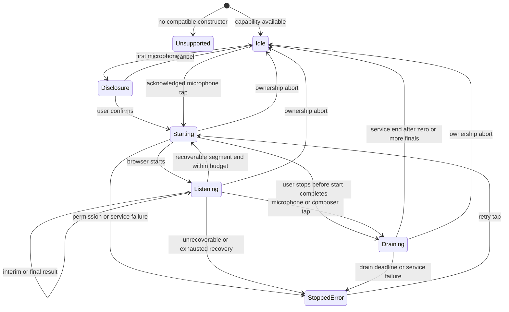
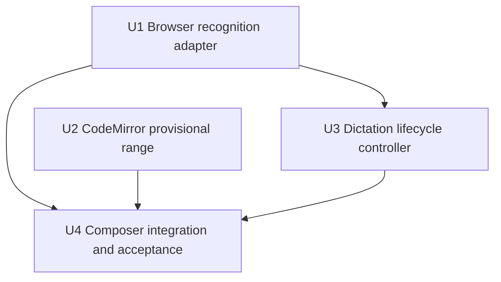
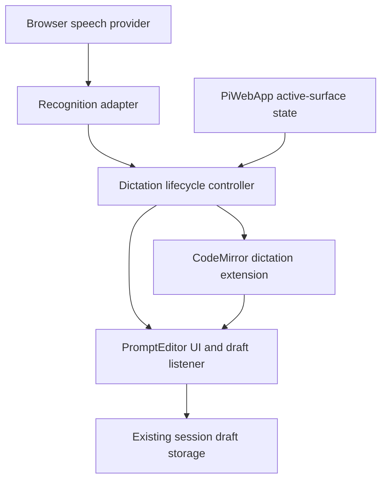

# Composer live dictation implementation plan

## Summary

Isolate browser speech recognition behind a normalized adapter, represent provisional speech as a non-durable CodeMirror decoration, and let a composer-owned lifecycle controller coordinate capture, draining, retries, and session safety. Integrate one intrinsic-layout microphone slot plus a first-use privacy popover into the existing persistent `PromptEditor` without adding a server audio path.

---

## Problem Frame

The installed Fold PWA currently requires the Android keyboard for substantial prompts, sacrificing transcript space and reading continuity. The implementation must add live voice drafting without weakening the composer's existing session-scoped persistence, undo, explicit-send, and stable-CodeMirror guarantees.

---

## Requirements

- R1. Provide dictation only in the message composer when compatible browser speech recognition is available.
- R2. Use tap-to-start/tap-to-stop with an unambiguous active state.
- R3. Start at the current CodeMirror selection, replacing selected text or inserting at an empty cursor.
- R4. Start without the Android keyboard and dismiss it if already open.
- R5. Show changing interim speech inline as one provisional range without duplicate appends.
- R6. Replace the provisional range with ordered, naturally separated final draft text.
- R7. Continue across ordinary pauses and browser segment boundaries until explicit stop or unrecoverable failure.
- R8. User stop drains the last available phrase, keeps the prompt unsent, and does not reopen the keyboard.
- R9. A composer tap while active follows the same drain path before normal cursor placement and keyboard editing.
- R10. Persist pre-existing and final dictated text in the originating session draft; never persist interim text.
- R11. Preserve normal editing, undo, session-scoped persistence, and explicit send after dictation stops.
- R12. Session change or leaving the active composer surface stops recognition, discards interim speech, preserves prior finals, and blocks late cross-session insertion.
- R13. First use follows browser permission behavior; denial preserves the draft and gives a recovery path.
- R14. Unsupported recognition, missing microphone, network failure, and recognition failure each produce a clear, draft-safe state.
- R15. Recoverable service endings restart under active intent; repeated or unrecoverable failures stop visibly rather than loop.
- R16. Disclose that the browser provider may process microphone audio remotely; Forgerie neither transports nor stores microphone audio.
- R17. Unsupported browsers receive a concise explanation rather than a control that silently fails.
- R18. Microphone and live state fit beside all existing composer controls without crowding.
- R19. Dictation remains usable across all four Fold postures and posture transitions without losing or moving active text/session state.
- R20. Completion includes validation in the installed PWA on the physical Galaxy Z Fold 8; desktop/headless evidence alone is insufficient.

**Plan-local completion gate:** Add a patch changeset for the user-visible composer capability; do not edit `CHANGELOG.md` manually.

**Origin actors:** A1 (Forgerie user), A2 (browser speech service)

**Origin flows:** F1 (dictate into a prompt), F2 (stop and edit)

**Origin acceptance examples:** AE1 (provisional replacement and selection commit), AE2 (pause and stop drain), AE3 (composer tap then edit), AE4 (session isolation), AE5 (permission/failure preservation), AE6 (bounded segment recovery), AE7 (unsupported browser), AE8 (Fold posture acceptance)

---

## Scope Boundaries

- No dictation in `ask_user`, settings, dialogs, file editors, terminals, or any field other than the message composer.
- No global voice action, transcript panel, voice commands, punctuation commands, or automatic prompt submission.
- No simultaneous keyboard and voice editing; mutable composer actions remain guarded while provisional or draining speech exists.
- No direct `getUserMedia()` preflight, media recorder, audio buffering, audio upload, or new server endpoint.
- No guaranteed offline/on-device recognition and no experimental language-pack installation flow.
- No promise of equivalent behavior in browsers without compatible `SpeechRecognition` or `webkitSpeechRecognition` support.
- No new viewport-width breakpoint or device/user-agent sniffing.
- No retirement of the existing `1180px`, `640px`, or `430px` CSS breakpoints; that separate intrinsic-layout cleanup remains backlogged.
- No Samsung Tab Ultra 11 acceptance until its CSS viewport and device-pixel ratio are measured.

### Deferred to Follow-Up Work

- Experimental local-processing support may be reconsidered when browser APIs and target-device language packs are stable; it is not a fallback in this slice.

---

## Context & Research

### Relevant Code and Patterns

- `src/client/src/components/PromptEditor.ts` owns the persistent CodeMirror `EditorView`, a deliberately non-reactive live draft, session/machine draft switching in `willUpdate`, durable updates through its CodeMirror listener, and touch-sensitive DOM stability.
- `src/client/src/components/PromptEditor.draft.test.ts` and `src/client/src/components/PromptEditor.modelCompletion.test.ts` establish per-concern composer tests and direct CodeMirror/component seams.
- `src/client/src/promptDraftStorage.ts` and `src/client/src/promptEnterBehavior.ts` establish injectable storage helpers that tolerate unavailable, quota-blocked, or privacy-blocked local storage.
- `src/client/src/appShell/onScreenKeyboardController.ts` and `src/client/src/components/PiWebApp.keyboard.test.ts` establish keyboard modality and mobile-surface regression patterns.
- `src/client/src/components/PiWebApp.ts` owns whether the selected session's composer is actually visible/interactive in the current shell mode and exposes plugin prompt insertion/focus bridges; it must pass real composer activity down and route those bridges through component guards rather than making the editor infer app navigation from viewport or CSS.
- `src/client/src/components/shared.ts` contains `promptEditorStyles`, reusable theme tokens, existing intrinsic flex behavior, touch sizes, and reduced-motion precedent.
- `src/client/src/components/promptEditorIcons.ts` is the single home for composer action SVG renderers.
- `work/items/active/01KZKV9P4SJ69Z018FXQ6FVEJZ-content-first-mobile-chrome/plan.md` is an active sibling plan touching the same composer row and adding a summoned-pane resting state; U4 must rebase against its landed shape rather than duplicate or overwrite it.
- `package.json` confirms Lit 3, CodeMirror 6, TypeScript, happy-dom/Vitest, and the repository-wide verification gate already exist; no dependency is needed for this feature.

### Institutional Learnings

- `docs/solutions/` does not exist; repository guidance lives in `AGENTS.md`, active design records, and focused tests.
- `AGENTS.md` makes the Galaxy Z Fold 8 the acceptance device, requires all four posture captures to be opened and visually judged, and forbids new width breakpoints near the 499–979 CSS-pixel posture range.
- `AGENTS.local.md` requires user-facing changes on `main` to be rebuilt and the local Forgerie systemd user units restarted when no agent run is in flight.
- Existing composer comments treat preserving the CodeMirror DOM as a correctness constraint for mobile touch gestures, not merely a performance preference.

### External References

- MDN, `SpeechRecognition`: limited browser availability, browser-server processing caveat, continuous/interim controls, events, and service ownership — https://developer.mozilla.org/en-US/docs/Web/API/SpeechRecognition
- MDN, `SpeechRecognition: result event`: result event and `SpeechRecognitionEvent` contract — https://developer.mozilla.org/en-US/docs/Web/API/SpeechRecognition/result_event
- MDN, `SpeechRecognition.stop()`: stop attempts to return a result from captured audio — https://developer.mozilla.org/en-US/docs/Web/API/SpeechRecognition/stop
- MDN, `SpeechRecognition.abort()`: abort stops without attempting a result — https://developer.mozilla.org/en-US/docs/Web/API/SpeechRecognition/abort
- MDN, microphone Permissions Policy: the default same-origin microphone allowlist is `self`, so this same-origin PWA needs no new server header — https://developer.mozilla.org/en-US/docs/Web/HTTP/Reference/Headers/Permissions-Policy/microphone

---

## Key Technical Decisions

- **Normalize the non-Baseline browser API at one boundary:** a small adapter selects the standard constructor before the prefixed constructor, supplies the minimal missing structural browser types locally, configures interim/continuous recognition, and emits application-owned segment events. It consumes result/error events structurally instead of relying on standard-versus-prefixed `instanceof` checks. `PromptEditor` and the controller do not inspect raw browser result lists, provider messages, or error codes.
- **One recognition object per service segment:** each start/restart gets a fresh adapter segment and token. This prevents stale object callbacks from being mistaken for the active segment and makes browser-driven `end` boundaries explicit.
- **Treat `continuous` as an optimization, not a guarantee:** the controller still handles clean `end` events while listening. A segment that produced useful results resets the empty-failure streak; repeated segments that end without useful speech consume a finite recovery budget and settle in a visible error state.
- **Keep provisional speech out of the document:** a CodeMirror state field/decoration owns the original selection, insertion anchor, current interim widget, and any deferred pointer target. Interim revisions change decoration state only; final phrases use ordinary document transactions so the existing update listener remains the sole persistence path.
- **Make stop and abort distinct contracts:** microphone/composer stop calls browser `stop()` and waits for result/end up to a bounded drain deadline. Session/surface/page teardown calls `abort()`, clears the provisional decoration, invalidates tokens immediately, and never carries an unfinished phrase across ownership boundaries.
- **Guard ownership twice:** callbacks must match both the active generation/segment token and the originating machine-session draft key. A matching generation alone is insufficient after navigation.
- **Use a tagged lifecycle state:** unsupported, idle, disclosure, starting, listening, draining, and stopped-error states determine control availability, editor lock, status copy, and cleanup. There are no independent booleans that can produce “idle but microphone still active” combinations.
- **Preserve trusted user activation synchronously:** first use opens a non-modal anchored disclosure; its confirmation handler writes acknowledgement synchronously and reaches browser recognition start in the same click stack, with no awaited storage, permission query, network check, timer, or animation callback in between. Do not query or open a separate media stream before starting browser recognition.
- **Persist disclosure, not audio or a second transcript copy:** confirmation is global to this browser install and uses a versioned, namespaced local preference. Storage failure keeps an in-memory acknowledgement for the page lifetime and may show the disclosure again after reload, but never blocks dictation or crashes the composer. Finalized text still persists through the ordinary local draft path and the disclosure must distinguish that text retention from Forgerie's no-audio-storage promise.
- **Keep disclosure acknowledgement independent from microphone permission:** revoking site permission does not erase acknowledgement or reopen the privacy popover; it produces the normal permission-recovery state on the next trusted start.
- **Use browser language preference for v1:** explicitly set recognition language from `navigator.language` rather than relying on HTML-language fallback. Language selection UI is outside this slice.
- **Lock only mutable composer behavior while active:** the editor and send/queue/steer/attachment mutation paths cannot race provisional or draining speech. The microphone remains the stop control, and unrelated emergency “stop current agent work” remains available. Normal controls resume when dictation settles.
- **No server or manifest change:** secure installed-PWA delivery and same-origin microphone policy are already sufficient. The implementation stays under the client and changes no request, websocket, session-daemon, or service-worker contract.
- **Coordinate rather than couple to mobile-chrome work:** if the sibling resting composer has landed, disclosure/starting/listening/draining force its expanded state because interim speech is intentionally absent from the durable draft. If it has not landed, this plan does not pre-implement that sibling feature.

---

## Open Questions

### Resolved During Planning

- First-use privacy treatment: an anchored composer popover with confirm/start and cancel actions, not a full-screen modal and not browser-permission-only disclosure.
- Interim representation: CodeMirror decoration/widget state, not temporary document text filtered out of persistence.
- Service ownership: browser-managed remote-capable recognition; no Forgerie audio transport or storage.
- Language source: current browser/user-agent locale; no new setting.
- Unsupported treatment: no actionable microphone control that can silently fail; show concise unavailable status in the same composer action area.
- Server policy: no new `Permissions-Policy` header because microphone defaults to same-origin `self` and the app is not embedded cross-origin.

### Deferred to Implementation

- Exact restart backoff, empty-segment limit, and stop-drain deadline: measure Chrome's installed-PWA behavior on the physical Fold, keep values centralized/injectable, and choose the shortest policy that passes pause recovery without an invisible loop.
- Final microcopy and motion treatment for starting, listening, draining, permission recovery, and provider failure: select within the established tone/theme tokens while implementing, then verify accessibility and crowding in captures.
- Exact accessible interim channel: first verify whether the CodeMirror widget's semantic text is announced reliably on target assistive technology; otherwise use a throttled latest-value polite announcement. Either implementation must remain provisional, replace rather than queue stale revisions, and clear when finalized/aborted.

---

## High-Level Technical Design

> *This illustrates the intended approach and is directional guidance for review, not implementation specification. The implementing agent should treat it as context, not code to reproduce.*

The browser adapter emits normalized segment events to the controller. The controller accepts events only for the current generation and owner, sends provisional/final operations to the CodeMirror extension, and exposes one lifecycle state to Lit. The extension is the only layer that knows CodeMirror positions; `PromptEditor` is the only layer that persists final document changes and renders controls/status. U2 does not import U3: the extension emits a generic deferred-edit intent, and U4 wires that intent to the controller's drain request.

For a composer tap while listening, the CodeMirror extension captures and prevents the pointer edit, stores a mapped target, and emits a deferred-edit intent; U4 asks the controller to drain. Final transactions map that target forward. Once drain settles, the extension applies the target and focuses the editor; a microphone stop does neither, so it cannot reopen the keyboard.

---

## Implementation Units

### U1. Browser recognition adapter

**Goal:** Provide a narrow, testable client boundary over standard/prefixed Web Speech constructors, raw result lists, service events, and stop-versus-abort semantics.

**Requirements:** R1, R7, R8, R13-R17

**Dependencies:** None

**Files:**
- Create: `src/client/src/speechRecognition.ts`
- Test: `src/client/src/speechRecognition.test.ts`

**Approach:**
- Define application-owned capability, segment, result-batch, and normalized failure contracts; keep the minimum structural declarations needed for browser constructor/controller shapes in this module because TypeScript's DOM declarations do not provide the full controller surface consistently.
- Capability detection prefers `SpeechRecognition`, falls back to `webkitSpeechRecognition`, and returns unsupported without throwing in Node, SSR-like, or browser environments where neither exists.
- A started segment configures continuous listening, interim results, one best alternative, and the supplied browser locale. Leave experimental local-only processing unset so the browser may use its managed remote-capable service; language-pack installation is outside scope. Starting remains synchronous so the controller can preserve trusted activation.
- Reconcile each result event from its changed index: emit newly final transcript in source order and the current mutable interim suffix once. The adapter, not callers, prevents unchanged final results from being emitted twice.
- Normalize only stable error codes and recoverability. Discard the provider's free-form error message at this boundary so it cannot reach UI or logs. Preserve `aborted` as a distinct outcome so U3 can silence it only when the app already initiated abort/retirement; an unexpected browser abort while user intent is active must not disappear silently.
- Normalize `nomatch` as an explicit no-useful-match segment outcome. It is neither durable text nor a second failure when the same segment subsequently emits end.
- Preserve direct stop and abort operations. Adapter cleanup detaches handlers so a retired segment cannot retain the component/controller.
- Keep constructors and host globals injectable so tests use a recording implementation of the same port rather than mutating production code paths around test-only flags.

**Execution note:** Implement the normalized event contract test-first because every later lifecycle and draft guarantee depends on final/interim classification being deterministic.

**Patterns to follow:**
- `src/client/src/clipboard.ts` for a small browser capability wrapper with an injectable host.
- `src/client/src/promptEnterBehavior.ts` for environment-safe browser access and narrow exported types.

**Test scenarios:**
- Happy path: only the standard constructor exists → the adapter reports available, configures one segment, and forwards start/end.
- Happy path: only the prefixed constructor exists → behavior is identical through the same application-owned port.
- Happy path: a result list revises one interim item three times, then finalizes it and adds a new interim suffix → normalized batches contain each final phrase once and only the latest provisional suffix.
- Edge case: `resultIndex` skips unchanged finalized entries → those entries are not re-emitted or duplicated.
- Edge case: neither constructor or browser global exists → capability is unsupported without an exception.
- Error path: permission, audio-capture, network, no-speech, and unknown browser errors → each maps to a stable application category plus recoverability metadata; a non-empty provider message is absent from the normalized event.
- Edge case: `nomatch` followed by end → emitted as one no-useful-match segment outcome, not final text or two budget events.
- Edge case: an `aborted` error retains its distinct category so app-initiated teardown can suppress it while an unexpected active abort remains observable.
- Integration: stop and abort are invoked on the underlying segment as distinct operations, and retiring a segment prevents subsequent raw callbacks from reaching its listener.

**Verification:**
- Raw Web Speech result/error objects are confined to this module, and its tests prove identical normalized behavior for standard and prefixed constructors.

---

### U2. CodeMirror provisional dictation range

**Goal:** Show interim speech inline while keeping it out of the durable document, then commit finalized phrases as ordinary selection-aware CodeMirror edits.

**Requirements:** R3, R5, R6, R9-R12

**Dependencies:** None

**Files:**
- Create: `src/client/src/components/promptEditorDictation.ts`
- Test: `src/client/src/components/promptEditorDictation.test.ts`

**Approach:**
- Add a self-contained CodeMirror extension that captures the starting main selection and renders one styled provisional range/widget over it without changing `state.doc`.
- Interim updates are effect-only state-field transactions that replace extension state rather than append text. With no document changes, CodeMirror reports `docChanged` false, so the existing guarded update listener does not persist them or run draft-derived behavior. Clearing/aborting removes the decoration and leaves an originally selected range's text untouched.
- Finalization replaces the original selection (first phrase) or inserts after the previous final phrase (later phrases), collapses the insertion anchor, and retains extension state for the next segment.
- Normalize only phrase boundaries: avoid merging adjacent words while respecting provider whitespace and punctuation. Preserve transcript interior rather than rewriting recognized content.
- Annotate final edits as ordinary user-facing document changes that enter normal history. Interim effects never enter document history; undo after a selected-text final restores the pre-dictation text.
- While dictation is active, intercept pointer selection before CodeMirror mutates it. Keep the requested target mapped through any final changes and expose a settle operation that either applies/focuses it after drain or drops it on ownership abort.
- Keep all position/decoration mechanics inside this extension so the lifecycle controller remains editor-agnostic.

**Execution note:** Build this against a real in-memory `EditorView`/`EditorState`, not a hand-shaped editor object, so mapping, selection replacement, and undo semantics are genuine CodeMirror behavior.

**Patterns to follow:**
- The persistent `EditorView`, update listener, history extension, and touch DOM handlers in `src/client/src/components/PromptEditor.ts`.
- CodeMirror 6 state fields/effects, mapped ranges, decorations/widgets, and transaction history conventions already supplied by the installed dependencies.

**Test scenarios:**
- Covers AE1. Happy path: selected text plus three revised interim phrases → the document remains byte-identical during revisions, one provisional range shows the latest phrase, and finalization replaces the selection once.
- Happy path: an empty cursor receives successive final phrases → text remains ordered with one natural boundary and no duplicate whitespace or joined words.
- Edge case: punctuation or provider-supplied leading/trailing whitespace → boundary normalization does not add spurious spaces or alter interior transcript text.
- Edge case: abort with a non-empty original selection and visible interim → the original document/selection remain available and no undo item is created.
- Covers AE3. Integration: pointer target is captured while active, final text changes positions during drain, and settling applies the mapped cursor only after the final transaction.
- Integration: finalization triggers the existing CodeMirror document listener and can be undone through normal history; interim revisions trigger neither document persistence nor document undo entries.
- Integration: multiple finalized phrases plus a stop/drain settle as ordinary history-bearing draft text, and subsequent undo remains usable beyond the first selection replacement.

**Verification:**
- Tests demonstrate that provisional speech can be visually revised without changing the draft string, while final speech behaves exactly like an ordinary selection replacement/insertion.

---

### U3. Composer dictation lifecycle controller

**Goal:** Coordinate user intent, browser segments, retries, draining, failure classification, and machine-session ownership independently of Lit rendering and CodeMirror internals.

**Requirements:** R2, R7-R9, R12-R15

**Dependencies:** U1

**Files:**
- Create: `src/client/src/controllers/promptDictationController.ts`
- Test: `src/client/src/controllers/promptDictationController.test.ts`

**Approach:**
- Model the tagged lifecycle from the technical design and expose state changes plus editor-facing callbacks for begin, interim, final, settle-edit, and discard.
- Accept a recognition factory, owner key, locale, scheduler/clock, and bounded policy. This keeps production browser behavior real while allowing deterministic segment and timeout tests.
- Increment the generation on every new user session and owner abort; assign each browser segment its own token. Ignore result/error/end callbacks that fail either token or owner checks.
- User start begins a fresh generation and reaches adapter start synchronously from the initiating click; controller setup, locale reads, and policy checks add no awaited boundary. User stop changes intent to draining exactly once, calls stop when possible, disables restart, and accepts zero or more final results before end. Because browser stop is best-effort and may emit only end when nothing can be finalized, stop before browser start is remembered and every drain is bounded independently of result arrival.
- Composer-edit stop follows the same drain path but carries a deferred-edit intent that is released after successful drain or a visible stopped error. A microphone stop has no edit intent and never requests editor focus.
- A clean/recoverable end during listening starts a fresh segment only while intent is active and the useful-result-aware recovery budget allows it. Useful interim/final results reset the empty-segment streak; repeated empty ends/no-speech or synchronous start failures exhaust it. Budget accounting is per segment: a no-speech error and its trailing end are one empty outcome, not two failures.
- Permission/service-not-allowed, audio capture, unsupported language, network/provider failures, and unknown failures stop immediately with stable recovery guidance. App-initiated abort callbacks during teardown are silent; an unexpected `aborted` outcome while intent is active becomes a visible stopped/recoverable outcome under the same bounded policy.
- Drain has a finite deadline. If the provider never finalizes/ends, abort and retire the active segment, invalidate its token, discard remaining interim, then unlock editing. Preserve all durable text and surface that the final phrase could not be confirmed rather than hanging or silently retrying.
- Owner change, inactive surface, hidden page, browser `pagehide`, disabled editor, or disconnect aborts immediately and clears pending edit intent. Browser lifecycle listeners are registered/removed idempotently with controller/component ownership. Resize/orientation changes alone do nothing.

**Execution note:** Implement state-transition and stale-callback tests before wiring the controller to `PromptEditor`; race safety is substantially easier to prove without rendering noise.

**Patterns to follow:**
- Small dependency-injected controller modules under `src/client/src/controllers/` and their focused Vitest suites.
- `src/client/src/machineKeys.ts` for the machine-session identity used by draft ownership.
- `src/client/src/appShell/onScreenKeyboardController.ts` for explicit browser lifecycle listeners and idempotent cleanup.

**Test scenarios:**
- Covers F1 / AE2. Happy path: start → interim/final batches → clean segment end after useful speech → automatic new segment → user stop → final/end → idle, with no send callback.
- Covers AE6. Happy path: one empty/recoverable or no-match segment outcome restarts; a later useful result resets the streak; repeated empty endings eventually enter a visible stopped error and create no further segments.
- Edge case: stop arrives while starting → exactly one eventual stop/drain occurs and no restart follows the segment end.
- Edge case: repeated stop taps while draining → stop remains idempotent and does not create parallel deadlines or segments.
- Covers AE4. Integration: owner changes from session A to B while A has final plus interim speech → abort/discard is issued, A's prior final remains, and late A callbacks cannot reach B.
- Error path: permission denied, no microphone, network failure, unsupported language, and unknown service failure → no automatic retry, durable callbacks remain intact, and state exposes the correct recovery category.
- Error path: recoverable segment start throws repeatedly → the finite budget settles visibly rather than looping.
- Error path: drain deadline expires with only interim speech → active recognition is aborted/retired before editing unlocks, its token is invalidated, interim is discarded, deferred composer edit can proceed, finalized text is untouched, and late callbacks are ignored.
- Integration: inactive chat surface, hidden document, browser `pagehide`, disabled composer, and disconnect each use abort rather than stop; a pure posture resize does not alter listening intent.
- Edge case: no-speech error followed by end for one segment → recovery budget advances once and opens at most one replacement segment.

**Verification:**
- The controller suite covers every lifecycle edge in the state diagram and proves there is no path for an old owner/generation to emit editor mutations.

---

### U4. Composer UI, privacy disclosure, and release acceptance

**Goal:** Wire dictation into the persistent composer, render accessible/space-safe states and first-use disclosure, preserve keyboard/draft behavior, and complete user-visible release evidence.

**Requirements:** R1-R20 plus the plan-local changeset gate

**Dependencies:** U1, U2, U3

**Files:**
- Create: `src/client/src/dictationDisclosure.ts`
- Test: `src/client/src/dictationDisclosure.test.ts`
- Create: `src/client/src/components/PromptEditor.dictation.test.ts`
- Create: `src/client/src/components/PiWebApp.dictation.test.ts`
- Modify: `src/client/src/components/PromptEditor.ts`
- Modify: `src/client/src/components/PiWebApp.ts`
- Modify: `src/client/src/components/PiWebApp.keyboard.test.ts`
- Modify: `src/client/src/components/promptEditorIcons.ts`
- Modify: `src/client/src/components/shared.ts`
- Create: `.changeset/composer-live-dictation.md`

**Approach:**
- Instantiate the controller once with an injectable recognition capability and retain the existing CodeMirror instance. Add the dictation extension during editor creation; Lit state mirrors only the controller's coarse lifecycle/status, never per-token draft text.
- Before any session/machine draft switch in `willUpdate`, abort the old owner and clear provisional state, then allow the existing save/load/sync sequence to run. Also synchronize controller activity with `disabled`, component connect/disconnect, document visibility/`pagehide`, and an explicit composer-active property from `PiWebApp`. Derive that property from the shell's actual visible/interactive composer condition: a constrained workspace/navigation overlay aborts, while a roomy side-by-side workspace view that still displays the composer remains active.
- On start, capture the current main selection, close transient completions, blur CodeMirror before invoking recognition, and leave focus on the microphone or popover confirmation. This dismisses the Android keyboard without reconstructing the editor. Suppress command/file/model completion refresh while dictation is active so final phrases containing trigger characters cannot open competing UI; refresh once after settle if the final cursor context requires it.
- Render one microphone action slot when recognition is available. Idle, starting, listening, and draining use the same control with truthful labels, `aria-pressed`, visible active treatment, and a polite live status. Expose the latest provisional phrase to assistive technology through the semantic widget or a throttled latest-value live channel, without making it durable or repeatedly announcing stale revisions. Motion is supplemental and disabled under reduced motion. Unsupported capability renders a concise unavailable status in that slot rather than a control that can fail silently.
- First tap without acknowledgement opens a small, non-modal, action-anchored disclosure above the composer row. It distinguishes browser-provider remote audio processing and Forgerie's no-audio-storage boundary from the ordinary local persistence of finalized draft text. Confirm starts synchronously, cancel/Escape returns focus to the microphone, and neither path focuses CodeMirror. Hidden-page/session-owner/disconnect teardown closes an open disclosure without acknowledgement. Confirmed preference persists through the failure-tolerant helper independently of current microphone permission.
- Add a dedicated dictation lock rather than overloading `disabled`, whose existing meaning is archived/unusable. While starting/listening/draining, the lock reconfigures CodeMirror and guards every mutable route: Enter/send/queue/steer, attach button, paste/drop, file-input change, public focus requests, and plugin prompt insertion. Route `PiWebApp`'s plugin bridge through guarded `PromptEditor` operations instead of direct `EditorView` focus/dispatch; a requested focus or insertion drains first and is applied as a deferred editor intent. The lock leaves the microphone and unrelated emergency agent-stop action available. Intercept a composer pointer tap through U2's same generic edit-intent seam, let U4 request controller drain, and only focus/place the cursor when the deferred edit settles. A microphone stop returns focus to the microphone and leaves the keyboard closed.
- Final document transactions flow through the existing update listener, `updateDraft`, input-mode detection, draft storage, and send path. Do not create a parallel draft string or persistence call in the controller.
- Preserve attach, agent-stop, model/thinking, send/queue/steer ordering and hit targets. Add only theme-token, flexible sizing, absolute/anchored status, and reduced-motion styles; add no viewport breakpoint. Verify at the component's own available width.
- Rebase this unit against the active content-first mobile-chrome work immediately before editing shared composer files. If its summoned resting state exists, treat disclosure/starting/listening/draining as reasons to remain expanded and keep the same persistent editor DOM.
- Add a patch changeset describing keyboard-free live composer dictation and its browser-dependent availability.

**Execution note:** Start with component interaction tests for the disclosure, keyboard focus, stop/edit distinction, and session switch, then add visual styling. Do not rely on snapshots alone for focus, persistence, or lifecycle behavior.

**Patterns to follow:**
- `src/client/src/components/PromptEditor.ts` for property/callback conventions, persistent CodeMirror ownership, and mutation guards.
- `src/client/src/promptDraftStorage.ts` and `src/client/src/promptEnterBehavior.ts` for failure-tolerant local preference storage.
- `src/client/src/components/PiWebApp.keyboard.test.ts` for happy-dom focus/modality assertions.
- `src/client/src/components/shared.ts` for theme tokens, flexible action layout, touch targets, and `prefers-reduced-motion` treatment.
- `.changeset/keep-composer-above-android-keyboard.md` for a concise single-package patch changeset.

**Test scenarios:**
- Happy path: first microphone tap → anchored disclosure distinguishes remote audio processing/no Forgerie audio storage from normal local draft-text persistence; cancel returns to idle; confirm records acknowledgement and invokes recognition synchronously in the same click stack.
- Happy path: subsequent microphone tap with acknowledgement → starts directly without rendering disclosure; blocked local storage still permits capture and does not throw.
- Error path: acknowledged user with revoked site permission → disclosure stays skipped, permission-denied guidance points to browser/site access recovery, and the durable draft is unchanged.
- Covers F1 / AE1. Integration: selected composer text, revised interim events, and a final event → only the provisional widget changes before final, assistive technology has one current provisional value rather than queued stale revisions, then existing draft persistence contains one final replacement and the prompt remains unsent.
- Covers F2 / AE2. Integration: microphone stop during a partial phrase → control shows draining, final speech persists, idle returns with microphone focus, and CodeMirror/Android keyboard is not focused.
- Covers F2 / AE3. Integration: pointer tap inside the active editor → initial pointer mutation is prevented, drain completes, mapped cursor is applied, and editor focus occurs only afterward.
- Covers AE4. Integration: `PiWebApp` changes selected session or enters a shell mode that actually hides/deactivates the mounted composer while listening → old controller aborts before draft sync, interim disappears, and a late callback cannot modify the rendered session; a roomy side-by-side workspace view with a visible composer does not abort.
- Covers AE5. Error path: permission denial and microphone/provider/network failures → existing/final draft text remains, editor unlocks, normalized guidance is visible/announced, and retry starts a new generation.
- Covers AE7. Edge case: unsupported constructor set → no actionable microphone is rendered, concise unavailable status appears, and send/attach/editor behavior is unchanged.
- Edge case: disclosure is open when the page hides, component disconnects, or session owner changes → it closes without acknowledgement and no capture begins.
- Edge case: active dictation plus Enter, send/queue/steer, attach click, paste, drop, file-input change, plugin prompt insertion, or public focus request → no mutation/focus races provisional speech; insertion/focus intents drain then apply, agent-stop remains available, and ordinary actions restore after settle.
- Edge case: finalized speech contains `/`, `@`, or `#` near the cursor → completion UI stays suppressed until dictation settles and then follows the ordinary cursor context.
- Edge case: reduced-motion preference → state remains visually distinguishable without animation.
- Integration: existing draft and model-completion suites remain green; dictation finalization uses the same persistence/input-mode path and editor DOM identity survives surrounding Lit updates.
- Integration: if content-first summoned mode has landed, empty-draft interim speech keeps the composer expanded; settling with an empty durable draft returns to its normal resting rule.

**Verification:**
- Automated suites cover disclosure persistence, browser capability injection, focus behavior, session isolation, UI states, and existing composer regressions.
- Four headless captures at 739×979, 979×739, 499×789, and 789×499 are opened and visually reviewed as deterministic resting-layout evidence for control overlap, unavailable/idle treatment, touch targets, and unchanged editor/action layout. Popover or live-state claims require an intentionally staged deterministic capture; a default headless screenshot does not prove them.
- On the installed physical Fold PWA: clear acknowledgement and test first-use disclosure; grant and deny permission; dictate multiple sentences across pauses; stop by microphone and by composer; edit/undo/send explicitly; switch sessions while active; fold/unfold and rotate through all four postures while listening; confirm the Android keyboard stays closed except after the intentional composer-edit path; confirm the browser microphone indicator ends after stop/abort. A foreground posture transition must preserve active dictation; if target Chrome emits a transient lifecycle signal that triggers abort, narrow the lifecycle trigger rather than accepting that as R19 completion.
- Repository verification passes, the patch changeset is valid, and no client request/server/session-daemon contract changed.

---

## System-Wide Impact

- **Interaction graph:** Browser events cross one adapter into the lifecycle controller; the controller drives CodeMirror provisional/final commands and Lit status; `PiWebApp` supplies actual composer-active state and routes plugin prompt focus/insertion through guarded component operations; final CodeMirror document changes continue through the existing composer draft listener into session-scoped storage.
- **Error propagation:** Raw browser errors terminate at U1. U3 classifies retry versus stopped failure. U4 renders stable user guidance and never replaces the draft with an error payload or provider message.
- **State lifecycle risks:** The critical races are result-versus-stop, end-versus-restart, session switch during drain, hidden/disconnected component callbacks, and a provider that never ends. Generation plus owner checks, distinct stop/abort paths, idempotent transitions, and finite deadlines cover them.
- **API surface parity:** No server, websocket, plugin, CLI, or action-palette API needs a voice equivalent. Voice is a human input modality for the same draft/send capability already available to agents and keyboard users.
- **Integration coverage:** Unit tests cannot prove browser permission UI, real remote service latency/end behavior, Android keyboard dismissal, microphone indicator cleanup, or posture-transition continuity; physical installed-PWA acceptance is mandatory.
- **Unchanged invariants:** Prompt submission remains explicit; interim text is not durable; final text belongs to one machine-session draft; the persistent CodeMirror DOM survives Lit updates; existing session and attachment APIs are unchanged; Forgerie never owns audio bytes.

---

## Alternative Approaches Considered

- **Temporarily write interim text into `state.doc` and suppress persistence:** rejected because every completion, input-mode, undo, and draft listener would need to distinguish provisional transactions, and selected-text rollback would become fragile.
- **Put Web Speech callbacks directly in `PromptEditor`:** rejected because service segmentation, retry budgets, stale callbacks, and drain deadlines form an independent state machine that needs deterministic tests.
- **Request `getUserMedia()` before speech recognition:** rejected because it creates a second media lifecycle and potentially duplicate permission flow without supplying audio to `SpeechRecognition`.
- **Use `ModalSurface` for privacy confirmation:** rejected because the confirmed interaction is a small first-use popover; a focus-trapped backdrop would be disproportionate and could disturb the touch-first composer.
- **Add a Forgerie transcription endpoint:** rejected by privacy/scope requirements and unnecessary for the target browser's managed recognition service.

---

## Success Metrics

- A multi-sentence prompt can be dictated, observed provisionally, drained, edited, undone, and explicitly sent without keyboard focus during voice capture.
- Interim speech never appears in local draft storage or undo history; finalized speech follows the existing session-scoped draft path.
- A session/surface transition cannot receive a late phrase from the prior owner in automated race tests or physical acceptance.
- Recoverable silence/segment endings resume without another tap, while repeated empty/failing segments stop visibly and release the microphone.
- All four Fold postures and transitions retain readable, non-overlapping composer controls and live state in reviewed captures and on the physical installed PWA.

---

## Risks & Dependencies

| Risk | Mitigation |
|------|------------|
| Web Speech is non-Baseline and provider behavior varies | Capability gate standard/prefixed constructors, normalize at one adapter, expose unsupported/error states, and make physical Chrome acceptance mandatory |
| Browser `continuous` still ends after silence | Treat each browser run as a segment and restart only under active intent with a useful-result-aware finite budget |
| `stop()` is best-effort and may yield results then end, only end, or no timely end | Accept zero or more final results, settle cleanly on end with nothing pending, and use a finite drain deadline only when the provider does not terminate |
| Late callbacks write into another session | Invalidate generation on abort and require both segment token and machine-session owner match before every editor callback |
| Interim text contaminates persistence/undo/completions | Keep interim entirely in a CodeMirror decoration; only final document transactions reach the existing update listener |
| First-use permission loses trusted activation | Keep acknowledgement write and controller/adapter start synchronous in the confirmation click; no awaited storage, timer, animation, network, or media preflight |
| Disclosure acknowledgement storage is unavailable | Catch read/write failures and retain page-lifetime in-memory acknowledgement; no capture data is stored |
| Composer becomes crowded on Fold cover posture | One fixed-size action slot, flexible existing status row, anchored overlay status/popover, no new breakpoint, and four-posture visual review |
| Concurrent content-first plan conflicts in shared composer files | Rebase before U4, preserve its persistent editor/resting state, and make active dictation an expansion reason only if that feature has landed |
| Fold transition fires unexpected lifecycle events | Resize/orientation are non-events; foreground posture transitions must preserve dictation, and physical evidence must drive narrowing any over-broad hidden-page trigger rather than relaxing R19 |
| Remote provider processing surprises users | First-use disclosure before capture, stable privacy language that distinguishes audio from locally persisted final draft text, and no Forgerie audio transport/logging |
| Future server hardening blocks same-origin microphone policy | Treat resulting permission denial as a stopped recovery state whose guidance covers browser/site access and operator-set Permissions Policy; do not weaken policy automatically |

---

## Documentation / Operational Notes

- Add only the patch changeset; do not edit `CHANGELOG.md` directly.
- No README/server configuration update is required: capability is browser-dependent and explained in the composer, and no operator setting is introduced.
- Do not log raw transcripts, provider error messages, or recognition events beyond existing finalized draft behavior.
- After user-facing changes land on `main`, follow `AGENTS.local.md`: rebuild the deployed output and restart the Forgerie user units only when no agent run is in flight, then verify the HTTPS installed-PWA endpoint.
- Record physical target observations for restart/drain timing in implementation evidence. If measured CSS viewports differ from `AGENTS.md`, correct the device guidance separately before relying on new dimensions.

---

## Sources & References

- **Origin document:** `work/items/active/01KZKXSTMDPYHZQ2FDZJQAP5Y7-composer-live-dictation/requirements.md`
- Work metadata: `work/items/active/01KZKXSTMDPYHZQ2FDZJQAP5Y7-composer-live-dictation/work.md`
- Related active plan: `work/items/active/01KZKV9P4SJ69Z018FXQ6FVEJZ-content-first-mobile-chrome/plan.md`
- Related code: `src/client/src/components/PromptEditor.ts`, `src/client/src/components/shared.ts`, `src/client/src/promptDraftStorage.ts`, `src/client/src/appShell/onScreenKeyboardController.ts`, `src/client/src/components/PiWebApp.ts`
- Repository guidance: `AGENTS.md`, `AGENTS.local.md`
- MDN Web Speech API: https://developer.mozilla.org/en-US/docs/Web/API/SpeechRecognition
- MDN stop/abort semantics: https://developer.mozilla.org/en-US/docs/Web/API/SpeechRecognition/stop and https://developer.mozilla.org/en-US/docs/Web/API/SpeechRecognition/abort
- MDN microphone Permissions Policy: https://developer.mozilla.org/en-US/docs/Web/HTTP/Reference/Headers/Permissions-Policy/microphone
