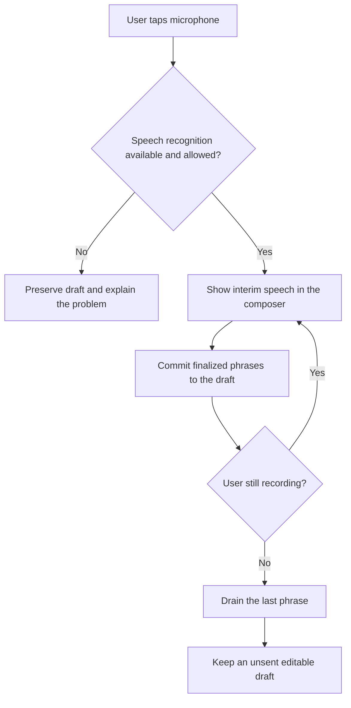

# Composer Live Dictation

## Summary

Add keyboard-free live dictation to the message composer. Prioritize a seamless installed-PWA experience on the Galaxy Fold by using the browser speech service and showing interim speech directly in the draft.

---

## Problem Frame

Forgerie is used as a touch-first PWA on a Galaxy Fold. Writing a substantial Pi prompt currently requires the Android keyboard, which consumes much of the available chat area and interrupts reading the transcript.

Irori already demonstrates the desired interaction: voice input can continue across phrases without opening the keyboard, while recognition progress remains visible. Forgerie has a narrower need because the destination is its own message composer rather than an arbitrary field in another app.

---

## Actors

- A1. Forgerie user: Dictates, reviews, edits, and sends a Pi prompt from the installed PWA.
- A2. Browser speech service: Captures microphone audio and returns interim and final recognition results using browser-managed processing.

---

## Key Flows

- F1. Dictate into a prompt
  - **Trigger:** A1 taps the composer microphone control.
  - **Actors:** A1, A2
  - **Steps:** Forgerie keeps the current draft and insertion point, starts browser recognition, shows changing interim words in the composer, and commits finalized phrases while recognition remains active across ordinary pauses.
  - **Outcome:** A1 has an unsent draft containing the finalized dictated text.
  - **Covered by:** R1-R8

- F2. Stop and edit
  - **Trigger:** A1 taps the microphone again or taps the composer while dictation is active.
  - **Actors:** A1, A2
  - **Steps:** Forgerie requests the final recognition result, drains it into the draft, stops microphone use, and then permits normal composer editing when the composer initiated the stop.
  - **Outcome:** No speech is lost at the stop boundary, and A1 can review or edit before sending.
  - **Covered by:** R6-R10

---

## Requirements

**Composer interaction**

- R1. The message composer provides a microphone control when browser speech recognition is available. Dictation does not extend to other Forgerie text fields in this version.
- R2. One tap starts dictation and a second tap stops it. The active state remains unambiguous for the full recording session.
- R3. Dictation starts at the current composer selection. Spoken text replaces selected text or inserts at the current cursor when the selection is empty.
- R4. Starting dictation does not require the Android keyboard. It dismisses an open on-screen keyboard so the transcript retains its reading area.
- R5. Interim recognition appears inside the composer in real time as one provisional range. Revised interim results replace that range instead of appending duplicate words.
- R6. Final recognition replaces the provisional range with ordinary draft text. Successive finalized phrases remain correctly ordered and separated.
- R7. Recognition continues across ordinary speech pauses and browser recognition segment boundaries until A1 explicitly stops it or an unrecoverable error occurs.
- R8. Tapping stop requests and drains the last available phrase before the session becomes idle. Stopping neither sends the prompt nor reopens the Android keyboard.

**Editing and draft integrity**

- R9. Tapping the composer while dictation is active follows the same drain behavior as the stop control, then allows normal cursor placement and keyboard editing.
- R10. Text that was present before dictation and finalized dictated text remain part of the session-scoped persisted draft. Interim text is provisional and does not become durable until finalized.
- R11. Dictation preserves normal draft behavior after it stops, including editing, undo, session-scoped persistence, and explicit send.
- R12. If the selected session changes or the composer leaves the active surface, recognition stops and cannot insert text into the new session. Finalized text remains with its originating draft; unfinalized interim text is discarded.

**Availability, privacy, and failure**

- R13. The first use follows the browser microphone-permission flow. Permission denial leaves the draft unchanged and gives A1 a clear recovery path.
- R14. Unsupported speech recognition, an unavailable microphone, network failure, and recognition failure each produce a clear state without losing pre-existing or finalized draft text.
- R15. Recoverable browser service endings restart while dictation intent remains active. Repeated or unrecoverable failures stop dictation rather than creating an invisible retry loop.
- R16. Forgerie discloses that the browser provider may process microphone audio remotely. Forgerie does not transmit microphone audio through, or store it on, the Forgerie server.
- R17. When speech recognition is unavailable, the composer gives a concise explanation instead of presenting a control that silently fails.

**Target-device experience**

- R18. The microphone control and live state fit the composer without crowding its existing attach, send, steer, stop, model, and thinking controls.
- R19. Dictation remains usable through all four Galaxy Fold posture viewports and through rotation or fold transitions. Active text and recording state must not silently move to another session or disappear during a layout change.
- R20. Completion requires validation in the installed PWA on the physical Galaxy Fold. Desktop browser support or headless emulation alone is insufficient evidence.

---

## Acceptance Examples

- AE1. **Covers R3, R5, R6, R10.** Given a draft with selected text, when A1 starts dictation and the browser revises an interim phrase three times before finalizing it, the composer shows only the latest provisional phrase and ultimately replaces the selection with one finalized phrase.
- AE2. **Covers R2, R7, R8.** Given active dictation with a partial final phrase, when A1 taps the microphone after a pause, Forgerie drains the phrase, stops microphone use, keeps the prompt unsent, and does not reopen the keyboard.
- AE3. **Covers R9, R11.** Given active dictation, when A1 taps a location in the composer, Forgerie drains and stops dictation before allowing normal editing at the requested location.
- AE4. **Covers R12.** Given active dictation in session A, when A1 navigates to session B, finalized text remains in session A's draft, interim text is discarded, and no later recognition event changes session B's draft.
- AE5. **Covers R13, R14.** Given an existing draft, when microphone permission is denied or recognition fails, the existing and finalized text remains intact and the composer explains how to retry or restore access.
- AE6. **Covers R15.** Given active dictation, when the browser ends one recognition segment after silence, Forgerie resumes recognition without another tap; when restart repeatedly fails, Forgerie enters a visible stopped error state.
- AE7. **Covers R17.** Given a browser without speech-recognition support, the composer explains that dictation is unavailable and all existing composer behavior remains usable.
- AE8. **Covers R18-R20.** Given the installed PWA on the Fold, dictation can start, show live text, survive each posture transition, stop, and preserve the draft in all four supported postures without the composer controls overlapping.

---

## Success Criteria

- The user can dictate a multi-sentence Pi prompt, observe interim words in the composer, stop without losing the last phrase, edit the result, and send it without opening the Android keyboard during dictation.
- Existing drafts and finalized speech survive recoverable errors, session reselection, and Fold posture changes without speech crossing session boundaries.
- Physical-device acceptance confirms the installed PWA behavior across all four Galaxy Fold postures.
- Planning can derive implementation and verification work without inventing activation, insertion, stop, editing, failure, privacy, or scope behavior.

---

## Scope Boundaries

- No dictation in `ask_user` answers, settings, dialogs, file editors, terminals, or other editable controls.
- No global transcript or caption panel.
- No simultaneous keyboard and voice editing.
- No self-hosted transcription service or microphone-audio transport through the Forgerie server.
- No requirement for on-device-only or offline recognition.
- No guarantee of equal behavior across browsers that lack compatible speech recognition.
- No automatic prompt submission, voice commands, punctuation commands, or spoken composer actions.

---

## Key Decisions

- Composer-only first slice: It proves the primary prompt-writing value without global focus routing or Shadow DOM coordination.
- Tap-to-toggle recording: It supports long prompts and matches the proven Irori interaction better than hold-to-talk.
- Browser speech service: It provides the lowest-friction live experience on the target device, at the cost of partial browser portability and possible remote provider processing.
- Inline interim text: The user sees speech where it will land rather than in a separate status surface.
- Stop before editing: Draining recognition before keyboard edits keeps cursor, persistence, and undo behavior predictable.
- Draft-first completion: Dictation produces editable text and never sends a prompt implicitly.

---

## Dependencies / Assumptions

- The installed PWA runs in a secure HTTPS context and the target browser exposes microphone and speech-recognition capabilities.
- Browser recognition can return interim and final results with acceptable latency on the physical Fold.
- The browser provider owns audio processing, language availability, recognition quality, and any remote service dependency.
- Experimental on-device language-pack APIs are optional future enhancements, not a dependency for this version.

---

## Outstanding Questions

### Deferred to Planning

- [Affects R7, R15][Needs research] Measure the target browser's actual recognition-ending and restart behavior in the installed PWA before setting retry timing and limits.
- [Affects R18-R20][Technical] Determine the least disruptive visual treatment for active, draining, unavailable, and error states within the existing intrinsic composer layout.
