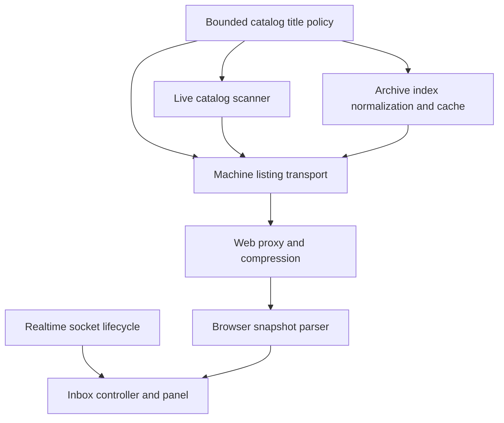
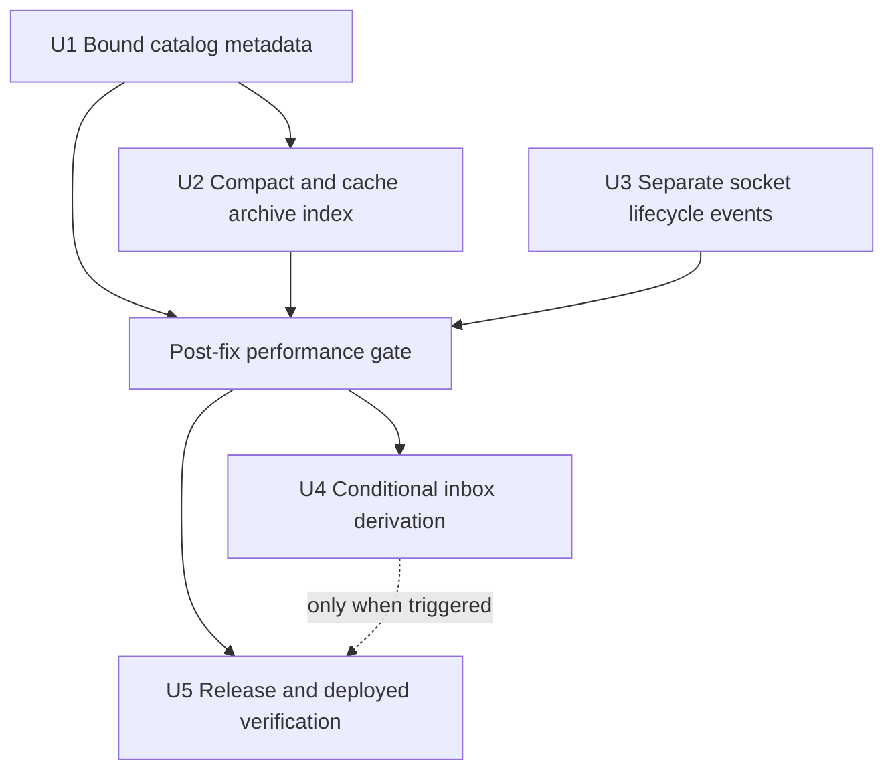
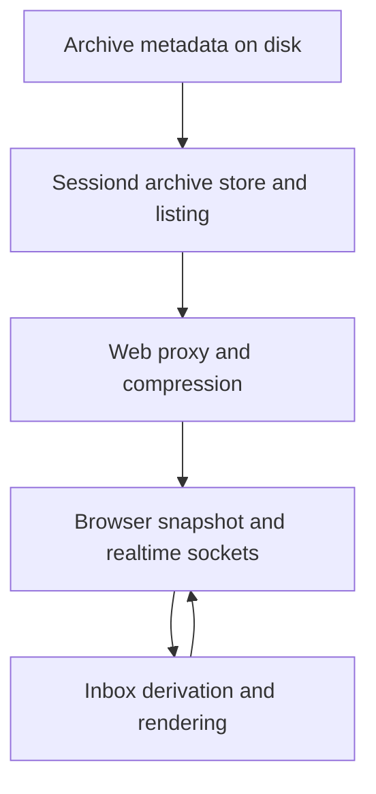

# fix: Bound session catalog work across startup

## Summary

Enforce one bounded `firstMessage` fallback contract across live and archived session catalogs, compact and cache the archive index safely, and remove the duplicate initial machine snapshot. Measure the deployed result before applying the secondary inbox derivation optimization.

---

## Problem Frame

The deployed machine catalog returns 2,229 sessions, including 2,102 archived sessions. Its decoded response is 25.6 MB because archived `firstMessage` values contain 24.2 MB of complete prompts. Page startup requests this catalog twice. Each request repeatedly reads and parses the 25.9 MB archive index, then crosses the sessiond, web-proxy, compression, browser-parse, and client-validation boundaries.

The live catalog already limits display titles to 500 Unicode code points. The archived path bypasses that policy. The inbox also repeats full-board derivation during one Lit update, but that cost must be measured again after the larger boundary costs are removed.

---

## Requirements

- R1. Every session catalog `firstMessage` fallback sent to the browser contains at most 500 Unicode code points, regardless of whether the session is active, archived, or produced by a full cleanup listing. Generated `name` values keep their separate 60-character contract.
- R2. Existing oversized archive-index titles are compacted atomically without modifying archived transcript files.
- R3. The archive store reads and parses its index once per daemon lifetime in the steady state. Successful archive mutations update the cache only after durable persistence succeeds.
- R4. Archive-store callers cannot mutate the store's cached snapshot through returned arrays or records.
- R5. Initial page load and machine switch issue one selected-machine `/sessions/all` request. A real socket reconnect still re-snapshots stale session, unread, terminal, and activity state.
- R6. Non-selected machine activity subscriptions refresh their unread and activity snapshots on both initial open and reconnect.
- R7. Browser and server performance are measured after the catalog and socket fixes. Inbox derivation changes ship only when the residual trace shows that work remains material.
- R8. Regression coverage proves title bounds, legacy compaction, cache lifecycle, socket lifecycle, request count, and any gated inbox derivation change.
- R9. The user-visible performance fix has a patch Changeset and passes the repository verification and local deployment gates.

---

## Scope Boundaries

- Do not modify archived `.jsonl` transcripts or remove complete conversation content.
- Do not repair stale paths or catalog entries that bulk archive cannot resolve; that remains in `work/items/parking-lot/01KZJMACABQFMXCJD5ETFWW7JB-reconcile-machine-catalog-entries-that-bulk-archive-cannot-r.md`.
- Do not replace the sessiond proxy or change the public machine-listing wire shape.
- Do not add a telemetry platform or permanent production profiler.
- Do not redesign the inbox or change its grouping, sorting, selection, archive, or responsive behavior.
- Do not change `SessionSummaryScanner`'s exact workspace-listing contract. Apply the title bound at catalog and archive boundaries instead.
- Do not reorder archive transcript copy, move, or delete operations in this performance slice.

### Deferred to Follow-Up Work

- Make archive restore and deletion failures atomic: backlog item `01KZMMQN2F307A35CS1DE17KTW`.
- Virtualize or paginate archived rows if rendering thousands of disclosed archive entries remains slow after this plan.
- Rework message pagination, which still walks the full in-memory branch before slicing, only if a later trace identifies it as a separate user-visible bottleneck.

---

## Context & Research

### Relevant Code and Patterns

- `src/server/sessions/sessionCatalogScanner.ts` — current 64 KiB bounded scan, stat-based memo, and 500-code-point title policy. Commit `25946ed` reduced machine discovery from about 236 seconds to 1.83 seconds cold and 180 ms warm; commit `9f9b55d` added the title bound.
- `src/server/sessions/sessionArchiveStore.ts` — atomic temp-file rename and serialized mutation queue. It currently reads and parses the full index on every `list()` and `get()`.
- `src/server/sessions/piSessionService.ts` — archive input mapping and machine-listing transport mapping. Both currently pass legacy archived `firstMessage` values without the catalog bound.
- `src/server/sessiond.ts` — sessiond composition root. It can initialize the archive store before session routes accept requests and can report a non-fatal compaction failure through the structured logger.
- `src/client/src/sessionSocket.ts` — `SessionSocket` already distinguishes initial open from reconnect and resets that lifecycle on explicit close. `RealtimeSocket` currently does not.
- `src/client/src/components/PiWebApp.ts` — starts the explicit selected-machine snapshot and wires both selected-machine and background-machine realtime sockets.
- `src/client/src/controllers/sessionInboxController.ts` — generation guards, in-flight event replay, stale-state recovery, and trailing refresh behavior must remain intact.
- `src/client/src/components/SessionInboxPanel.ts` and `src/client/src/sessionBoard.ts` — board derivation currently runs twice per update; project grouping is calculated even in state mode.
- `.agents/skills/testing-guide/SKILL.md` — use pure/service tests first, real temporary files for persistence, and happy-dom only for rendered component behavior.
- `AGENTS.local.md` — the deployed services run `dist/`; user-facing changes on `main` require build, safe service restart, status checks, and a live endpoint check.

### Institutional Learnings

- Machine navigation must use `listCatalog()`, not `listAll()`. The full listing is reserved for cleanup and exact transcript metadata.
- Catalog `firstMessage` is a display fallback, not the complete user prompt. Live generated session names remain the preferred row title.
- Reconnect re-snapshot is the only correction path after sessiond loses in-memory asks and activity state. Removing the initial duplicate must not remove reconnect recovery.
- Status and activity updates already use one animation-frame batch. New work must not bypass `flushPendingSessionStateToGlobal()` and restore per-event renders.
- Cached object props should change only when their content changes. Commit `7f33d43` established this rule for inbox inputs.

### External References

- None. The repository contains direct patterns for bounded catalog data, atomic file persistence, socket lifecycle state, and Lit update testing.

---

## Key Technical Decisions

| Decision | Rationale | Cost |
|---|---|---|
| Put the 500-code-point `firstMessage` fallback invariant in one server-internal catalog metadata module. | The scanner, archive write boundary, legacy normalizer, and transport fallback must not restate the same limit or Unicode behavior. | Adds one focused module for one shared policy. It must remain catalog-specific rather than grow into a generic text utility. |
| Defend the bound at acquisition, archive persistence, and transport mapping. | New data stays small, legacy data is corrected, and malformed or unmigrated records cannot inflate the public response. | The same policy runs at several boundaries, but each boundary protects a different failure mode. |
| Initialize and compact the archive index before route registration completes. | The first request receives bounded cached data. Compaction is idempotent and rewrites only when records change. | Sessiond startup pays one read and, on the first upgraded start, one atomic rewrite. |
| Treat compaction failure as degraded performance, not sessiond unavailability. | The existing readable index remains valid because replacement is atomic. The composition root logs the failure and continues; transport bounding still protects the browser. | A read-only or full disk can leave the large on-disk index until the next successful restart or mutation. |
| Keep the cache private and copy data at its boundary. | Existing mutation code edits arrays in place. A shared cached object would diverge from disk if a later write failed or a caller sorted it. | Shallow snapshot copies add small O(n) allocation costs, far below repeated JSON parsing and proxy work. |
| Publish cache changes only after atomic rename succeeds. | The prior cache continues to match disk on write failure. | Mutation code must work on a private copy instead of the cached object itself. |
| Mirror `SessionSocket` initial-open/reconnect state in `RealtimeSocket`. | The selected machine can skip the initial socket refresh while retaining reconnect correction. Background machine sockets can opt into both lifecycle callbacks. | All internal `RealtimeSocket` call sites and lifecycle tests must migrate together. |
| Use structural budgets in automated tests and runtime traces for timing. | Fixed millisecond assertions are noisy across CI machines. Bounds, call counts, cache behavior, and payload sizes are deterministic. | Performance regressions outside those structures still need the documented trace check. |
| Gate inbox derivation changes on the post-fix trace. | The catalog fixes remove the dominant work. This prevents an unneeded UI refactor and keeps one hypothesis per optimization step. | A second implementation pass may be required if the browser remains over budget. |

---

## Alternative Approaches Considered

- **Keep a one-shot copy of the pre-compaction index:** Rejected. It would preserve the unbounded prompt copies that this migration removes and would introduce a second durable file with no cleanup owner. The transform changes only the display fallback, preserves every other index field, and leaves complete transcripts unchanged. Atomic replacement protects the index file; field-preservation tests and transcript checks protect migration meaning.
- **Normalize only at browser transport:** Rejected. It would reduce payload size but retain repeated parsing, large sessiond heap use, and future oversized archive writes.
- **Remove all socket-open refresh callbacks:** Rejected. Background-machine unread/activity state and selected-machine reconnect correction depend on those callbacks. The plan separates initial open from reconnect instead.

---

## Open Questions

### Resolved During Planning

- **When does legacy compaction run?** During explicit archive-store initialization at sessiond startup, before routes serve the first catalog request. It skips the write when no title changes.
- **What happens if compaction cannot write?** The old file stays intact. Sessiond logs a warning and caches the parsed disk-equivalent snapshot, not the unpersisted normalized candidate. U1 transport mapping still enforces the browser bound. The next successful archive-index mutation or daemon restart retries durable compaction.
- **What happens if the index cannot be parsed?** Sessiond logs the validation or JSON error and leaves the store cold. Archive catalog operations continue to fail visibly as they do today; the store does not invent an empty archive state or overwrite the unreadable file.
- **How does cache failure safety work?** Mutations use private copies. The cache changes only after a successful atomic rename, so a failed index write leaves the prior cache aligned with the prior index. This does not make the pre-existing transcript copy, move, and delete ordering atomic.
- **Do reads wait for an in-flight archive mutation?** No. Preserve the existing brief pre-commit read window. Server-first archive responses and client projection updates occur only after persistence succeeds.
- **Does compaction canonicalize legacy paths?** No. This slice changes only catalog title size. Path normalization could interact with the parked archive-resolution defect.
- **How do background machine sockets behave?** Their existing refresh callback runs on initial open and reconnect. Only the selected machine omits the socket-triggered initial snapshot because it has an explicit startup snapshot.
- **Does the internal socket API change require a breaking release?** No. `RealtimeSocket` is internal client code, so one patch Changeset covers the user-visible fix.

### Deferred to Implementation

- The final name of the catalog metadata policy module and its exported symbols, provided the module stays server-internal and catalog-specific.
- The smallest existing `PiWebApp` test seam that proves selected-machine and background-machine callback wiring without asserting private Lit implementation details.
- Whether the residual browser trace justifies the conditional U4 code change.

---

## High-Level Technical Design

> *This illustrates the intended approach and is directional guidance for review, not implementation specification. The implementing agent should treat it as context, not code to reproduce.*

The archive store owns one normalized snapshot. Startup loads it, rewrites legacy oversized titles only when needed, and then serves copies. Mutations derive a new snapshot, persist it atomically, and publish it to the cache only after success.

The selected-machine socket has separate initial-open and reconnect behavior. The explicit startup request owns initial data. Reconnect owns stale-state correction. Background-machine sockets use the same refresh behavior on both lifecycle events because they have no separate initial snapshot call.

---

## Implementation Units

### U1. Enforce the bounded catalog-fallback contract

**Goal:** Every active and archived machine-catalog row obeys one 500-Unicode-code-point `firstMessage` fallback policy before data reaches archive persistence or the browser.

**Requirements:** R1, R8

**Dependencies:** None

**Files:**
- Create: `src/server/sessions/sessionCatalogMetadata.ts`
- Modify: `src/server/sessions/sessionCatalogScanner.ts`
- Modify: `src/server/sessions/piSessionService.ts`
- Modify: `src/server/sessions/sessionCleanup.ts`
- Test: `src/server/sessions/sessionCatalogScanner.test.ts`
- Test: `src/server/sessions/piSessionService.machineListing.test.ts`
- Test: `src/server/sessions/sessionCleanup.test.ts`

**Approach:**
- Move the existing Unicode-safe bound into a catalog-specific pure helper.
- Keep `SessionCatalogScanner` behavior unchanged by routing it through the helper.
- Apply the helper at both full-listing archive-input seams in `piSessionService.ts` and `sessionCleanup.ts`, so direct and cleanup-driven archives cannot persist complete prompts.
- Apply the helper to both active and archived records when they become public `ClientSession` values. This covers the compatibility fallback where a session manager implements `listAll()` but not `listCatalog()`, plus legacy, malformed, or un-compacted archive stores.
- Do not change generated session names. A stored `name` still takes precedence over `firstMessage` in the inbox.

**Execution note:** Start with failing contract tests for oversized archived and full-listing titles.

**Patterns to follow:**
- Unicode-safe truncation and bounded-scanner tests in `src/server/sessions/sessionCatalogScanner.ts` and `src/server/sessions/sessionCatalogScanner.test.ts`.
- Pure server policy helpers such as `src/server/sessions/sessionNameGenerator.ts` where a narrow invariant has several callers.

**Test scenarios:**
- Happy path: a title below 500 code points remains byte-for-byte unchanged.
- Edge case: a 501-code-point title becomes exactly 500 code points.
- Edge case: emoji and other multi-byte characters are truncated by Unicode code point without producing broken text.
- Integration: an oversized archived record returned by `machineListing()` has a bounded `firstMessage`, while the record's archived transcript path and file contents remain unchanged.
- Compatibility: when the session-manager gateway has no `listCatalog()` and falls back to `listAll()`, active machine-listing rows still have bounded `firstMessage` values.
- Integration: a session archived directly from the exact full-listing path stores only the bounded catalog fallback, not the complete first prompt.
- Integration: cleanup planning and cleanup execution pass the same bounded fallback into archive persistence.
- Compatibility: an archived record with no `firstMessage` retains its current fallback or exclusion behavior; this slice does not invent missing metadata.

**Verification:**
- All machine-listing entries satisfy the 500-code-point contract from every source.
- Existing active catalog ordering, names, paths, counts, and archive flags remain unchanged.

### U2. Compact and cache the archive index safely

**Goal:** Upgrade legacy archive metadata once, then serve a normalized in-memory snapshot without repeated disk reads or cache/disk divergence.

**Requirements:** R2, R3, R4, R8

**Dependencies:** U1

**Files:**
- Modify: `src/server/sessions/sessionArchiveStore.ts`
- Modify: `src/server/sessiond.ts`
- Test: `src/server/sessions/sessionArchiveStore.test.ts`

**Approach:**
- Give `SessionArchiveStore` an explicit initialization operation. The sessiond composition root awaits it before constructing the route-facing session service.
- Parse and normalize the existing index in memory. Rewrite it through the existing temp-file and rename path only when normalization changed at least one record.
- Keep transcript files outside the operation. Only `archived-sessions.json` changes.
- Cache the normalized snapshot. Return copies from `list()` and `get()` so callers cannot sort or mutate cached state.
- Guard initialization with one shared promise, following `SessionUnreadStore.load()`, so concurrent initialization and first reads share one parse and one cache publication.
- Make archive, restore, and delete operations work on private snapshot copies. Publish a new cache snapshot only after durable index write success.
- Preserve the current physical transcript operation order. Characterize its failure behavior so cache tests do not make a false claim that copy, move, delete, and index replacement are one transaction.
- If startup compaction write fails, report it through the structured logger, keep the parsed disk-equivalent snapshot in cache, and continue. U1 prevents an oversized response. A later successful index mutation normalizes the complete snapshot before persistence and cache publication.
- If startup parsing or validation fails, report the error, preserve the unreadable file, keep the store cold, and retain the current visible failure on archive catalog operations.
- Treat manual external edits to `archived-sessions.json` during one daemon lifetime as unsupported. A daemon restart reloads them.

**Execution note:** Use the real filesystem in temporary directories. Characterize current atomic-write behavior before adding cache state.

**Patterns to follow:**
- Atomic temp-file replacement and `exclusive()` mutation queue in `src/server/sessions/sessionArchiveStore.ts`.
- Startup loading and structured persistence error reporting for `SessionUnreadStore` in `src/server/sessiond.ts`.
- File-identity cache ownership in `src/server/sessions/sessionCatalogScanner.ts`, adapted to the archive store's single owned file.

**Test scenarios:**
- Happy path: initialization loads a valid bounded index and skips rewriting an unchanged file.
- Migration: initialization rewrites a legacy oversized title to 500 Unicode code points while preserving `name`, identifiers, cwd, timestamps, paths, message count, parent relationship, and archive time.
- Migration: a record with both a generated `name` and an oversized fallback keeps the generated name unchanged.
- Migration safety: the matching archived `.jsonl` transcript has the same contents before and after initialization.
- Cache: after one successful load, repeated `list()` and `get()` calls still work after the index pathname is temporarily unavailable, proving they use the owned snapshot rather than another disk parse.
- Cache isolation: sorting or editing a returned list or record does not alter a later `list()` result.
- Mutation: archive, restore, and delete each update both disk and subsequent cached reads.
- Error path: a configured index-write failure during archive copy leaves the source transcript intact and the prior cached snapshot visible; any orphaned copy is characterized as the pre-existing behavior tracked in backlog item `01KZMMQN2F307A35CS1DE17KTW`.
- Error path: a configured index-write failure after restore move or partial delete leaves the prior cache aligned with the prior index while the physical transcript divergence is surfaced as a pre-existing risk, not hidden by the cache.
- Error path: failed startup compaction write leaves the original file valid, caches only the parsed disk-equivalent snapshot, serves bounded transport data through U1, and lets sessiond continue with a reported warning.
- Error path: malformed JSON or an invalid archive shape is reported, is not replaced with an empty index, and keeps archive catalog operations visibly failed.
- Concurrency: concurrent initialization calls share one guarded load result; a queued mutation cannot lose records loaded during initialization.
- Empty state: a missing archive index initializes as an empty cached snapshot without creating a file until the first mutation.

**Verification:**
- The deployed legacy index shrinks from 25.9 MB to a bounded metadata size without touching archived transcripts. Durable migration passes only when no compaction warning occurred and the on-disk index was verified.
- Warm `list()` and `get()` no longer perform file reads or JSON parsing.
- After every write outcome, the cache matches the last durable archive index. It does not claim that transcript paths still match that index after the pre-existing copy, move, or delete ordering fails.

### U3. Separate realtime initial-open and reconnect behavior

**Goal:** Make one selected-machine snapshot on initial load and machine switch while preserving every required reconnect and background-machine refresh.

**Requirements:** R5, R6, R8

**Dependencies:** None

**Files:**
- Modify: `src/client/src/sessionSocket.ts`
- Modify: `src/client/src/components/PiWebApp.ts`
- Test: `src/client/src/sessionSocket.test.ts`
- Test: `src/client/src/components/PiWebApp.tree.test.ts`

**Approach:**
- Mirror the lifecycle distinction already used by `SessionSocket`: first open, reconnect after an unplanned close, and explicit close/reset.
- Keep the explicit selected-machine inbox, unread, terminal, and workspace-activity load paths as the initial snapshot owners.
- Run selected-machine stale-state correction only from the reconnect callback. This removes duplicate initial inbox, unread, terminal, and activity refreshes without changing their reconnect behavior.
- For background machine activity sockets, use the existing unread/activity refresh on both initial open and reconnect because those sockets have no separate initial call.
- Update all `RealtimeSocket` call sites together. Do not change `SessionInboxController` generation guards, in-flight event buffering, retry, or trailing-refresh semantics.

**Execution note:** Write socket lifecycle and composition-wiring tests before changing the callback contract.

**Patterns to follow:**
- `SessionSocket` lifecycle state and tests in `src/client/src/sessionSocket.ts` and `src/client/src/sessionSocket.test.ts`.
- Existing `PiWebApp` controller-construction and callback-wiring tests. Use observable request/callback counts instead of private method assertions.

**Test scenarios:**
- Happy path: the first selected-machine socket open does not cause a second inbox, unread, terminal, or workspace-activity snapshot after their explicit initial load paths.
- Reconnect: an unplanned socket close followed by open triggers one inbox, unread, terminal, and workspace-activity correction pass.
- Machine switch: explicit close resets lifecycle state; the first open for the new machine is initial, not reconnect, and only one new-machine inbox snapshot occurs.
- Background machine: initial open refreshes unread and workspace activity once; reconnect refreshes both once again.
- Replacement race: queued frames from an old machine remain rejected after a new machine socket replaces it.
- Edge case: a socket that never opens does not suppress the explicit selected-machine snapshot.

**Verification:**
- A browser network trace shows exactly one selected-machine `/sessions/all` request on stable initial load and machine switch. A real reconnect before initial settlement may add one intentional trailing correction refresh.
- Forcing a realtime disconnect produces exactly one correction snapshot after reconnection.
- Background-machine badges still initialize without waiting for a reconnect.

### U4. Apply the gated inbox derivation optimization

**Goal:** Remove residual main-thread work only if the post-U1–U3 trace still shows inbox derivation as material.

**Requirements:** R7, R8

**Dependencies:** U1, U2, U3; post-fix performance gate

**Files:**
- Conditional modify: `src/client/src/components/SessionInboxPanel.ts`
- Conditional modify: `src/client/src/sessionBoard.ts`
- Conditional test: `src/client/src/components/SessionInboxPanel.test.ts`
- Conditional test: `src/client/src/sessionBoard.test.ts`

**Approach:**
- First repeat the same browser trace and pure-board benchmark used in diagnosis with the corrected payload and one initial request. Profile the inbox closed, then open, then during a batched status update so transport parsing and component work remain separately attributable.
- Trigger this unit when any repeatable inbox interaction or batched status update misses the 16.7 ms frame budget with board derivation, location resolution, or unconditional project grouping on its stack, or when those functions consume at least 4 ms of one frame in repeated traces. Absence of a 50 ms long task is not enough to pass this gate.
- If archive-row rendering is the residual bottleneck, do not trigger this derivation unit. Capture it as the deferred virtualization or pagination follow-up.
- If triggered, derive one board and one location resolver per Lit update cycle, then reuse that value for auto-expand and render composition.
- Compute project grouping only when project mode is selected. Preserve keyboard navigation, selected-group auto-expansion, sorting, local preferences, and the archived shelf.
- If the gate does not trigger, record the measurement in the work handoff and leave these production files unchanged.

**Execution note:** Characterize the rendered behavior before changing update-cycle ownership. Do not add fixed-duration unit assertions.

**Patterns to follow:**
- Content-equality caching for `cachedUnreadCompletedAt` in `src/client/src/components/PiWebApp.ts`.
- Pure board derivation tests in `src/client/src/sessionBoard.test.ts`.
- happy-dom interaction coverage in `src/client/src/components/SessionInboxPanel.test.ts`.

**Test scenarios:**
- Happy path: one property update renders the same visible state groups, counts, row order, and selection as before.
- Update lifecycle: one Lit update performs one board derivation and one location-resolver construction when the unit is triggered.
- State mode: project grouping is not calculated.
- Project mode: project grouping remains ordered by attention and recency.
- Edge case: a selected row moving to a collapsed destination group still expands that group before render and keeps or deterministically restores focus.
- Focus: a focused row survives an ordinary recomputation; when archive or removal deletes the focused row, focus moves to the existing next-row or board fallback target.
- Focus: group-mode changes and archive-shelf disclosure preserve the current keyboard order and a visible focus target.
- Edge case: empty, all-clear, archived-only, and stale states render unchanged.
- Integration: status and activity batches still produce at most one panel update per animation frame.

**Verification:**
- The post-change trace contains no inbox-derived long task over 50 ms in the production-scale scenario.
- Interaction frames remain within the 16.7 ms target on the measured acceptance device or its documented browser-profile approximation.
- No visual or keyboard behavior changes across the four Fold 8 posture viewports.

### U5. Record, deploy, and verify the user-visible fix

**Goal:** Ship the performance fix with durable release notes and prove the deployed instance uses the corrected build and data.

**Requirements:** R7, R9

**Dependencies:** U1, U2, U3; U4 only when its gate triggers

**Files:**
- Create: `.changeset/bound-session-catalog-work.md`

**Approach:**
- Add one patch Changeset that describes faster session loading and inbox response without internal file details.
- Run focused tests after each unit and the full repository verification before integration.
- Build the production `dist/` output and restart the local web and sessiond user services only when no agent run is in flight.
- Before implementation changes replace the baseline, capture a quiet warm comparison with the same data, browser profile, and endpoint layers.
- After deployment, confirm compaction, issue one warm-up catalog request to populate the in-process cache, then measure repeated quiet runs.
- Record sessiond response time, web response time, browser response-end time, decoded payload size, request count, browser heap, component frame cost, and service health separately.
- Capture matching before/after screenshots for all four Fold 8 viewports with the same seeded session states. Compare visible controls, selected row, group order, archive shelf state, composer/chrome placement, and focus indication. Allow only documented dynamic time or activity text differences.

**Patterns to follow:**
- `.agents/skills/changeset-changelog/SKILL.md` for a patch release note.
- `AGENTS.local.md` for build, restart, and local service checks.
- AGENTS.md acceptance-device capture and review rules.

**Test scenarios:**
- Integration: the production build starts with the existing legacy archive index and serves bounded catalog data after compaction.
- Integration: initial browser load sends one selected-machine snapshot; a forced reconnect sends one more.
- Regression: all four posture captures preserve the current information hierarchy and controls.
- Operational failure: if compaction logs a warning, the app still loads bounded catalog data and the original index remains valid, but durable migration is reported as failed.
- Reconnect race: stable initial open produces one snapshot; if a real disconnect/reconnect happens before that snapshot settles, one trailing correction refresh is allowed and recorded as reconnect recovery.

**Verification:**
- `npm run verify` passes.
- With the recorded 2,229-session fixture, current production data drops from 25.6 MB decoded to about the simulated 2.1 MB result with modest serialization headroom. If session count changes, the operative gate is at least a 90% reduction with every title still bounded.
- Median warm `/sessions/all` latency across repeated quiet runs improves by at least 70% from a quiet pre-change baseline, with no duplicate startup request. Sessiond, web, and browser timings remain separately reported so a miss identifies its layer.
- Browser profiling shows no catalog-induced long task over 50 ms. Heap use is recorded as an observation with the same trace setup, not used as a noisy pass/fail gate.
- Both systemd user units report healthy after restart, and the public Tailscale URL serves the new build.

---

## System-Wide Impact

- **Interaction graph:** Archive inputs and legacy records pass through the shared title policy; archive-store initialization precedes `PiSessionService`; the machine listing flows through the existing proxy unchanged; `RealtimeSocket` lifecycle callbacks feed selected and background machine controllers; the optional UI unit changes only within one Lit update cycle.
- **Error propagation:** Archive mutation failures continue to reject the user action. Cache publication follows index durability, but this does not make transcript copy, move, or delete ordering atomic; a later index-write failure can leave pre-existing physical divergence tracked in backlog item `01KZMMQN2F307A35CS1DE17KTW`. Startup compaction write failures become structured warnings because transport bounding preserves safe behavior. Parse failures remain visible failures and never become an invented empty archive. Socket failures retain existing reconnect backoff.
- **State lifecycle risks:** The cache must not expose mutable arrays, publish before rename, or persist across a daemon restart. Explicit socket close must reset initial/reconnect state. Inbox generation and event-buffer semantics remain unchanged.
- **API surface parity:** Local and remote machines use the same federated `/sessions/all` route. No wire type changes are planned. Every internal `RealtimeSocket` caller must choose initial-open and reconnect behavior explicitly.
- **Integration coverage:** Unit tests cannot prove proxy compression, browser decode/parse cost, production-scale payload reduction, systemd deployment, or posture stability. U5 covers those boundaries against the deployed stack.
- **Unchanged invariants:** Full transcripts remain complete; archive actions remain server-first and archive index replacement remains atomic; cache truth means last-durable-index truth rather than proof of transcript-path existence; `listAll()` remains a cleanup-only exact listing; reconnect still corrects in-memory daemon state; inbox state precedence and UI behavior do not change.

---

## Success Metrics

| Metric | Recorded baseline | Completion target |
|---|---:|---:|
| Decoded `/sessions/all` size | 25.6 MB; cap simulation produced 2.1 MB | About 2.1 MB for the recorded fixture; ≥90% reduction is operative if count changes |
| Archived metadata index | 25.9 MB | Bounded to catalog metadata; transcript files unchanged |
| Initial selected-machine snapshots | Duplicate catalog plus other socket-open refreshes | One initial snapshot per selected-machine data source; one correction pass per reconnect |
| Sessiond, web, and browser response time | 533–575 ms sessiond; 881–894 ms web; 1.02–1.92 s browser resources in the traced pair | Re-baseline under matching quiet load; ≥70% lower warm median with each layer reported separately |
| Browser long tasks and frames | 5 tasks at 66–84 ms | No catalog-induced task over 50 ms; trigger U4 for a repeatable inbox-attributed frame over 16.7 ms or ≥4 ms of named derivation work in one frame |
| Browser JS heap after load | 123.7 MB | Observation only; record the same-profile result and expected downward direction |
| Inbox derivation benchmark | 9.8 ms per update on desktop CPU | Re-evaluate after primary fixes; optimize only if still material |

---

## Risks & Dependencies

| Risk | Mitigation |
|---|---|
| Startup compaction rewrites durable metadata incorrectly. | Use the existing atomic replacement path, normalize only `firstMessage`, skip unchanged files, preserve every other field explicitly, and verify transcripts remain byte-identical. Atomic replacement protects file integrity; it is not semantic rollback. |
| Cache and disk index diverge after a failed write. | Mutate private copies and publish cache state only after successful rename. Keep the prior cache on failure. |
| Pre-existing transcript copy, move, or delete succeeds before the index write fails. | Characterize the physical state and keep cache aligned with the index; do not claim transactionality. Track the ordering fix separately in backlog item `01KZMMQN2F307A35CS1DE17KTW`. |
| The archive index is malformed and cannot be parsed at startup. | Log the parse or validation error, preserve the file, keep the store cold, and retain visible catalog failure instead of inventing an empty archive. |
| A caller mutates cached records. | Return copied arrays and records; add an explicit mutation-isolation test. |
| Socket split removes a needed initial refresh. | Migrate every caller in one unit. Test selected-machine and background-machine behavior separately. |
| Reconnect stale-state correction stops working. | Keep the reconnect callback and force a real close/reopen in tests and deployed verification. |
| Timing targets fluctuate under active agent workloads. | Use structural automated gates and compare medians from quiet repeated runs with the same data and browser setup. |
| Optional UI work expands the fix without benefit. | Gate U4 on a post-primary trace and leave UI production files unchanged when the trace is clean. |
| Restarting sessiond interrupts active agents. | Follow `AGENTS.local.md`; inspect the running UI and restart only when no run is active. |
| Existing manual archive-index edits are hidden by cache. | Treat the index as sessiond-owned. A service restart is the supported reload boundary. |

---

## Documentation / Operational Notes

- Add one patch Changeset. Do not edit `CHANGELOG.md` manually.
- No README or public configuration documentation changes are needed because no user-facing setting or API contract changes.
- Keep the before/after measurements in the implementation handoff or PR evidence. Do not add a permanent benchmark artifact containing personal session prompts.
- Remove temporary trace files and synthetic catalog fixtures after verification.
- The first upgraded sessiond start can take longer while it compacts the archive index. Later starts should read the bounded index once.

---

## Sources & References

- Related feature plan: `work/items/active/01KZFG0Y7GKA8H2XGYDE6WPSCM-session-inbox-primary-navigation/plan.md`
- Related deferred defect: `work/items/parking-lot/01KZJMACABQFMXCJD5ETFWW7JB-reconcile-machine-catalog-entries-that-bulk-archive-cannot-r.md`
- Catalog policy and scan: `src/server/sessions/sessionCatalogScanner.ts`
- Archive persistence: `src/server/sessions/sessionArchiveStore.ts`
- Machine listing: `src/server/sessions/piSessionService.ts`
- Sessiond composition: `src/server/sessiond.ts`
- Realtime lifecycle: `src/client/src/sessionSocket.ts`
- Client composition: `src/client/src/components/PiWebApp.ts`
- Inbox update path: `src/client/src/controllers/sessionInboxController.ts`
- Inbox render path: `src/client/src/components/SessionInboxPanel.ts`
- Pure board model: `src/client/src/sessionBoard.ts`
- Project test guidance: `.agents/skills/testing-guide/SKILL.md`
- Local deployment guidance: `AGENTS.local.md`
