# feat: Delegated agents panel for pi-subagents runs

## Summary

Add an **Agents** workspace panel that shows the selected session's `pi-subagents` delegated runs — grouped by run, one line per agent, with live status while a run is in flight. The panel derives everything from `state.messages`, which already carries the extension's `details` payload through `tool.start` / `tool.update` / `tool.end`. No server change, no `pi-subagents` change, and no inbox change. Control stays with the parent agent: the panel writes precise instructions into the composer rather than reaching past the orchestrator.

---

## Problem Frame

A single `hiper` session ran nine `subagent` calls with `context: "fork"` on 9 Aug and produced 36 child session files. Every one became an ordinary inbox row inheriting the parent's name, because `createBranchedSession()` writes a top-level `.jsonl` whose only marker is `parentSession`. Seven of those rows were agents that failed at launch and did no work.

The inbox is the wrong surface for this. Delegated agents are execution detail of one journey the user is managing, not journeys of their own — the parent LLM decides how many to spawn, retries failures, synthesises results, and reports back. What is missing is not a smarter inbox row; it is a place to watch the workforce a session owns.

---

## Requirements

- R1. The selected session's delegated runs are visible in the session pane, grouped by `pi-subagents` run, newest first.
- R2. Each agent occupies exactly one line: state glyph, agent name, current tool or result, state, elapsed time.
- R3. A run states only what it recorded — the agent name when every child shares one (`scout ×3`), otherwise a bare count (`8 agents`). No role is inferred from a name substring.
- R4. While a run is in flight, agent rows update live without a manual refresh, provided the runtime delivers partial tool results for `subagent`. U1's probe settles this before the panel is built; if partial results do not arrive, R4 degrades explicitly to run-level liveness (the run shows as running, agents show as pending until completion) and the panel says so rather than implying per-agent liveness it cannot deliver.
- R5. A completed agent's task and output are reachable from its row without leaving the panel.
- R6. The panel distinguishes four states: no session selected; no delegated runs; runs present; and a loaded-window boundary state. The boundary state applies whenever `messagePageStart > 0`, whether or not the loaded window contains runs — an empty loaded window with older messages unloaded must say "no delegated runs in the loaded transcript", never a bare "no delegated runs".
- R7. The panel tab carries a badge showing the number of currently running agents, and no badge when none are running.
- R8. Agent-level intervention routes through the owning parent session: the panel composes an exact instruction into the composer for the user to send.
- R9. The inbox is unchanged by this work — no chip, no count, no new row element, no change to board state derivation.
- R10. The panel is usable across all four Galaxy Fold postures, using container queries rather than viewport breakpoints, and adds no `@media` width rule inside the 499–979px range.
- R11. Failed-at-launch agents are visible and distinguishable from agents that ran and failed.
- R12. `npm run verify` passes; no regression in existing workspace panel behaviour.

---

## Scope Boundaries

- No change to the session inbox, `sessionBoard.ts`, or board state derivation.
- No promotion of a delegated child into a first-class inbox session.
- No direct `interrupt` / `nudge` / `resume` calls from Forgerie to `pi-subagents`.
- No viewer for a child session's full transcript.
- No machine-wide "all agents everywhere" view.
- No fork or vendoring of `pi-subagents`.
- No server-side or `sessiond` changes.
- No changes to how `pi-subagents` stores child sessions.

### Deferred to Follow-Up Work

- **Child transcript viewer**: opening a nested `run-N/session.jsonl` requires a read-only transcript surface and catalog-independent loading. Future iteration.
- **Promote to its own session**: needs a durable ownership record plus catalog adoption for nested children. Future iteration, and only if the ask recurs.
- **Direct control channel**: real `interrupt` / `resume` from the web client requires either vendoring `pi-subagents` (the `pi-processes` precedent) or an upstream contribution. Revisit only if instruction-through-the-parent proves too slow in practice.
- **Machine-wide agents view**: same derivation, different scope. Deferred until several parents fan out concurrently and the per-session view demonstrably fails.

---

## Context & Research

### Relevant Code and Patterns

- `src/client/src/plugins/core/panels.ts` — `createCoreWorkspacePanels()`; Files=10, Git=20, Terminal=30 orders; `badge` and `visible` hooks. The registration site.
- `src/client/src/components/WorkspaceGitPanel.ts` — LitElement panel taking `.context`, `willUpdate` cache invalidation keyed on context identity, `workspacePanelStyles` from `components/shared`.
- `src/client/src/components/WorkspaceFilesPanel.ts` — second panel exemplar; `--depth` custom-property indentation for nested rows, reusable here for run → agent nesting.
- `pi-web-plugins/processes/processesPanelElement.ts` — the session-scoped panel exemplar: four explicit states, badge returning `undefined` rather than `0`, session-identity cache key.
- `src/client/src/chatTranscript.ts` — `applyTranscriptEvent()` turns `tool.start` / `tool.update` / `tool.end` into `ToolExecutionPart` with `toolName`, `args`, `details`, `status`. This is the data source.
- `src/client/src/appState.ts` — `AppState.messages: ChatLine[]`, `selectedSession`, `messagePageStart`, `messagePageEnd`. `messagePageStart > 0` is the signal for R6's fourth state.
- `src/server/sessions/piSessionService.ts` (~line 4506) — `tool_execution_update` → `{ type: "tool.update", details: toolResultDetails(partialResult) }`. Confirms live `details` reaches the client already.
- `src/client/src/sessionForkGrouping.ts`, `src/client/src/sessionBoard.ts` — the pure-derivation module convention this plan's derivation follows.
- `src/client/src/appShell/shellLayoutMode.ts` — `WORKSPACE_PANEL_MIN_WIDTH = 360`, `CHROME_RESIDENT_MIN_WIDTH = 1180`. Reuse; do not add new width constants.
- `src/client/src/templateInspection.testSupport.ts` — shared TemplateResult helper; do not copy per-file variants.

**Upstream shapes consumed** — `pi-subagents@0.24.0` is **not a Forgerie dependency**. It is a Pi extension installed in the user's Pi profile and observed here at `/home/simonwjackson/code/github/simonwjackson/pi-software-engineering/node_modules/pi-subagents/src/shared/types.ts`. These shapes are transcribed for reference only: nothing is imported, no dependency is added, and the panel must keep working when the extension is absent (a session with no `subagent` calls simply has no runs).

- `Details` = `{ mode, runId?, context?: "fresh"|"fork", results: SingleResult[], progress?: AgentProgress[], asyncId?, asyncDir? }`
- `AgentProgress` = `{ index, agent, status: "pending"|"running"|"completed"|"failed"|"detached", task, currentTool?, currentToolArgs?, toolCount, durationMs, error? }`
- `SingleResult` = `{ agent, task, exitCode, output, error?, sessionFile?, model? }`

### Institutional Learnings

- **Container declaration goes on the parent frame**, not the element that queries it (`prototypes/session-board/README.md`). Rows inside the panel must respond to pane width, not viewport.
- **`--window-size` is not the CSS viewport** — it undersizes by roughly 87px and invalidates all four postures. Use `scripts/capture-screenshots.mjs` (CDP `Emulation.setDeviceMetricsOverride`). Capturing without reading the PNGs is not validation (`AGENTS.md`).
- **The 499–979px posture cliff is a known, backlogged defect** (`work/items/parking-lot/01KZKS6M89CS8JKQSN32JHXG1D-…`). No new breakpoint may land inside that range.
- **Dispatch on type, parse `details` all-optional, enforce a minimum shape, fall back to raw** — the pattern established by `01KZFNG5XM0Y6CN7B39KFZFCE5-first-class-pi-processes` U5 for `ad-process:notification`. `details` here is `unknown` off the wire and must be parsed defensively.
- **Four explicit panel states are required**, not a boolean plus nullable payload (`workspace-tasks` exemplar).
- **happy-dom is opt-in per file**; pure derivation tests stay on node.

### External References

- None needed. Every shape consumed is local (`node_modules/pi-subagents/src/shared/types.ts`) or already in this repo.

---

## Key Technical Decisions

- **Derive from `state.messages`; do not add a runtime bridge.** The extension's `details` already arrives live through `tool.update` and is persisted in the transcript, so both history and live state come from one source. A `piWebUnstable` runtime (the Processes pattern) would add a subscription layer for data the panel already has.

- **Core panel, not an external plugin.** The panel reads `context.state` directly. Plugins reach session data through `piWebUnstable` precisely because they cannot touch `AppState`; a core panel has no such constraint and avoids the plugin build step.

- **Ownership is structural, never inferred.** A child is delegated because it appeared inside a `subagent` tool call in this session's transcript — not because it has a `parentSessionPath`. Manual forks carry `parentSessionPath` too and must remain untouched first-class sessions.

- **Run labels state only what was recorded.** All-children-share-a-name renders `<name> ×N`; mixed renders `N agents`. The 9 Aug run `eb2ca573` mixed `se-architecture-strategist`, `se-learnings-researcher`, and reviewers — a name-substring rule would have labelled it "reviewers ×8" and been wrong.

- **Control routes through the parent, by instruction.** `context.prompt.insertText()` composes an exact instruction (e.g. `subagent({ action: "interrupt", id: "eb2ca573" })` framed as a request) into the composer. The user sends it; the parent LLM executes it. This respects parent ownership, needs no extension change, and keeps Forgerie from reaching past the orchestrator into a process it does not own.

- **The tab appears only when it has something to show, and never disappears while selected.** `visible` returns true when the session has at least one delegated run **or** the panel is the currently selected workspace tool. Without the second clause the panel could be yanked out from under the user when a session switch clears the runs.

- **The loaded transcript window is the honest boundary.** `state.messages` is paged. When `messagePageStart > 0` the panel says so rather than implying it is showing every run the session ever launched. This qualifier applies to the empty case too, which is where a naive implementation would lie most confidently.

- **Ownership is parent-owned by default, with a named exception.** Foreground runs are unambiguously parent-owned. `Details` also carries `asyncId` / `asyncDir`, and `SingleResult` carries `detached` — an async or detached child can outlive the parent's attention. This plan keeps such children under the parent panel and does not invent a second home for them, but U1 must preserve the `asyncId` and `detached` fields so a later iteration can surface orphaned runs without re-deriving.

- **No inbox change is needed for liveness.** While a foreground `subagent` call is in flight the parent session is streaming, so the board already classifies it Working. Async runs, where the parent could idle while children run, are absent from all observed usage (0 of 76 calls on 8–9 Aug) and are handled by the same panel when they appear.

---

## Open Questions

### Resolved During Planning

- Can Forgerie get run and agent data without changing `pi-subagents`? — Yes. `details` rides `tool.update` / `tool.end` and is persisted in the transcript.
- Should this be a plugin like Processes? — No. Core panel; it reads `AppState` directly.
- Should the inbox show agent counts? — No. Ownership means the parent's own state already covers it, and the inbox stays a triage surface.
- Does the panel need a promote action to be useful? — No. Observability is the demonstrated need; promotion is speculative and deferred.

### Deferred to Implementation

- **Does `pi` emit `tool_execution_update` for `subagent` specifically?** The transport exists and the extension calls `onUpdate`, but whether partial results surface for this tool is only knowable at runtime. Fallback if not: agents come from the call `args` and show `pending` until `tool.end` delivers per-agent results. U1's parser must handle a run whose only evidence is `tool.start` args.
- **Exact wording of the composed instruction** for interrupt and nudge — settled inside U4 against a real parent session, and owned solely by U4's verification. U5 does not repeat this check.
- **Whether a composed instruction can steer a parent that is mid-`subagent` call.** A foreground run occupies the parent in a tool call, so a sent message may queue as a follow-up rather than steer the active turn. U4 must establish which of the two happens; if it queues, R8 means "guide between runs", not "guide during a run", and the plan must say so.
- **Whether `WorkspacePanel` tolerates the selected panel becoming invisible** — verify in U3 and keep the selected-tool clause in `visible` regardless.
- **Whether mixed runs need a stronger identity than `N agents`** — the alternatives (first agent + overflow, first task's opening words, a parent-supplied label) all misrepresent or need an upstream field. Ship the bare count, revisit with real use.

---

## High-Level Technical Design

> *This illustrates the intended approach and is directional guidance for review, not implementation specification. The implementing agent should treat it as context, not code to reproduce.*

```mermaid
flowchart LR
  A[pi-subagents extension] -->|onUpdate / result| B[pi runtime]
  B -->|tool_execution_update / _end| C[piSessionService event map]
  C -->|tool.update / tool.end with details| D[SessionSocket]
  D --> E[chatTranscript: ToolExecutionPart]
  E --> F[AppState.messages]
  F --> G[deriveDelegatedRuns - pure]
  G --> H[workspace-agents-panel]
  H -->|composed instruction| I[prompt.insertText]
  I --> J[user sends to parent session]
```



Derivation shape:

```text
ChatLine[]
  └─ parts[] where type = toolExecution and toolName = subagent
       ├─ args    → agent names, tasks, context, async
       ├─ details → runId, progress[] (live), results[] (final)
       └─ status  → pending | running | success | error
                    ↓
        DelegatedRun { runId, label, state, startedAt, agents[] }
          └─ DelegatedAgent { index, name, state, detail, elapsedMs, task?, output? }
```

---

## Implementation Units

### U1. Pure derivation of delegated runs from the transcript

**Goal:** Settle whether live per-agent detail is reachable, then land one tested function that turns the loaded transcript into runs and agents, tolerating every shape the extension emits.

**Requirements:** R1, R2, R3, R4, R11

**Dependencies:** None

**Files:**
- Create: `src/client/src/delegatedAgents.ts`
- Test: `src/client/src/delegatedAgents.test.ts`

**Approach:**
- Export `deriveDelegatedRuns(messages: ChatLine[]): DelegatedRun[]`, newest run first.
- Select `parts` where `type === "toolExecution"` and `toolName === "subagent"`. Ignore management calls (`args.action` present) — they are not runs.
- Parse `details` defensively: every field optional, unknown shapes yield no agents rather than throwing. Minimum shape for a run row is a resolvable id (`details.runId`, else the `toolCallId`).
- Agent list resolution order: `details.progress[]` (live and richest) → `details.results[]` (final) → `args.tasks[] / args.chain[] / args.agent` (pre-flight names only).
- Agent state maps `pending | running | completed | failed | detached` and, from results, `exitCode === 0 → done` else `failed`.
- Run label rule (R3): collect distinct agent names; one distinct name → `<name> ×N`; more → `N agents`.
- `detail` per agent: `currentTool` while running, result summary when finished, `error` when failed.

**Execution note:** Start with the live-update probe, before any panel work. Trigger a real `subagent` call in a Forgerie session and record whether `tool.update` arrives for `toolName === "subagent"` and whether its `details.progress[]` carries per-agent `status` and `currentTool`. Capture one real payload as a test fixture. If partial results do not arrive, stop and re-scope R4 with the user before building U2 — the panel is still worth building, but it must not promise per-agent liveness it cannot deliver. Then write the parser test-first; the shape variance is the remaining risk and fixtures are cheap.

**Patterns to follow:**
- `src/client/src/sessionBoard.ts` (structural input types, no imports from wire types, pure)
- `src/client/src/sessionForkGrouping.ts` (module + node-env test pairing)

**Test scenarios:**
- Happy path: a `tool.end` part with `details.results` of 4 entries, all `exitCode 0`, yields one run, state done, four agents marked done.
- Happy path: a running part with `details.progress` of 8 entries (2 running, 4 completed, 2 failed) yields eight agent rows with matching states and `currentTool` as detail.
- Happy path (R3): four children all named `scout` label as `scout ×4`; the real `eb2ca573` mix of eight distinct names labels as `8 agents`.
- Edge case: a part with `status: "pending"` and only `args` yields a run whose agents come from `args.tasks[]` with state pending and no detail.
- Edge case: `args.tasks[{ agent, count: 3 }]` expands to three agent rows.
- Edge case: chain mode (`args.chain` with a nested `parallel` array) flattens to the correct agent count and order.
- Edge case: `details` is `undefined`, `null`, a string, or `{}` — the run still renders from `args`; nothing throws.
- Edge case: a management call (`args.action === "list"`) produces no run.
- Error path (R11): a result with `exitCode !== 0` and `error: "model not supported"` and `durationMs 0` renders failed with that error as detail, distinct from an agent that ran then failed.
- Integration: two `subagent` parts in the same message and one in a later message produce three runs ordered newest first.

**Verification:**
- The probe's outcome is recorded in `work.md`: either a captured live `tool.update` payload, or an explicit note that partial results do not arrive and R4 was re-scoped.
- Fixtures built from the recorded 9 Aug `hiper` runs (`eb2ca573`, `f011359d`, `6f167d8f`) produce the labels and counts observed in the wireframe.
- `asyncId` and `detached` survive derivation even though nothing renders them yet.

---

### U2. Agents panel component

**Goal:** Render runs and agents at one line per agent, with the four required states.

**Requirements:** R1, R2, R5, R6, R10, R11

**Dependencies:** U1

**Files:**
- Create: `src/client/src/components/WorkspaceAgentsPanel.ts`
- Test: `src/client/src/components/WorkspaceAgentsPanel.test.ts`

**Approach:**
- `LitElement` with `@property({ attribute: false }) context: WorkspacePanelContext | undefined`, mirroring `WorkspaceGitPanel`.
- Four states (R6), each with fixed content:

  | State | Condition | Body | Actions |
  |---|---|---|---|
  | No session | `selectedSession === undefined` | "Select a session to see its delegated agents." | none |
  | Empty | runs empty, `messagePageStart === 0` | "This session has not delegated any agents." | none |
  | Populated | runs present | summary line + run list | per-agent `⋯` |
  | Loaded-window boundary | `messagePageStart > 0` | notice above the list; when runs are empty the notice replaces the empty copy: "No delegated runs in the loaded transcript. Older messages are not loaded." | none |
- Summary line above the list: total agents plus per-state counts.
- Run row: chevron, run id, label from U1, state, time. Expanded run reveals its agents.
- **Default expansion:** the newest run expands by default, and any run with a running agent expands, so the panel never opens on a list that hides live work. Manual expand/collapse is remembered per run id for the life of the selection and is discarded on session change.
- Agent row: single line — glyph (`◐ ✓ ✗`), name, detail (monospace, ellipsised, `flex: 1`), state, elapsed, `⋯`.
- **Truncation order** when width is scarce: detail ellipsises first, then elapsed drops, then the state word drops (the glyph already carries state); the agent name and `⋯` never truncate, because the name is the row's identity and `⋯` is its only action. Full detail stays reachable through row expansion.
- **Container query ownership:** the panel's own list frame declares `container-type: inline-size`; rows query that frame. The panel host cannot query a container it establishes, so the declaration must not sit on `:host`.
- **Touch targets:** run rows, agent rows, and `⋯` meet a minimum 44px interactive height on coarse pointers via padding, without changing the one-line text layout. `⋯` carries an accessible name identifying its agent.
- Nesting uses the `--depth` custom-property idiom from `WorkspaceFilesPanel`.
- Expanding an agent row (R5) reveals its task and output inline; nothing navigates away.
- Memoise the derivation on `context.state.selectedSession?.id` plus the **identity of the `messages` array**, invalidated in `willUpdate`. Do not key on `messages.length`: `applyTranscriptEvent` handles `tool.update` through `updateToolExecution`, which returns a new array of the *same* length with one line replaced. A length-based key would freeze agent rows at their first observed state and silently break R4.
- Styles: `[workspacePanelStyles, css\`…\`]`, theme tokens only, container queries only (R10).

**Patterns to follow:**
- `src/client/src/components/WorkspaceGitPanel.ts` (context property, `willUpdate` cache guard)
- `pi-web-plugins/processes/processesPanelElement.ts` (four-state modelling)

**Test scenarios:**
- Happy path: with two runs where one is expanded, the expanded run renders one row per agent and each agent row is a single line element.
- Happy path: the summary line reports totals matching the derivation.
- Happy path (R5): activating an agent row reveals its task and output text in place; activating again hides them.
- Edge case (R6): no `selectedSession` renders the select-a-session state and no run list.
- Edge case (R6): a session with messages but no `subagent` parts renders the empty state, not the unavailable state.
- Edge case (R6): `messagePageStart > 0` renders the boundary notice alongside the runs.
- Edge case (R6): `messagePageStart > 0` with zero derived runs renders the boundary copy, never the bare empty copy.
- Edge case (R4): a `tool.update` that replaces a part in place — same `messages.length`, changed `details.progress[]` — re-renders the agent row with its new state and updates the badge count.
- Edge case: switching to a different session replaces the rendered runs and does not show the previous session's agents.
- Happy path: the newest run and any run containing a running agent are expanded on first render.
- Edge case (R11): a failed-at-launch agent renders with the failed glyph and its error as detail.
- Edge case: an agent whose detail string is very long stays on one line (ellipsised), verified through the rendered element's class contract rather than pixel measurement.

**Verification:**
- Component tests pass under `// @vitest-environment happy-dom` using the shared TemplateResult helper.

---

### U3. Register the panel and its badge

**Goal:** Agents appears in the session pane between Terminal and Processes, badged with the running count.

**Requirements:** R1, R7

**Dependencies:** U1, U2

**Files:**
- Modify: `src/client/src/plugins/core/panels.ts`
- Modify: `src/client/src/components/tabIcons.ts` (add an `agents` builtin icon)
- Test: `src/client/src/plugins/core/panels.test.ts` (create if absent)

**Approach:**
- Contribution `{ id: "workspace.agents", title: "Agents", order: 40, icon, badge, visible, render }`.
- `badge` returns the count of agents whose state is running, and `undefined` when zero — never `0`.
- `visible` returns true when the session has at least one delegated run, or when this panel is the selected workspace tool.
- `render` returns `html\`<workspace-agents-panel .context=${context}></workspace-agents-panel>\``.

**Test scenarios:**
- Happy path: with two running agents the badge is `2`; with none it is `undefined`.
- Happy path: panel order places Agents after Terminal (30) and before the Processes plugin (50).
- Edge case: a session with no delegated runs hides the tab, unless it is the selected tool.
- Edge case: switching to a session with no runs while Agents is selected keeps the tab present and shows the empty state.

**Verification:**
- Existing workspace panel tests still pass; the tab strip renders six tabs without layout error at the narrowest posture.

---

### U4. Ask-the-parent actions

**Goal:** The `⋯` menu turns an intent into an exact instruction in the composer, addressed to the owning parent.

**Requirements:** R8

**Dependencies:** U2

**Files:**
- Modify: `src/client/src/components/WorkspaceAgentsPanel.ts`
- Create: `src/client/src/delegatedAgentInstructions.ts`
- Test: `src/client/src/delegatedAgentInstructions.test.ts`
- Test: `src/client/src/components/WorkspaceAgentsPanel.test.ts` (extend)

**Approach:**
- Pure builders: `interruptRunInstruction(run)`, `nudgeAgentInstruction(run, agent)`, `retryAgentInstruction(run, agent)` return plain-text instructions naming the run id, agent name, and index.
- The menu calls `context.prompt.insertText(...)`; it never sends. The user reviews and sends, which keeps the parent the sole actor.
- Menu contents adapt to agent state, with every state covered:

  | Agent state | Menu |
  |---|---|
  | pending | no actions; menu hidden |
  | running | nudge, interrupt |
  | completed | no actions; menu hidden |
  | failed | retry |
  | detached | retry |

- **Actions are gated on run liveness, not only agent state.** A historical run replayed from the transcript can contain agents whose recorded state is `running` because the transcript captured them mid-flight. Offer actions only when the run is the live in-flight run for this session — otherwise the panel would compose an instruction to interrupt something that finished hours ago.

**Patterns to follow:**
- `src/client/src/plugins/types.ts` `PluginPromptEditor.insertText` (already used by existing contributions)

**Test scenarios:**
- Happy path: interrupt on run `eb2ca573` inserts text containing the run id and the word interrupt exactly once.
- Happy path: nudge on agent index 1 of that run names both the agent and its index.
- Edge case: a finished agent's menu offers neither nudge nor interrupt.
- Edge case: a failed agent's menu offers retry.
- Integration: choosing an action calls `insertText` exactly once and does not submit the prompt.
- Edge case: a pending agent and a completed agent expose no menu.
- Edge case: an agent recorded as running inside a finished historical run exposes no actions.

**Verification:**
- Instruction text is stable enough that a parent session interprets it without further clarification — confirmed once against a live session before this unit is called done.

---

### U5. Posture validation and release notes

**Goal:** Prove the panel works on the acceptance device and record the change.

**Requirements:** R10, R12

**Dependencies:** U2, U3, U4

**Files:**
- Create: `.changeset/<generated>.md`
- Modify: `work/items/active/01KZMSMT9AH8A352RP58BY4H9C-delegated-agents-panel/work.md` (progress note)

**Approach:**
- Capture all four postures with `scripts/capture-screenshots.mjs` — never `--window-size`, which undersizes the viewport by roughly 87px.
- Read every capture and judge it: agent rows single-line at 499px, tab strip reachable, no horizontal overflow, no new breakpoint behaviour between 739px and 789px.
- Changeset describes the user-visible addition.

**Test expectation:** none — validation is by capture review and the suites landed in U1–U4.

**Verification:**
- Four captures reviewed and judged, with the 499px and 789px pair explicitly compared for paradigm consistency.
- `npm run verify` green.

---

## System-Wide Impact

- **Interaction graph:** the panel is a pure consumer of `AppState.messages`. It adds no listener, no fetch, and no socket subscription, so it cannot perturb the transcript pipeline.
- **Error propagation:** `details` is `unknown` off the wire. Every parse failure degrades to fewer agent rows, never to a thrown render. A run with unparseable details still shows as a run.
- **State lifecycle risks:** the derivation cache must invalidate on session change, or a session switch would show the previous session's agents. This is the single most likely defect and is covered by a U2 test.
- **API surface parity:** none. No route, no wire type, no plugin API change. `WorkspacePanelContribution` is used exactly as Files, Git, and Terminal use it.
- **Integration coverage:** whether live `tool.update` carries `details` for `subagent` is only provable at runtime — U1's fallback path and U5's live check are the coverage.
- **Unchanged invariants:** the inbox, `sessionBoard.ts`, the catalog scanner, `parentSessionPath` handling, manual-fork behaviour, and `pi-subagents` itself are all untouched. Existing panels keep their orders and badges.

---

## Risks & Dependencies

| Risk | Mitigation |
|---|---|
| `tool.update` may not carry `details` for `subagent`, so live per-agent state never appears | U1 resolves agents from `args` as a documented fallback; the panel still shows the run as running. Confirmed or refuted in U5 against a live run |
| `details` shapes drift when `pi-subagents` updates (currently 0.24.0) | Parse all-optional with a minimum shape; drift costs agent rows, never a crash. Shapes are transcribed, never imported. U1 keeps one real captured payload as a fixture so drift shows up as a failing test rather than an empty panel |
| Only the loaded transcript window is visible, so older runs are missing | R6's fourth state names the boundary instead of implying completeness |
| A sixth tab overflows the strip at 499px | U5 captures the folded postures; Processes already faces the same constraint and its behaviour is the reference |
| Instruction-based control is slower than a real control channel | Accepted for v1 and stated plainly; a direct channel needs vendoring, which is deferred rather than hidden |
| Derivation cost on a long transcript | O(parts) over the loaded window only, memoised on session identity; the 36-agent case is trivial at this size |

---

## Documentation / Operational Notes

- After merge to `main`, follow `AGENTS.local.md`: `npm run build`, then restart `forgerie-sessiond.service` and `forgerie-web.service`. Sessiond restarts kill in-flight agent runs — restart when no session is mid-run.
- No configuration, migration, or rollback step. Removing the contribution from `panels.ts` fully reverts the feature.

---

## Sources & References

- Design session producing the wireframe and the ownership decision: this conversation, 2026-08-09.
- Upstream shapes: `node_modules/pi-subagents/src/shared/types.ts` (`Details`, `AgentProgress`, `SingleResult`) at 0.24.0.
- Live event mapping: `src/server/sessions/piSessionService.ts` `tool_execution_update` / `tool_execution_end`.
- Panel precedent: `pi-web-plugins/processes/pi-web-plugin.ts`, `src/client/src/plugins/core/panels.ts`.
- Posture and capture rules: `AGENTS.md`, `prototypes/session-board/README.md`.
- Related active work: `work/items/active/01KZFG0Y7GKA8H2XGYDE6WPSCM-session-inbox-primary-navigation/plan.md` (its resolved question "Fork display in the global list?" is superseded by this plan's ownership model).
