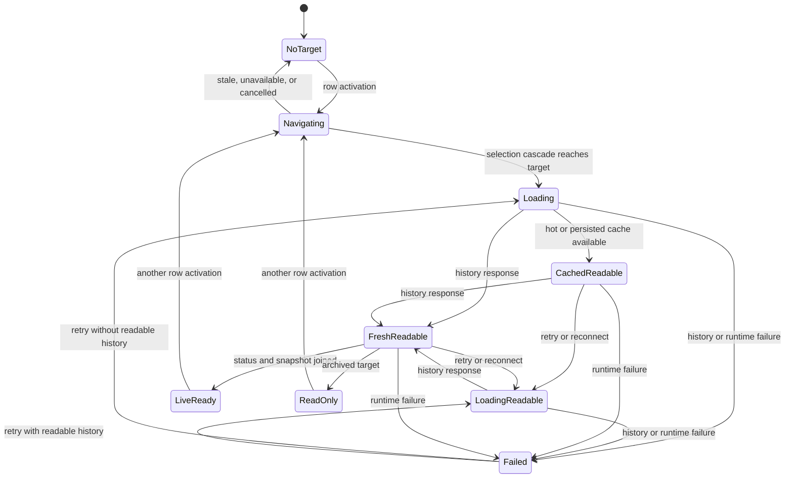
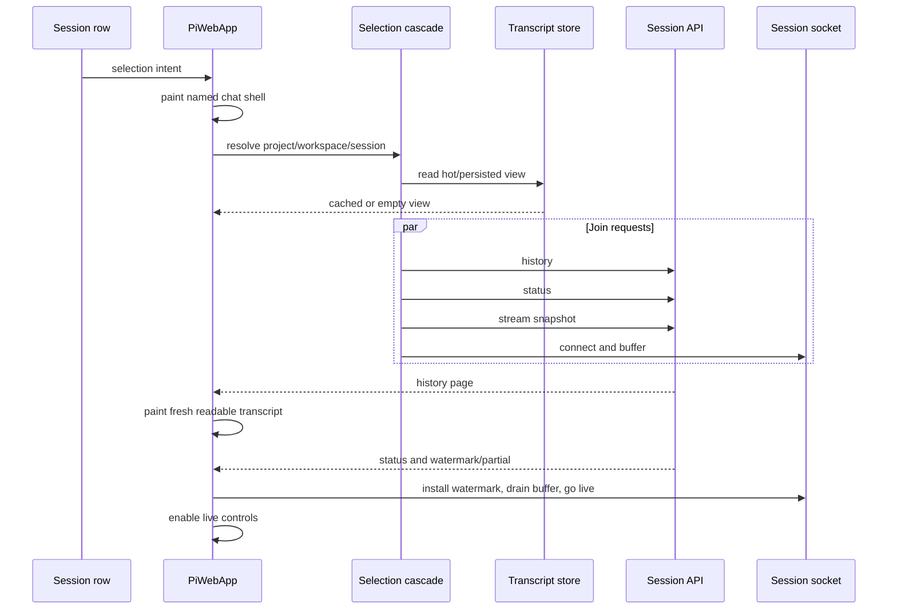
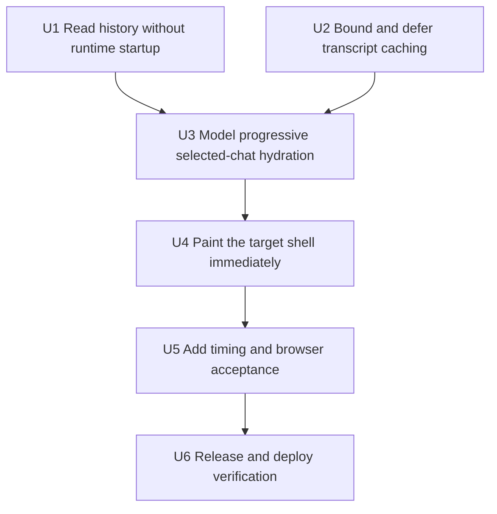
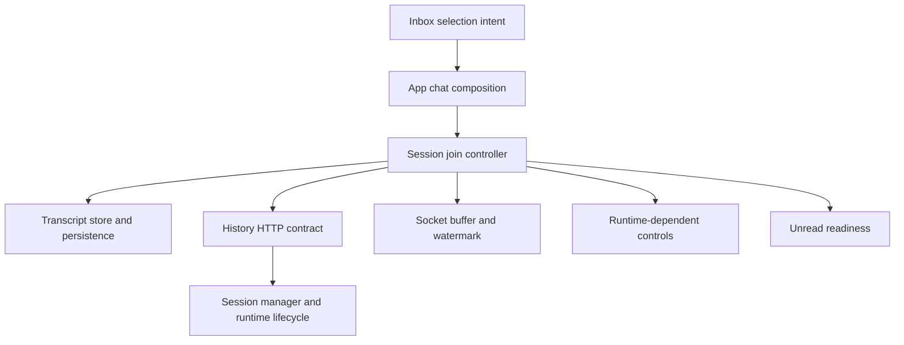

# fix: Make chat opening feel instant

## Summary

Reveal the selected chat shell before workspace resolution or runtime activation, then hydrate cached history, fresh history, and live controls as separate guarded phases. Read inactive transcripts without creating a Pi runtime, retain normalized transcript views, and move browser persistence outside the interaction-critical task.

---

## Problem Frame

Selecting a chat currently leaves the inbox visible until the complete navigation and session-join promise settles. The join waits for history, status, a stream snapshot, and notification refresh before the app calls its chat reveal boundary. Inactive history reads also create a complete Pi runtime and bind extensions before returning messages.

A local probe of the deployed service found cold history/status/snapshot requests completing together in 257–331 ms because they shared runtime startup. Warm requests took 5–42 ms. Representative transcript responses ranged from 152 KB to 2.16 MB for only 31–38 messages, after which the browser still parses, normalizes, persists, groups, and renders the page. The user sees that accumulated work as one delayed transition and one large render burst.

---

## Requirements

**Opening experience**

- R1. A session-row activation reveals a shell identified as the selected target within the next rendered frame; it never leaves the old chat visible under the new selection intent.
- R2. A same-tab cached transcript appears without waiting for network or runtime activation. An uncached target shows a quiet opening state that is distinct from a genuinely empty transcript.
- R3. Fresh transcript history becomes readable as soon as its request completes. Status, stream snapshot, notification refresh, and optional controls do not gate the first fresh transcript render.
- R4. Live sending, model changes, thinking-level changes, and stop actions remain unavailable until the selected live runtime has joined with a valid stream watermark. Navigation, archive, and control-sheet actions remain available where their existing contracts permit them.

**Runtime and selection invariants**

- R5. Inactive and archived history reads resolve the session file and project its branch without creating an agent runtime, binding extensions, registering notification ownership, or publishing startup activity. Active sessions continue to read their current runtime branch.
- R6. Rapid selection, cross-workspace navigation, refresh, reconnect, and join failure preserve the existing selection-generation, socket-buffer, watermark, and unread-readiness invariants. Stale completions never mutate the current target.
- R7. Cached or fresh readable history remains visible when runtime hydration fails. The selected chat presents a retry action that performs a complete authoritative rejoin.

**Caching, measurement, and release**

- R8. Transcript caching reuses normalized views, keeps a small bounded hot set, and performs browser persistence outside the click-to-shell and transcript-commit tasks with last-write-wins ordering.
- R9. Stable User Timing milestones expose selection intent, shell paint, cached/fresh transcript paint, and live readiness. The primary acceptance budget is less than 100 ms from row activation to target shell paint on the deployed local service.
- R10. The behavior passes focused controller, service, cache, component, browser, and visual checks, including all four Fold 8 postures, and ships with a patch Changeset.

---

## Scope Boundaries

- Do not prewarm Pi runtimes or bind extensions speculatively.
- Do not prefetch every session or add catalog-driven transcript loading.
- Do not virtualize the transcript or lazy-load individual tool outputs in this slice.
- Do not change the message-page wire shape, public route, page size, safe-turn boundary, or transcript content.
- Do not change the 30-minute persisted-cache TTL until measurements show expiry is material.
- Do not bypass the existing project/workspace/session selection cascade for cross-workspace targets.
- Do not redesign the chat, composer, inbox, scroll-follow model, or turn-anchor behavior.
- Do not fold the parked machine-global session-domain migration into this work.

### Deferred to Follow-Up Work

- Add transcript windowing or lazy tool-output expansion if large fresh payloads still produce material long tasks after this plan lands.
- Replace `sessionStorage` with IndexedDB only if deferred persistence still causes measurable long tasks or quota loss.
- Optimize branch paging so the server need not project a complete branch before slicing, if the deployed probe identifies it as the remaining cold-history bottleneck.

---

## Context & Research

### Relevant Code and Patterns

- `src/client/src/components/PiWebApp.ts` — owns inbox selection, the cross-workspace cascade, chat reveal after render, unread acknowledgement readiness, and the final composition of chat and composer states.
- `src/client/src/controllers/inboxNavigation.ts` — preserves the full same-workspace/workspace/project selection cascade and generation checks.
- `src/client/src/controllers/sessionController.ts` — applies cached history synchronously, buffers socket events during join, coordinates refreshes, installs stream watermarks, and rejects stale selection completions.
- `src/client/src/chatTranscriptStore.ts` and `src/client/src/chatHistoryCache.ts` — injected raw-history cache seam, history merge, normalization boundary, and current synchronous `sessionStorage` persistence.
- `src/client/src/components/ChatView.ts` — already memoizes grouping by message-array identity and owns anchor-based scroll restoration. New loading states must compose around those contracts rather than replace them.
- `src/client/src/components/PromptEditor.ts` — distinguishes editor/send disabling from archive and control-sheet actions in its existing composition, but model and thinking controls need explicit live-readiness gating.
- `src/server/sessions/piSessionService.ts` — `messages()` currently calls `getOrOpen()`. Its `PiSessionManagerGateway.open()` already yields a manager with `getBranch()` before runtime creation, and `historyMessages()` can be refactored to project that manager directly.
- `src/server/sessions/piSessionManagerGateway.ts` — resolves a session file by compound id/cwd and opens the SDK `SessionManager` without calling Forgerie's runtime factory.
- `src/server/sessions/messagePaging.ts` — keeps pages on user-turn boundaries; this invariant remains unchanged.
- `scripts/lib/cdp.mjs` and `scripts/probe-turn-anchor.mjs` — established real-Chromium probe infrastructure and the four-posture capture pattern.
- `.agents/skills/testing-guide/SKILL.md` — pure/service tests first, controller tests for orchestration, happy-dom for rendered interactions, and real browser evidence for geometry and timing.

### Institutional Learnings

- Cached transcript paint followed by socket buffering and an authoritative HTTP join is already the intended selection pattern. Extend it; do not invent a parallel transcript store.
- Cross-workspace selection must retain the normal teardown cascade. Earlier inbox planning explicitly rejected a transcript-only navigation shortcut because chat, files, git, terminals, unread acknowledgement, and socket ownership depend on the cascade.
- `selectionSeq`, the join-time stream watermark, and buffered event replay are load-bearing reconnect contracts.
- Status and activity events already batch once per animation frame. Progressive hydration must not introduce per-event renders.
- Anchor-based scroll restoration survives transcript restructuring; raw scroll offsets do not.
- The current workspace and machine-global session projections are already a known architecture pressure point. The temporary opening target must remain presentation-only and must not become a third session-data projection.

### External References

- None. The repository contains direct patterns for every required boundary, and no new framework or browser-storage technology is required.

---

## Key Technical Decisions

| Decision | Rationale | Cost |
|---|---|---|
| Model selected-chat hydration as a tagged union with explicit no-target, loading-without-content, loading-with-readable-history, cached-readable, fresh-readable, live-ready, read-only, and failed cases. | Rendering and action eligibility must derive from one state model rather than booleans spread across the app, controller, chat, and composer. Retry and reconnect can stay loading without hiding readable messages. | Adds a state field and transition helpers that every reset/reselection path must update. |
| Keep a separate short-lived navigation intent at the composition root. | It can paint the named target before a cross-workspace cascade resolves without replacing `selectedSession`, showing the old transcript, or creating a third data projection. | The root must clear the intent on success, cancellation, unavailable workspace, stale token, and failure. |
| Intentionally yield one frame after recording selection intent before starting potentially synchronous cached-history work. | It guarantees visible click feedback even when persisted cache parsing or transcript normalization is expensive. | Adds one frame, typically 16 ms, before the actual navigation cascade begins. |
| Make the existing messages route read-only with respect to runtime lifecycle. | Callers ask for transcript data, not extension binding or an agent runtime. Active sessions can use their live manager; inactive and archived sessions can resolve and open only the session manager. | An inactive transcript and a concurrent runtime startup can each parse the same session file once. |
| Start history, status, and stream-snapshot requests together, but commit them in two phases. | Parallel I/O preserves latency; history can paint early while buffered events remain held until the snapshot watermark is known. | The join coordinator becomes more explicit and needs partial-failure tests. |
| Treat notification refresh as independent of transcript/live readiness. | Notification snapshots already own stale/error recovery and should not delay reading or sending. | Notification UI can briefly remain loading or stale after the chat is live. |
| Preserve readable content through failure and retry the complete join. | A full retry restores one authoritative history/status/snapshot relationship and avoids subtle partial-retry staleness. | Retrying may refetch history that already succeeded. |
| Keep a small LRU of raw pages plus normalized views in `ChatTranscriptStore`; coalesce deferred persisted writes per session. | Repeat switching becomes reference-stable and bounded, while expensive serialization leaves the interaction task and stale deferred writes cannot overwrite newer pages. | Sessions beyond the hot-set limit normalize again; persisted cache remains best effort. |
| Use User Timing marks at painted state boundaries, not immediately after `setState`. | The requirement concerns observable paint, so controller completion or state assignment is only a proxy. | Timing instrumentation spans the controller/root boundary and needs a small injected/testable seam. |
| Use structural automated assertions and a deployed Chromium probe for timing. | Fixed millisecond assertions are unreliable in shared CI, while state order, request count, no-runtime creation, and mark order are deterministic. | The under-100-ms budget remains an acceptance probe rather than a unit-test threshold. |

---

## Alternative Approaches Considered

- **Only close the navigation panel sooner:** Rejected. It improves feedback but leaves cold runtime startup, all-at-once hydration, repeated normalization, and synchronous cache persistence unchanged.
- **Add one aggregate join endpoint:** Rejected for this slice. The current requests already run concurrently and share pending runtime startup. One response would still wait for the slowest field and would prevent transcript-first rendering unless it introduced streaming transport complexity.
- **Prefetch on hover or selection proximity:** Rejected. Hover is absent on the primary Fold device, and speculative runtime creation has unbounded memory and extension cost across 2,379 sessions.
- **Replace `sessionStorage` with IndexedDB now:** Deferred. It removes synchronous storage APIs but adds schema, migration, transaction, and failure-handling costs before deferred/coalesced persistence has been measured.
- **Render the previous transcript until the new one arrives:** Rejected. It is fast but contextually unsafe; the visible transcript, identity, composer destination, and session actions could disagree.

---

## Open Questions

### Resolved During Planning

- **How can history avoid runtime creation?** Use an already-active runtime manager when present. Otherwise resolve the current or archived session file, call the existing manager gateway's `open()`, project `getBranch()`, and page the result without invoking the runtime factory.
- **How does progressive hydration avoid duplicate live events?** History may paint early, but the socket continues buffering until status and the stream snapshot settle. The controller installs the watermark and seeded partial before it drains buffered events or switches to the live handler.
- **What does retry do?** It re-runs history, status, and stream snapshot together. Existing readable messages stay rendered while the state returns to loading.
- **What is the uncached opening treatment?** A calm, low-motion progress state inside the normal transcript frame, identified with the target session. No shimmer, layout-mode change, or replacement design.
- **Which controls remain available before live readiness?** Navigation, archive, and the control sheet retain their existing eligibility. Transcript-mutating and runtime-dependent controls remain unavailable.
- **Does cached history promise survive a reload?** Persisted history remains best effort. The strict instant guarantee applies to the shell and the same-tab hot cache; a post-reload persisted-cache read may follow the shell paint.

### Deferred to Implementation

- The exact hot-set entry count, chosen from measured representative memory use; it must remain deliberately small and have a deterministic test configuration.
- The precise scheduling primitive for deferred browser persistence, provided it runs after the first shell/transcript paint, has a supported fallback, and preserves per-session last-write-wins order.
- The final internal names of state helpers and timing marks, provided the mark names are namespaced and stable before the browser probe lands.

---

## High-Level Technical Design

> *This illustrates the intended approach and is directional guidance for review, not implementation specification. The implementing agent should treat it as context, not code to reproduce.*

---

## Implementation Units

### U1. Read transcript history without runtime startup

**Goal:** Make the existing history contract return current transcript pages without creating an agent runtime for inactive or archived sessions.

**Requirements:** R3, R5, R6

**Dependencies:** None

**Files:**
- Modify: `src/server/sessions/piSessionService.ts`
- Test: `src/server/sessions/piSessionService.messages.test.ts`
- Test: `src/server/sessions/piSessionService.lifecycle.test.ts`

**Approach:**
- Refactor raw branch projection so it accepts a session manager rather than requiring a `PiAgentSession`; keep thinking-level, custom-message, compaction, and branch-summary projection unchanged.
- Resolve message sources in priority order: matching active runtime manager, matching archived path, then current session file resolved by id/cwd.
- Open only the SDK session manager for inactive and archived sources. Do not call Forgerie's runtime creation, extension binding, notification registration, startup activity, or active-session publication paths.
- Keep the public messages route, query, page response, browser projection, and error mapping unchanged.
- Accept one duplicate file parse when history and runtime activation race. Do not add a shared partially initialized runtime or lock to remove that bounded cost. Record direct-history and live-readiness durations separately in U5; reopen the deferral if direct history is not materially earlier or the fresh-transcript budget fails.

**Execution note:** Start with a failing service test that proves an inactive history request returns messages while the injected runtime factory is never called.

**Patterns to follow:**
- Direct `PiSessionManagerGateway.resolveSessionFile()` and `open()` use in `src/server/sessions/piSessionService.ts`.
- Pure history projection and paging in `historyMessages()` and `src/server/sessions/messagePaging.ts`.
- Real gateway/session-file coverage in `src/server/sessions/piSessionManagerGateway.test.ts` where path resolution behavior matters.

**Test scenarios:**
- Happy path: an inactive persisted session with user, assistant, tool, compaction, and thinking-level entries returns the same projected page as the current runtime-backed path, with zero runtime-factory calls.
- Happy path: an already-active session reads the active manager branch and does not reopen its file.
- Happy path: an archived session reads its archive path and does not become active or register notifications.
- Edge case: exact and prefix session ids retain the current resolver semantics and cwd confinement.
- Error path: a missing current or archived session still maps to the existing not-found route response.
- Integration: a history request followed by a status request first returns readable history, then creates exactly one active runtime through the status path.
- Integration: browser projection still removes thinking signatures without changing thinking-level labels or mutating service messages.

**Verification:**
- History responses are wire-compatible with current clients.
- Tests prove that messages alone do not publish startup activity or add an active runtime.

### U2. Bound and defer transcript caching

**Goal:** Make repeat transcript reads reference-stable and keep normalization and browser persistence from dominating session selection.

**Requirements:** R2, R8

**Dependencies:** None

**Files:**
- Modify: `src/client/src/chatTranscriptStore.ts`
- Modify: `src/client/src/chatHistoryCache.ts`
- Test: `src/client/src/chatTranscriptStore.test.ts`
- Test: `src/client/src/chatHistoryCache.test.ts`

**Approach:**
- Let `ChatTranscriptStore` own a bounded least-recently-used hot set whose entry pairs the merged raw page with its normalized `ChatTranscriptView`.
- Return the retained normalized view and message array by reference when the raw page has not changed. Normalize once for each actual merged page, not once for every selection/read call; this identity is the input contract that lets `ChatView` reuse its grouping cache.
- Separate merge from persistence at the store's public boundary. Merging updates the in-memory page/view and returns it without calling the cache adapter; a distinct scheduling operation owns browser persistence.
- Keep streamed partials and live deltas outside the raw-history and persisted caches, preserving the current committed-history invariant.
- Inject a cancellable scheduler alongside `ChatHistoryCacheAdapter`, following the scheduler seam in `src/client/src/chatScrollPosition.ts`. A newer write for the same session cancels the queued older callback before it can serialize, then publishes only the newest page after the shell/transcript commit has had an opportunity to paint.
- Keep persisted reads and quota/private-mode failure as best effort. A storage failure must not evict the in-memory hot view or fail selection.
- Expose deterministic cache capacity and scheduling dependencies to tests without introducing a general cache framework.

**Execution note:** Implement cache identity, eviction, and write-order tests before changing production scheduling.

**Patterns to follow:**
- Existing `ChatHistoryCacheAdapter` dependency seam and `MemoryChatHistoryCache` test implementation.
- Content-stable object identity practices in inbox projections and `ChatView.groupedMessages()`.
- Debounced scroll-position persistence in `src/client/src/chatScrollPosition.ts` for bounded browser side effects.

**Test scenarios:**
- Happy path: two reads of an unchanged session return the same normalized view and message-array references.
- Happy path: a newer overlapping history page creates one new normalized view, persists the merged committed page, and becomes the retained reference.
- Edge case: loading more history invalidates only that session's view and keeps page offsets based on raw entries.
- Edge case: exceeding configured hot capacity evicts the least recently used session; revisiting it rehydrates without corrupting other entries.
- Race: a second deferred write for the same session cancels the first before execution; the superseded page is never serialized and only the newer page reaches storage.
- Race: rapid A → B → A selection retains independent pages and normalized identities.
- Failure path: quota or unavailable storage leaves the hot view readable and does not throw.
- Invariant: seeded streaming partials and live deltas never enter raw or persisted history.

**Verification:**
- Repeat same-tab selection performs no second normalization for unchanged committed history.
- The merge operation performs no browser persistence; no `JSON.stringify` or `sessionStorage.setItem` runs in the controller's shell-paint or transcript-state commit stack.

### U3. Model progressive selected-chat hydration

**Goal:** Give selected chat loading one explicit state contract and split transcript readability from live-runtime readiness without weakening join correctness.

**Requirements:** R3, R4, R6, R7

**Dependencies:** U1, U2

**Files:**
- Create: `src/client/src/selectedChatLoad.ts`
- Create: `src/client/src/selectedChatLoad.test.ts`
- Modify: `src/client/src/appState.ts`
- Modify: `src/client/src/controllers/sessionController.ts`
- Test: `src/client/src/controllers/sessionController.refresh.test.ts`
- Test: `src/client/src/controllers/sessionController.streamSeed.test.ts`
- Test: `src/client/src/controllers/sessionController.liveEvents.test.ts`
- Test: `src/client/src/controllers/sessionController.reloadSelection.test.ts`
- Test: `src/client/src/controllers/sessionController.startupProgress.test.ts`

**Approach:**
- Define one tagged union for the current selected-chat load state. Each non-empty case carries the machine/session identity so stale state cannot be rendered for another target.
- On selection, publish cached-readable or loading state before starting I/O. Archived selection uses the same readable states but terminates in read-only rather than live-ready.
- Preserve the existing parallel start of history, status, and stream-snapshot requests, but split their current all-at-once commit. Commit fresh history and fresh-readable state as soon as history resolves.
- Continue buffering socket events until status and snapshot are both available. Seed the partial, install the watermark, apply the authoritative status, drain buffered events in order, then publish live-ready.
- If reconnect fires during the fresh-readable-to-live-ready gap, route it through the existing trailing refresh coordinator. The in-progress join keeps buffer ownership; a reconnect refresh may trail it but must not install a competing watermark or drain the buffer twice.
- Run notification refresh independently; its own controller already converts failure into stale projection state.
- On any join failure, retain current messages and record whether they are absent, cached, or fresh in the failed case. Keep the existing fail-open live socket handler behavior. A retry transitions back to loading while preserving readable messages and re-runs the complete join.
- Preserve selected-session refresh coalescing and one trailing refresh. Reconnect follows the same state transitions without showing a cross-session navigation shell.
- Fire `onSelectedSessionReady` only from live-ready and read-only transitions, after buffer ownership is settled. This keeps unread acknowledgement gated away from the navigation shell and cached/fresh intermediate paints; U4 does not move this callback again.
- Reset load state on deselection, workspace teardown, pending client-side session replacement, archive/restore, reload, and disposal.

**Execution note:** Add state-transition and buffered-event race tests before splitting the current `Promise.all` commit.

**Patterns to follow:**
- Tagged state unions in `src/client/src/chatFollowMode.ts` and `src/client/src/appState.ts` dialog state.
- Generation guards and trailing refresh coordination in `SessionController` and `SessionNotificationController`.
- Join snapshot/watermark tests in `sessionController.streamSeed.test.ts`.

**Test scenarios:**
- Happy path: cache miss progresses loading → fresh-readable → live-ready while history renders before a delayed snapshot.
- Happy path: cache hit progresses cached-readable → fresh-readable → live-ready without replacing the cached message-array reference before fresh history arrives.
- Happy path: archived selection progresses cached/loading → read-only and never connects a session socket or enables runtime controls.
- Edge case: a genuinely empty fresh page leaves the transcript empty but exits the opening state.
- Race: a buffered event arriving after history paint but before watermark installation is applied exactly once after the watermark is installed.
- Race: status/snapshot resolve before history; live-ready waits for the history commit and still drains the buffer once.
- Race: selecting B while A is in any phase prevents A's history, status, snapshot, error, and deferred readiness callback from mutating B.
- Reconnect: a live session becomes loading-with-readable-history, rejoins, replaces its watermark, and returns to live-ready without clearing the transcript.
- Reconnect race: reconnect fires after fresh history paints but before the first watermark is installed; refresh coordination preserves one buffer owner, drains it exactly once, and leaves the final authoritative watermark.
- Failure path: history fails with cache present; cached messages stay visible and failed state identifies cached readability.
- Failure path: history succeeds and snapshot fails; fresh messages stay visible, runtime controls remain disabled, and full retry can reach live-ready.
- Failure path: join failure still installs the live socket handler as today so later events and reconnect can recover.
- Integration: unread readiness fires only after the selected chat is rendered and live-ready/read-only, not at shell or cached-readable paint.

**Verification:**
- One source of truth determines opening, readability, retry, and runtime-control eligibility.
- Existing stream seeding, reconnect, pending-dialog, and unread acknowledgement tests remain valid.

### U4. Paint the target chat shell immediately

**Goal:** Respond to row activation within one frame and render the selected chat's opening, readable, failed, and live states without exposing the previous chat or raising the keyboard.

**Requirements:** R1, R2, R4, R7, R10

**Dependencies:** U3

**Files:**
- Modify: `src/client/src/components/PiWebApp.ts`
- Modify: `src/client/src/components/ChatView.ts`
- Modify: `src/client/src/components/PromptEditor.ts`
- Test: `src/client/src/components/PiWebApp.keyboard.test.ts`
- Create: `src/client/src/components/PiWebApp.chatOpening.test.ts`
- Test: `src/client/src/components/ChatView.test.ts`
- Test: `src/client/src/components/PromptEditor.restingState.test.ts`

**Approach:**
- Add a presentation-only tagged navigation intent at the app composition root. It carries the target identity while the existing project/workspace/session cascade resolves but contains no transcript, status, or runtime projection.
- On row activation, record the intent, switch to chat, await the existing after-render boundary, and only then start the navigation cascade. Render the target identity and quiet opening treatment while intent is active; do not render the old selected transcript or composer.
- Clear the intent when `selectSession` reaches its synchronous selected-session commit. Clear or fail it on stale token, unavailable workspace, thrown navigation, cancellation, and component disposal.
- Pass selected-chat load state into `ChatView`. Show opening treatment only when no transcript is readable; show a compact updating/failure/retry treatment alongside cached or fresh content without moving the transcript into a different layout paradigm.
- Derive editor/send/stop, model, and thinking action availability from live-ready/read-only state. Keep archive and the control-sheet summon action independent where existing eligibility permits them.
- Preserve prompt drafts, focus ownership, anchor-based scroll restoration, load-earlier behavior, and turn-follow state across cached → fresh → live renders.
- Use existing theme tokens and intrinsic layout. Add no viewport breakpoint or posture-specific branch.

**Execution note:** Use happy-dom for rendered state and real interaction. Do not assert visual geometry outside the browser probe.

**Patterns to follow:**
- `PiWebApp.openChat()` as the no-keyboard reveal boundary.
- `SessionInboxPanel` callback composition and `navigationSelectionSeq` stale guards.
- `ChatView` top notices/liveness composition and existing anchor restore continuation.
- `PromptEditor` separation between editor controls and chrome-summon/archive actions.

**Test scenarios:**
- Happy path: clicking a same-workspace row changes the main view to the target opening shell before a deferred session join settles and never focuses the editor.
- Happy path: clicking a cross-workspace row shows the target shell while project/workspace loading continues, then hands off to the selected cached/fresh chat after the normal cascade.
- Happy path: cached-readable state renders messages with a non-blocking freshness indication; live-ready removes it and enables runtime controls.
- Edge case: an empty fresh session shows the normal empty-chat treatment, not the opening treatment.
- Race: rapid A → B clicks never flash A's transcript or identity after B becomes the current intent.
- Error path: unavailable workspace or navigation failure clears the transient target and returns a recoverable navigation/error surface rather than stranding an opening shell.
- Error path: runtime join failure keeps readable messages, disables runtime-dependent controls, and exposes retry.
- Interaction: archive and control-sheet summon remain available when eligible during runtime loading; send, stop, model, and thinking changes do not.
- Scroll: cached → expanded fresh history retains the selected session's anchor restoration contract and does not jump to another session's stored position.
- Accessibility: opening and failure states have appropriate status semantics; retry is keyboard reachable; progress does not repeatedly announce on live deltas.

**Verification:**
- The browser always gives immediate target-specific feedback and never displays a destination mismatch.
- All four Fold postures use the same chat composition and retain usable controls without clipping or layout cliffs.

### U5. Add chat-open timing and browser acceptance

**Goal:** Measure the user-observable milestones and provide repeatable deployed evidence for the latency and posture requirements.

**Requirements:** R9, R10

**Dependencies:** U4

**Files:**
- Create: `src/client/src/chatOpenTiming.ts`
- Create: `src/client/src/chatOpenTiming.test.ts`
- Modify: `src/client/src/components/PiWebApp.ts`
- Create: `scripts/probe-chat-open.mjs`
- Reuse: `scripts/lib/cdp.mjs`

**Approach:**
- Give each selection attempt one timing identity and record namespaced milestones for intent, target shell paint, cached/fresh transcript paint, and terminal live-ready, read-only-ready, or failed outcomes.
- Record painted milestones from the root's post-render boundary rather than from controller state assignment. Clear or close incomplete attempts when a newer selection supersedes them.
- Keep timing local to the browser User Timing API. Do not add telemetry, durable analytics, or runtime logging.
- Add a real-Chromium probe that activates representative same-workspace and cross-workspace rows, captures milestone durations and long tasks, and records screenshots at the four required Fold viewports.
- Use structural unit assertions for mark order and supersession. Treat the under-100-ms shell budget and absence of a visible old-chat flash as deployed acceptance evidence, not a fixed CI timing assertion.

**Patterns to follow:**
- Browser orchestration and posture matrix in `scripts/probe-turn-anchor.mjs`.
- CDP helpers in `scripts/lib/cdp.mjs`.
- Injected browser-boundary testing patterns in app-shell and keyboard tests.

**Test scenarios:**
- Happy path: one selection records intent, shell-painted, fresh-transcript-painted, and live-ready milestones in order.
- Happy path: a cache hit records cached-transcript-painted before fresh-transcript-painted.
- Edge case: read-only selection ends at read-only readiness without inventing a live-ready milestone.
- Race: superseding A with B closes A's attempt and B's measures never use A's start mark.
- Failure path: a failed join records shell and readable milestones that occurred, plus failure, without recording live readiness.
- Browser integration: same-workspace and cross-workspace activation each show the target shell before network/runtime completion.
- Browser integration: representative warm, cold, and large-transcript sessions report shell, transcript, and live timings plus long-task observations.
- Visual: screenshots at 739×979, 979×739, 499×789, and 789×499 show the opening, cached/updating, failed/retry, and ready states without clipping or a layout-paradigm switch.

**Verification:**
- On the deployed local service, click-to-target-shell paint is below 100 ms for representative same-workspace and cross-workspace selections.
- For the representative transcript of at least 2 MB, no browser long task over 50 ms occurs between shell paint and fresh-transcript paint; if one remains, the probe fails this acceptance gate and supplies evidence for the deferred transcript-windowing work.
- Captures have been opened and visually reviewed, not only generated.
- The probe reports actual transcript/live timing separately, so a fast shell cannot hide a slow backend regression.

### U6. Release and deployed verification

**Goal:** Ship the user-visible performance fix with complete repository, service, and acceptance evidence.

**Requirements:** R10

**Dependencies:** U5

**Files:**
- Create: `.changeset/<unique-chat-opening-name>.md`

**Approach:**
- Add one patch Changeset describing the faster and progressive chat-opening experience in user terms. Do not edit `CHANGELOG.md` directly.
- Run the full repository verification gate after focused unit, service, component, and browser checks.
- Build the production artifacts before restarting the local services. Check for active agent runs before restarting sessiond because restart terminates them.
- Restart the user services, verify their status and local HTTP response, then run the chat-open probe against the deployed build.
- Inspect the four posture captures and record measured shell, transcript, live, and long-task results in the implementation handoff or PR evidence.

**Patterns to follow:**
- `.agents/skills/changeset-changelog/SKILL.md` for patch Changeset format.
- `AGENTS.local.md` for build, safe restart, and endpoint checks.
- `AGENTS.md` for the Fold 8 visual acceptance matrix.

**Test scenarios:**
- Test expectation: none — this unit packages and verifies behavior covered by U1–U5.

**Verification:**
- `npm run verify` passes.
- Production build and both user services are healthy after restart.
- The deployed browser probe and visual review satisfy R9 and R10.

---

## System-Wide Impact

- **Interaction graph:** Inbox selection records a presentation intent, the existing cascade reaches `SessionController`, and history becomes readable through `ChatTranscriptStore`. For live sessions, status/snapshot complete the socket join before runtime-dependent controls and unread acknowledgement become ready. Archived/read-only sessions become unread-ready when the read-only state is rendered, without connecting a socket.
- **Error propagation:** Navigation failures clear the transient target and use the existing app error surface. Selected-session join failures become explicit chat-load failure state while background notification failures remain owned by the notification projection.
- **State lifecycle risks:** Every selection, reconnect, reload, archive/restore, pending-session replacement, workspace reset, and disposal path must move or clear the tagged load state. Deferred cache writes require per-key generations so stale work cannot overwrite a newer page.
- **API surface parity:** The browser messages route and shared `MessagePage` shape do not change. Local and remote machines receive the same faster server behavior through the existing federated route.
- **Integration coverage:** Service tests prove no-runtime history reads; controller tests prove phased watermark-safe joins; component tests prove action eligibility; Chromium proves painted timing and posture behavior.
- **Unchanged invariants:** Message ordering, safe-turn paging, transcript content, socket sequence semantics, workspace teardown, draft persistence, ask/dialog rendering, follow mode, scroll anchors, archive behavior, and unread acknowledgement rules remain unchanged.

---

## Risks & Dependencies

| Risk | Mitigation |
|---|---|
| Painting early exposes a wrong session or stale composer destination. | Render a presentation-only target shell with no composer until the normal cascade commits the selected session; never reuse the old transcript under the new identity. |
| Splitting the join duplicates or drops live events. | Keep buffering until history, status, and snapshot are coordinated; install watermark and partial before draining. Add events-between-phases tests. |
| Direct history and runtime startup parse the same large file concurrently. | Accept one bounded duplicate read in exchange for lower first-content latency; do not introduce shared partial runtime state. Measure before further optimization. |
| A session file changes between direct history read and runtime snapshot. | Treat history as the committed base and snapshot partial/watermark as the live seam; reconnect/full retry remains authoritative. |
| Deferred persistence writes stale history after rapid navigation. | Coalesce by compound machine/session key and use last-write-wins generations. The in-memory merged page remains authoritative for the tab. |
| Bounded hot-cache eviction makes an older revisit slower. | Keep the shell guarantee independent of cache hits and tune the small capacity from measured memory, not total catalog size. |
| Large 2 MB+ transcripts still cause parse/render long tasks. | Measure long tasks separately. Keep transcript windowing and lazy outputs as explicit follow-up rather than expanding this slice. |
| Existing active work also touches `ChatView.ts`, `PromptEditor.ts`, `PiWebApp.ts`, and `sessionController.ts`. | Execute after or rebase onto the turn-anchor, content-first chrome, and global-composer changes; preserve their tests and reconcile the controller join changes before U3. |
| Sessiond restart interrupts active work during deployment. | Follow `AGENTS.local.md`: inspect the running UI first and restart only when no session is mid-run. |

---

## Success Metrics

- Target shell paint occurs within 100 ms of row activation on the deployed local service for representative same-workspace and cross-workspace selections.
- A same-tab cache hit paints readable history without awaiting HTTP or runtime readiness.
- Cold fresh history paints before the live-ready milestone.
- A messages-only request causes zero agent-runtime creations and zero extension bindings.
- Rapid A → B selection produces no A milestone, transcript, error, or control state after B becomes current.
- Representative large transcripts show no persistence or repeated-normalization work in the click-to-shell task, and no task over 50 ms between shell paint and fresh-transcript paint for the observed 2 MB class.
- All four Fold posture captures pass visual review.

---

## Documentation / Operational Notes

- No README or long-form user documentation is required; the behavior is self-explanatory and has no configuration surface.
- Add one patch Changeset. Do not edit `CHANGELOG.md` during implementation.
- The timing marks are a developer diagnostics contract. Keep their names stable once `scripts/probe-chat-open.mjs` depends on them.
- User-facing changes on `main` require a production build and safe restart of `forgerie-sessiond.service` and `forgerie-web.service` before deployed acceptance.

---

## Sources & References

- Related code: `src/client/src/components/PiWebApp.ts`
- Related code: `src/client/src/controllers/sessionController.ts`
- Related code: `src/client/src/chatTranscriptStore.ts`
- Related code: `src/client/src/chatHistoryCache.ts`
- Related code: `src/server/sessions/piSessionService.ts`
- Related plan: `work/items/active/01KZFG0Y7GKA8H2XGYDE6WPSCM-session-inbox-primary-navigation/plan.md`
- Related plan: `work/items/active/01KZMKYX9G4THPDDE08FYVF8GE-session-catalog-performance/plan.md`
- Deferred architecture item: `work/items/parking-lot/01KZGZ9KSNRW8JRY8RSWHB8P8H-establish-a-machine-global-session-domain-boundary.md`
- Project acceptance rules: `AGENTS.md`
- Local deployment rules: `AGENTS.local.md`
