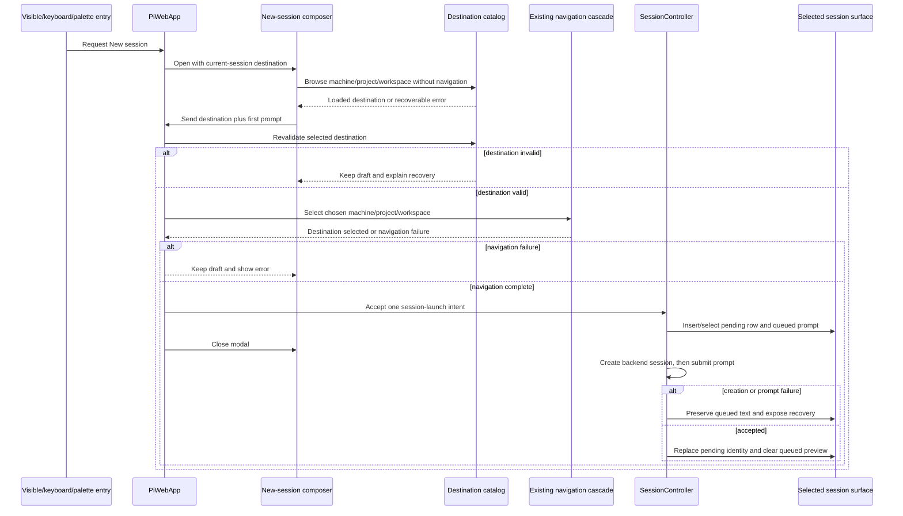
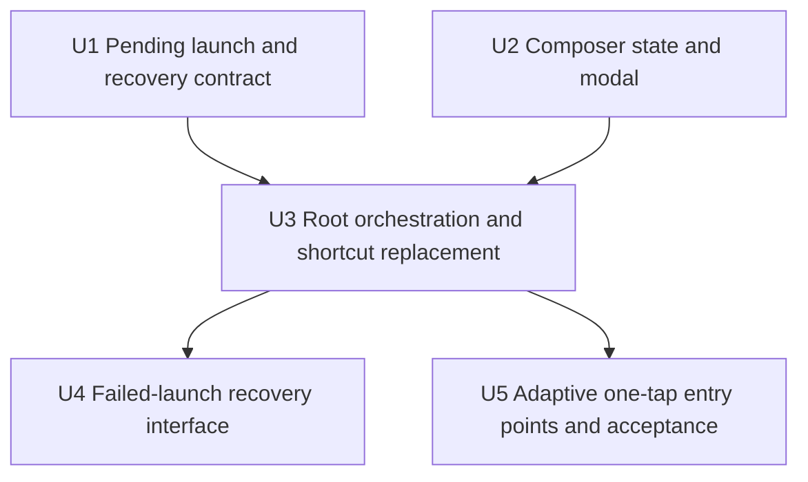
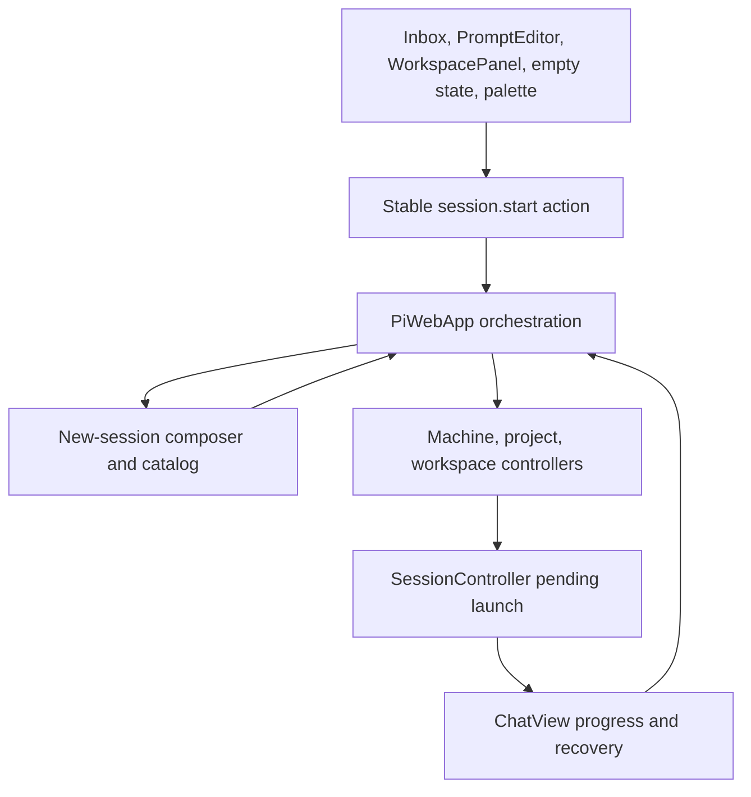

# Global New-Session Composer Implementation Plan

## Summary

Build the composer as a deep Lit modal with local, non-durable draft state; route every entry point through one root orchestration path; and extend the existing pending-session queue with explicit first-prompt recovery. Reuse the normal machine, project, workspace, modal, and action systems instead of adding a parallel navigation or launch framework.

---

## Problem Frame

Forgerie currently has two incompatible start paths: an inbox picker and a global action that immediately creates a session in the selected workspace. The implementation must replace both with one addressed-message flow while preserving shortcut preferences, pending-start truthfulness, and access from every shell surface.

---

## Requirements

- R1. Expose one New session interaction from chat, workspace tools, navigation, empty states, and other first-party surfaces.
- R2. Keep a visible one-tap touch entry point on every active surface without requiring an intermediate menu.
- R3. Make `Ctrl/⌘+Enter` open the composer, including when the existing prompt editor has focus.
- R4. Keep the command-palette action and every visible trigger on the same root open path.
- R5. Use one action name, plus icon, and accessible label in adaptive, non-overlaid placements.
- R6. Open the composer as a modal without changing navigation, selection, or the current session draft.
- R7. Resolve a complete default destination from the current session when possible.
- R8. Permit opening without a complete default, but require a valid destination before Send.
- R9. Let the user change machine, project, and workspace without losing the first prompt.
- R10. Present destination, first prompt, Cancel, and Send; enable Send only for valid non-empty input.
- R11. Make Cancel side-effect free.
- R12. Keep composer destination and prompt state in memory while the modal survives destination steps and posture changes.
- R13. Treat Send as one launch intent that creates one blank session, selects it, and queues its first prompt without inherited history.
- R14. Reuse pending-session and queued-message projections so creation and submission progress remain truthful.
- R15. Revalidate the selected destination at Send and retain the composer when the target is unavailable.
- R16. Preserve failed launch text and expose recovery for creation and first-prompt delivery failures.
- R17. Focus the existing composer when another activation reaches the root while it is already open.
- R18. Keep the trigger and modal usable across all four Galaxy Z Fold 8 viewport assumptions through intrinsic layout.
- R19. Complete physical-device checks in all four postures and through at least one transition with an unsent prompt.

**Origin actors:** Forgerie user; touch user; keyboard user.

**Origin flows:** F1 (compose from the current location), F2 (change destination before sending).

**Origin acceptance examples:** AE1-AE8.

---

## Scope Boundaries

- Do not retain a separate immediate-start action or shortcut.
- Do not fork, copy, summarize, or otherwise inherit conversation history.
- Do not redesign the session inbox beyond routing its existing affordance into the composer.
- Do not add model, thinking-level, or attachment controls to the first version.
- Do not add a floating button over chat, workspace tools, or plugin content.
- Do not add viewport breakpoints inside or near the Fold posture range; use container-owned fluid layout.
- Do not add client-side durable storage for the new-session prompt.
- Do not change session-daemon or server session-creation protocols.
- Do not claim Samsung Tab Ultra 11 acceptance until its CSS viewport and DPR are measured.

### Deferred to Follow-Up Work

- PromptEditor reconnect defects unrelated to the new-session shortcut: keep separate from this feature.
- A generic modal, catalog-loading, or async-state framework: introduce only the feature-specific seam needed here.
- Wider shell breakpoint refactoring: retain the current shell modes and avoid adding another cliff.

---

## Context & Research

### Relevant Code and Patterns

- `src/client/src/components/ModalSurface.ts` already owns modal focus entry, focus trapping, Escape/backdrop behavior, layer ordering, and focus restoration. The composer should be modal content, not another overlay implementation.
- `src/client/src/components/SessionInboxNewSessionDialog.ts` and its tests show the current project/workspace loading and cancellation conventions. Its start mode will be retired; its workspace-management behavior remains.
- `src/client/src/components/PiWebApp.ts` owns modal state, navigation sequencing, controller composition, and all root action callbacks. It is the one orchestration boundary for opening and submitting the composer.
- `src/client/src/plugins/core/actions.ts` defines `session.start`. Keeping that action ID preserves custom shortcut preferences while changing the action title, enabled state, and behavior.
- `src/client/src/components/PromptEditor.ts` handles Enter inside CodeMirror before the global dispatcher. It needs an explicit modified-Enter route to the root New session callback.
- `src/client/src/controllers/sessionController.ts` already inserts a temporary selected session synchronously, queues sends until backend creation resolves, and retains queued previews when startup fails.
- `src/client/src/inboxLocation.ts` and the existing machine/project/workspace controllers provide location resolution and the normal navigation cascade. The composer catalog must not mutate selected navigation while the user edits.
- `src/client/src/appShell/shellLayoutMode.ts` confirms every Fold posture uses summoned chrome. The trigger therefore cannot depend only on resident navigation.
- Vitest plus happy-dom component tests are the repository standard. Behavior-bearing units must start from failing scenarios.

### Institutional Learnings

- No matching `docs/solutions/` note established a different pattern. The live modal, pending-start, and navigation implementations are authoritative for this work.
- User-facing changes require a Changesets fragment. `CHANGELOG.md` remains release-generated.

### External References

- No external research is required. The feature is governed by established repository contracts and the approved requirements and wireframe.

---

## Key Technical Decisions

| Decision | Chosen approach | Rationale | Cost / residual risk |
|---|---|---|---|
| Composer ownership | A deep Lit component owns its draft, destination-step state, and catalog load state; `PiWebApp` owns only open/close and submission orchestration. | Keeps sensitive draft text out of durable storage and prevents root state from becoming a nullable field bag. | The component has meaningful internal state and needs focused transition tests. |
| Destination data | Use an injected feature-specific catalog over existing machine, project, and workspace APIs. Do not replace selected app catalogs while browsing destinations. | Cross-machine choices must not navigate before Send, and the same seam supports deterministic tests and previews. | Data can become stale; Send must revalidate and a final creation race can still fail truthfully. |
| Creation boundary | After Send validation, use the existing navigation cascade, then create the pending row and queue the initial prompt as one controller-owned launch intent. | The transport can accept an explicit cwd/machine, but current pending-row selection, status routing, startup dialogs, and identity replacement all depend on selected machine/workspace. Navigation-first preserves that single lifecycle and is permitted after Send. | The underlying selected destination changes after Send. Creation or delivery failure must leave that target selected with recovery visible there; U3 tests this invariant. |
| Modal lifetime | Keep the modal open through destination validation/navigation; close it once the pending session and queued prompt exist. | Early failures preserve the modal draft, while closing after acceptance leaves pending startup dialogs reachable. | Later backend failures cannot recover inside the original modal and need explicit session-surface actions. |
| Failure recovery | Retain failed launch sends in controller-owned in-memory recovery records and render retry/change-destination actions beside the queued preview. | Reuses the truthful queued-message projection and avoids false success or durable prompt storage. | Recovery data is tab-memory only and is lost if the page closes, matching the requirement's in-memory constraint. |
| Shortcut compatibility | Keep action ID `session.start`; make it always open the composer, and intercept modified Enter inside PromptEditor before normal send handling. | Existing custom bindings remain attached to the same action, and the shortcut works from the most common editable context. | Any third-party action consumer that assumed immediate creation sees the new product semantics, as required by removing that workflow. |
| Visible placement | Reuse the inbox trigger and add the same action to the chat composer row, workspace-tool header, and no-session empty state. | These are content-owned chrome surfaces that cover chat, Files, Git, Terminal, plugins, navigation, and empty states without an overlay. | Several small render sites must share exact identity through constants and tests. |
| Destination availability | React immediately to known machine health changes and revalidate project/workspace membership on Send; do not poll continuously. | Preserves the draft and catches known stale selections without creating another background lifecycle. | A destination can disappear after validation; the normal failed-start recovery remains the final safety net. |
| Responsive design | Keep one modal composition with fluid tracks, intrinsic sizing, and internal scrolling; do not switch to unrelated phone/desktop dialogs. | Preserves state and visual continuity through the Fold posture matrix. | Physical keyboard/OSK behavior cannot be proved by happy-dom or headless layout alone. |

---

## Open Questions

### Resolved During Planning

- Adaptive trigger placement: use the PromptEditor action row for chat, the WorkspacePanel header for Files/Git/Terminal/plugin tools, the existing inbox header for navigation, and an action-bearing no-session empty state.
- Shortcut migration: preserve `session.start`; do not migrate stored bindings or create a second action ID.
- PromptEditor conflict: route modified Enter to New session before the ordinary Enter/send logic.
- Initial focus: focus the first-prompt field when the default destination is complete; otherwise focus the destination control.
- Multi-machine selection: show machine context in the destination and make it selectable when alternatives exist; load downstream catalogs without changing app selection.
- Failure location: close the modal after the pending launch is accepted, then recover creation/delivery failures on the selected session surface.
- Destination loss: detect known health changes while open and revalidate at Send rather than add polling.

### Deferred to Implementation

- Exact internal type and helper names: choose intention-revealing names while preserving the state and ownership boundaries above.
- Exact fluid modal dimensions and label-collapse thresholds: tune against the four required captures and physical device instead of guessing values in the plan.
- Whether workspace-management retains its current filename or is renamed after its start mode is removed: prefer a rename if it can remain an atomic, low-risk cleanup in U3.

---

## High-Level Technical Design

> *This illustrates the intended approach and is directional guidance for review, not implementation specification. The implementing agent should treat it as context, not code to reproduce.*

The composer state has three behavioral regions, represented with tagged states rather than independent flags:

| Region | Responsibilities | Exit |
|---|---|---|
| Editing | Destination summary, prompt text, validation, Cancel/Send | Destination browsing or submission |
| Choosing destination | Machine/project/workspace step plus loading/error result; prompt remains untouched | Return to editing with chosen destination |
| Submitting | Block duplicate Send and Cancel while validation/navigation determines whether a pending launch can be accepted | Close after acceptance, or return to editing with the same draft and an error |

---

## Implementation Units

### U1. Extend pending launch with an initial-prompt recovery contract

**Goal:** Make a destination-selected session launch synchronously create one pending row and queue one marked initial prompt, while retaining enough in-memory information to recover failures without automatically resubmitting an ambiguously accepted prompt.

**Requirements:** R13-R16; F1; AE5-AE6.

**Dependencies:** None.

**Files:**
- Modify: `src/client/src/controllers/sessionController.ts`
- Modify: `src/client/src/controllers/sessionController.sendQueue.test.ts`
- Create: `src/client/src/controllers/sessionController.sessionLaunch.test.ts`
- Modify if needed: `src/client/src/appState.ts`

**Approach:**
- Add a controller-level launch path that composes the existing pending-start insertion and queued-send behavior. The first prompt must enter the queue before any backend result can resolve.
- Mark the launch prompt within the in-memory queued-send model so delivery failure can retain that specific intent without changing generic shell/command queue semantics.
- Retain failed creation data separately from active pending starts. Preserve the existing failed transient row, queued preview, and activity error as the truthful projection.
- When backend creation succeeds but initial prompt delivery reports failure, retain the launch intent under the resolved session identity and reconcile against canonical session transcript/status before classifying it as accepted, confirmed unsent, or ambiguous.
- Offer automatic retry only for confirmed-unsent delivery. If acceptance remains ambiguous, preserve the text and expose refresh/inspect plus restore-to-editor recovery so the user, not an automatic loop, decides whether to resubmit.
- Expose a small controller recovery view and actions for retrying a confirmed failed stage or retrieving the original destination/prompt for destination change.
- Clear recovery records only after accepted delivery, explicit deletion/discard, or successful replacement. Guard repeated retry while a retry is active.
- Keep all prompt recovery data in memory. Do not route the composer prompt through `promptDraftStorage.ts`.

**Execution note:** Test first. Characterize current pending-row insertion, identity replacement, and failed queued-preview retention before extending them.

**Patterns to follow:**
- `PendingSessionStart` and queued-send handling in `src/client/src/controllers/sessionController.ts`
- Activity projections in `src/client/src/sessionActivity.ts`
- Existing send queue scenarios in `src/client/src/controllers/sessionController.sendQueue.test.ts`

**Test scenarios:**
- Happy path: a launch with valid selected destination and non-empty prompt inserts exactly one selected pending session and one queued preview before the backend promise resolves.
- Integration: backend creation resolves to a real session, the pending identity is replaced, the prompt is delivered once, and its preview disappears only after acceptance.
- Error path: creation rejects, leaving the failed transient row, prompt preview, failed stage, same-destination retry, and destination-change recovery data available.
- Error path: creation succeeds but prompt delivery rejects; canonical transcript/status reconciliation marks the prompt accepted, confirmed unsent, or ambiguous without inventing a sent state.
- Edge case: confirmed-unsent delivery permits one Retry; two Retry activations while one retry is active produce one backend attempt.
- Edge case: ambiguous delivery offers no automatic Retry, preserves the text, and can restore it for an explicit user decision after transcript inspection.
- Edge case: deleting a failed transient launch or successfully replacing it clears its recovery record and prompt preview.
- Regression: ordinary prompts, shell sends, and commands queued during startup keep their existing ordering and behavior.

**Verification:**
- Controller tests prove one automatic delivery attempt per launch, no automatic retry after ambiguous acceptance, stage-specific recovery retention, and cleanup without durable prompt writes.

---

### U2. Build the stateful composer and destination catalog

**Goal:** Add the modal interaction that owns one in-memory prompt, permits cross-machine destination changes, and remains stable through internal steps and responsive rerenders.

**Requirements:** R6-R12, R15, R17-R18; F1-F2; AE1-AE4, AE7-AE8.

**Dependencies:** None.

**Files:**
- Create: `src/client/src/newSessionComposer.ts`
- Create: `src/client/src/newSessionComposer.test.ts`
- Create: `src/client/src/components/NewSessionComposer.ts`
- Create: `src/client/src/components/NewSessionComposer.test.ts`
- Modify: `src/client/src/components/shared.ts`
- Reuse without changing unless a verified gap appears: `src/client/src/components/ModalSurface.ts`

**Approach:**
- Define a destination value that carries machine, project, and workspace identity and display context. Keep incomplete destination state explicit rather than encoding it as unrelated optional fields.
- Define tagged editing, destination-selection, and submitting states. Keep the prompt text within the mounted component and preserve it across every state transition.
- Provide a feature-specific catalog contract over existing machine/project/workspace APIs. Include production API loading and a deterministic in-memory implementation used by tests and visual previews.
- Load projects after machine choice and workspaces after project choice. Ignore stale async results when the user backs out, changes an earlier selection, cancels, or closes the modal.
- Show known machine availability and catalog errors in place. Define explicit empty results: no machines offers Refresh or Cancel; no projects offers Refresh, Back/change machine, or Cancel; no workspaces offers Refresh, Back/change project, or Cancel. Every empty state keeps the prompt and Send disabled.
- Perform structural input validation locally, then let the root submission callback own authoritative Send-time destination revalidation and return any rejection to the same mounted draft.
- Use `ModalSurface` for focus, Escape, backdrop, and busy behavior. Move focus to the prompt for a complete default, the destination control for an incomplete default, and the existing modal when focus is requested again.
- Keep destination selection within the same modal composition. Do not open a second modal or unmount the prompt while browsing.
- Use intrinsic sizing, fluid tracks, and a scrollable content region so the software keyboard and short landscape viewport do not hide the footer.

**Execution note:** Test pure transitions and async stale-result guards before rendering tests. Then implement the smallest UI that satisfies those contracts.

**Patterns to follow:**
- Tagged dialog state in `src/client/src/appState.ts`
- Focus and busy semantics in `src/client/src/components/ModalSurface.ts`
- Lazy loading/error handling in `src/client/src/components/SessionInboxNewSessionDialog.ts`
- Existing dialog styles and controls in `src/client/src/components/shared.ts`

**Test scenarios:**
- Happy path: complete default destination focuses the prompt, accepts text, and enables Send only after trimming proves the prompt is non-empty.
- Happy path: selecting another machine, project, and workspace returns to the same prompt text and submits the chosen destination.
- Edge case: no current session opens a destination-required state; Send stays disabled until both inputs are valid.
- Edge case: empty machine, project, and workspace catalogs show their stage-specific recovery actions, retain the prompt, and never silently choose another destination.
- Edge case: changing destination repeatedly or receiving stale catalog responses never rewinds the latest choice or draft.
- Error path: a catalog or revalidation failure leaves the prompt intact, identifies the invalid destination, and permits another selection.
- Integration: Cancel, Escape, and backdrop close only while not submitting and produce no submission callback.
- Integration: a repeated root focus request focuses the existing modal without reinitializing its state.
- Responsive: rerendering across representative container sizes preserves prompt and destination and keeps all controls reachable.
- Accessibility: the modal has one accessible name, predictable focus entry, trapped Tab order, and labelled destination, prompt, Cancel, and Send controls.

**Verification:**
- Component and state tests prove single-draft ownership, destination isolation, stale-load safety, focus behavior, and no side effects before Send.

---

### U3. Replace direct start with one root composer orchestration path

**Goal:** Route the inbox, command palette, keyboard shortcut, and PromptEditor-modified Enter through one `PiWebApp` composer request and launch handoff while keeping stored action bindings valid.

**Requirements:** R3-R4, R6-R8, R11, R13, R17; F1-F2; AE1-AE2, AE4-AE5, AE7.

**Dependencies:** U1, U2.

**Files:**
- Modify: `src/client/src/appState.ts`
- Modify: `src/client/src/components/PiWebApp.ts`
- Modify: `src/client/src/components/PiWebApp.keyboard.test.ts`
- Modify: `src/client/src/components/PiWebApp.workspaceTopology.test.ts`
- Modify: `src/client/src/components/PromptEditor.ts`
- Create: `src/client/src/components/PromptEditor.newSessionShortcut.test.ts`
- Modify: `src/client/src/plugins/core/actions.ts`
- Modify: `src/client/src/plugins/types.ts`
- Modify: `src/client/src/components/appShell/AppNavigationPanel.ts`
- Modify: `src/client/src/components/SessionInboxNewSessionDialog.ts`
- Modify: `src/client/src/components/SessionInboxNewSessionDialog.test.ts`

**Approach:**
- Store only the root composer request in `AppState`: closed or open with an initial destination and optional recovered prompt. The mounted composer remains the single draft owner.
- Derive the default from the selected session's machine and resolved cwd. Prefer loaded workspace identity; use existing inbox location data to resolve sibling worktrees, and fall back to destination-required rather than guessing.
- Add one idempotent root open path. If already open, focus the existing modal instead of replacing its request.
- Keep `session.start` as the action ID, rename its user-facing identity to New session, and allow it to open even when no workspace is selected.
- Change the plugin runtime action callback behind that ID to open the composer rather than create immediately. Do not add a replacement action ID or migration.
- In PromptEditor, handle modified Enter before ordinary Enter/send behavior and call the same root open callback. Preserve all plain Enter and Shift+Enter preferences.
- On Send, revalidate destination, navigate through existing machine/project/workspace controllers with the existing stale-navigation token guard, and keep the modal open if navigation cannot reach the exact target.
- Once navigation is current, hand one launch intent to U1. Close the composer only after the pending row and queued prompt are present, then show chat so startup dialogs and progress remain usable.
- Route the inbox start affordance to the composer. Reduce the old dialog to workspace management only; rename it if that cleanup stays mechanical and test-contained.

**Execution note:** Start with action and keyboard contract tests, then add root orchestration coverage before changing rendered flows.

**Patterns to follow:**
- Root action context in `src/client/src/components/PiWebApp.ts`
- Shortcut dispatch and modal suppression in `src/client/src/components/PiWebApp.keyboard.test.ts`
- Navigation sequencing in existing project/workspace selection helpers
- Inbox cwd resolution in `src/client/src/inboxLocation.ts`

**Test scenarios:**
- Happy path: inbox click, command-palette action, global shortcut, and PromptEditor modified Enter each open one composer with the same default destination.
- Edge case: no selected workspace no longer disables the action; the opened composer requires destination selection.
- Edge case: custom shortcut lookup continues to use `session.start` and therefore retains the stored binding.
- Edge case: activation while open preserves the existing request and draft and invokes focus rather than mounting another composer.
- Integration: opening over Files/Git/Terminal does not change main view, selected tool, session, or existing PromptEditor draft.
- Integration: changing to another machine/workspace mutates navigation only after Send and starts against the exact chosen destination.
- Error path: navigation or Send-time destination validation failure leaves the modal open with its prompt and does not start in a fallback workspace.
- Integration: after navigation succeeds, creation or delivery failure leaves the chosen target selected and its pending/resolved session surface exposes recovery even though the origin surface is no longer selected.
- Regression: plain Enter, Shift+Enter, and mobile prompt-enter preferences keep their current chat-send/newline behavior.
- Regression: workspace management still loads and opens the chosen workspace without starting a session.

**Verification:**
- Root integration tests prove all triggers converge, the action ID remains stable, and no navigation or session side effect occurs before Send.

---

### U4. Add failed-launch recovery to the selected session surface

**Goal:** Let users recover the initial prompt after either creation or first-prompt submission fails, with actions appropriate to the failed stage.

**Requirements:** R14-R16; AE5-AE6.

**Dependencies:** U1, U3.

**Files:**
- Modify: `src/client/src/components/ChatView.ts`
- Create: `src/client/src/components/ChatView.sessionLaunchRecovery.test.ts`
- Modify: `src/client/src/components/PiWebApp.ts`
- Modify: `src/client/src/components/shared.ts`
- Modify as test findings require: `src/client/src/controllers/sessionController.sessionLaunch.test.ts`

**Approach:**
- Extend the existing client-queued message section rather than add a disconnected toast. Render stage-specific recovery controls only when U1 reports a recoverable launch failure for the selected session.
- For failed creation, offer same-destination Retry and Change destination. Change destination reopens the composer with the original prompt and destination, while the failed row remains until a replacement launch is accepted or the user deletes it.
- For failed first-prompt delivery on a created session, show the reconciliation result. Offer Retry only when the prompt is confirmed unsent; when acceptance is ambiguous, offer transcript refresh/inspection and restore the text to the current session editor for an explicit user decision. Do not offer destination change after a real session exists.
- Keep the prompt preview visibly queued until delivery is accepted or canonical transcript/status proves acceptance. Show creation failure, confirmed-unsent delivery, and ambiguous delivery as distinct stages and never use sent/success wording without evidence.
- Disable duplicate recovery actions while a retry is active. Preserve normal failed-row deletion and clear recovery state when deletion succeeds.

**Execution note:** Test the rendered recovery contract against controller-owned tagged stages before wiring callbacks.

**Patterns to follow:**
- Queued-message sections and activity rendering in `src/client/src/components/ChatView.ts`
- Failed pending activity and transient deletion in `src/client/src/controllers/sessionController.ts`
- Root modal reopening in U3

**Test scenarios:**
- Error path: creation failure displays the original prompt, failed-start stage, Retry, and Change destination without a sent claim.
- Happy recovery: same-destination Retry succeeds once, replaces the failed projection with normal startup, and clears recovery controls after prompt acceptance.
- Happy recovery: Change destination opens one composer seeded with the original prompt; cancel keeps the failed row, while accepted replacement removes it only after the new pending row exists.
- Error path: confirmed-unsent initial-prompt delivery offers Retry but not Change destination; successful Retry clears the preview.
- Error path: ambiguous delivery preserves the prompt, offers refresh/inspect and restore-to-editor recovery, and does not automatically submit another request.
- Edge case: rapid repeated Retry clicks produce one recovery attempt and a truthful busy state.
- Regression: ordinary client and server queue sections render unchanged when no launch recovery exists.

**Verification:**
- The selected session surface exposes recoverable text and stage-correct actions for both required failure modes, with no duplicate delivery in controller tests.

---

### U5. Add adaptive one-tap entry points and complete device acceptance

**Goal:** Make the same visible New session action one tap away on every shell surface and prove the modal through the full Fold posture matrix.

**Requirements:** R1-R2, R5, R12, R18-R19; AE1, AE3, AE8.

**Dependencies:** U3. May proceed in parallel with U4 after U3.

**Files:**
- Modify: `src/client/src/components/PromptEditor.ts`
- Modify: `src/client/src/components/PromptEditor.summonedChrome.test.ts`
- Modify: `src/client/src/components/WorkspacePanel.ts`
- Create: `src/client/src/components/WorkspacePanel.test.ts`
- Modify: `src/client/src/components/SessionInboxPanel.ts`
- Modify: `src/client/src/components/SessionInboxPanel.test.ts`
- Modify: `src/client/src/components/PiWebApp.ts`
- Modify: `src/client/src/components/shared.ts`
- Modify as needed: `src/client/src/appShell/shellLayoutMode.test.ts`
- Create: `.changeset/global-new-session-composer.md`

**Approach:**
- Use the same plus icon, New session identity, tooltip, and accessible label in each placement. Share the identity constant; do not build a configuration-heavy button abstraction for four simple render sites.
- Add the chat placement to the PromptEditor action row without displacing Send, Steer, Stop, or summoned-chrome controls.
- Add the workspace placement to the WorkspacePanel header outside the horizontally scrolling tool-tab strip, so Files, Git, Terminal, and plugin panels keep their content space and tab scroll behavior.
- Keep the inbox header action and route it to U3. Update its old Start session wording.
- Put a visible action in the no-session empty state so the flow remains reachable when PromptEditor is absent.
- Use container-owned layout and fluid spacing. Let labels adapt only where their container can support them; keep the icon action visible throughout 499-979 CSS px without a viewport breakpoint.
- On the physical Fold, measure and record the browser's actual CSS viewport and device-pixel ratio before treating the four documented dimensions as acceptance inputs; correct `AGENTS.md` if the working assumptions differ.
- Exercise the modal with the on-screen keyboard and short landscape height. Its content region may scroll, but destination, prompt, and footer actions must remain reachable.
- Add a minor Changesets fragment describing the global composer, addressed first prompt, and recoverable startup behavior. Do not edit `CHANGELOG.md`.

**Execution note:** Add placement and accessibility assertions before styling. Treat screenshots and physical-device interaction as acceptance evidence, not substitutes for behavior tests.

**Patterns to follow:**
- Existing PromptEditor action buttons and summoned-chrome tests
- WorkspacePanel scroll-frame ownership
- SessionInboxPanel header action
- Intrinsic design rules in `AGENTS.md`

**Test scenarios:**
- Happy path: chat, each workspace tool, navigation, and no-session empty state expose one visible New session action that calls the same callback.
- Accessibility: every placement has the same name, icon meaning, tooltip, and accessible label.
- Edge case: a narrow PromptEditor preserves New session and Send without horizontal clipping or overlay.
- Integration: workspace tabs remain horizontally scrollable and plugin content dimensions are unchanged after adding the fixed header action.
- Responsive: headless captures at 739×979, 979×739, 499×789, and 789×499 show no clipped or obstructed composer controls; each image is opened and reviewed.
- Physical calibration: record actual CSS viewport and DPR for all four Galaxy Z Fold 8 postures, update the documented working assumptions if needed, and use the measured values for acceptance.
- Physical integration: on the Galaxy Z Fold 8, open from chat, navigation, and a workspace tool across folded/unfolded portrait/landscape; edit destination and prompt; cancel and send successfully.
- Physical transition: with an unsent prompt and changed destination, fold or unfold and rotate at least once; verify one modal, unchanged text/destination, reachable controls, and no unrelated layout switch.

**Verification:**
- Automated tests, reviewed captures, and physical-device notes establish one-tap reachability and seamless interaction across the required posture matrix.

---

## System-Wide Impact

- **Interaction graph:** Visible controls and shortcuts converge on the stable action/root callback; the composer loads isolated destination catalogs; Send crosses the existing navigation cascade into SessionController; ChatView routes recovery back to the controller or composer.
- **Error propagation:** Catalog and navigation failures return to the still-open composer. Creation and delivery failures become per-session activity plus queued-message recovery, while global errors may remain supplementary and must not be the only recovery surface.
- **State lifecycle risks:** Stale catalog responses, navigation races, duplicate Send/Retry, ambiguous transport acceptance, pending-to-real identity movement, failed-row deletion, and modal remounts can lose or duplicate prompts. Tagged state, generation guards, synchronous queue insertion, canonical reconciliation, and conservative recovery tests address each boundary; without a server idempotency token, ambiguous acceptance never triggers automatic resend.
- **API surface parity:** `session.start` keeps its ID and custom binding but changes product semantics everywhere to open the composer. The plugin action context, command palette, and visible callbacks must not preserve an immediate-start bypass.
- **Integration coverage:** Unit tests cannot prove CodeMirror capture order, cross-machine navigation handoff, software-keyboard geometry, plugin-panel obstruction, or Fold transitions. Root integration, browser captures, and physical acceptance cover these seams.
- **Unchanged invariants:** Server/sessiond APIs, blank-session creation, pending startup dialogs, ordinary chat sending, session forks, workspace management, and attachment/model defaults remain unchanged. Existing direct controller primitives may remain for non-UI internals, but no first-party user action may expose them as a separate start flow.
- **Stakeholders:** End users receive the changed shortcut semantics; plugin authors see the stable action ID with new product behavior; operations must deploy rebuilt client assets and restart both local services after the main-branch change.

---

## Risks & Dependencies

| Risk | Mitigation |
|---|---|
| CodeMirror consumes modified Enter before the global dispatcher. | Add an editor-level modified-Enter route and test it separately from window shortcut dispatch. |
| The destination catalog accidentally mutates selected app navigation while browsing. | Inject read-only loaders into the composer and assert selected machine/project/workspace remain unchanged until Send. |
| A selected workspace disappears between validation and creation. | Revalidate on Send, then use normal failed-start recovery for the remaining race; never choose a fallback silently. |
| The modal closes before prompt recovery is durable enough for the current tab. | Close only after the controller has inserted the pending row and retained the launch prompt in its in-memory queue. |
| Startup dialogs become inaccessible behind the composer. | Close after launch acceptance rather than waiting for backend readiness or prompt delivery. |
| Retry duplicates a prompt that the server accepted before a client timeout. | Reconcile against canonical transcript/status. Retry automatically only when confirmed unsent; preserve and restore ambiguous text for an explicit user decision. This avoids automatic duplication but cannot guarantee exactly-once delivery without a future server idempotency contract. |
| New header controls obstruct narrow content. | Place actions in existing chrome, use container-owned sizing, and validate every Fold posture plus the software keyboard. |
| Existing shortcut customizations are lost. | Keep `session.start` unchanged as the persistent action ID; change only its title, enabled condition, and behavior. |
| Multi-machine catalogs return out of order. | Carry a request generation through each destination step and ignore results that no longer match the active selection. |
| Physical-device validation is unavailable at implementation time. | Do not call R19 complete. Report automated and headless evidence separately and leave physical acceptance as an explicit blocker. |

---

## Documentation / Operational Notes

- Add a minor Changesets fragment; do not edit generated release notes manually.
- No README or long-form user documentation change is required for this self-explanatory app interaction unless implementation introduces a non-obvious operational limitation.
- Before completion, run the repository verification gate under Node 22.
- For visual evidence, capture all four specified CSS viewports and inspect each PNG, including the short landscape modal with the prompt focused.
- Measure the physical Galaxy Z Fold 8 CSS viewports and DPR first, correct the working assumptions in `AGENTS.md` if they differ, then record results for folded portrait, folded landscape, unfolded portrait, unfolded landscape, and one live posture transition with an unsent prompt.
- After the user-facing change lands on `main`, check the UI for in-flight agent runs before restarting sessiond. When clear, build `dist/`, restart `forgerie-sessiond.service` and `forgerie-web.service`, then verify the running local instance rather than treating source tests as deployment proof.
- No database migration, server rollout, feature flag, or authentication change is required.

---

## Sources & References

- **Origin document:** [requirements.md](requirements.md)
- **Approved wireframe:** [new-session-wireframe.png](new-session-wireframe.png)
- Work metadata: [work.md](work.md)
- Related action definitions: `src/client/src/plugins/core/actions.ts`
- Root orchestration: `src/client/src/components/PiWebApp.ts`
- Current picker: `src/client/src/components/SessionInboxNewSessionDialog.ts`
- Shared modal: `src/client/src/components/ModalSurface.ts`
- Existing composer: `src/client/src/components/PromptEditor.ts`
- Pending launch and queue: `src/client/src/controllers/sessionController.ts`
- Shell layout rules: `src/client/src/appShell/shellLayoutMode.ts`
- Project guidance: `AGENTS.md`, `AGENTS.local.md`
