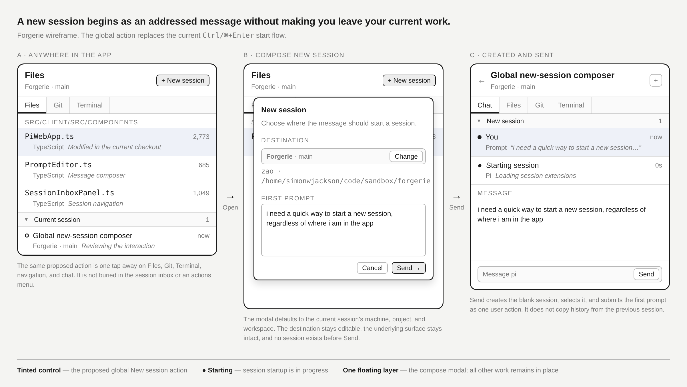

# Global New-Session Composer

## Summary

Replace the current direct Start Session action with a global new-session composer. One tap opens an addressed first prompt, defaults its destination from the current session, and creates and sends only when the user confirms.

---

## Problem Frame

Starting a session currently depends on app location. The session inbox exposes a new-session picker, while the global `Ctrl/⌘+Enter` action starts immediately only when a workspace is already selected. A user working in chat, Files, Git, Terminal, or navigation must remember which route applies and may need to leave the current surface before they can express the next task.

This friction matters most on touch devices. A hidden action-menu entry is technically global but does not provide the one-tap access needed when Forgerie is the user's daily control surface.

---

## Key Flows

- F1. Compose a new session from the current location
  - **Trigger:** The user taps the visible New session control or invokes the New session shortcut or command-palette action.
  - **Steps:** Forgerie opens the composer over the current surface, defaults the destination to the current session's machine, project, and workspace, accepts a first prompt, and lets the user send or cancel.
  - **Outcome:** Send creates and selects a new session and submits the prompt. Cancel returns to the unchanged underlying surface without creating a session.
  - **Covered by:** R1-R12

- F2. Change the destination before sending
  - **Trigger:** The user opens the destination control in the composer.
  - **Steps:** Forgerie lets the user choose an available machine, project, and workspace, then returns to the same first-prompt draft.
  - **Outcome:** The eventual session starts in the chosen destination, not the location from which the composer opened.
  - **Covered by:** R6-R9, R13

The wireframe is directional. The requirements below govern behavior if the final visual treatment differs.

---

## Requirements

**Global entry points**

- R1. New session is directly available from chat, Files, Git, Terminal, navigation, empty states, and any other first-party app surface.
- R2. Touch users can open New session with one visible tap. The action must not require opening the Actions palette, control sheet, or another menu first.
- R3. `Ctrl/⌘+Enter` opens the new-session composer and replaces the current immediate Start Session behavior.
- R4. The command palette exposes the same New session action. Every entry point opens the same interaction and follows the same destination and draft rules.
- R5. The visible action keeps a consistent name, icon, and accessible label when its placement adapts to the available container space. It must not cover or obstruct app content.

**Composer and destination**

- R6. Opening New session presents a modal composer over the current surface. Opening it does not navigate away, alter the current session, or modify the current session's existing prompt draft.
- R7. When a current session exists, the destination defaults to that session's machine, project, and workspace.
- R8. When no current session supplies a complete destination, the composer remains usable and requires the user to choose an available destination before sending.
- R9. Before sending, the user can change the machine, project, or workspace without losing the first-prompt draft.
- R10. The composer includes the destination, a first-prompt field, Cancel, and Send. Send is unavailable until the prompt is non-empty and the destination is valid.
- R11. Cancel closes the composer without creating a session and returns the user to the unchanged underlying surface.
- R12. The composer preserves its destination and first-prompt draft through destination changes, responsive layout changes, rotation, and fold or unfold transitions while it remains open.

**Creation, submission, and failure**

- R13. Send creates a new blank session in the selected destination, selects it, and submits the first prompt as one user action. The new session does not inherit history from the previous session.
- R14. After Send, the selected session surface shows truthful startup and prompt-submission progress rather than reporting success before the relevant stage completes.
- R15. If the destination becomes unavailable before Send, Forgerie keeps the first-prompt draft, explains that the destination must change or recover, and does not create a session against a different destination silently.
- R16. If session creation or first-prompt submission fails, the prompt remains recoverable, the failed stage is visible, and the interface provides a retry or destination-change path without claiming the prompt was sent.
- R17. Repeated activation while the composer is already open returns focus to the existing composer rather than opening another layer or creating another draft.

**Target-device behavior**

- R18. The visible action and modal remain usable across all four Galaxy Z Fold 8 posture viewports without overlap, clipping, or a change to an unrelated layout paradigm.
- R19. Completion requires visual and interaction validation on the physical Galaxy Z Fold 8 across folded and unfolded portrait and landscape postures, including at least one transition while the composer contains an unsent prompt.

---

## Acceptance Examples

- AE1. **Covers R1-R7.** Given the user is viewing Files for the current Forgerie session, when they tap New session or press `Ctrl/⌘+Enter`, the same modal opens over Files with that session's machine, project, and workspace selected and the existing session draft unchanged.
- AE2. **Covers R8, R10.** Given no session or complete workspace is selected, when the user opens New session, the modal opens in a destination-required state and cannot send until the user chooses a valid destination and enters a non-empty prompt.
- AE3. **Covers R9, R12.** Given a first prompt is present, when the user changes from the current workspace to another available workspace and then folds or rotates the device, the chosen destination and prompt remain present.
- AE4. **Covers R11.** Given the user opened the modal over Git and entered text, when they cancel, no session is created and Git returns with its previous selection and state intact.
- AE5. **Covers R13, R14.** Given a valid destination and prompt, when the user sends, one new blank session becomes selected and the prompt appears with truthful startup or submission progress until accepted.
- AE6. **Covers R15, R16.** Given the selected workspace goes offline or creation fails after the prompt is entered, when Send runs, the prompt remains recoverable, no false sent state appears, and the user can retry or choose another destination.
- AE7. **Covers R17.** Given the modal is already open, when another New session activation occurs, Forgerie focuses the existing modal and preserves its single draft.
- AE8. **Covers R18, R19.** Given the physical Fold in each supported posture, the user can open the modal in one tap, read and edit its destination and prompt, and send or cancel without controls overlapping; an unsent prompt also survives a posture transition.

---

## Success Criteria

- A user can begin an addressed first prompt from any app surface without first navigating to the session inbox.
- Touch activation is always one visible tap, and keyboard activation consistently uses `Ctrl/⌘+Enter`.
- Cancel, destination changes, responsive transitions, unavailable destinations, and failed starts do not lose or misdirect prompt text.
- Sending produces exactly one new blank session in the chosen destination and submits the first prompt without copying prior history.
- Physical-device acceptance verifies the full flow across all four Galaxy Z Fold 8 postures.
- Planning can proceed without inventing activation, default destination, cancellation, send, failure, or responsive behavior.

---

## Scope Boundaries

- No separate immediate-start shortcut or retained direct Start Session workflow.
- No session fork, copied history, summary transfer, or continuation of the current session's context.
- No redesign of the session inbox beyond routing its existing new-session affordance into the global interaction.
- No model or thinking-level selection in the first version; the created session uses normal session defaults.
- No attachment selection in the first version.
- No floating action button that overlays Files, Git, Terminal, chat, or plugin content.
- No requirement to add a measured Samsung Tab Ultra 11 viewport before that device's CSS viewport and device-pixel ratio are known.

---

## Key Decisions

- Addressed-message model: A session begins from a destination plus first prompt rather than from an empty session created in advance.
- One modal interaction: All visible, keyboard, and command-palette entry points converge on the same behavior.
- Current-session default: The existing session supplies location context, but the user can change it before sending.
- Send is the creation boundary: Opening or editing the composer has no session-side effects.
- Adaptive visible placement: The one-tap control may move with resident shell chrome, but it keeps one identity and does not overlay content.
- Blank-session semantics: Destination is inherited; conversation history is not.

---

## Dependencies / Assumptions

- Forgerie can enumerate available machines, projects, and workspaces through its existing navigation data.
- Session creation and queued first-prompt submission can expose their stages without reporting a prompt as sent prematurely.
- The modal can preserve an in-memory draft across responsive transitions while open without storing sensitive prompt text in client-accessible durable storage.

---

## Outstanding Questions

### Deferred to Planning

- [Affects R2, R5, R18][Technical] Determine the action's adaptive placement in each existing shell state while keeping it one tap away and avoiding a viewport breakpoint cliff.
- [Affects R3, R4][Technical] Determine how existing custom shortcut preferences for the replaced Start Session action continue or migrate without silently losing the user's binding.
- [Affects R14-R16][Technical] Map existing pending-session and queued-prompt behavior to the required truthful progress and recovery states.
