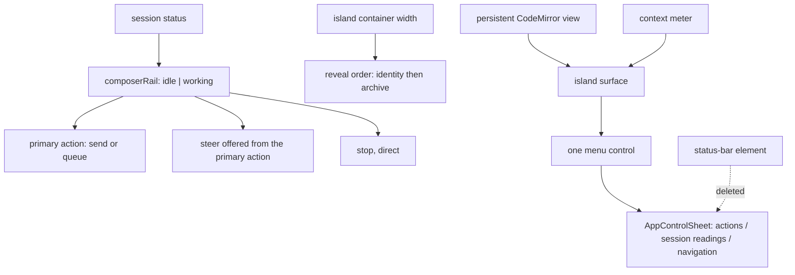

# feat: Floating composer island

## Summary

Reshape the existing composer into one inset island with a single control rail, absorb the
context meter into its top edge, fold the retired status-bar readings into the sheet the
composer already summons, and delete the status bar. The composer element keeps its identity
and its CodeMirror instance; what changes is its shape, its rail composition, and where the
occasional readings live.

---

## Problem Frame

Resident chrome above the transcript was removed by the content-first mobile chrome work
(`prototypes/mobile-chrome/README.md`), but the area below it was left as it was: a two-row
composer plus a permanent status bar. On the folded-portrait posture that area is the direct
competitor of the only region that matters for reading, and every new composer capability has
arrived as another band. Full pain framing lives in the origin requirements doc.

---

## Requirements

- R1. One inset floating island; transcript visible around it.
- R2. Resting single control line; grows only for draft, attachments, or a mode hint.
- R3. Less resident vertical space than composer plus status bar, at every posture.
- R4. No separate status bar at any pane size.
- R5. Context use stays visible on the island without a control row.
- R6. At most one control row; it never wraps; controls replace rather than accumulate.
- R7. Model and thinking are one control reporting both values.
- R8. Attachments and the summoned session controls share one rail control.
- R9. Idle offers send; streaming offers queue with steer plus direct stop; compacting offers queue and stop without steer; height unchanged.
- R10. Every existing capability reachable in one tap, or one tap plus one menu step.
- R11. Liveness stays in the transcript, not on a permanent row.
- R12. Tokens, cost, queued count, and the warning control remain available from the island menu.
- R13. Warning and notification signals stay perceivable, including announcements.
- R14. Draft editing, completions, prompt history, and draft persistence unchanged.
- R15. Attachment chips, delivery choice, and errors stay visible and operable.
- R16. Shell-mode and compaction hints stay visible and do not overlap controls.
- R17. Archived or disabled sessions still show a disabled input and its reason.
- R18. One composition at every size; no new viewport breakpoints in 499-979; no device sniffing.
- R19. Draft, attachments, scroll position, and open menu survive fold, rotate, keyboard.
- R20. Island stays above the on-screen keyboard; transcript keeps the rest.
- R21. Touch targets keep at least today's size; no overlap.
- R22. `npm run verify` passes and all four Fold 8 postures are captured and reviewed.

**Origin actors:** A1 (Forgerie user), A2 (Pi session)
**Origin flows:** F1 (write and send), F2 (act while the agent works), F3 (reach a retired status reading)
**Origin acceptance examples:** AE1 (R2, R3), AE2 (R6, R9), AE3 (R9, R10), AE4 (R4, R12), AE5 (R15), AE6 (R16), AE7 (R19, R20), AE8 (R18, R21)

---

## Scope Boundaries

- No response guidance, instruction presets, or model-facing prompt changes.
- No dictation behavior; the rail must leave room for it, not implement it.
- No transcript typography, message card, or reading-column changes.
- No navigation or session-inbox changes beyond the sheet absorbing retired readings.
- No retirement of width breakpoints outside the composer area (backlog `01KZKS6M89CS8JKQSN32JHXG1D`).
- No server, session daemon, or protocol changes.

### Deferred to Follow-Up Work

- Sheet swipe-down dismissal and animation polish: inherited from the chrome work's own deferral.
- A dedicated steer control at wide container widths: revisit after the posture review (see Open Questions).

---

## Context & Research

### Relevant Code and Patterns

- `src/client/src/components/PromptEditor.ts` — the composer. Owns the persistent CodeMirror `EditorView`, `promptComposerIsResting()`, the `.compact-status` row (model, thinking, identity, archive, summon), attachments, hints, and the send/steer/stop cluster. This is the element that becomes the island.
- `src/client/src/components/shared.ts` — `promptEditorStyles` (composer footer, resting rules, the two viewport media queries at 640px and 430px), `appStyles` (main column layout, `status-bar, context-usage-meter { flex: 0 0 auto }`, the `main:has(context-usage-meter) prompt-editor { --pi-composer-rule: transparent }` trick), and `controlSheetStyles`.
- `src/client/src/components/StatusBar.ts` — the bar to retire. Exports `statusBarWarningControlContent()`, consumed only by itself today.
- `src/client/src/components/ContextUsageMeter.ts` — 2 px rule plus `contextUsageWorthShowing()`; currently a sibling of the composer in the main column.
- `src/client/src/components/appShell/AppControlSheet.ts` — the summoned sheet: absolute inside `<main>`, scrim dismissal, context bar, main tabs, notification count. The island menu extends this rather than introducing a second overlay type.
- `src/client/src/components/PiWebApp.ts` — composition root. Renders chat view, context meter, prompt editor, status bar, control sheet; owns `sessionWarningVisibility`, `handleToggleWarnings`, `handleArchiveAndNext`, `handleOpenControlSheet`, and the model/thinking pickers.
- `src/client/src/appShell/shellLayoutMode.ts` + `appShellController.ts` — content-derived layout constants, `chromeDisclosure()`, `isChromeSummoned`. The island adds no new width axis; internal reveals come from container queries.
- `src/client/src/sessionStatusStrip.ts` — `sessionActivityIndicator()`, the single derivation of session status text, already consumed by the transcript liveness line.
- `src/client/src/utils/format.ts` — `formatTokenCount`, `formatCost`, needed by whatever renders the retired readings.
- Container-query precedents: `SessionInboxPanel.ts`, `WorkspaceAgentsPanel.ts`, `AskUserCard.ts`, and `chatStyles` in `shared.ts`.
- Test precedents: `src/client/src/components/PromptEditor.summonedChrome.test.ts` (template inspection), `src/client/src/components/PiWebApp.chromeDisclosure.test.ts` (asserts the meter sits above the bottom controls — this assertion changes), `src/client/src/components/appShell/AppControlSheet.test.ts`, `src/client/src/templateInspection.testSupport.ts`.
- `scripts/capture-postures.mjs` + `scripts/lib/cdp.mjs` — the four-posture capture path using CDP emulated viewports.

### Institutional Learnings

`docs/solutions/` does not exist. The equivalent records are:

- `prototypes/mobile-chrome/README.md` — measured chrome and transcript heights per posture, and the rejected alternatives (hairline bar, scroll-driven chrome, flex-overflow fit detection). Supplies the "before" numbers this plan re-measures against.
- `work/items/active/01KZKV9P4SJ69Z018FXQ6FVEJZ-content-first-mobile-chrome/plan.md` — landed predecessor. Establishes: delete a band rather than conditionally hide it; one derivation of session status; sheets are modals in behavior; archive moved into the composer specifically so the thread-header band could be deleted.
- `work/items/active/01KZKXSTMDPYHZQ2FDZJQAP5Y7-composer-live-dictation/plan.md` — the CodeMirror DOM must never be recreated on collapse or expand; this is a correctness constraint for touch, not a performance preference.
- `AGENTS.md` — acceptance postures, intrinsic design rules, the standing ban on new breakpoints inside 499-979 px, and the requirement to look at captures rather than only take them.
- `AGENTS.local.md` — rebuild and restart the systemd user units after user-facing changes land on `main`.

### External References

None. Local patterns are strong for every part of this work.

---

## Key Technical Decisions

- **The island is the composer's own shape, not a wrapper element**: `PromptEditor` already owns the draft, attachments, hints, and controls. Wrapping it would add a seam that only forwards properties, and would put a second element between the CodeMirror host and the layout. Cost: `PromptEditor` stays large; mitigated by extracting rail composition into a pure module.
- **The island keeps its own layout slot and is opaque**: it stays `flex: 0 0 auto` in the main column with a gutter around it, rather than floating over the transcript. Overlaying would require scroll padding, obscure the last message, and interact badly with the transcript's anchoring work. Cost: less literally "floating" than the reference screenshot.
- **The context meter moves inside the island's top edge**: today the shell blanks the composer's border with `--pi-composer-rule` so two hairlines do not stack. Inside the island the meter is the top edge by construction, so that coupling between `appStyles` and the composer border retires.
- **Retired readings join the existing summoned sheet**: a second overlay type would duplicate scrim, dismissal, and layering behavior that `AppControlSheet` already gets right. The sheet gains sections so it does not read as one undifferentiated list. Cost: the sheet takes on a second job and must not become a junk drawer.
- **One rail control opens that sheet, including attach**: it satisfies "one row, never wraps" at the narrowest posture and keeps a single mental model for "everything else". Cost: attaching a file becomes one tap plus one menu step.
- **Model and thinking merge into one capsule that opens a chooser**: they are always read together and each picker stays unchanged. Cost: switching model costs one extra step compared with today.
- **Identity and archive become container-width reveals**: the rail has a fixed priority order and reveals them when the island's own container affords it, with the sheet as their narrow-width home. This is what keeps R6 true without shrinking labels into codes.
- **Rail composition is a pure module**: idle versus working is a tagged union derived once from session status, not a set of booleans re-derived inside the render. It is testable on the fast node environment.
- **No new width axis in the shell**: reveals come from the island's own `container-type: inline-size`, never from viewport media queries, per AGENTS.md.

---

## Open Questions

### Resolved During Planning

- How is the island menu organised so attachments and status readings do not feel like one list? — Sections inside the existing sheet: actions first, session readings second, existing navigation last.
- Is the island opaque or translucent over the transcript? — Opaque, in its own layout slot; see Key Technical Decisions.
- What does the rail reveal as width grows? — Fixed priority order: menu, model and thinking, primary action, stop always; then session identity; then archive.
- Where does the before/after height measurement come from? — Re-measured with the existing CDP posture script rather than derived from CSS.

### Deferred to Implementation

- A dedicated steer control at wide container widths is follow-up work after the posture review; this implementation keeps steer in the primary action's menu at every width.
- Whether the sheet needs its own internal scroll once it carries readings as well as navigation: decide when the sections exist.
- Exact resting height of the island after the gutter is applied: it depends on the final padding, and R3 is verified by measurement, not by prediction.

---

## High-Level Technical Design

> *This illustrates the intended approach and is directional guidance for review, not implementation specification. The implementing agent should treat it as context, not code to reproduce.*



Island composition, at rest and in hand:

```
[ context meter — the island's top edge                         ]
[ draft text (CodeMirror, never recreated)                      ]
[ menu | model · thinking | (identity) | (archive) | primary | stop ]
```

---

## Implementation Units

### U1. Rail composition as a pure module

**Goal:** One derivation of what the rail offers, from session status, expressed as a tagged union rather than booleans re-read inside the render.

**Requirements:** R6, R9

**Dependencies:** None

**Files:**
- Create: `src/client/src/composerRail.ts`
- Test: `src/client/src/composerRail.test.ts`

**Approach:**
- Model the rail as a tagged union with an idle case and a working case, derived from the inputs the composer already receives: streaming, compacting, sending, stoppable, and disabled.
- Expose the primary action (send or queue), whether steer is available, and whether stop is live, so the render reads named cases instead of recomputing `canSteer || isCompacting`.
- Keep it free of Lit and DOM so it runs on the default node environment.
- Follow the flat domain-module convention used by `src/client/src/chatFollowMode.ts` and `src/client/src/sessionStatusStrip.ts`.

**Patterns to follow:**
- `src/client/src/chatFollowMode.ts` for a tagged union plus pure transition helpers.
- `promptComposerIsResting()` in `src/client/src/components/PromptEditor.ts` for an exported pure predicate with a small input object.

**Test scenarios:**
- Happy path: idle session with a draft yields the send primary action, with steer unavailable and stop not live.
- Happy path: streaming session yields the queue primary action with steer available and stop live.
- Edge case: compacting session yields queue without steer, because steering has nothing to steer.
- Edge case: sending in flight keeps the primary action present but not invocable.
- Edge case: archived or disabled session yields no invocable action.
- Edge case: stoppable without streaming (queued work only) still offers stop.

**Verification:**
- The composer render can name its state without arithmetic on booleans, and the module's cases cover every combination the session status can produce.

---

### U2. Island surface, context edge, and container queries

**Goal:** The composer renders as one inset island with a gutter around it, absorbs the context meter as its top edge, and replaces its viewport media queries with container queries.

**Requirements:** R1, R2, R5, R18, R20, R21

**Dependencies:** None

**Files:**
- Modify: `src/client/src/components/shared.ts` (`promptEditorStyles`, `appStyles`)
- Modify: `src/client/src/components/PromptEditor.ts`
- Modify: `src/client/src/components/PiWebApp.ts`
- Modify: `src/client/src/components/ContextUsageMeter.ts`
- Test: `src/client/src/components/PromptEditor.island.test.ts`
- Test: `src/client/src/components/PiWebApp.chromeDisclosure.test.ts`

**Approach:**
- Give the composer host a gutter and draw the island as an inset surface with a radius, a border, and the sheet's shadow language, keeping it in the main column's flex slot rather than overlaying the transcript.
- Declare `container-type: inline-size` on the island so every internal decision reads its own width.
- Replace the `640px` and `430px` viewport media queries in `promptEditorStyles` with container queries expressed against the island.
- Render the context meter inside the island's top edge and stop rendering it as a sibling in `PiWebApp`; retire the `main:has(context-usage-meter) prompt-editor` rule and the `--pi-composer-rule` blanking it depends on.
- Keep the persistent CodeMirror host and the resting behavior exactly as they are: the island changes the box, not the editor lifecycle.
- Preserve the safe-area inset handling so the island clears the home indicator and the on-screen keyboard.

**Patterns to follow:**
- `controlSheetStyles` in `src/client/src/components/shared.ts` for radius, border, and shadow language.
- `SessionInboxPanel.ts` and `WorkspaceAgentsPanel.ts` for `container-type: inline-size` plus `@container` rules.
- `promptComposerIsResting()` for the untouched resting contract.

**Test scenarios:**
- Happy path: with a context reading above the visibility threshold, the meter renders inside the composer and not as a sibling of it.
- Happy path: below the threshold, no meter renders and the island still has a top edge.
- Edge case: an empty unfocused draft keeps the resting single-line composition.
- Edge case: focus or a non-empty draft expands the island without recreating the editor host.
- Integration: the shell no longer renders a `context-usage-meter` element between the transcript and the composer.
- Integration: no `@media (max-width: …)` rule remains in the composer's styles.

**Verification:**
- At every posture the island reads as one surface with a gutter, and the only hairline between transcript and controls is the island's own edge.

---

### U3. State-swapped primary action, steer, and stop

**Goal:** The rail offers send when idle and queue with steer plus a direct stop while working, using U1, without changing island height.

**Requirements:** R6, R9, R10

**Dependencies:** U1, U2

**Files:**
- Modify: `src/client/src/components/PromptEditor.ts`
- Modify: `src/client/src/components/shared.ts`
- Test: `src/client/src/components/PromptEditor.rail.test.ts`

**Approach:**
- Drive the action cluster from the rail state instead of the current inline conditionals, so send and queue occupy the same slot rather than sitting side by side.
- Offer steer from the primary action rather than as a separate always-present control, keeping the same handler and streaming behavior it has today.
- Keep stop a direct control whenever work can be stopped.
- Keep the accessible names explicit for each state so assistive technology reports queue, steer, and stop distinctly.

**Patterns to follow:**
- The existing send, steer, and stop handlers and their `title` and `aria-label` conventions in `PromptEditor.ts`.
- `src/client/src/components/PromptEditor.summonedChrome.test.ts` for template-level assertions on rendered controls.

**Test scenarios:**
- Happy path: idle session renders one primary action that sends.
- Happy path: streaming session renders the queue action and invoking steer from it calls the steer path with the same behavior as today.
- Edge case: compacting session queues and does not offer steer.
- Edge case: stop is disabled when nothing is running and enabled when it is.
- Edge case: a disabled or archived session offers no invocable action.
- Integration: switching from idle to working does not change the number of rendered control rows.

**Verification:**
- Sending, queueing, steering, and stopping all behave as they do today, with one control fewer on the rail while idle.

---

### U4. Merged model and thinking control

**Goal:** One capsule reports the current model and thinking level and routes to the existing pickers.

**Requirements:** R7, R10

**Dependencies:** U2

**Files:**
- Modify: `src/client/src/components/PromptEditor.ts`
- Modify: `src/client/src/components/shared.ts`
- Modify: `src/client/src/components/PiWebApp.ts`
- Test: `src/client/src/components/PromptEditor.modelThinking.test.ts`

**Approach:**
- Replace the separate model button and thinking gauge with one capsule that shows both current values and truncates the model name rather than wrapping.
- Opening the capsule presents the two destinations and routes to the existing model and thinking pickers unchanged.
- Keep the thinking gauge glyph as the capsule's secondary mark so the current level stays readable at a glance.
- Keep the existing callbacks so `PiWebApp` remains the owner of both pickers.

**Patterns to follow:**
- `renderThinkingGauge()` and `thinkingLevelLabel()` usage in `PromptEditor.ts`.
- `command-picker` invocation from `PiWebApp.ts` for both pickers.

**Test scenarios:**
- Happy path: the capsule reports the session's model and thinking level.
- Happy path: choosing the model destination opens the model picker; choosing thinking opens the thinking picker.
- Edge case: a session with no model reports the absent state without breaking the rail.
- Edge case: a very long model identifier truncates instead of wrapping the rail.
- Integration: picking a model or thinking level still updates the session through the existing paths.

**Verification:**
- Both pickers remain reachable and unchanged, and the rail spends one slot where it used to spend two.

---

### U5. Island menu: attachments, retired readings, warnings

**Goal:** One rail control opens the summoned sheet, and that sheet gains an actions section and a session-readings section.

**Requirements:** R8, R10, R12, R13, R15

**Dependencies:** U2

**Files:**
- Modify: `src/client/src/components/appShell/AppControlSheet.ts`
- Modify: `src/client/src/components/shared.ts` (`controlSheetStyles`)
- Modify: `src/client/src/components/PromptEditor.ts`
- Modify: `src/client/src/components/PiWebApp.ts`
- Test: `src/client/src/components/appShell/AppControlSheet.test.ts`
- Test: `src/client/src/components/PromptEditor.menu.test.ts`

**Approach:**
- Collapse today's separate attach button and summon button into one rail control that opens the sheet.
- Give the sheet three labelled sections so it does not read as one list: actions (attach files, archive and next when it is not on the rail), session readings (input and output tokens, cost, queued count, and the warning control), then the existing navigation content.
- Move the warning toggle's rendering into the sheet while keeping `PiWebApp` as the owner of warning visibility and the transcript as the place the warnings themselves appear.
- Reuse `formatTokenCount` and `formatCost` rather than re-deriving any reading, and keep attachment chips, delivery choice, and errors inside the island itself.
- Register the sheet with the modal layer registry if it is not already, so global shortcuts stay suppressed while it is open.

**Patterns to follow:**
- `AppControlSheet`'s existing scrim, dismissal, and section composition.
- `statusBarWarningControlContent()` from `src/client/src/components/StatusBar.ts` — move it with the behavior rather than rewriting it.
- `src/client/src/components/modalLayerRegistry.ts` for modality registration.

**Test scenarios:**
- Happy path: opening the menu from the rail opens the sheet.
- Happy path: the sheet reports input tokens, output tokens, cost, and queued count for the current session.
- Happy path: the warning control in the sheet toggles warning visibility through the same handler the status bar used.
- Edge case: a session with no warnings does not render a warning control.
- Edge case: a session with no queued messages omits the queued reading rather than showing zero.
- Edge case: choosing attach from the sheet opens the file picker and dismisses the sheet.
- Integration: attachment chips, delivery choice, and errors still render inside the island, not in the sheet.

**Verification:**
- Every reading and action the status bar carried is reachable in one tap plus one menu step, and the sheet reads as three sections rather than one list.

---

### U6. Delete the status bar

**Goal:** The status-bar element stops existing.

**Requirements:** R4, R11, R13

**Dependencies:** U5

**Files:**
- Delete: `src/client/src/components/StatusBar.ts`
- Delete: `src/client/src/components/StatusBar.test.ts`
- Modify: `src/client/src/components/PiWebApp.ts`
- Modify: `src/client/src/components/shared.ts` (`appStyles`, `statusBarStyles`)
- Test: `src/client/src/components/PiWebApp.chromeDisclosure.test.ts`
- Test: `src/client/src/components/PiWebApp.warningVisibility.test.ts`

**Approach:**
- Remove the element, its import, its render method, and the keyboard-open guard that only existed to hide it.
- Remove `status-bar` from the shell's layout selectors and delete `statusBarStyles` once nothing references it, so knip stays clean.
- Preserve `statusBarWarningControlContent()` in its new home from U5 rather than deleting it with the component.
- Confirm the transcript's liveness line remains the only continuous status signal, using the existing single derivation.

**Patterns to follow:**
- The predecessor work's rule: delete a band rather than conditionally hide it.

**Test scenarios:**
- Integration: the shell renders no `status-bar` element at any pane width.
- Integration: session liveness still renders inside the transcript while work is running.
- Integration: warning and notification announcements still reach the live regions after the bar is gone.
- Edge case: opening the on-screen keyboard no longer needs a special case to hide a bottom band.
- Edge case: warning visibility toggling still works from its new home, replacing the status-bar-based assertions.

**Verification:**
- `npm run verify` passes with no unused exports or dead styles, and nothing below the transcript remains except the island.

---

### U7. Container-width reveals for identity and archive

**Goal:** The rail reveals session identity and archive as its own container affords them, and never wraps at the narrowest posture.

**Requirements:** R6, R10, R18, R21

**Dependencies:** U3, U4, U5

**Files:**
- Modify: `src/client/src/components/shared.ts` (`promptEditorStyles`)
- Modify: `src/client/src/components/PromptEditor.ts`
- Test: `src/client/src/components/PromptEditor.reveal.test.ts`

**Approach:**
- Define one priority order for the rail: menu, model and thinking, primary action, and stop are always present; session identity reveals next; archive and next reveals last.
- Express the reveals as container queries against the island, with no viewport media query and no device check.
- Keep archive reachable from the sheet whenever it is not on the rail, so the triage loop never disappears.
- Keep the rail a single non-wrapping row in every case.

**Patterns to follow:**
- `@container` usage in `SessionInboxPanel.ts` and `WorkspaceAgentsPanel.ts`.
- The existing archive conditions in `PromptEditor.ts` so a dead control is never shown.

**Test scenarios:**
- Happy path: archive is invocable from the rail when revealed, and from the sheet when it is not.
- Edge case: a session that cannot be archived shows no archive control in either place.
- Edge case: a long session label truncates rather than pushing controls out of the row.
- Integration: the composer's styles contain container queries and no viewport media queries.

**Verification:**
- At 499 px the rail holds its core controls on one row; at wider container widths identity and then archive appear without any layout paradigm change.

---

### U8. Posture measurement, captures, and changeset

**Goal:** Prove the space claim and the posture behavior, and record the user-visible change.

**Requirements:** R3, R19, R20, R22

**Dependencies:** U2, U3, U4, U5, U6, U7

**Files:**
- Create: `.changeset/floating-composer-island.md`
- Modify: `prototypes/mobile-chrome/README.md`

**Approach:**
- Measure resident height below the transcript before and after, per posture, with the existing CDP posture script rather than deriving numbers from CSS.
- Capture all four postures and read the images, judging overlap, wrapping, truncation, and the gutter.
- Exercise the transitions by hand on the device: fold, unfold, rotate, and keyboard open and close, with a draft and a pending attachment in place and the menu open.
- Record the measured before and after numbers beside the predecessor's table so the two chrome reductions read as one story.

**Patterns to follow:**
- `scripts/capture-postures.mjs` and the CDP emulated-viewport rule from AGENTS.md.
- The measured-height table in `prototypes/mobile-chrome/README.md`.

**Test scenarios:**
- Test expectation: none — this unit is measurement, capture review, and documentation. The behavior it checks is covered by U1 through U7 unit tests plus manual device acceptance.

**Verification:**
- Each posture shows a smaller resident area than before, the four captures are reviewed rather than only taken, and the recorded transitions preserve draft, attachments, scroll position, and menu state.

---

## System-Wide Impact

- **Interaction graph:** `PiWebApp` keeps ownership of warnings, archive, pickers, and sheet visibility; the island fires callbacks upward. The chat view keeps its own warning toggle and liveness line.
- **Error propagation:** attachment capture errors keep surfacing inside the island; no error path moves into the sheet.
- **State lifecycle risks:** the persistent CodeMirror view must survive every island state change; recreating it would lose draft selection and break touch gestures.
- **API surface parity:** none. This work is client-only and changes no wire contract.
- **Integration coverage:** the shell's render order changes when the meter moves inside the island and the status bar disappears; the existing chrome-disclosure test asserts the old order and must be updated deliberately rather than deleted.
- **Unchanged invariants:** draft persistence keys, prompt history, autocomplete behavior, attachment delivery preference storage, the model and thinking pickers, `sessionActivityIndicator()` as the single status derivation, and `shellLayoutMode` thresholds all stay as they are.

---

## Risks & Dependencies

| Risk | Mitigation |
|------|------------|
| Sibling worktrees touch the same composer files | Rebase against `main` immediately before editing `PromptEditor.ts` and `shared.ts`; land units in small commits |
| The island rebuilds the CodeMirror host on state change | Change only the surrounding box and visibility; assert the editor host survives expansion in U2's tests |
| The sheet becomes a junk drawer | Three named sections, with the ordering fixed in U5 and reviewed in the posture captures |
| Attach costs one extra step | Accepted; revisit only if the posture review shows it hurting a common flow |
| Rail wraps at 499 px once identity or archive appear | Reveals are container-driven and tested; U7 verification checks the narrowest posture explicitly |
| Space claim asserted rather than proven | U8 measures before and after per posture with the existing CDP script |

---

## Documentation / Operational Notes

- Add a changeset describing the island and the retired status bar as one user-visible change.
- Record measured before and after heights beside the predecessor table in `prototypes/mobile-chrome/README.md`.
- After landing on `main`, follow `AGENTS.local.md`: `npm run build`, then restart the `forgerie-sessiond` and `forgerie-web` user units, checking first that no session is mid-run.

---

## Sources & References

- **Origin document:** `work/items/active/01KZQD4T7N8B2K5M9V1XW3PH6C-floating-composer-island/requirements.md`
- Design record: `work/items/active/01KZQD4T7N8B2K5M9V1XW3PH6C-floating-composer-island/island-states.png`
- Predecessor plan: `work/items/active/01KZKV9P4SJ69Z018FXQ6FVEJZ-content-first-mobile-chrome/plan.md`
- Measured baselines: `prototypes/mobile-chrome/README.md`
- Sibling constraint: `work/items/active/01KZKXSTMDPYHZQ2FDZJQAP5Y7-composer-live-dictation/plan.md`
