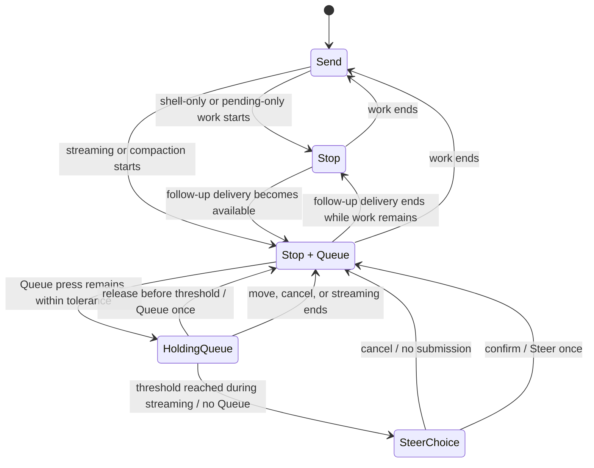

# fix: Align composer working controls

## Summary

Revise the existing composer rail around truthful idle, stop-only, and queue-capable states. Send and Stop share the primary slot, Queue remains direct only while the server accepts follow-up delivery, and the existing press and popover patterns provide a discoverable, confirmable held-Queue path to Steer.

---

## Problem Frame

The capability refactor left the real active-work value on a dead host binding while declaring Stop stoppable whenever the runtime was available. The composer therefore renders Send and Stop as separate controls even when the session is idle. The current visible Steer button also gives a secondary action equal weight with the more valuable Queue action.

---

## Requirements

- R9. Idle shows Send without Stop. Stoppable work replaces Send with Stop in the same slot. Queue appears beside Stop only while the server accepts follow-up delivery during streaming or compaction. Shell-only and pending-only work show Stop without Queue, and the draft stays intact until submission is available again. Steer is available only during streaming.
- R10. Touch, mouse, keyboard, and assistive-technology users can reach the same actions. While streaming, Queue includes a subtle secondary-action cue plus tooltip and accessible text for the held-Steer path. During compaction, Queue remains a plain follow-up action without a Steer cue or hold behavior. Short Queue activation queues. Holding Queue while streaming reveals Steer without submitting. Steer requires confirmation, cancellation returns to Queue, and one interaction cannot trigger two actions.
- R14. Draft editing, completion, prompt history, and session-scoped persistence remain unchanged.
- R17. Archived or otherwise disabled sessions keep a disabled input and its reason.
- R18. The control composition responds to its container without new viewport breakpoints inside or near the current 475–932 px Fold 8 posture range.
- R21. Stop and Queue keep the established touch target size and do not overlap other rail controls.
- R22. Repository verification passes, and all four Fold 8 posture captures are reviewed.

**Origin actors:** A1 (Forgerie user), A2 (Pi session)
**Origin flow:** F2 (act while the agent works)
**Origin acceptance examples:** AE2 (Send/Stop and Queue state transition), AE3 (short Queue versus held Queue disclosure and confirmed Steer)

---

## Scope Boundaries

- No server, daemon, protocol, queue-ordering, or Stop-semantics changes.
- No draft, attachment, completion, or CodeMirror ownership changes.
- No permanent third Steer control.
- No viewport, user-agent, touch-capability, or device-model branching.
- No generic press-gesture framework or refactor of the existing session-row hold interaction.
- No unrelated composer or floating-island cleanup.

---

## Context & Research

### Relevant Code and Patterns

- `src/client/src/composerRail.ts` centralizes the rail state but still models Send becoming Queue and Stop as an independent flag.
- `src/client/src/components/PromptEditor.ts` renders Queue and Steer together, then renders Stop as a separate sibling. It owns the composer's existing anchored disclosures and their lifecycle.
- `src/client/src/components/PiWebApp.ts` computes the real active-work condition but sends runtime availability into the Stop capability. Its separate `canStop` binding is no longer consumed.
- `src/client/src/composerCapabilities.ts` already separates capability existence from whether the action is currently stoppable.
- `src/server/sessions/piSessionService.ts` applies follow-up queue behavior only while streaming or compacting; shell-only and pending-only work are stoppable but not queue-capable.
- `src/client/src/rowPress.ts` and `src/client/src/components/SessionInboxPanel.ts` establish a 500 ms hold, 10 px movement tolerance, timer cancellation, and consumed-click suppression.
- `src/client/src/components/ComposerPopover.ts` establishes the anchored disclosure, outside-press dismissal, Escape handling, placement, and focus-restoration callback.
- `src/client/src/components/PromptEditor.escape.test.ts` establishes fake-timer testing in this component and verifies that Escape retains direct Stop parity with Pi.
- `src/client/src/components/PromptEditor.rail.test.ts` is the component-boundary home for rail rendering and interaction assertions.

### Institutional Learnings

- The CodeMirror host must survive every rail transition. Only the action subtree may change.
- A successful hold ends with a synthetic click. The hold must consume that click or Queue will also submit.
- Long-press controls must suppress browser callouts and abandon the hold when pointer movement indicates scrolling.
- Stop is an emergency action. Queue disclosure state must never disable or hide Stop.
- A hidden hold action needs a visible cue plus a pre-activation accessible description; expanded state alone does not make Steer discoverable.
- The current acceptance matrix is 704 × 783, 932 × 553, 475 × 638, and 711 × 374 CSS pixels.

### External References

None. The repository contains direct patterns for the state derivation, held interaction, anchored disclosure, accessibility, and tests.

---

## Key Technical Decisions

- **Model idle, stop-only, and queue-capable cases explicitly:** The first slot is Send or Stop. Queue visibility and Steer disclosure availability are separate fields. Streaming and compaction are queue-capable; shell-only and pending-only work are stop-only.
- **Derive stoppability once at the chat composition boundary:** Streaming, running shell work, compaction, or pending queued messages make work stoppable when the runtime is available. The Stop capability carries that value; the dead `canStop` binding is removed. Queue capability remains derived from streaming or compaction so the client matches server delivery semantics.
- **Keep hold interpretation composer-specific:** A small pure module names the Queue press outcomes and uses the established 500 ms threshold and 10 px movement tolerance. It does not turn the session-row contract into a generic gesture framework.
- **Reuse the composer’s one anchored disclosure layer:** Holding Queue opens a single-action Steer confirmation through the existing popover. Model, thinking, guidance, and Steer disclosures remain mutually exclusive.
- **Disclose the secondary action before activation:** While `canSteer` is true, Queue carries a subtle secondary-action indicator. Its tooltip and accessible description state that holding Queue reveals Steer. Compaction Queue omits the cue and all Steer disclosure paths.
- **Support each input path deliberately:** Pointer hold serves touch and mouse. Holding Space or Enter on the focused Queue control follows the same threshold. Right-click or the platform context-menu action opens the same disclosure as a non-timed alternative. Untracked synthetic activation continues to Queue for assistive technology.
- **Keep submission and emergency control independent:** Queue is disabled during its own in-flight submission, but Stop remains available. Opening or closing Steer never mutates the draft.

---

## Open Questions

### Resolved During Planning

- **Hold threshold:** Use the established 500 ms threshold and 10 px movement tolerance. A shorter threshold increases accidental disclosure without adding a new user capability.
- **Steer surface:** Reuse the existing anchored composer popover with one explicit confirmation action.
- **Keyboard path:** Holding Space or Enter reveals Steer. The context-menu action provides an additional non-timed route.
- **Invalidation:** Cancel a pending hold and close Steer without restoring stale focus when streaming ends, the session changes, runtime controls disappear, or the component disconnects.
- **Posture source:** Use the current Fold 8 viewport matrix in `AGENTS.md`, not the older dimensions preserved in the first island plan.
- **Queue scope:** Keep Queue client-only and show it only during streaming or compaction, matching the server's existing follow-up semantics. Shell-only and pending-only work show Stop without a submission action.
- **Steer discoverability:** While streaming, add a subtle secondary-action indicator inside Queue plus tooltip and accessible text such as “Queue message; hold for Steer.” During compaction, keep Queue plain because Steer is unavailable.

### Deferred to Implementation

- Exact internal names for the press state and rail case fields may follow the clearest types found during implementation.
- Exact popover and accessible wording may follow the existing composer choice language, provided it communicates the held-Steer path before activation and keeps the confirmation action named “Steer current response.”

---

## High-Level Technical Design

> *This illustrates the intended approach and is directional guidance for review, not implementation specification. The implementing agent should treat it as context, not code to reproduce.*

The persistent draft remains outside this state machine. Only the action slot, Queue control, and temporary Steer disclosure change.

---

## Implementation Units

### U9. Make stoppable work the rail’s source of truth

**Goal:** Fix the lost active-work state and derive one explicit rail contract for Send, Stop, Queue, and Steer availability.

**Requirements:** R9, R14, R17; F2; AE2

**Dependencies:** None

**Files:**
- Modify: `src/client/src/composerRail.ts`
- Modify: `src/client/src/components/PiWebApp.ts`
- Modify: `src/client/src/components/PromptEditor.ts`
- Modify: `src/client/src/components/promptEditorTestSupport.ts`
- Test: `src/client/src/composerRail.test.ts`
- Test: `src/client/src/components/PromptEditor.rail.test.ts`
- Test: `src/client/src/components/PiWebApp.composerControls.test.ts`

**Approach:**
- Replace the old Send-or-Queue primary-action model with explicit idle, stop-only, and queue-capable rail cases.
- In the idle case, render Send and no Stop or Queue. In every stoppable case, put Stop in Send’s slot. Render Queue beside Stop only while streaming or compacting.
- Keep Steer availability as metadata for U10. It is true only while streaming and never renders a direct Steer button.
- Let Enter submit normally while idle and queue a follow-up while queue-capable. During shell-only or pending-only work, return the existing `rejected` submit outcome from `PromptEditor` before `onSend` runs. Do not use `submissionDisabled` or disable the draft: text, attachments, delivery choice, completion, and editing remain active until delivery becomes available again.
- Feed the Stop capability the actual active-work condition from the selected session. Remove both dead `canStop` bindings and stale comments.
- Keep Stop invocable when Queue submission is busy. Disabled or archived sessions retain visible but non-invocable controls only when stoppable work exists.

**Execution note:** Start with failing pure rail tests and a component-boundary reproduction of idle Send plus resident Stop.

**Patterns to follow:**
- `src/client/src/composerRail.ts` for pure state conversion.
- `src/client/src/components/promptEditorTestSupport.ts` for one shared chat-capability fixture.
- `ComposerDraftSubmitOutcome` in `src/client/src/components/ComposerDraft.ts` for preserving a snapshot when the host returns `rejected`.
- Existing selected-chat composition tests in `src/client/src/components/PiWebApp.chatOpening.test.ts` for mounting real app state without replacing the component under test.

**Test scenarios:**
- Covers AE2. Idle runtime: Send exists; Stop and Queue are absent.
- Covers AE2. Streaming starts: Send is replaced by Stop in the same primary group; Queue appears; no direct Steer control appears.
- Covers AE2. Work ends: Stop and Queue leave; Send returns; the persistent draft element remains the same node.
- Happy path: compaction yields Stop plus Queue without Steer availability.
- Happy path: running shell-only and pending-only work each yield Stop without Send, Queue, or Steer; Enter returns `rejected`, does not call `onSend`, and preserves text, attachments, delivery choice, and prompt history.
- Preservation edge case: stop-only state still permits draft edits, completion, attachment add or remove, and delivery-choice changes.
- Edge case: streaming with a Queue submission in flight disables Queue but leaves Stop invocable.
- Edge case: archived or disabled stoppable session invokes neither Stop nor Queue.
- Integration: an idle selected session maps to `stoppable: false`; streaming, shell, compaction, and pending-message states map to `stoppable: true`.
- Regression: the removed `canStop` property binding is not needed to update the rail.

**Verification:**
- One named state controls all rail rendering. Idle renders Send, queue-capable work renders Stop plus Queue, and other stoppable work renders Stop without exposing an unsupported submission path.

---

### U10. Reveal confirmed Steer from a held Queue action

**Goal:** Add the secondary held-Queue interaction without accidental Queue submission, inaccessible paths, or competing composer layers.

**Requirements:** R9, R10, R14; F2; AE3

**Dependencies:** U9

**Files:**
- Create: `src/client/src/composerQueuePress.ts`
- Test: `src/client/src/composerQueuePress.test.ts`
- Modify: `src/client/src/components/PromptEditor.ts`
- Modify: `src/client/src/components/shared.ts`
- Test: `src/client/src/components/PromptEditor.rail.test.ts`
- Test: `src/client/src/components/PromptEditor.runtimeControls.test.ts`

**Approach:**
- Put threshold, movement tolerance, and press outcomes in a pure composer-specific module. Keep timers, pointer capture, consumed-click state, and disclosure ownership inside `PromptEditor`.
- Only when `rail.canSteer` is true, arm the pointer or keyboard hold, render the cue and held-Steer description, and route context-menu activation to Steer. During compaction, Queue remains a plain follow-up button for any press duration.
- Arm pointer hold only for primary-button presses. Track origin and abandon the hold when movement exceeds tolerance or cancellation occurs. A short activation follows the existing Queue submission path.
- When the hold threshold fires, reveal Steer, consume the release click, and release pointer capture so the disclosure can receive the next action.
- On the first non-repeat Space or Enter keydown, prevent the native button action and arm one hold timer. Ignore `event.repeat`. Resolve the owned press on keyup, blur, cancellation, or state invalidation, and suppress any following native click. Preserve untracked click activation for assistive technology.
- Prevent the browser context menu and touch callout on the streaming Queue control. Before right-click or a keyboard context-menu action opens Steer, cancel any pending hold and suppression state so the disclosure opens exactly once.
- Render the secondary-action indicator inside the existing streaming Queue target. Give it pre-activation tooltip and accessible text that explain the held-Steer path without reducing its touch target.
- Anchor the disclosure to Queue. Focus the confirmation action when it opens. Escape or outside activation closes it without submission and restores Queue focus when Queue is still valid. Confirmation submits Steer once, closes the layer, and returns focus to the draft.
- Close other composer disclosures before Steer opens. Close and clean up Steer when streaming ends, the session changes, runtime controls disappear, or the component disconnects.
- Do not disable Stop while a hold is pending or the Steer disclosure is open.

**Execution note:** Implement the press outcomes and gesture arbitration test-first. Time, movement, and synthetic-click ordering are the regression surface.

**Patterns to follow:**
- `src/client/src/rowPress.ts` for pure threshold and movement interpretation.
- `src/client/src/components/SessionInboxPanel.ts` for timer cleanup, pointer capture, and consumed-click suppression.
- `src/client/src/components/ComposerPopover.ts` for placement, outside dismissal, Escape, and focus restoration.
- `src/client/src/components/PromptEditor.escape.test.ts` for fake-timer setup and cleanup.

**Test scenarios:**
- Covers AE3. Releasing Queue before 500 ms submits one follow-up and never opens Steer.
- Covers AE3. Holding Queue through 500 ms opens Steer, submits nothing on release, and suppresses the following synthetic click.
- Covers AE3. Confirming the disclosed action submits one Steer message and not a follow-up.
- Covers AE3. Escape and outside activation close Steer without submission or draft mutation.
- Pointer edge case: movement beyond 10 px cancels the hold and does not disclose Steer.
- Pointer edge case: pointer cancellation and component disconnection clear timers and pending suppression state.
- Mouse edge case: secondary-button pointerdown does not arm a hold; context-menu activation cancels pending press state, opens Steer once, and never queues.
- Keyboard happy path: short Space or Enter queues once; holding it reveals Steer and key release does not queue.
- Keyboard edge case: repeated Space or Enter keydowns arm one timer, open at most one disclosure, and cannot queue before or after held disclosure.
- Accessibility path: before activation, streaming Queue's accessible description identifies the held-Steer path; untracked button activation queues, context-menu activation reveals Steer, and Queue reports its expanded state and controlled disclosure.
- Compaction path: Queue has no Steer cue or description; long pointer or key activation and context-menu activation do not disclose Steer, while ordinary activation queues exactly once.
- State transition: streaming ending during a pending hold or open Steer disclosure closes it without stale focus restoration.
- Layer ordering: opening Steer closes model, thinking, or guidance disclosure; opening another composer disclosure closes Steer.
- Emergency path: Stop remains invocable while the Queue hold is pending and while Steer is open.
- Disabled path: a disabled Queue cannot arm a hold, open Steer, or submit.

**Verification:**
- Each input path produces exactly one observable result: Queue, reveal, confirmed Steer, or cancellation. No path can produce two.

---

### U11. Verify posture behavior and record the fix

**Goal:** Prove the revised controls across the acceptance matrix, record the user-visible fix, and update the running local instance after landing.

**Requirements:** R18, R21, R22; AE2, AE3

**Dependencies:** U9, U10

**Files:**
- Create: `.changeset/swap-send-stop.md`

**Approach:**
- Add a patch changeset written for users. Do not edit `CHANGELOG.md` directly.
- Capture and inspect all four Fold 8 CSS viewports in idle, stop-only, and queue-capable states. Also inspect the Steer disclosure at the narrowest and shortest postures.
- Verify that Stop occupies Send’s position, the Queue cue remains legible inside a full touch target, the rail never wraps, and the disclosure stays reachable without covering Stop.
- Exercise fold, unfold, rotation, and keyboard transitions with a draft present and Steer open. The draft, transcript position, and composer ownership must survive.
- Run the repository verification gate. Because this is user-facing work on `main`, rebuild and restart the local user services after confirming that no session is mid-run, then smoke-test the local HTTP endpoint and running UI.

**Patterns to follow:**
- `AGENTS.md` for the current posture matrix and required image review.
- `AGENTS.local.md` for build, restart, and local smoke-test requirements.
- `.agents/skills/changeset-changelog/SKILL.md` for a patch changeset and user-facing release note.

**Test scenarios:**
- Covers AE2. Each posture shows only Send while idle, Stop plus Queue while queue-capable, and Stop only during other stoppable work, with no overlap or third resident action.
- Covers AE3. The Steer confirmation remains visible and operable at 475 × 638 and 711 × 374.
- Transition: fold, unfold, rotate, and open or close the keyboard while the draft and Steer disclosure exist; state remains coherent and no unrelated layout paradigm appears.
- Test expectation: visual and operational verification complements the automated behavior tests in U9 and U10.

**Verification:**
- `npm run verify` passes. All required captures are read and accepted. The rebuilt local instance serves the corrected interaction.

---

## System-Wide Impact

- **Interaction graph:** Selected session status flows through `PiWebApp` into the Stop capability, while streaming and compaction continue to define queue-capable delivery. The pure rail state carries both facts into `PromptEditor`; Queue and Steer continue through the existing draft submission callback.
- **Error propagation:** Submission failures keep their existing controller path. The hold and disclosure add no new remote failure mode.
- **State lifecycle risks:** Timers, pointer capture, synthetic-click suppression, focus, and the disclosure must reset on session and runtime transitions. The draft owner must never disconnect.
- **API surface parity:** Wire payloads and streaming behavior values remain unchanged. Only the browser interaction that selects follow-up or Steer changes.
- **Integration coverage:** Pure rail tests cannot prove the host capability mapping. A real `PiWebApp` component test must cover idle and active selected-session states.
- **Unchanged invariants:** Stop restores queued text according to its current contract. Queue ordering, draft persistence, attachments, completions, model choice, guidance, and Escape-to-stop behavior stay unchanged.

---

## Risks & Dependencies

| Risk | Mitigation |
|------|------------|
| A held Queue also fires its release click and queues | Use the proven consumed-click pattern and test timer-to-release ordering |
| Custom keyboard handling breaks native button or screen-reader activation | Own only tracked Space/Enter presses; keep ordinary click activation and context-menu disclosure |
| Stop disappears because stoppability is confused with runtime availability again | Derive the condition once at the composition boundary and cover it through a real app component test |
| The disclosure remains open after streaming ends or session selection changes | Invalidate it from lifecycle updates and component cleanup |
| Stop plus Queue crowds the folded rail | Keep Steer non-resident, keep its cue inside Queue, and review idle, stop-only, queue-capable, and disclosed captures at 475 px and 711 px |
| Another composer popover competes with Steer | Preserve the one-layer invariant and test cross-disclosure replacement |
| User-facing changes run from stale built output | Follow the local rebuild and restart rule after landing on `main` |

---

## Documentation / Operational Notes

- Add a patch changeset for the corrected Send, Stop, Queue, and Steer interaction.
- Do not edit `CHANGELOG.md`; release tooling consumes the changeset.
- The origin requirements now use the current Fold 8 dimensions from `AGENTS.md`.
- After landing on `main`, rebuild and restart `forgerie-sessiond.service` and `forgerie-web.service` only when no session is mid-run. Confirm the local endpoint and inspect the running UI.

---

## Sources & References

- **Origin document:** `work/items/active/01KZQD4T7N8B2K5M9V1XW3PH6C-floating-composer-island/requirements.md`
- Rail state: `src/client/src/composerRail.ts`
- Composer surface: `src/client/src/components/PromptEditor.ts`
- Chat composition root: `src/client/src/components/PiWebApp.ts`
- Hold precedent: `src/client/src/rowPress.ts`
- Hold integration: `src/client/src/components/SessionInboxPanel.ts`
- Anchored disclosure: `src/client/src/components/ComposerPopover.ts`
- Testing guidance: `.agents/skills/testing-guide/SKILL.md`
- Release-note guidance: `.agents/skills/changeset-changelog/SKILL.md`
