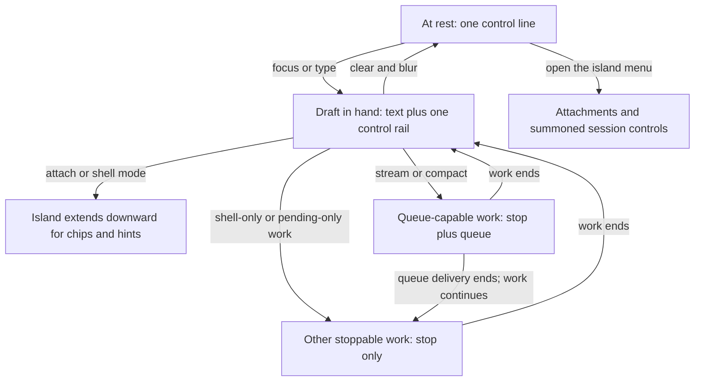

# Floating Composer Island

## Summary

Replace the docked composer and the bottom status bar with one floating composer island that
holds every existing composer capability. The island rests at one control line, grows only
when the draft needs room, and swaps its controls by session state instead of adding rows.

---

## Problem Frame

The area below the transcript has grown by accumulation. A focused composer already spends two
stacked rows on the draft and its controls, a separate status bar sits under it, and each new
capability arrives as another band. On the acceptance device's folded portrait posture
(475 × 638 CSS px) this area is the direct competitor of the only region that matters for
reading.

The bottom status bar is the clearest symptom. It reports token counts, cost, queued messages,
and a warning toggle on a permanent row that the reader crosses on every turn, while the
liveness reading it also carries already exists inside the transcript. Recent work removed the
resident chrome above the transcript for the same reason; the space below it never received the
same treatment.

The visual reference is an inset floating island rather than a full-width docked bar, and the
current stacking pattern cannot absorb one more control without feeling crowded.

---

## Actors

- A1. Forgerie user: writes, attaches, sends, steers, and stops work from a touch-first PWA.
- A2. Pi session: reports model, thinking level, streaming state, queued messages, context use, cost, and warnings that the composer area surfaces.

---

## Key Flows

- F1. Write and send
  - **Trigger:** A1 taps the island at rest.
  - **Actors:** A1, A2
  - **Steps:** The island grows to hold the draft, keeps one control rail, and offers send while the session is idle.
  - **Outcome:** The prompt is sent and the island returns to its resting height when the draft clears.
  - **Covered by:** R1-R3, R6, R9, R14

- F2. Act while the agent works
  - **Trigger:** A2 starts work that can be stopped.
  - **Actors:** A1, A2
  - **Steps:** Send becomes Stop in place. Queue appears beside it only while the server accepts follow-up delivery during streaming or compaction. A short Queue press submits a follow-up. During streaming, holding Queue reveals Steer without submitting it; A1 confirms Steer separately or cancels back to Queue.
  - **Outcome:** A1 can always stop stoppable work, can queue directly when follow-up delivery is supported, and can reach the lower-priority Steer action without a third resident control or a taller island.
  - **Covered by:** R6, R9, R10

- F3. Reach a retired status reading
  - **Trigger:** A1 wants token use, cost, queued count, or warnings.
  - **Actors:** A1
  - **Steps:** A1 opens the island's secondary menu and reads the values or opens the warning area.
  - **Outcome:** No permanent row is spent on readings that are consulted occasionally.
  - **Covered by:** R4, R8, R12, R13

---

## Requirements

**Island shape and reclaimed space**

- R1. The composer renders as one floating island inset from the pane edges, with the transcript visible around it, matching the supplied floating reference rather than a full-width docked bar.
- R2. At rest the island occupies a single control line. It grows only for a multi-line draft, pending attachments, or an active mode hint, and it returns to the resting height when those clear.
- R3. Total resident vertical space between the transcript and the pane's bottom edge is lower than today's composer plus status bar in every supported posture, at rest and while a single-line draft is in hand.
- R4. No separate status bar renders below the composer at any pane size.
- R5. Context use remains visible on the island itself using today's visibility threshold and reading, without occupying a control row.

**One control rail**

- R6. Control rows never accumulate. The island exposes at most one row of controls, that row never wraps, and new or state-specific controls replace or collapse existing ones rather than adding a row.
- R7. Model and thinking level are one control that reports both current values and opens the existing pickers.
- R8. Attachment actions and the summoned session controls are reachable from a single control on the rail.
- R9. While the session is idle, the rail offers Send and does not show Stop. While work can be stopped, Send becomes Stop in the same slot. Queue appears beside Stop only while the server accepts follow-up delivery during streaming or compaction. Shell-only and pending-only work show Stop without Queue, and the draft remains intact until submission is available again. Steer is available only while a response is streaming. Island height is identical in every state.
- R10. Every current composer capability remains reachable with touch, mouse, and keyboard. While streaming, Queue includes a subtle secondary-action cue plus tooltip and accessible text that explain that holding it reveals Steer. During compaction, Queue remains a plain follow-up action without a Steer cue or hold behavior. A short Queue activation submits a follow-up. Holding Queue while streaming reveals Steer without submitting it. Steer requires separate confirmation, cancellation returns to Queue, and one interaction cannot both queue and reveal Steer.

**Retired status bar content**

- R11. Session liveness continues to be reported inside the transcript; the island does not restate it on a permanent row.
- R12. Input tokens, output tokens, cost, queued message count, and the session warning control remain available from the island's secondary menu, and the warning area can still be opened and closed from there.
- R13. Warning and notification signals remain perceivable, including their assistive-technology announcements, after the status bar is removed.

**Preserved composer behavior**

- R14. Draft editing keeps today's behavior: markdown editing, file and slash-command completion, model completion, prompt history navigation, and session-scoped draft persistence.
- R15. Pending attachments, the delivery choice, and attachment errors remain fully visible and operable, extending the island downward while they exist.
- R16. Shell-command mode and compaction hints remain visible and do not displace or overlap rail controls.
- R17. An archived or otherwise disabled session still shows a disabled input and its reason.

**Device and layout behavior**

- R18. The island uses one composition at every size, sized by the space it is given. No new viewport breakpoints are introduced inside or near the 475–932 px posture range, and no user-agent or device-model checks drive its layout.
- R19. Draft text, pending attachments, transcript scroll position, and any open island menu survive fold, unfold, rotation, and keyboard open or close.
- R20. With the on-screen keyboard open, the island remains fully visible above the keyboard and the transcript keeps the remaining space.
- R21. Interactive controls keep at least today's touch-target size and never overlap each other or the draft text at any supported posture.
- R22. `npm run verify` passes, and all four Galaxy Z Fold 8 posture viewports are captured and visually reviewed before this work is called done.

---

## Acceptance Examples

- AE1. **Covers R2, R3.** Given an empty draft and an unfocused composer, when the session is open at 475 × 638, the island shows one control line and the transcript has more visible height than it does today.
- AE2. **Covers R6, R9.** Given an idle session with Send visible, when streaming or compaction starts, Send becomes Stop in the same position, Queue appears beside it, no third action appears, and the island's height is unchanged. Given shell-only or pending-only work, the same slot shows Stop without Queue and a draft cannot submit until delivery is available again. When work ends, Stop becomes Send and Queue leaves the rail.
- AE3. **Covers R9, R10.** Given a streaming session and a draft, when A1 activates Queue briefly, the draft is queued. When A1 holds Queue, no message is submitted and Steer is revealed. Confirming Steer submits it once; cancelling restores Queue without changing the draft.
- AE4. **Covers R4, R12.** Given a session with recorded token use, cost, and one warning, when A1 opens the island's secondary menu, all of those readings are present and the warning area can be opened from there.
- AE5. **Covers R15.** Given two pending attachments, when A1 opens the island, the chips, the delivery choice, and any error are fully visible and the control rail still fits on one row.
- AE6. **Covers R16.** Given a draft that begins with a shell prefix, when the composer enters shell mode, the mode hint is visible and no rail control is covered.
- AE7. **Covers R19, R20.** Given a draft, a pending attachment, and an open island menu on the folded screen, when the device is unfolded and rotated with the keyboard open, the draft, attachment, scroll position, and menu state all survive and the island stays above the keyboard.
- AE8. **Covers R18, R21.** Given each of the four Fold posture viewports, when the island renders, its composition is the same, its controls do not overlap, and no width-keyed layout switch occurs inside the posture range.

---

## Success Criteria

- The reader gains transcript height at every posture while every composer capability stays reachable.
- Adding a future composer capability does not require another row; it either collapses into the rail or joins the island's menu.
- The bottom status bar can be deleted without a user losing access to any reading it carried.
- Physical acceptance on the Galaxy Z Fold 8 confirms the island across all four postures and their transitions.
- Planning can sequence implementation without inventing island states, control placement, or what happens to retired status readings.

---

## Scope Boundaries

- No response guidance, session instruction presets, or prompt injection work; that follows separately.
- No new dictation behavior. The island must leave room for the separate live-dictation work, but does not implement it.
- No transcript typography, message card, or reading-column changes.
- No changes to navigation or the session inbox. The summoned control sheet may gain an actions section and a session-readings section, but its existing navigation content and behavior stay as they are.
- No retirement of the existing legacy width breakpoints outside the composer area.
- No server, session daemon, or protocol changes.

---

## Key Decisions

- One floating island instead of stacked bands: it is the shape the reference asks for and it makes "no new rows" a structural rule rather than a habit.
- Replace controls by state rather than reveal them additively: Send and Stop share one slot, Queue appears only when the server accepts follow-up delivery, and Steer stays behind Queue's held disclosure. The rail preserves direct access to supported working actions without carrying three equal controls.
- Model and thinking merge into one capsule: they are always read together and each pickers' behavior is unchanged.
- Retired status readings move under a menu rather than into the transcript: they are consulted occasionally, and the transcript already carries the reading that matters continuously.
- One composition at every size: this follows the project's intrinsic design rules and avoids a second desktop-only design. The cost is that roomy panes get a composer built for a narrow one, mitigated only by revealing more inside the same rail as space allows.
- Stop stays direct but not resident: it replaces Send only while work can actually be stopped. This keeps its position predictable without showing an inert control during idle time.
- Queue stays first-class while follow-up delivery is supported; shell-only and pending-only work show Stop without Queue. Steer is second-class because it is used less often. A subtle cue and accessible description disclose the held-Queue path, and confirmation prevents an accidental hold from submitting a different action.

---

## Dependencies / Assumptions

- The composer keeps its existing resting behavior, draft persistence, autocomplete, and attachment capture; this work changes their container, not their contracts.
- The summoned session-controls surface already exists and can absorb the retired status readings.
- Session liveness inside the transcript already exists and is the only continuous status signal needed.
- The context usage reading and its visibility threshold already exist and remain unchanged.
- The composer area is client-only; no upstream-adoption surfaces are touched.

---

## Outstanding Questions

### Deferred to Planning

- [Affects R8, R12][Technical] Decide how the island's secondary menu is organised so that attachments and the retired status readings do not feel like one undifferentiated list.
- [Affects R1][Technical] Decide whether the island is opaque or partly translucent over the transcript, and how it behaves at the scroll boundary.
- [Affects R6, R18][Technical] Decide what the rail reveals as available width grows, given that one composition must serve every size.
- [Affects R3][Needs research] Measure the current resident height per posture before and after, so the space claim is verified rather than asserted.

---

## Design Record

`island-states.png` in this folder draws the three island states at the folded-portrait width with
real session values. `island-states.html` is its source; rendering it again requires the
`wireframe-sheet` skill's stylesheet beside it.
