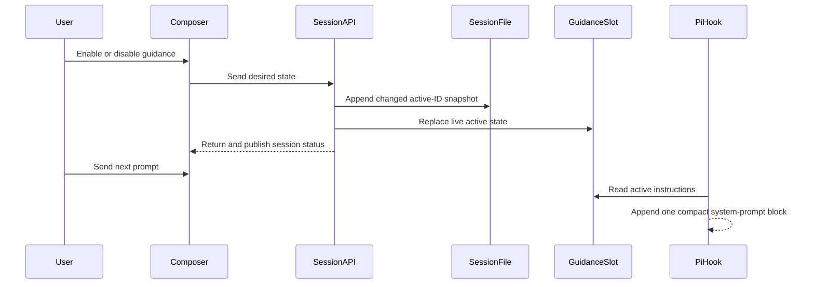

# feat: Add session guidance

## Summary

Add a compact guidance control to the floating composer. Store the active selection in the Pi session file, restore it through a hidden runtime extension, and add only the active instruction to the system prompt at each new agent turn.

---

## Problem Frame

A user can state a working preference in chat, but the preference can weaken as the session grows. Putting the preference in `AGENTS.md` makes it apply outside the current session. Repeating it in user messages adds noise and spends more context.

Forgerie needs a session control that stays visible, survives reloads, and changes the model-facing system prompt without changing the user message. The control must fit the floating composer without adding another row.

---

## Requirements

**Scope and catalog**

- R1. Guidance is optional, additive, and scoped to one Pi session. It does not read or change `AGENTS.md`.
- R2. Version 1 contains one built-in entry named `Technical English`. Its description states that it uses short, direct sentences and consistent terms. Its server-only instruction requires ASD-STE100 Simplified Technical English.
- R3. The design supports several active entries and preserves activation order. The first active entry remains the named anchor until the user disables it.
- R4. The rail shows `Guidance` when no entry is active. It shows the first active name and `+N` when more entries are active. It never shows `+0`, wraps, or adds a row.
- R5. Tapping the rail control opens a picker above the composer. The picker shows each entry's name, description, and active state. It closes after a successful selection.
- R6. The UI does not expose skills or prompt templates as guidance concepts. Future server-only instructions can refer to them.

**Persistence, runtime, and API**

- R7. The latest active-ID snapshot is stored as a versioned Pi custom session entry. Empty snapshots persist clearing. Guidance survives browser reload, web restart, sessiond restart, runtime reload, archive, and restore.
- R8. Guidance applies through Pi's `before_agent_start` system-prompt hook. It does not change the user message, add a transcript message, or use a custom message entry.
- R9. With no active guidance, the effective system prompt is unchanged. With active guidance, one compact block contains only active instruction text in activation order.
- R10. A change during an active response does not change that response. It applies at the next `before_agent_start` boundary. The open picker states this next-turn effect while the agent works.
- R11. A session-tree fork inherits the source session's active guidance. A normal new session starts with no guidance.
- R12. Guidance state travels in the existing session-status contract. Status polling and `status.update` events keep reloads and other browser clients consistent. An open picker renders external status changes without closing.
- R13. The enable or disable mutation is idempotent. A no-op does not append a session entry. Invalid IDs, invalid desired states, read-only sessions, and persistence failures do not change live state.

**Composer interaction and layout**

- R14. The picker remains available while the agent works. Archive and restore preserve guidance. Version 1 does not open an archived runtime only to inspect guidance; the user restores the session before inspection.
- R15. While a guidance mutation is pending, the user cannot submit another guidance mutation or send a prompt. Success closes the picker. Failure keeps the previous state and gives a clear retry path. The browser aborts the request after 10 seconds so the lockout is bounded.
- R16. The guidance control stays visible at rest and while editing. Model text truncates, and session identity and archive controls yield before guidance when space is limited.
- R17. The picker supports keyboard and touch use. Escape closes it. An outside activation closes it without swallowing that activation. Focus moves into the picker and returns to the trigger after Escape or a successful selection.
- R18. Opening guidance closes prompt completion UI and does not recreate the CodeMirror editor. Session changes and component removal close the picker and remove temporary listeners.
- R19. Layout responds to the composer container. It adds no viewport breakpoint or device check. The picker stays anchored through fold, unfold, rotation, and keyboard changes.

**Verification**

- R20. `npm run verify` passes. Rest, focused, working, and picker-open states are captured and reviewed at 704 × 783, 932 × 553, 475 × 638, and 711 × 374 CSS pixels.

---

## Scope Boundaries

- No guidance authoring or editing UI.
- No global or project guidance defaults.
- No automatic conversion of skills or prompt templates into guidance entries.
- No model, thinking-level, or tool presets.
- No model-facing custom tool that lets the agent change its own guidance.
- No new authentication boundary. The mutation uses Forgerie's existing trusted, session-scoped HTTP boundary and federated route allowlist.
- No `Prototype early` entry in version 1.
- No unrelated composer-border, control-sheet, notification, or navigation cleanup.
- No changes to transcript content or draft persistence.

### Deferred to Follow-Up Work

- Add more built-in guidance entries after their names, descriptions, and model-facing rules are defined.
- Add user-authored guidance only if a later product decision requires it.

---

## Context & Research

### Relevant Code and Patterns

- `src/client/src/components/PromptEditor.ts` owns the persistent CodeMirror editor and the floating island rail. Its local state is the correct owner for a temporary picker.
- `src/client/src/components/shared.ts` defines the island's container queries, one-row rail, and anchored autocomplete menu.
- `src/client/src/components/PiWebApp.ts` passes selected-session state and callbacks into the composer.
- `src/client/src/composerRail.ts` keeps working-state actions separate from secondary rail accessories. Guidance must not add another rail state axis there.
- `src/client/src/controllers/sessionController.ts` uses selected-session and selected-machine guards when it applies mutation responses.
- `src/client/src/api/clients.ts` and `src/client/src/api/parsers.ts` are the browser contract boundary.
- `src/server/sessions/sessionRoutes.ts` uses session-scoped POST routes for model, thinking, warnings, and queue mutations.
- `src/server/sessions/piSessionService.ts` owns writable-session checks, entry-mutation guards, status publication, runtime creation, reload, and rebind.
- `src/server/sessions/processBridge.ts` and `src/server/sessions/sessionTitleBridge.ts` establish the per-runtime slot plus hidden inline-extension pattern.
- `src/shared/apiTypes.ts` defines `SessionStatus`, which already rehydrates selected-session state through polling and live status events.
- Pi SDK 0.83.0 custom session entries are excluded from model context. Its preset example restores the latest custom state in `session_start` and chains system-prompt changes in `before_agent_start`.
- `work/items/active/01KZQD4T7N8B2K5M9V1XW3PH6C-floating-composer-island/requirements.md` requires one rail row, container-owned layout, and preserved composer behavior.

### Institutional Learnings

- `docs/solutions/` does not exist. Repository decisions live in `AGENTS.md`, active work items, and `prototypes/mobile-chrome/README.md`.
- The composer must keep its CodeMirror DOM. Recreating it can break touch editing and focus.
- Daemon memory is not a durable source. Session-scoped state must be recoverable from the Pi session file.
- The current island already hides model details at rest and reveals identity and archive through container queries. Guidance must extend this priority model instead of adding a row.
- The user selected an anchored picker above the composer. This is an intentional exception to the existing bottom-sheet pattern. The picker must own its dismissal and focus behavior as one contained component.
- `AGENTS.local.md` requires a build and a safe restart of the web and sessiond user services after user-facing work lands on `main`.

### External References

- No external research is required. The pinned Pi SDK and current Forgerie patterns define the needed contracts.

---

## Key Technical Decisions

| Decision | Rationale | Cost |
|---|---|---|
| Keep public catalog metadata in a shared guidance domain module and instruction text in the server module | The client needs names and descriptions, but it must not receive or render model-facing instructions | Adding an entry requires coordinated shared and server changes |
| Store full active-ID snapshots as versioned Pi custom entries | The state follows the session file through reload, archive, restore, and tree forks; custom entries do not enter model context | The session log is append-only; idempotent no-ops must not write |
| Treat the latest matching entry as authoritative | Clearing and later schema changes cannot revive older guidance | A malformed latest entry resolves to empty rather than falling back |
| Read all session entries, not only the active branch | Guidance is session-scoped and must not change during tree navigation | Branch-local guidance is not supported |
| Use a per-runtime guidance slot and hidden inline extension | This follows the existing bridge pattern and lets the server update the next hook without rebuilding the runtime | Reload and rebind must clear and restore the slot carefully |
| Add active IDs to `SessionStatus` | Existing polling and status events already solve reload and multi-client synchronization | A small ID list travels with status updates |
| Mutate one entry by ID plus desired enabled state | The server computes activation order and makes retries idempotent | The API does not support bulk replacement |
| Persist first, then update the live slot | A failed session-file append cannot leave active guidance that will disappear on restart | The slot setter must be non-throwing |
| Keep picker state inside `PromptEditor` | The picker is temporary, anchored to the composer, and must close on session ownership changes | The component gains contained disclosure and focus logic |
| Block prompt submission while a guidance change is pending | A user cannot send a prompt before the server applies the selected guidance | Queue or send waits for one short local API request |
| Keep guidance outside `composerRail` | Guidance does not change with idle, streaming, or compacting state | `PromptEditor` composes the accessory beside the rail state |

---

## Open Questions

### Resolved During Planning

- Which entries ship in version 1? — `Technical English` only. `Prototype early` is removed.
- Does a tree fork inherit guidance? — Yes. It continues the source conversation and its active guidance.
- Where does the picker open? — Above the composer, as shown in the approved wireframe.
- Where is state stored? — In versioned Pi custom session entries, not a separate Forgerie JSON store.
- How does the client rehydrate state? — Through the existing `SessionStatus` path.
- Can the agent change its own guidance? — No. The human-facing session mutation is not exposed as a model tool.

### Resolved During Implementation

- Pi tree forks need an explicit inherited snapshot after rebind. A persistence failure reports an activity error but does not turn a completed fork into a failed fork.
- The rail keeps the existing 560 px and 700 px container thresholds. Guidance stays resident and the existing identity and archive controls yield at those thresholds.
- A contained Lit picker above the composer provides Escape, outside activation, focus return, status re-rendering, and listener cleanup without a modal or bottom sheet.

---

## High-Level Technical Design

> *This illustrates the intended approach and is directional guidance for review, not implementation specification. The implementing agent should treat it as context, not code to reproduce.*



The persistence rule is a sequence of complete snapshots:

```text
no entry                     -> no active guidance
snapshot [technical-english] -> Technical English active
snapshot []                  -> guidance cleared
```

---

## Implementation Units

### U1. Define the guidance domain and compact prompt text

**Goal:** Create one source of truth for public guidance metadata, activation order, persisted snapshots, and server-only instruction text.

**Requirements:** R1-R4, R6-R9, R13

**Dependencies:** None

**Files:**
- Create: `src/shared/sessionGuidance.ts`
- Create: `src/shared/sessionGuidance.test.ts`
- Create: `src/server/sessions/sessionGuidance.ts`
- Create: `src/server/sessions/sessionGuidance.test.ts`

**Approach:**
- Define the public entry ID, name, and description in the shared module. Keep the model-facing instruction in the server module.
- Ship only `Technical English`. Require ASD-STE100 Simplified Technical English with short sentences, one idea per sentence, plain words, and stable terms.
- Provide pure operations that enable or disable an ID while preserving first activation order and preventing duplicates.
- Derive the rail summary from ordered active entries. Keep the `+N` behavior generic so later catalog entries do not require a composer redesign.
- Store versioned full snapshots. Restore the latest matching entry from the full session entry list. Deduplicate known IDs in first-seen order. Drop unknown IDs.
- Treat a malformed or unsupported latest snapshot as empty. Do not search backward and revive stale guidance.
- Build one bounded active-only prompt block. Return no override when the active set is empty.

**Execution note:** Implement the pure state and prompt behavior test-first.

**Patterns to follow:**
- `src/client/src/composerRail.ts` for a small pure domain module.
- Persisted custom-entry parsing near subsession recovery in `src/server/sessions/piSessionService.ts` for defensive unknown-data handling.
- The Pi SDK preset example for latest-entry restoration and chained system-prompt changes.

**Test scenarios:**
- Happy path: no active IDs produces the `Guidance` summary and no prompt block.
- Happy path: enabling Technical English produces that label and one concise instruction block.
- Edge case: enabling an already active ID or disabling an inactive ID reports no state change.
- Edge case: synthetic multiple entries preserve activation order and produce `first name +N`; re-enabling appends the ID after entries that stayed active.
- Edge case: duplicate and unknown restored IDs are removed while known first-seen order stays intact.
- Error path: an unsupported version or malformed latest snapshot resolves to empty and does not revive an older valid snapshot.
- Edge case: an empty latest snapshot clears older active guidance.
- Token boundary: descriptions, inactive entries, UI-only names, and custom-entry data do not enter the compiled prompt block.

**Verification:**
- Public metadata and server instructions have a clear boundary.
- All activation, restoration, summary, and prompt rules are proven without DOM or runtime setup.

---

### U2. Persist and inject guidance through the Pi runtime

**Goal:** Restore guidance from the session file, update it without rebuilding the runtime, and append it at the system-prompt hook.

**Requirements:** R7-R11, R13-R14

**Dependencies:** U1

**Files:**
- Create: `src/server/sessions/sessionGuidanceBridge.ts`
- Create: `src/server/sessions/sessionGuidanceBridge.test.ts`
- Modify: `src/server/sessions/piSessionService.ts`
- Test: `src/server/sessions/piSessionService.guidance.test.ts`

**Approach:**
- Add a per-runtime slot beside the process and session-title slots. It exposes a non-throwing active-state replacement and a defensive snapshot.
- Add a hidden inline extension through `extensionFactories`. On `session_start`, clear the slot and restore the latest snapshot from `ctx.sessionManager.getEntries()` before status publication.
- On `before_agent_start`, append the compact block to the event's current system prompt. Return no result when guidance is empty so other prompt content remains byte-for-byte unchanged.
- Dispose or clear the slot during shutdown, runtime failure, reload, and session rebind.
- Add a service mutation that validates the built-in ID and desired state, checks writability, and uses the existing session-entry mutation guard.
- Compute, append, and install a changed snapshot without an asynchronous gap. A no-op returns current status without writing. Append before slot replacement.
- Publish the recomputed status after a successful change.
- Preserve active guidance in a session-tree fork. Use the SDK's copied custom entries when verified; otherwise add one inherited snapshot in the existing fork transaction.

**Patterns to follow:**
- `src/server/sessions/processBridge.ts` for slot ownership and disposal.
- `src/server/sessions/sessionTitleBridge.ts` for a hidden inline extension.
- `createDefaultRuntimeFactory()` and runtime rebind handling in `src/server/sessions/piSessionService.ts`.
- `runSessionEntryMutation()` for exclusion with tree navigation.

**Test scenarios:**
- Happy path: session start with a saved active snapshot restores the slot before the first prompt hook.
- Happy path: active guidance appends one block to the prompt produced by earlier extensions.
- Happy path: two guided agent starts each receive one block; no block accumulates in session or transcript state.
- Edge case: empty guidance returns no prompt override.
- Edge case: changing guidance during an active response leaves that response unchanged and affects the next `before_agent_start` boundary.
- Edge case: a no-op mutation appends no custom entry and still returns current status.
- Error path: append failure leaves the live slot and returned state unchanged.
- Error path: an unknown ID, non-writable session, or active tree navigation changes neither persisted nor live state.
- Lifecycle: runtime reload, sessiond restart, archive, and restore recover the latest snapshot, including an empty clear.
- Lifecycle: a session-tree fork inherits active guidance; a normal new session has none.
- Lifecycle: runtime rebind cannot leak the prior session's slot state.

**Verification:**
- Guidance survives every required session lifecycle from the session file alone.
- Only `before_agent_start` changes the model-facing prompt, and no user or transcript message changes.

---

### U3. Carry guidance through status and the session API

**Goal:** Let the browser change guidance through an idempotent session mutation and receive authoritative active IDs through existing status flows.

**Requirements:** R3, R7, R10-R15

**Dependencies:** U1, U2

**Files:**
- Modify: `src/shared/apiTypes.ts`
- Modify: `src/server/sessions/sessionRoutes.ts`
- Test: `src/server/sessions/sessionRoutes.test.ts`
- Modify: `src/client/src/api.ts`
- Modify: `src/client/src/api/clients.ts`
- Modify: `src/client/src/api/parsers.ts`
- Modify: `src/client/src/controllers/sessionController.ts`
- Test: `src/client/src/controllers/sessionController.guidance.test.ts`

**Approach:**
- Add the ordered active guidance IDs to `SessionStatus`. Accept an absent field as empty for compatibility with an older daemon response.
- Add one session-scoped POST mutation with an entry ID and desired enabled state. Reuse cwd and machine scoping, request validation, and mutation error mapping.
- Return the recomputed `SessionStatus`. Publish the same status to session and global streams so other browsers update through existing handlers.
- Add the client parser and request method. Reject invalid wire values and normalize active IDs through the shared catalog rules.
- Add one controller method that applies the returned status only when session, machine, and request generation are still current.
- Do not optimistically replace active IDs. Keep one mutation pending per mounted composer, so same-browser responses cannot arrive out of order.

**Patterns to follow:**
- Model, thinking-level, queue, and warning routes in `src/server/sessions/sessionRoutes.ts`.
- `dismissWarning()` in `src/client/src/controllers/sessionController.ts` for machine and selection guards.
- `parseSessionStatus()` in `src/client/src/api/parsers.ts` for compatible optional fields.

**Test scenarios:**
- Happy path: valid enable and disable requests return status with the authoritative ordered IDs.
- Integration: a successful mutation publishes `status.update` to the session and global event streams.
- Error path: unknown ID, missing or non-Boolean desired state, wrong cwd, read-only session, and persistence failure return a clear error and keep state unchanged.
- Compatibility: status without the guidance field parses as empty.
- Error path: invalid field types are rejected; unknown IDs are removed.
- Race: a response received after session or machine selection changes does not alter the new selection.
- Race: a stale same-session response cannot replace newer state.
- Multi-client: one browser mutation updates another browser through the existing status event path.

**Verification:**
- No new client state store or guidance-specific socket event is needed.
- Polling, mutation responses, and live events agree on the same active-ID order.

---

### U4. Add the anchored picker and stable rail summary

**Goal:** Make guidance visible and operable from the floating composer without adding height or weakening editor behavior.

**Requirements:** R2-R6, R12, R14-R20

**Dependencies:** U1, U3

**Files:**
- Create: `src/client/src/components/GuidancePicker.ts`
- Test: `src/client/src/components/GuidancePicker.test.ts`
- Modify: `src/client/src/components/PromptEditor.ts`
- Modify: `src/client/src/components/shared.ts`
- Modify: `src/client/src/components/PiWebApp.ts`
- Test: `src/client/src/components/PromptEditor.guidance.test.ts`
- Test: `src/client/src/components/PromptEditor.island.test.ts`
- Test: `src/client/src/components/PiWebApp.guidance.test.ts`
- Create: `.changeset/session-guidance.md`

**Approach:**
- Render a text capsule in the compact status area. It stays visible at rest and in working states. Use `Guidance`, `Technical English`, or `first name +N` from the pure summary helper.
- Keep the capsule on one line. Let model text truncate. Reveal identity and archive only after the container has room for guidance and all primary controls.
- Render a focused anchored picker above the composer. List public names and descriptions with clear selected and pending states. Do not render instruction text or skill/prompt metadata.
- Keep temporary open and pending state inside `PromptEditor`. Close on successful selection, Escape, session change, and disconnect. Keep the picker open on mutation failure and show an announced retry state.
- Clear autocomplete before opening. Close guidance before actions that leave or replace the composer flow.
- Disable send or queue and duplicate guidance activation while the mutation is pending. Keep stop available.
- Do not open an archived runtime only for picker inspection. Preserve guidance through archive and restore, then show the picker after restore.
- Manage document listeners and focus as one contained disclosure lifecycle. Outside activation closes without losing the target activation or forcing focus back to the trigger.
- Add active-ID content comparison to the composer's status equality check so per-token status objects do not re-render CodeMirror.
- Use only container queries and intrinsic sizing. Keep the picker open and re-anchored through posture changes.
- Add a patch changeset that describes persistent session guidance for users. Do not edit `CHANGELOG.md`.

**Execution note:** Start with failing component tests for the summary, picker lifecycle, and pending-send guard. Keep the existing CodeMirror instance mounted throughout.

**Patterns to follow:**
- `src/client/src/components/AutocompleteMenu.ts` and `autocompleteStyles` for an upward anchored list.
- `src/client/src/components/CommandPicker.ts` for option labels, descriptions, keyboard navigation, and selected-state conventions, without using its modal surface.
- Existing container-query reveal rules in `promptEditorStyles`.
- `src/client/src/components/PromptEditor.summonedChrome.test.ts` and template inspection helpers for callback wiring.

**Test scenarios:**
- Happy path: empty status shows `Guidance` at rest and while focused.
- Happy path: one active entry shows `Technical English`; synthetic multiple entries show the first name and `+N` with no `+0`.
- Happy path: opening shows names, descriptions, and selected state above the composer.
- Happy path: a successful toggle updates status, closes the picker, and restores focus to the summary.
- Error path: a failed toggle keeps the old summary, leaves the picker available for retry, and announces the failure.
- Pending state: a second toggle and send or queue are blocked until the first mutation settles; stop remains available.
- Edge case: opening guidance clears active prompt completions and leaves one disclosure.
- Edge case: Escape closes and restores trigger focus. Outside pointer activation closes without swallowing the target action or stealing its focus.
- Edge case: session change or disconnect closes the picker and removes temporary listeners.
- Edge case: archive and restore preserve entries; an archived runtime is not opened only for inspection.
- Performance: token-only status updates with equal active ID contents do not re-render the editor shell.
- Integration: the callback reaches the session controller with the selected machine and session, then the returned status changes the summary.
- Layout: rest, focused, working, empty, active, and picker-open states keep one rail row; identity and archive yield before guidance.
- Accessibility: keyboard-only selection, visible focus, expanded and selected states, and failure announcement work without relying on colour.

**Verification:**
- `npm run verify` passes.
- Captures at 704 × 783, 932 × 553, 475 × 638, and 711 × 374 are opened and reviewed for rest, focused, working, and picker-open states.
- The picker is not clipped. The rail does not wrap. Fold, unfold, rotation, and keyboard changes keep the selected guidance and open picker.

---

## Acceptance Evidence

- A headless multi-persona review found and resolved status ordering, federated routing, runtime rebind, reload rollback, fork completion, picker lifecycle, and responsive-threshold defects. The final correctness, reliability, frontend-race, and TypeScript follow-up reviews reported no P0-P2 findings.
- The real-agent check enabled `Technical English` before a prompt about software checksums. The response used two paragraphs, four short direct sentences, and one stable term for the concept. The session status reported `activeGuidanceIds: ["technical-english"]`.
- Final `npm run verify` passed: 358 test files passed, 3,485 tests passed, and 2 tests were skipped.
- The 16 Fold 8 captures are in `/tmp/forgerie-guidance-postures/`. They cover rest, focused editing, working, and picker-open states at 704 × 783, 932 × 553, 475 × 638, and 711 × 374 CSS pixels.
- Geometry checks confirmed that every composer stays inside the viewport. Every picker is above its composer, shares its width, and stays inside the viewport. The rail stays on one row in all captures.
- The focused captures use a real draft and keep the same CodeMirror instance. The working captures use a running shell command and keep Stop available. The picker captures show the active state, description, and selected check mark.

---

## System-Wide Impact

- **Interaction graph:** The composer calls the selected-session controller. The controller calls the session route. The service appends a custom entry, updates the runtime slot, returns status, and publishes status. The next Pi hook reads the slot and appends the instruction block.
- **Error propagation:** Request validation and persistence errors return through the existing API error path. The controller applies them only to the current selection. The picker keeps prior state and permits retry.
- **State lifecycle risks:** Empty clears, malformed latest entries, concurrent toggles, runtime rebind, tree forks, and daemon restart can produce stale guidance if snapshot order is wrong. Full snapshots, a synchronous mutation section, and restore-before-status prevent this.
- **API surface parity:** The browser gets one session mutation. No plugin API, CLI flag, slash command, or model tool is added.
- **Integration coverage:** Service tests must prove session-file persistence and hook injection together. Browser tests must prove mutation response to rail summary. Visual tests must prove anchoring and rail priority.
- **Unchanged invariants:** User messages, transcript entries, drafts, CodeMirror ownership, model selection, thinking selection, queue, steer, stop, attachments, and the existing control sheet keep their current contracts.

---

## Risks & Dependencies

| Risk | Mitigation |
|---|---|
| A toggle and prompt race produces an unguided prompt | Keep send and queue unavailable until the mutation settles |
| Two clients overwrite activation order | Compute desired state from the live slot in one synchronous server section; use idempotent desired-state mutations |
| A failed append leaves temporary live guidance | Append first; replace the non-throwing slot only after persistence succeeds |
| Runtime reload leaks or clears the slot | Clear before each `session_start`, restore before status publication, and restore the prior snapshot when reload fails |
| Status churn disturbs CodeMirror | Compare active ID contents in `sessionStatusRenderEqual()` |
| The picker clips in folded landscape | Anchor to the composer, bound the list, and inspect the 711 × 374 capture |
| The new capsule crowds model and actions | Keep guidance fixed in priority; truncate model text and defer identity/archive reveals |
| Append-only custom entries grow | Do not write no-op mutations; version 1 has one bounded entry |
| Future catalog changes leave unknown IDs | Filter unknown IDs and treat the latest snapshot as authoritative |
| SDK tree forks do not copy custom entries as expected | Verify the pinned SDK behavior and write one inherited snapshot in the fork transaction if needed |

---

## Documentation / Operational Notes

- Add a patch Changeset. Do not edit `CHANGELOG.md` directly.
- No README or configuration documentation is needed because version 1 is built-in and controlled in the composer.
- After the change lands on `main`, follow `AGENTS.local.md`: build `dist/`, confirm no agent run is active, restart `forgerie-sessiond.service` and `forgerie-web.service`, then verify the local and HTTPS endpoints.
- Provider and extension registration freeze at sessiond startup. The deployed feature is not active until sessiond restarts.

---

## Sources & References

- Related requirements: `work/items/active/01KZQD4T7N8B2K5M9V1XW3PH6C-floating-composer-island/requirements.md`
- Related plan: `work/items/active/01KZQD4T7N8B2K5M9V1XW3PH6C-floating-composer-island/plan.md`
- Composer: `src/client/src/components/PromptEditor.ts`
- Composer styles: `src/client/src/components/shared.ts`
- Session service: `src/server/sessions/piSessionService.ts`
- Extension patterns: `src/server/sessions/processBridge.ts`, `src/server/sessions/sessionTitleBridge.ts`
- Session routes: `src/server/sessions/sessionRoutes.ts`
- Shared status contract: `src/shared/apiTypes.ts`
- Client session flow: `src/client/src/controllers/sessionController.ts`, `src/client/src/api/clients.ts`, `src/client/src/api/parsers.ts`
- Design record: `prototypes/mobile-chrome/README.md`
- Repository guidance: `AGENTS.md`, `AGENTS.local.md`
- SDK precedent: `@earendil-works/pi-coding-agent` 0.83.0 preset extension and custom-entry contracts
