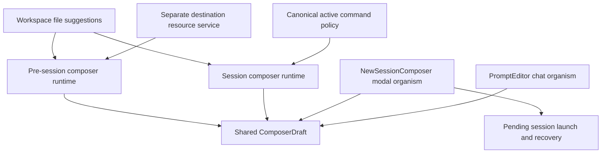
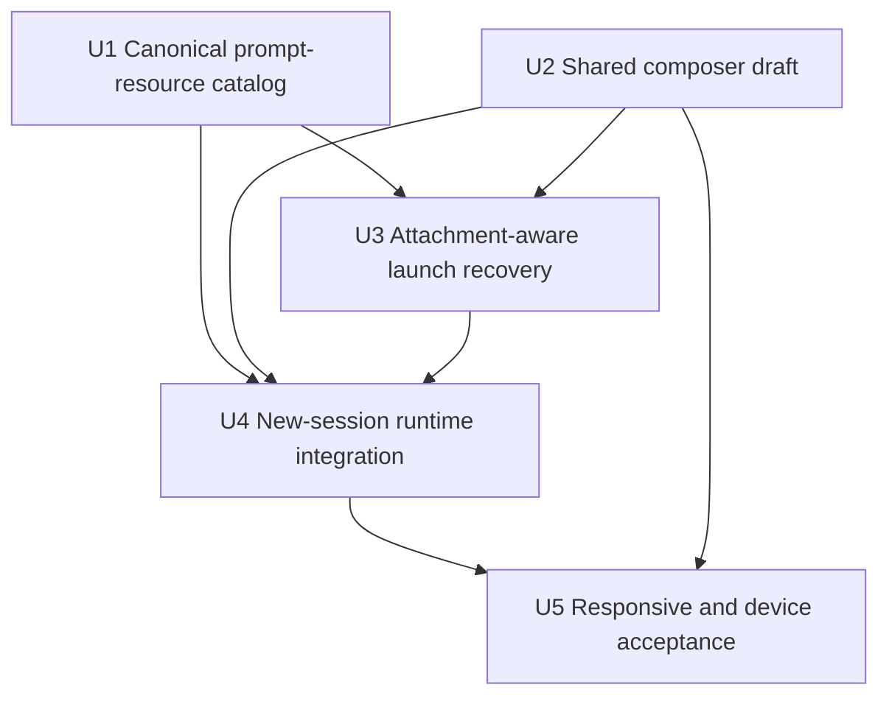
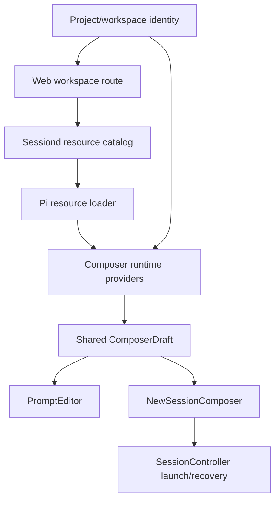

# feat: Share composer affordances with new sessions

## Summary

Extract the editable draft, completion, attachment, and keyboard behavior into one maintained composer component used by both chat and the new-session modal. Each surface supplies one typed runtime port with only valid behavior, so the modal gains skills, prompt templates, file references, and attachments without a copied command registry, exported provider framework, or modal-specific blacklist.

---

## Problem Frame

The main chat composer and new-session modal currently implement prompt entry twice. `PromptEditor` owns CodeMirror, completions, attachments, history, keyboard behavior, and request-race handling, while `NewSessionComposer` owns a plain textarea. Adding selected features to the textarea would make the modal a second source of truth and require every future composer change to be maintained twice.

The new-session surface also has a different runtime boundary. It has a machine, project, and workspace before Send, but no session identity. Skills, prompt templates, file references, and attachments can form a first prompt; session-tree, clone, shell, model-selection, guidance, and running-session controls cannot.

---

## Requirements

- R1. Main chat and the new-session modal must render the same shared editable composer component. Neither surface may own a copied CodeMirror setup, completion loop, attachment implementation, or keyboard map.
- R2. The shared component must preserve the main chat's markdown editing, completion navigation and insertion, prompt-history support when supplied, input-assistance behavior, focus API, disabled state, and configurable Enter behavior.
- R3. With a valid new-session destination, slash completion must list the destination's currently permitted skills and prompt templates without creating or opening a session.
- R4. With a valid destination, tracked-file and all-file completion must use that destination's machine, project, and workspace. A destination change must invalidate results from the previous destination.
- R5. The new-session modal must support file picker, paste, and drag-and-drop attachments; attachment removal; delivery choice; attachment errors; and attachment-only first prompts through the shared implementation.
- R6. Session-dependent commands and modes, including `/tree`, `/clone`, shell execution, model selection/completion, guidance, prompt history, and running-session controls, must not appear in the pre-session runtime.
- R7. A manually entered leading slash command must be validated against the authoritative first-prompt command catalog before creation. Commands absent from that positive catalog must not create a session or become literal first prompts. If a previously valid command becomes removed or source-ambiguous after startup, it must not execute and must enter confirmed-unsent recovery.
- R8. The first-prompt command catalog and the active-session command catalog must share one server-side policy for command grammar, normalization, collision precedence, sorting, source identity, content fingerprint, and first-prompt eligibility. Pre-session validation and post-start execution must bind to the same identity. The client must not classify command names or command sources with a separate hardcoded list.
- R9. Opening the modal or loading its resources must not create a session, mutate navigation, or execute project extensions. Resource discovery must use the active agent profile and the runtime's current SettingsManager/resource-path policy, with all extension paths and factories explicitly absent from the catalog loader.
- R10. Destination changes, catalog refreshes, responsive rerenders, disconnect/reconnect, rotation, and fold/unfold must preserve the text, attachments, delivery choice, and latest completion context while the modal remains open.
- R11. Send must create exactly one blank session and retain the complete first-prompt submission—text, attachments, and delivery choice—through pending startup, retry, destination change, and ambiguous-delivery recovery. View-facing recovery state may expose attachment metadata but never base64 payloads.
- R12. The modal and controller must keep first-prompt text and attachment payloads in memory only. They must not write them to `promptDraftStorage.ts`, `localStorage`, another client-accessible durable store, or Lit view properties.
- R13. Shared contract tests must prove common behavior once, and integration tests must prove that both chat and new-session surfaces consume that contract with their correct runtime capabilities.
- R14. Completion menus, attachment controls, and the modal footer must remain reachable and accessible across all four Galaxy Z Fold 8 postures, including short landscape with the software keyboard open.
- R15. The change must produce a patch Changesets fragment and pass the repository verification, reviewed-capture, physical-device, build, and local deployment gates required for a user-facing change.
- R16. Composer, launch, recovery, catalog, and error paths must not log prompt text, attachment contents/base64, full submission snapshots, or absolute resource paths. Diagnostics may contain only redacted identifiers and the minimum attachment metadata needed for support.
- R17. The destination resource route must enforce named limits of 1,000 combined commands, 128 code units per command name, 2,048 code units per description, 512 code units per source identity, and 2 MiB serialized output. It must single-flight concurrent loads per canonical destination, cap each sessiond at 2 active distinct-destination loads plus 16 queued loads, reject excess work as busy, and use explicit local and federated deadlines.

---

## Scope Boundaries

- Do not make `/tree`, `/clone`, `/fork`, shell commands, model selection, guidance, or other running-session operations work before a session exists.
- Do not expose extension commands pre-session unless a future Pi contract supplies authoritative first-prompt execution metadata. Current extension commands remain session-only.
- Do not add a separate new-session prompt-history store. The shared component supports history, but the pre-session runtime supplies no entries.
- Do not redesign destination selection, the floating composer island, chat session controls, or modal visuals beyond the changes needed to host the shared draft and keep its menus and attachments usable.
- Do not create a hidden or temporary session to obtain resource metadata.
- Do not add modal-specific command names, source filters, completion branches, or capability booleans to the shared view.
- Do not edit `CHANGELOG.md`; Changesets generates it during release preparation.

### Deferred to Follow-Up Work

- Pre-session model selection and `#provider/model` completion: this would change new-session defaults and needs its own product decision.
- Pre-session extension commands: adopt only after the Pi SDK exposes authoritative lifecycle or first-prompt compatibility metadata.

---

## Context & Research

### Relevant Code and Patterns

- `src/client/src/components/PromptEditor.ts` is the current feature-rich implementation. It owns CodeMirror, completion fetching, keyboard handling, history, attachment capture, draft persistence, and session controls in one component.
- `src/client/src/components/NewSessionComposer.ts` owns destination flow and submission but renders a separate textarea.
- `src/client/src/promptCompletions.ts` already provides pure trigger detection and insertion helpers. It should remain the trigger source of truth.
- `src/client/src/components/AutocompleteMenu.ts` is already a reusable completion presentation component.
- `src/client/src/promptAttachmentCapture.ts` and the attachment-delivery helpers already separate browser file capture from prompt delivery.
- `src/client/src/composerRail.ts` demonstrates the repository's preferred pattern: derive one typed behavior contract from raw runtime state rather than repeat conditions in render code.
- `src/client/src/controllers/sessionController.ts` already queues prompt attachments while a session is pending. Its public `launchSession` input and launch-recovery projection currently retain only text.
- `src/server/sessions/piSessionService.ts` currently builds active-session commands from builtins, extension registrations, prompt templates, and skills without a separate collision policy. That assembly must move behind the canonical catalog policy consumed by both active and pre-session paths.
- The Pi SDK's `DefaultResourceLoader` can load skills and prompt templates for a `cwd` and `agentDir` with extensions, themes, and context files disabled. This permits resource discovery without creating an agent session.
- `src/server/workspaceExplorerRoutes.ts` shows the project/workspace route pattern: resolve registered IDs to a canonical workspace root before accessing destination-scoped data.
- `src/shared/federatedRoutes.ts` is the allowlist that must carry a new destination-scoped resource route across machines.

### Institutional Learnings

- No `docs/solutions/` directory exists. The live composer, resource-loader, and controller contracts are the authoritative patterns.
- `work/items/parking-lot/01KZM9CTTVW9TRFPR6D3SE98DY-restore-prompteditor-after-disconnect-and-reconnect.md` records a CodeMirror lifecycle defect that this extraction must resolve.
- `work/items/parking-lot/01KZRHVQ27FSKPQRSHWBZC9DEA-fit-completion-menus-within-short-composer-surfaces.md` records an existing 11 px completion-menu overflow at 711 × 374. Modal reuse makes this part of the active acceptance scope.
- The completed global composer requirements and plan remain the source for destination, cancellation, launch, recovery, and Fold behavior: `work/items/active/01KZQ6V8N2M4J7H9T3C5R1F0XA-global-new-session-composer/requirements.md` and `work/items/active/01KZQ6V8N2M4J7H9T3C5R1F0XA-global-new-session-composer/plan.md`.

### External References

- No external research was used. The relevant behavior is specific to Forgerie's session lifecycle and the installed Pi SDK 0.83 resource contracts; established local patterns are stronger than generic frontend guidance.

---

## Key Technical Decisions

| Decision | Chosen approach | Rationale | Cost / residual risk |
|---|---|---|---|
| Shared UI boundary | Extract a `ComposerDraft`-level component: editor, completion interaction, attachments, and draft keyboard behavior. Keep `PromptEditor` as the chat organism that adds session rail/status/guidance; keep `NewSessionComposer` as the modal organism that adds destination and Cancel/Send. | Reusing `PromptEditor` wholesale would leak session controls into the modal. Extracting only CodeMirror would leave attachments and completion behavior duplicated. This boundary is the largest honest shared part. | `PromptEditor` becomes composition rather than one file, so existing focused tests must be redistributed without weakening coverage. |
| Capability model | Expose one deep composer-runtime port per host. `promptCompletions.ts` alone detects triggers; the runtime declares supported trigger kinds, resolves an already-detected trigger, and supplies host-valid draft behavior. Session/file/model resolver composition remains private to runtime factories. | One public port gives the shared component a stable contract without exporting provider arrays, API-shaped wrappers, modal flags, or duplicate trigger classifiers. | The runtime interface must stay small. Adding one-method classes per API call would be shallow ceremony and fails this decision. |
| Draft ownership | `ComposerDraft` is the only mutable owner of live text, attachments, delivery choice, completion state, and editor lifecycle. Hosts receive validity/submit signals and immutable submission snapshots; they do not mirror draft changes per keystroke. | CodeMirror already acts as the keystroke source of truth. A second copy in `NewSessionComposerState` would recreate the maintenance and synchronization problem at the state layer. | Recovery reopening needs a one-time seed/transfer contract. The draft remains intact until launch acceptance; controller recovery owns the accepted snapshot afterward. |
| First-prompt command identity | Model skills and prompt templates as prompt-resource commands under one canonical command-catalog policy. A shared parser defines slash name/argument boundaries. The opaque identity fingerprints source kind, exact case-sensitive name, canonical origin, expansion content, and skill base-directory semantics. Both catalogs and the identity-bound first-prompt dispatcher consume that policy. | Formatting or a locator alone is not enough: duplicate names can change source resolution, and a file can change at the same path between selection and startup. | A second post-start gate must verify the same source and content identity before delivery. If removal, content change, or collision appears after creation, the session may exist but no command executes and the submission remains recoverable. |
| Pre-session discovery | Add a destination-scoped web route backed by a separate sessiond prompt-resource service, not `PiSessionService`. The service uses the active agent profile and a resource-only loader with extensions, extra extension paths/factories, themes, and context files explicitly absent. The route inherits Forgerie's existing allowed-host/Tailscale and configured-machine-peer boundary; registered workspace IDs remain object validation, not a new authentication layer. | Web owns registered project/workspace authorization; sessiond owns the active Pi profile; `PiSessionService` should remain an active-session aggregate rather than become a generic resource facade. The project deliberately has no app-local auth. | Resource loading is more expensive than reading an active session cache. Start without cross-request caching so catalog truth is simple; add caching only if measurement justifies invalidation complexity. |
| Project-resource policy | Match the active runtime's current SettingsManager and resource-path semantics; do not invent a separate trust store or claim a stored trust decision that Forgerie does not currently have. If a future runtime adds an explicit trust outcome, both catalog and startup must consume one shared policy. | Parity requires both paths to resolve the same direct/package prompt and skill resources, while catalog mode still forbids extension execution. | Extension-generated resources cannot be discovered safely pre-session and remain excluded. This limit is explicit rather than hidden as an empty result. |
| Manual slash input | Treat a draft whose first token starts at offset zero with `/` as command intent, matching `promptCompletions.ts`. Before creation, revalidate it against the current destination's prompt-resource catalog. Only a matching prompt or skill command can cross the creation boundary. Keep invalid input editable, disable both send paths, and show one inline reason plus retry when catalog state can recover. Do not add a modal-only “send as text” escape. | Discovery alone does not protect pasted, remembered, or manually typed `/tree` and `/clone`. Validating against the same provider avoids a separate blocked-name list. A modal-only literal escape would make command parsing differ between the two shared-composer hosts. | Users must rephrase an intended literal that begins with `/`. Catalog failure blocks slash-command submission but does not block ordinary text or attachment-only starts. |
| Enter behavior | Reuse the user's normal composer Enter preference and route a send gesture through the modal's existing validated submission boundary. Newline gestures remain identical to chat. | The request explicitly includes shortcuts. Always-newline modal behavior would preserve a discrepancy; direct form submission without validation would be unsafe. | A send gesture can now create a session. Tests must prove invalid destinations, invalid slash commands, and attachment capture still prevent submission. |
| Attachment ownership | `ComposerDraft` owns capture, pending attachment state, removal, delivery choice, and errors for both surfaces. It exposes one submission snapshot to its containing surface. | Attachment behavior is part of composing a prompt, not a chat-session rail concern. One owner prevents copied paste/drop and delivery logic. | The component now owns meaningful in-memory state and needs a stable snapshot/restore contract for recovery and destination changes. |
| Launch and recovery | Expand the existing initial-prompt launch intent and recovery record to carry text, attachments, and delivery choice. Reuse the current pending-send delivery pipeline rather than add a new upload path. | The queue already supports attachments correctly after a pending session resolves. Extending its public launch contract is smaller and preserves one delivery implementation. | Base64 payloads increase tab-memory use until success or discard. They remain intentionally non-durable and are lost on page close. |
| Responsive completion menu | Constrain the existing menu to its nearest composer boundary and available block space, with internal scrolling and combobox/listbox semantics. | One positioning contract must work in the floating chat island and the modal, including 711 × 374 and the on-screen keyboard. | Browser geometry cannot be proven by happy-dom; reviewed browser captures and the physical Fold remain required. |

### First-prompt ownership state machine

| State | Sole payload owner | View-visible data | Transfer or clear event |
|---|---|---|---|
| Live draft | Mounted `ComposerDraft` | Its own text, chips, delivery choice, and local errors | Validation takes an immutable snapshot but does not clear or transfer ownership. |
| Validation in flight | `ComposerDraft` | Existing draft plus validation state | Rejection leaves the draft unchanged. Controller acceptance atomically transfers the accepted snapshot. |
| Launch accepted / session pending | Controller-private queued launch | Opaque recovery/session IDs, destination, status, and attachment metadata only | Session creation advances the same private record; it does not create a second payload copy. |
| Prompt delivery pending | Controller-private queued send | Delivery stage and metadata only | Confirmed prompt acceptance clears text and attachment payloads. |
| Confirmed unsent | Controller-private recovery record | Editable recovery action, destination, reason, and attachment metadata | One guarded Retry reuses the same record; Change destination transfers it once into a newly mounted draft; discard clears it. |
| Ambiguous delivery | Controller-private recovery record | Ambiguous status and metadata; no automatic retry | Explicit user resolution retries or discards. The controller never infers that silence means unsent. |
| Change destination recovery | Newly mounted `ComposerDraft` after an atomic one-shot claim by opaque recovery ID | Restored text, chips, and delivery choice inside the draft only | A successful claim removes payload ownership from controller recovery; later launch acceptance transfers it back as a new intent. |
| Cancel before launch acceptance | `ComposerDraft` until close | Modal draft | Closing the modal clears its in-memory payloads and creates no controller record. |
| Successful delivery or explicit discard | No owner | Metadata-free terminal status | All text, attachment payloads, canonical delivered text, and previews are cleared. |

`AppState` and Lit properties may carry only opaque recovery IDs, destination metadata, and status. After mount, the modal claims a private recovery record directly from the controller through a one-shot imperative port; prompt text and attachment payloads never pass through `NewSessionComposerRequest`, `PiWebApp` reactive state, or a Lit property.

---

## Open Questions

### Resolved During Planning

- Attachments are in scope, including attachment-only first prompts and launch recovery.
- The modal reuses a shared draft component, not the whole session-aware `PromptEditor` organism.
- Skills and prompt templates come from a destination resource catalog. They are not copied from the currently selected session.
- File completion uses the destination's existing workspace endpoint.
- Unsupported slash commands are blocked by positive validation against the current prompt-resource catalog, not by a client blacklist. A slash at offset zero is command intent; blocked commands stay editable with inline feedback and no modal-only literal-text escape.
- The modal uses the same Enter preference and keyboard editing behavior as chat, but all send gestures pass through modal validation.
- Model completion, shell mode, prompt history, guidance, extension commands, and running-session controls are absent because no valid pre-session provider exists.
- Existing reconnect and short-menu defects are prerequisites inside this plan, not deferred cleanup.

### Deferred to Implementation

- Exact exported type and factory names: preserve the `ComposerDraft`, composer runtime, and prompt-resource catalog boundaries without treating plan names as required code identifiers.
- Whether the resource catalog needs a short-lived cache: begin with fresh destination loads and add caching only if measured latency requires it.
- Exact completion-menu block-size calculation: choose the smallest container-owned measurement that works in both hosts and verify it in a real browser.

---

## Output Structure

    src/
    ├── shared/
    │   ├── promptResourceCommand.ts
    │   └── promptResourceCommand.test.ts
    └── server/
        ├── resources/
        │   ├── promptResourceCatalog.ts
        │   ├── promptResourceCatalog.test.ts
        │   ├── promptResourceRoutes.ts
        │   └── promptResourceRoutes.test.ts
        └── sessions/
            ├── commandCatalog.ts
            └── commandCatalog.test.ts

This is the expected new shape. Existing client and server files remain in their current directories.

---

## High-Level Technical Design

> *This illustrates the intended approach and is directional guidance for review, not implementation specification. The implementing agent should treat it as context, not code to reproduce.*

The runtime is capability composition rather than context detection:

| Capability | Main chat runtime | New-session runtime |
|---|---|---|
| Markdown editing and keyboard behavior | Shared | Shared |
| Prompt/skill slash completion | Active session catalog | Destination resource catalog |
| Tracked/all-file completion | Selected workspace | Chosen destination |
| Model completion | Session provider | No provider |
| Shell mode | Session provider | No provider |
| Prompt history and durable draft | Session-owned adapters | No provider; in-memory only |
| Attachment capture and delivery choice | Shared | Shared |
| Send/steer/stop/guidance/model controls | `PromptEditor` outer composition | Not part of `ComposerDraft` |
| Destination and Cancel/Send footer | Not present | `NewSessionComposer` outer composition |

---

## Implementation Units

### U1. Add one canonical prompt-resource command catalog

**Goal:** Make destination-valid skills and prompt templates discoverable before session creation while establishing one canonical server policy for command identity and eligibility.

**Requirements:** R3-R4, R7-R9, R13, R16-R17.

**Dependencies:** None.

**Files:**
- Create: `src/shared/promptResourceCommand.ts`
- Create: `src/shared/promptResourceCommand.test.ts`
- Create: `src/server/sessions/commandCatalog.ts`
- Create: `src/server/sessions/commandCatalog.test.ts`
- Create: `src/server/resources/promptResourceCatalog.ts`
- Create: `src/server/resources/promptResourceCatalog.test.ts`
- Create: `src/server/resources/promptResourceRoutes.ts`
- Create: `src/server/resources/promptResourceRoutes.test.ts`
- Modify: `src/server/sessions/piSessionService.ts`
- Modify: `src/server/sessions/sessionCommandService.ts`
- Modify: `src/server/sessions/sessionCommandService.test.ts`
- Modify: `src/server/sessions/sessionRoutes.ts`
- Modify: `src/server/sessions/sessionRoutes.test.ts`
- Modify: `src/server/sessiond.ts`
- Modify: `src/server/workspaceExplorerRoutes.ts`
- Modify: `src/server/app.ts`
- Modify: `src/shared/apiTypes.ts`
- Modify: `src/shared/federatedRoutes.ts`
- Modify: `src/client/src/api/clients.ts`
- Modify: `src/client/src/api/parsers.ts`
- Modify: `src/client/src/api/clients.test.ts`
- Modify: `src/client/src/api/federatedRouteContract.test.ts`

**Approach:**
- Define a constrained wire contract for prompt-resource commands. Its source can only be prompt or skill, and its semantics state that it expands as a first prompt after startup. Its opaque identity is a SHA-256 fingerprint over source kind, exact name, canonical origin, exact expansion source, and skill base-directory semantics; never expose canonical filesystem paths.
- Add one shared slash parser used by completion-adjacent validation, catalog resolution, and identity-bound execution. Command intent requires `/` at offset zero; the name ends at the first ECMAScript whitespace; an empty name is invalid; arguments preserve all remaining text. Names compare by exact case-sensitive code points with no locale case-folding or Unicode normalization, and prefix names never match.
- Extract a canonical command-catalog policy from `PiSessionService.commands`. The policy owns parsing, collision precedence (`builtin` > `extension` > `skill` > `prompt`, matching current execution), deterministic code-point sorting by exact name/source/origin, source/content identity, and first-prompt eligibility. Active-session listing, `SessionCommandService` runtime resolution, the resource-only catalog, and the new first-prompt dispatcher consume this policy instead of independent OR checks.
- Add a separate sessiond prompt-resource service keyed by canonical cwd and active agent profile. Configure its Pi resource loader with extensions disabled and with empty additional extension paths and extension factories; also omit themes, context files, and session creation.
- Match the active runtime's current SettingsManager and resource-path policy. Pre-session eligibility includes direct and package prompt templates and skills resolved through that policy. It intentionally excludes builtins, extension commands, extension-generated resource paths, themes, and context-derived resources. The active catalog may contain those additional sources, but the post-start identity gate accepts only the prevalidated prompt/skill descriptor. Return a sanitized unavailable/diagnostic state when catalog-safe resources cannot be resolved; do not serialize absolute filesystem paths.
- Enforce R17 before serializing the wire catalog. Reject an over-limit catalog as one unavailable result rather than truncating it into a misleading partial catalog. Coalesce concurrent reloads for the same canonical `(agentDir, cwd)` into one in-flight promise. Across distinct destinations, admit at most 2 active loader calls and 16 FIFO queued calls per sessiond; duplicate joiners do not consume queue slots, and excess requests return a sanitized busy result. Apply a 10-second sessiond response deadline and a 15-second federated proxy deadline. Because the installed Pi loader has no abort signal, a timed-out load keeps its active slot until it settles; report the deadline truthfully and do not claim cancellation.
- Add a project/workspace route in the web server. Resolve registered IDs on the destination machine to the canonical workspace root before any sessiond call, then proxy the catalog request. Add the route to machine federation so local and remote destinations use the same contract. Keep it under the same allowed-host/Tailscale and configured-machine-peer controls as existing workspace routes; reject invalid hosts, peers, and workspace identities before sessiond resource access rather than treating registration as caller authorization.
- Add an identity-bound first-prompt prompt-resource execution path on the active session. It must re-resolve the parsed command through the canonical active policy, compare the complete source/content fingerprint, expand that exact prompt or skill on the server, then call Pi with template/extension expansion disabled. It must accept the existing image channel and folder-reference text. It must never forward the original leading-slash text through generic `prompt()` or generic extension-capable `commands/run`.
- Reject the complete response at the parser boundary if it contains a builtin, extension, or malformed entry. Surface a catalog error while keeping plain text and attachment-only composition usable.
- The identity-bound path is the only first-prompt slash dispatcher. After startup it resolves through the active canonical policy again and executes only when the complete source/content fingerprint still matches; all other outcomes retain confirmed-unsent recovery.

**Execution note:** Start with the pure projection and route contract tests. Then prove the resource-only implementation with a real temporary agent/workspace directory and the real Pi resource loader. Measure 20 warm local loads and 20 federated loads against representative resources before U4 starts. The median target is at most 500 ms local and 1.5 s federated, with p95 at most 2 s local and 5 s federated. If the fixture misses either p95 target, stop and add a bounded short-lived cache with explicit invalidation before modal integration; do not defer the latency decision until after release.

**Patterns to follow:**
- Command assembly in `src/server/sessions/piSessionService.ts`
- Resource-only SDK use in `src/server/sessions/bundledManagedProcesses.test.ts`
- Workspace identity resolution in `src/server/workspaceExplorerRoutes.ts`
- Federated route contract in `src/shared/federatedRoutes.ts`
- API parsing in `src/client/src/api/parsers.ts`

**Test scenarios:**
- Happy path: a temporary workspace with one prompt template and one skill returns both descriptors, sorted identically to the active-session command catalog, without creating or opening a session.
- Integration: the active-session catalog and destination catalog project the same prompt and skill metadata from the same resource inputs.
- Edge case: a workspace with no prompt templates or skills returns a successful empty catalog with no fabricated commands.
- Error path: malformed resource files return truthful diagnostics while valid resources remain available according to the SDK loader contract.
- Security: catalog loading executes no extensions even when the normal session runtime config includes bundled extension paths or factories.
- Error path: an unknown project/workspace pair and a cwd outside the registered workspace fail before sessiond resource access.
- Integration: a remote-machine request traverses the federated allowlist, revalidates the project/workspace registration on the destination machine, and resolves resources there rather than on the browser server's local filesystem.
- Contract: the client parser rejects the whole prompt-resource response when any entry has a builtin/extension source or malformed identity; ordinary prompts remain usable through the surfaced catalog error.
- Grammar: exact, prefix, argument, punctuation, empty-name, ASCII/Unicode whitespace, newline, case, and canonically equivalent-but-distinct Unicode inputs resolve identically in client validation, active catalog policy, and first-prompt execution.
- Security: invalid allowed-host, unconfigured federated peer, unknown workspace, and out-of-root cwd requests fail before sessiond loader access; tests state explicitly that Forgerie relies on its Tailscale/host boundary rather than app-local auth.
- Security: resource diagnostics returned to the browser contain safe summaries and no absolute agent/workspace filesystem paths.
- Security: 1,001 resources, an overlong name/description/identity, and a serialized response above 2 MiB each fail as one sanitized unavailable catalog; no partial catalog reaches the client.
- Concurrency: repeated refreshes for one destination share one loader call; 20 simultaneous distinct destinations run at most 2 loaders, queue at most 16, reject the rest as busy, and keep timed-out loader slots occupied until settlement.
- Performance: the recorded 20-load local and federated samples meet the stated median/p95 gate or U1 adds and tests the required bounded cache before U4.
- Collision: builtin/template, extension/template, extension/skill, duplicate prompt/skill, and resource-removal-after-start cases follow canonical precedence and never execute a source different from the prevalidated descriptor.
- Execution security: an extension that registers the same name after startup causes identity mismatch and confirmed-unsent recovery. A valid prompt/skill executes through the identity-bound path with Pi expansion disabled, including with inline images or folder references.
- Freshness: changing prompt/skill content, origin, or skill base-directory semantics after validation changes the fingerprint and enters confirmed-unsent recovery; no altered resource executes under the old selection.

**Verification:**
- One bounded canonical policy parses, fingerprints, lists, resolves, and identity-dispatches prompt/skill commands for active sessions and pre-session destinations. Tests prove generic extension-capable prompt dispatch cannot replace the selected source, resource discovery has no session or extension side effects, and the measured latency gate is recorded before modal integration.

---

### U2. Extract the shared composer draft and migrate main chat

**Goal:** Move CodeMirror, completion interaction, attachment capture, draft keyboard behavior, and editor lifecycle into one deep component while preserving `PromptEditor` as the session-specific outer composition.

**Requirements:** R1-R2, R5-R6, R10, R12-R14, R16.

**Dependencies:** None.

**Files:**
- Create: `src/client/src/composerRuntime.ts`
- Create: `src/client/src/composerRuntime.test.ts`
- Create: `src/client/src/components/ComposerDraft.ts`
- Create: `src/client/src/components/ComposerDraft.test.ts`
- Modify: `src/client/src/components/PromptEditor.ts`
- Modify: `src/client/src/components/PromptEditor.draft.test.ts`
- Modify: `src/client/src/components/PromptEditor.history.test.ts`
- Modify: `src/client/src/components/PromptEditor.menu.test.ts`
- Modify: `src/client/src/components/PromptEditor.runtimeControls.test.ts`
- Modify: `src/client/src/components/PromptEditor.summonedChrome.test.ts`
- Modify: `src/client/src/components/shared.ts`
- Reuse: `src/client/src/promptCompletions.ts`
- Reuse: `src/client/src/promptAttachmentCapture.ts`
- Reuse: `src/client/src/promptEnterBehavior.ts`
- Reuse: `src/client/src/promptHistory.ts`

**Approach:**
- Define one small composer-runtime port. `promptCompletions.ts` remains the only trigger detector; the runtime declares which trigger kinds it supports, resolves an already-detected trigger, and supplies host-valid input-mode behavior. Keep API-specific resolver composition private to runtime factories. Do not pass `isNewSession`, `allowShell`, `allowModels`, provider arrays, or similar view flags.
- Move the CodeMirror instance, trigger detection, asynchronous completion reconciliation, selection/pick behavior, keyboard precedence, input-assistance attributes, attachment capture, chips, delivery choice, and attachment errors into `ComposerDraft`. A supported provider that returns zero matches clears stale items and closes the existing menu, matching `AutocompleteMenu`; provider failure uses the visible recoverable error state instead of masquerading as an empty result.
- Let `ComposerDraft` own its live in-memory text and attachments so CodeMirror remains the keystroke source of truth. Expose validity/submit signals and immutable submission snapshots plus a one-time seed/restore boundary; do not mirror the full draft through Lit on every keystroke.
- Define the keyboard boundary: `ComposerDraft` owns completion, history, newline, submit, and local completion-Escape precedence. Unhandled Escape and session stop/double-Escape behavior remain with the outer host.
- Keep prompt history and draft persistence behind optional adapters supplied by the chat host. The new-session host will omit them. Keep Send/Steer/Stop, model/thinking controls, guidance, context usage, session status, and the floating rail in `PromptEditor`.
- Make CodeMirror creation idempotent across connect/disconnect so the same component instance regains a usable editor after reconnection.
- Preserve `PromptEditor`'s high-frequency render guard and public focus, replacement, attachment-picker, and plugin prompt APIs by delegating to the shared component.
- Redistribute tests by ownership. Draft content, completions, attachment state, keyboard behavior, and lifecycle scenarios move to `ComposerDraft.test.ts`; `PromptEditor.*.test.ts` keeps only chat composition and stable public delegation behavior. Do not reach through two shadow roots to seed shared-component private fields.
- Delete migrated implementation from `PromptEditor`; do not leave forwarding copies of completion or attachment logic behind.

**Execution note:** Add characterization coverage for the existing chat public contract before extraction. Before U3 or U4 proceeds, mount the smallest real `ComposerDraft` in both a chat harness and a modal harness with text, one completion provider, Enter/Escape, and attachment chips. Stop if either host needs draft-state mirroring, surface flags, or private-field reach-through; revise the boundary before launch contracts depend on it. Then migrate the chat host without changing user behavior.

**Patterns to follow:**
- Deep derived contract in `src/client/src/composerRail.ts`
- Pure trigger helpers in `src/client/src/promptCompletions.ts`
- Real configurable capture implementation in `src/client/src/promptAttachmentCapture.ts`
- happy-dom component testing guidance in `.agents/skills/testing-guide/SKILL.md`

**Test scenarios:**
- Happy path: a session runtime returns command, file, and model completions through provider composition; Arrow keys, Tab, click, and Escape navigate, insert, and dismiss the shared menu.
- Happy path: file picker, pasted files, and dropped files create the same attachment chips, delivery options, removable state, and submission snapshot.
- Edge case: an attachment-only snapshot is valid; empty text with no attachments is not.
- Edge case: changing runtime context while a request is in flight discards the old result and closes incompatible completions.
- Edge case: typing a trigger kind omitted by the runtime, such as `#` pre-session, starts no request and opens no empty menu.
- Edge case: disconnecting and reconnecting the same component preserves/restores its draft snapshot and yields a focusable, editable CodeMirror instance.
- Error path: completion-provider and attachment-read failures remain local, visible, and recoverable without clearing text or successful attachments.
- Security: draft provider/capture failures do not log or serialize prompt text, attachment contents/base64, or full draft snapshots.
- Regression: the chat host preserves session draft storage, prompt history boundary navigation, Enter preference, modified New session shortcut, shell hint, model completion, and plugin text insertion.
- Regression: high-frequency session status updates do not remount CodeMirror or interrupt focus/touch editing.
- Parity: mounting the same shared draft in minimal chat and modal hosts with the same runtime and gestures produces identical completion items, attachment chips, keyboard selection, and submission snapshots; host tests then cover only their distinct composition.

**Verification:**
- `PromptEditor` renders and delegates to the shared draft, all existing chat behavior remains green, and the shared component survives disconnect/reconnect without duplicate editor instances.

---

### U3. Carry attachments through initial launch and recovery

**Goal:** Extend the existing pending launch contract so the first prompt can contain text, attachments, or both and remain recoverable as one submission.

**Requirements:** R5, R7-R8, R10-R12, R16.

**Dependencies:** U1 for the post-start command-identity gate and U2 for the accepted submission snapshot and ownership transfer contract.

**Files:**
- Modify: `src/client/src/controllers/sessionController.ts`
- Modify: `src/client/src/controllers/sessionController.sessionLaunch.test.ts`
- Modify: `src/client/src/controllers/sessionController.sendQueue.test.ts`
- Modify: `src/client/src/components/ChatView.ts`
- Modify: `src/client/src/components/ChatView.sessionLaunchRecovery.test.ts`
- Modify: `src/client/src/components/PiWebApp.ts`
- Modify: `src/client/src/components/PiWebApp.newSessionComposer.test.ts`

**Approach:**
- Replace the text-only public launch input with one tagged first-prompt submission value containing text, optional attachments, effective delivery choice, and—only for a prevalidated leading slash prompt resource—its opaque canonical command identity. Preserve that identity in the private pending launch and recovery record so the post-start gate can compare the same descriptor rather than reclassify text.
- Reuse the existing pending prompt queue and its attachment preprocessing. Let ordinary text continue through `deliverPromptToSession`; add one explicit prompt-resource branch that calls U1's identity-bound endpoint. Do not add a modal upload path or upload before session creation.
- Keep full attachment payloads only in controller-private queued sends and recovery records. Expose a view-facing recovery projection with attachment names, MIME types, and sizes but no base64 data. Creation Retry and Change destination restore the same private payloads and delivery choice. Confirmed-unsent retry reuses them exactly once.
- For a leading slash first prompt, call only U1's identity-bound prompt-resource execution path after startup. It reparses with the shared grammar, re-resolves the active canonical catalog, verifies the complete source/content fingerprint, expands the exact selected resource, and dispatches with Pi command/template expansion disabled. Removal, content change, source collision, or grammar mismatch enters confirmed-unsent recovery without executing.
- For folder delivery, retain attachment payloads until save plus prompt acceptance succeeds. After save returns file references, append them to the original invocation before identity-bound expansion. Store the execution path's opaque delivery fingerprint/receipt on the private queued send before reconciliation; compare acceptance with that receipt rather than the pre-expansion slash text. For ordinary non-command folder prompts, record the exact rewritten body. For inline delivery, retain payloads until prompt acceptance is known. Clear payloads and delivery receipts/bodies on acceptance, explicit discard/deletion, or successful replacement.
- Keep ambiguous-delivery behavior conservative. Do not automatically resend text or attachments when acceptance cannot be proved.
- Keep all operational logs and serialized errors within R16. Tests must fail if logger arguments, thrown error details, diagnostics, or recovery snapshots contain prompt text, attachment data/file contents, or the complete private submission.
- Allow attachment-only launch while preserving the current rejection of a completely empty submission.

**Execution note:** Extend existing session-launch and send-queue tests first. The current queue already supports attachments, so this unit should deepen its public contract rather than introduce a parallel implementation.

**Patterns to follow:**
- `QueuedPendingSessionSend` and `deliverPromptToSession` in `src/client/src/controllers/sessionController.ts`
- Existing initial-prompt recovery scenarios in `src/client/src/controllers/sessionController.sessionLaunch.test.ts`
- Stage-specific recovery presentation in `src/client/src/components/ChatView.ts`

**Test scenarios:**
- Happy path: text plus inline images enters one pending launch, starts one session, and sends the prompt with the same attachments once.
- Happy path: an attachment-only launch passes the structured empty-submission guard, is accepted, and produces one prompt delivery.
- Integration: folder delivery saves files after the real session exists. Ordinary text records and reconciles the rewritten canonical body; a prompt-resource command reconciles the identity-bound delivery receipt. Both clear retained payloads without a false ambiguous-delivery state.
- Contract: a prevalidated prompt/skill submission retains its opaque source/content identity through creation and retry; the identity-bound dispatcher must match it before expanding or delivering.
- Security: a colliding extension command cannot run from a prevalidated prompt/skill invocation, with or without attachments; generic `prompt()` and `commands/run` are not called for this path.
- Freshness: editing the selected prompt/skill at the same origin after prevalidation blocks delivery and preserves confirmed-unsent recovery.
- Error path: creation failure retains text, attachments, and delivery choice for same-destination Retry and Change destination without writing payloads to durable storage; the public recovery projection contains attachment metadata and no `data` payload.
- Error path: a creation retry of a leading slash submission revalidates the current prompt-resource command identity; removal or collision blocks delivery and keeps confirmed-unsent recovery.
- Error path: confirmed-unsent delivery permits one guarded retry with the original attachments; two overlapping Retry calls produce one upload/send attempt.
- Error path: ambiguous delivery preserves recovery metadata but performs no automatic resend of attachments.
- Edge case: discarding or deleting the failed launch clears all retained attachment payloads, canonical delivered text, and queued previews.
- Security: success, validation rejection, creation failure, delivery failure, ambiguous recovery, retry, and discard emit no prompt text, attachment contents/base64, full private snapshots, or absolute paths through logs or serialized errors.
- Regression: ordinary post-start prompts and attachments keep their current upload, queue, and recovery behavior.

**Verification:**
- Controller and recovery tests prove that one complete first-prompt submission survives every existing launch stage without duplicate upload/delivery or durable payload storage.

---

### U4. Consume the shared composer in the new-session modal

**Goal:** Replace the modal textarea with `ComposerDraft`, wire destination-valid providers, and enforce first-prompt semantics at the creation boundary.

**Requirements:** R1-R14, R16.

**Dependencies:** U1, U2, U3.

**Files:**
- Modify: `src/client/src/appState.ts`
- Modify: `src/client/src/newSessionComposer.ts`
- Modify: `src/client/src/newSessionComposer.test.ts`
- Modify: `src/client/src/components/NewSessionComposer.ts`
- Modify: `src/client/src/components/NewSessionComposer.test.ts`
- Modify: `src/client/src/components/PiWebApp.ts`
- Modify: `src/client/src/components/PiWebApp.newSessionComposer.test.ts`
- Modify: `src/client/src/components/shared.ts`

**Approach:**
- Keep only destination, submission status, and errors in `NewSessionComposer`; remove mutable prompt ownership from its state transitions. Mount one persistent `ComposerDraft` as the sole mutable draft owner for the modal lifetime. Destination chooser transitions must not replace or unmount it, and modal state must not mirror text or attachments per keystroke.
- Build the pre-session runtime from the selected destination: prompt-resource command completion from U1 and file completion from the existing workspace files API. Supply no session-only providers. Resolve manual command input with U1's shared parser and exact identity; do not duplicate tokenization in modal state.
- When no complete destination exists, keep the draft and attachments usable but expose no destination-dependent completions and keep Send unavailable.
- On destination change, replace the runtime context atomically. Invalidate old command/file requests and clear their menu items while retaining text, attachments, and delivery choice.
- Generate input hints from installed providers so the modal advertises only slash prompt resources and file references. Do not mention model or shell triggers. Render all workspace/remote-machine command names, descriptions, and file labels through Lit's escaped text bindings only; do not use HTML or markdown rendering for provider metadata.
- Route the shared component's send gesture and the footer Send button through one validator. Revalidate destination and any leading slash command against the current prompt-resource catalog before passing the full tagged submission, including its validated command identity, to root orchestration.
- Treat an offset-zero leading slash as command intent. An absent, stale, or ambiguous command keeps the draft editable, disables both send paths, and shows a single inline explanation. Catalog failure adds Retry; successful empty catalogs and zero-match file queries close stale completion menus without showing a failure. Do not add a modal-only literal-text escape.
- Treat prompt-resource catalog failure as recoverable: preserve the draft, explain that slash commands cannot be verified, and allow plain text or attachment-only submission.
- Keep the draft intact while an immutable snapshot is validated and until launch acceptance transfers recovery ownership to the controller. Remove `initialPrompt` from `NewSessionComposerRequest` and all Lit properties. For Change destination recovery, keep only an opaque recovery ID and destination metadata in root state; after mount, let the modal atomically claim the controller-private submission through a one-shot imperative port and seed `ComposerDraft` directly. Do not synchronize two live copies. Cancel remains side-effect free.

**Execution note:** Start with failing component tests that mount the real shared component in happy-dom. Do not test this integration by calling private handlers or by substituting another textarea.

**Patterns to follow:**
- Tagged destination/submission states in `src/client/src/newSessionComposer.ts`
- Idempotent modal focus and destination request guards in `src/client/src/components/NewSessionComposer.ts`
- Root validation/navigation handoff in `src/client/src/components/PiWebApp.ts`
- Shared runtime factories from U2

**Test scenarios:**
- Happy path: a complete destination opens the shared editor, slash completion lists its skill and prompt template, file completion lists its tracked/all files, and Send launches one session with the resulting text.
- Happy path: picker, paste, and drop attachments work in the modal; text-plus-attachment and attachment-only snapshots pass one complete launch intent through the pure submission transition.
- Covers prior AE3. Destination change preserves text, attachments, and delivery choice while replacing prompt/file completion results with the new destination's catalog.
- Edge case: no destination permits drafting and attaching but disables Send and destination-dependent completions.
- Edge case: a repeated New session activation focuses the existing shared editor without replacing its state.
- Error path: `/tree`, `/clone`, an extension command, an unknown slash command, and a stale prompt-resource command each remain editable but unsendable, show the applicable inline reason, and create no session through Enter or the footer.
- Edge case: a successful empty catalog or zero-match slash/file query clears stale items and closes the menu; it does not show a provider failure.
- Error path: resource-catalog failure blocks slash submission with a visible Retry action but still permits ordinary text and attachment-only submission.
- Integration: the user's Enter-send preference reaches the same validated path as the footer button; newline behavior and completion-key precedence remain identical to chat.
- Integration: Cancel after text and attachments creates no session and releases in-memory attachment payloads when the modal closes.
- Privacy: `NewSessionComposerRequest`, `PiWebApp` reactive state, and Lit properties contain no first-prompt text, attachment payload, or full recovery snapshot; an opaque recovery ID can be claimed exactly once into the mounted draft.
- Lifecycle: disconnect and reconnect the real modal/app host with text, attachments, a non-default delivery choice, and active current-destination completion context; the same mounted draft recovers without routing payloads through AppState or Lit properties.
- Security: resource names/descriptions and file labels containing HTML/script-like text render literally through escaped bindings and cannot create elements, attributes, or event handlers.
- Accessibility: modal focus enters the shared editor for a complete destination, destination controls for an incomplete one, and returns correctly after completion picking and chooser transitions.

**Verification:**
- The modal contains no textarea or modal-owned editor/completion/attachment implementation, and integration tests prove its runtime is a positive subset of the same shared contract used by chat.

---

### U5. Harden shared completion layout and complete acceptance

**Goal:** Make the shared completion and attachment surface usable in both hosts across the full Fold posture matrix, then record and deploy the user-visible change.

**Requirements:** R10, R13-R15.

**Dependencies:** U2, U4.

**Files:**
- Modify: `src/client/src/components/AutocompleteMenu.ts`
- Create or modify: `src/client/src/components/AutocompleteMenu.test.ts`
- Modify: `src/client/src/components/ComposerDraft.test.ts`
- Modify: `src/client/src/components/NewSessionComposer.test.ts`
- Modify: `src/client/src/components/shared.ts`
- Create: `.changeset/share-new-session-composer.md`

**Approach:**
- Give the shared editor a real combobox relationship with the existing menu. Add listbox/option semantics, active-option state, and accessible expanded/collapsed signaling without changing keyboard behavior.
- Make every attachment chip and remove control keyboard reachable with a unique accessible name. Expose delivery choice as one labelled radio group or equivalent single-choice control. Announce attachment additions/removals and capture/delivery errors through an appropriately scoped live region without moving focus. Keep focus order editor → attachment controls → delivery choice → modal footer.
- Bound the completion popup by the nearest composer host's available block space. Cap and scroll the list rather than letting it escape above the viewport; do not add a viewport-width breakpoint.
- Keep attachment chips, errors, delivery choice, and footer controls within the modal's scrollable content at short heights. The software keyboard may reduce visible transcript/modal space but must not hide the active editor or all submission controls.
- Validate both consumers, not only the modal. The floating chat island and modal must show the same completion interaction without layout regressions.
- Add a patch changeset describing shared first-prompt skills, prompt templates, file references, and attachments. Do not edit generated release notes.
- Complete the repository's four reviewed headless captures and physical Galaxy Z Fold 8 interaction matrix, including a destination switch and a posture transition with text, attachments, and an open completion menu.

**Execution note:** Add accessibility and menu-boundary assertions before styling. Treat happy-dom as interaction proof only; browser captures and the physical device are the layout evidence.

**Patterns to follow:**
- `src/client/src/components/AutocompleteMenu.ts`
- Container-owned styles in `src/client/src/components/shared.ts`
- Fold acceptance requirements in `AGENTS.md`
- Changeset rules in `.agents/skills/changeset-changelog/SKILL.md`

**Test scenarios:**
- Accessibility: the editor reports combobox state, the menu reports listbox/options, and keyboard or pointer selection updates the active option and restores editor focus.
- Accessibility: keyboard-only users can focus each attachment chip/remove action, identify duplicate filenames unambiguously, choose one delivery mode through labelled single-choice semantics, and hear add/remove/error updates once without focus theft.
- Edge case: a long 12-item command or file result stays within the modal/chat host, keeps its first item and border visible, and scrolls to every option.
- Responsive: reviewed captures at 704 × 783, 932 × 553, 475 × 638, and 711 × 374 show reachable destination, editor, attachment, completion, Cancel, and Send controls without overlap or paradigm switching.
- Responsive: short landscape with the software keyboard open keeps the active editor and a usable completion/menu region visible through internal scrolling.
- Physical integration: on the Galaxy Z Fold 8, invoke a skill, a prompt template, and a file completion; attach by picker and paste; send and cancel from folded/unfolded portrait and landscape.
- Physical transition: change destination with text, an attachment, and the completion menu open, then fold/unfold and rotate; verify one draft, correct destination results, and no lost editor.
- Regression: the main chat floating island retains its resting height, one control rail, attachment visibility, and completion behavior after adopting the shared draft.

**Verification:**
- Automated interaction tests, inspected captures, and physical-device notes prove that both consumers share one accessible completion/attachment surface across all required postures.

---

## System-Wide Impact

- **Interaction graph:** Workspace selection supplies the destination. Web resolves it to cwd. Sessiond loads permitted prompt resources. Runtime providers expose prompt-resource and file completions to `ComposerDraft`. Chat and modal compose that component differently. Modal submission enters the existing pending launch queue.
- **Error propagation:** Resource or file completion failures stay inside the draft and do not clear work. Catalog or source-identity failures block only unverifiable slash submissions. Destination and launch failures retain the full draft. Attachment delivery failures use the existing stage-specific recovery surface.
- **State lifecycle risks:** CodeMirror reconnect, stale destination results, duplicate send gestures, attachment payload retention, and pending-to-real identity replacement can lose or duplicate work. Idempotent editor lifecycle, provider-version invalidation, one validated submit path, and the existing queue identity reconciliation address these boundaries.
- **API surface parity:** The active-session commands route remains backward compatible. The new destination prompt-resource route uses a narrower schema, and the new identity-bound execution route handles only validated first-prompt prompt/skill resources. Local and remote machine routes must expose the same behavior. `PromptEditor` public methods used by plugins remain stable through delegation.
- **Integration coverage:** Pure tests cannot prove web-to-sessiond federation, real Pi resource discovery, CodeMirror browser geometry, software-keyboard behavior, or Fold transitions. Route integration, real-loader temporary-directory tests, reviewed captures, and physical-device acceptance cover these seams.
- **Unchanged invariants:** Opening the modal creates no session; destination changes do not navigate; Cancel is side-effect free; session history is never inherited; existing chat command execution remains session-bound; first-prompt data stays non-durable.
- **Stakeholders:** Users gain parity and attachments in the new-session flow. Plugin authors keep the existing prompt insertion/focus surface. Operations must restart sessiond because its routes and resource catalog change, and rebuild/restart the web service for the client/API changes.

---

## Alternative Approaches Considered

| Approach | Decision | Reason |
|---|---|---|
| Add CodeMirror and selected handlers directly to `NewSessionComposer` | Rejected | This creates the exact second source of truth the work exists to remove. Every completion, shortcut, accessibility, and attachment fix would need two implementations. |
| Render the existing `PromptEditor` wholesale inside the modal and hide controls | Rejected | `PromptEditor` is a session-aware organism. Hiding its rail with flags would create a boolean prop forest and leave session storage, guidance, shell, model, and running-state assumptions inside the modal. |
| Keep separate views but share only utility functions | Rejected | Pure trigger helpers already exist and did not prevent the textarea divergence. The maintained unit must include the behavior-bearing editor and attachment surface, not only helpers. |
| Create a temporary hidden session to query commands | Rejected | It violates the Send-as-creation boundary, can trigger trust/extensions/dialogs, creates cleanup and failure states, and still does not define which commands are valid first prompts. |
| Fetch all session commands and blacklist `/tree`, `/clone`, and peers in the client | Rejected | Command names and lifecycle semantics would become a duplicated client policy that drifts whenever Pi or Forgerie adds a command. |
| Shared `ComposerDraft` plus provider-composed runtimes | Chosen | It produces one UI behavior source and one server prompt-resource projection while letting each surface supply only contracts that can truly execute. The cost is a deliberate extraction and a new read-only resource route. |

---

## Risks & Dependencies

| Risk | Mitigation |
|---|---|
| The abstraction becomes a generic mini-framework rather than a deep composer module. | Keep it domain-specific to Forgerie prompt drafting. Add providers only for real current consumers and reject boolean feature switches. |
| Resource discovery diverges from what the created session loads or generic Pi dispatch runs a colliding extension first. | Fingerprint source and expansion content, re-resolve through the active canonical policy, and execute first-prompt resources only through the identity-bound server path with Pi command/template expansion disabled. |
| Pre-session resource reads execute extensions, expose internal paths, or exhaust the daemon. | Use a separate bounded catalog service with extensions, extra extension paths/factories, themes, and context disabled; sanitize diagnostics; single-flight reloads; enforce count/field/response limits and deadlines; add real-loader side-effect and over-limit tests. |
| A slow old-destination completion appears after a destination switch. | Version the complete runtime context, invalidate on every destination change, and discard late results before rendering. |
| A manual or stale session-only command is sent as literal text. | Validate against the positive pre-session catalog before creation and against the same source identity after startup; mismatch becomes confirmed-unsent recovery. |
| Shared extraction regresses chat behavior. | Characterize the existing public contract first, retain `PromptEditor` public APIs, and run full verification after each feature-bearing unit. |
| Attachment payloads increase memory, leak into view state/logs, or survive too long after failure. | Follow the explicit ownership state machine; retain payloads only in `ComposerDraft` or controller-private queued/recovery records; expose metadata-only projections; redact logs/errors; clear on acceptance, cancel, discard, delete, or replacement; never persist. Page close remains a deliberate loss boundary. |
| Reusing CodeMirror in a modal exposes reconnect and popup overflow defects. | Include both parked defects in U2/U5 and verify the same component in both hosts on the physical Fold. |
| Sessiond route changes interrupt in-flight agent runs during deployment. | Build first, check the UI for active runs, restart both user services only when clear, then verify the deployed instance. |

---

## Documentation / Operational Notes

- Add a patch Changesets fragment. Do not edit `CHANGELOG.md`.
- No README or user guide change is required unless implementation reveals a user-visible resource-discovery limitation that cannot be explained in the modal.
- The new resource route and shared API types require whole-repository type checking and federated-route coverage.
- Before calling the work complete, inspect all four headless captures and validate all four physical Fold postures plus a live posture transition with text, attachments, and an open completion menu.
- After the user-facing change lands on `main`, build `dist/`, check for in-flight agent runs, restart `forgerie-sessiond.service` and `forgerie-web.service`, and verify the live Tailscale-hosted instance. No NixOS rebuild is required.

---

## Sources & References

- Prior requirements: `work/items/active/01KZQ6V8N2M4J7H9T3C5R1F0XA-global-new-session-composer/requirements.md`
- Prior completed plan: `work/items/active/01KZQ6V8N2M4J7H9T3C5R1F0XA-global-new-session-composer/plan.md`
- Work metadata: `work/items/active/01KZRM1N52SSDZ2TGBRRHKRSX2-shared-session-composer/work.md`
- Main composer: `src/client/src/components/PromptEditor.ts`
- New-session modal: `src/client/src/components/NewSessionComposer.ts`
- Completion domain: `src/client/src/promptCompletions.ts`
- Attachment domain: `src/client/src/promptAttachmentCapture.ts`
- Pending launch: `src/client/src/controllers/sessionController.ts`
- Active command catalog: `src/server/sessions/piSessionService.ts`
- Pi SDK resource contract: `node_modules/@earendil-works/pi-coding-agent/dist/core/resource-loader.d.ts`
- Workspace route pattern: `src/server/workspaceExplorerRoutes.ts`
- Federated route policy: `src/shared/federatedRoutes.ts`
- Reconnect follow-up: `work/items/parking-lot/01KZM9CTTVW9TRFPR6D3SE98DY-restore-prompteditor-after-disconnect-and-reconnect.md`
- Completion layout follow-up: `work/items/parking-lot/01KZRHVQ27FSKPQRSHWBZC9DEA-fit-completion-menus-within-short-composer-surfaces.md`
- Project guidance: `AGENTS.md`, `AGENTS.local.md`
