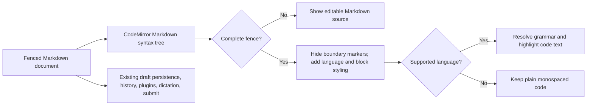

# feat: Add rich code blocks to the composer

## Summary

Keep fenced Markdown as the composer document, then derive a rich code-block
presentation from CodeMirror's Markdown syntax tree. Add focused keyboard and paste
transactions for fence conversion and block exit, while the existing draft, history,
plugin, dictation, and submission paths continue to read and write the same text.

---

## Problem Frame

The transcript now highlights supported fences, but the composer only recognizes the
Markdown markers. The implementation must close that gap without introducing a second
document model or breaking the composer's existing text ownership contract.

---

## Requirements

- R1-R5. Convert typed and pasted complete fences into editable code blocks with a visible language identity and supported syntax colours.
- R6-R11. Preserve newline, undo, selection, clipboard, history, persistence, dictation, plugin, exit, and canonical Markdown submission behavior.
- R12-R17. Keep transcript parity, reconnect and posture continuity, design-system fit, accessibility, verification, and visual acceptance.

**Origin actors:** A1 (Forgerie user), A2 (Pi session)
**Origin flows:** F1 (convert a typed fence), F2 (convert pasted Markdown), F3 (leave and send a code block)
**Origin acceptance examples:** AE1-AE8

---

## Scope Boundaries

- Do not add rich editing for non-code Markdown.
- Do not add preview modes, split panes, or a general rich-text document model.
- Do not change stored drafts, prompt history, message payloads, server APIs, or sessiond.
- Do not add stale-tab auto-reload behavior.
- Do not add viewport, device, user-agent, or touch-capability branches.

---

## Context & Research

### Relevant Code and Patterns

- `src/client/src/components/ComposerDraft.ts` owns the CodeMirror instance, draft text, keyboard behavior, persistence, paste handling, history, plugins, and dictation seams.
- `src/client/src/components/composerCommandMark.ts` derives visual treatment from ordinary editable document text with a CodeMirror decoration plugin.
- `src/client/src/components/composerDraftDictation.ts` shows how one editor transaction preserves selection, undo, and the component's draft-update path.
- `src/client/src/formatting/markdown.ts` defines the transcript's supported fence languages and closed-fence behavior.
- `src/client/src/components/CodeViewer.ts` shows CodeMirror language support and legacy stream-language integration.
- `src/client/src/components/shared.ts` owns composer and transcript styles through existing design tokens.

### Institutional Learnings

- CodeMirror extensions must be part of `createEditor()` so reconnect recreation restores behavior from canonical draft text.
- Layout transitions must keep the same editor instance; this feature must not remount it for presentation changes.
- All mutations must remain ordinary CodeMirror transactions observed by `ComposerDraft.updateDraft()`.
- The known short-landscape completion-menu overflow is pre-existing. Code-block chrome must not add a fixed overlay or another composer row.

### External References

- No external research is needed. The installed CodeMirror APIs and repository patterns cover the required behavior.

---

## Key Technical Decisions

- **Canonical Markdown plus derived presentation:** Complete `FencedCode` syntax nodes drive replacing, line, and widget decorations. The document always retains its fence markers and code text.
- **One shared language vocabulary:** Extract language names and aliases into metadata used by both transcript highlighting and exact composer language matching. CodeMirror uses `LanguageDescription` objects, but the current Vite manual chunk preloads the standard language bundle; changing that chunk policy is outside this feature.
- **Single-transaction conversion:** `Shift+Enter` on an opening fence inserts an empty code line, a closing fence, and a following prose position in one undoable transaction.
- **Derived paste conversion:** Plain-text paste remains one CodeMirror transaction. Complete fences become rich as soon as the syntax tree recognizes them; incomplete fences stay source text.
- **Explicit block exit:** The composer's existing Arrow Down handling first checks whether the cursor is on the final code line, then moves to or creates the prose position after the hidden closing fence before prompt-history navigation runs.
- **Non-colour identity:** A block widget displays the normalized language label. Untagged and unknown blocks still receive code-block structure without guessed token highlighting.

---

## Open Questions

### Resolved During Planning

- **Editor representation:** Use decorations derived from the Markdown syntax tree, not embedded editors or persisted conversion state.
- **Serialization:** No serializer is added. The CodeMirror document remains the exact fenced Markdown sent and stored today.
- **Paste boundary:** Text paste is one editor transaction; decoration recomputation handles all complete fences in that transaction.
- **Language loading:** Use exact CodeMirror language descriptions for the transcript-supported names and aliases. Keep the existing preloaded standard-language chunk and deferred legacy-language chunk unchanged.
- **Exit behavior:** Arrow Down from the last code line skips the hidden closing fence and enters the following prose line, creating it when absent.

### Deferred to Implementation

- Exact decoration ranges for opening and closing lines may adjust after validating CodeMirror cursor and measurement behavior.
- Exact generated syntax classes are implementation-owned; tests must assert visible token segmentation and language behavior rather than anonymous class names.

---

## High-Level Technical Design

> *This illustrates the intended approach and is directional guidance for review, not implementation specification. The implementing agent should treat it as context, not code to reproduce.*

---

## Implementation Units

### U1. Share the fence-language vocabulary

**Goal:** Keep transcript and composer language names and aliases aligned through exact CodeMirror grammar matching.

**Requirements:** R3, R4, R11-R13

**Dependencies:** None

**Files:**
- Create: `src/client/src/formatting/codeFenceLanguages.ts`
- Create: `src/client/src/components/composerCodeLanguages.ts`
- Modify: `src/client/src/formatting/markdown.ts`
- Test: `src/client/src/formatting/markdown.test.ts`
- Test: `src/client/src/components/ComposerDraft.codeBlock.test.ts`

**Approach:**
- Define product-level canonical language names and common aliases without importing either highlighting engine.
- Register highlight.js grammars and aliases from that vocabulary.
- Build CodeMirror `LanguageDescription` entries for the same names without changing the repository's current editor chunk policy.

**Execution note:** Implement test-first. Start with SQL and alias parity through the public transcript and composer boundaries.

**Patterns to follow:**
- Existing selective highlight.js registration in `src/client/src/formatting/markdown.ts`.
- CodeMirror language selection in `src/client/src/components/CodeViewer.ts`.

**Test scenarios:**
- Happy path: `sql` resolves in both transcript and composer.
- Edge case: common aliases such as `js`, `ts`, `sh`, and `shell` match their canonical grammar.
- Error path: an unknown tag receives no grammar.

**Verification:**
- Both presentation paths consume one canonical language vocabulary and unknown tags remain plain.

### U2. Add derived rich code-block presentation

**Goal:** Render each complete fence as one editable code block while keeping the source document unchanged.

**Requirements:** R1-R5, R8, R9, R14-R16

**Dependencies:** U1

**Files:**
- Create: `src/client/src/components/composerCodeBlock.ts`
- Modify: `src/client/src/components/ComposerDraft.ts`
- Modify: `src/client/src/components/shared.ts`
- Test: `src/client/src/components/ComposerDraft.codeBlock.test.ts`

**Approach:**
- Derive complete fence ranges from the Markdown syntax tree.
- Replace the visible opening and closing marker lines, expose an accessible language header, and decorate code lines as one bounded region.
- Recompute after document, viewport, or syntax-tree changes so grammar activation and restored drafts converge without persisted presentation state.
- Keep block geometry intrinsic and inside the existing editor scroller.

**Execution note:** Implement test-first through a mounted real `ComposerDraft` and its CodeMirror DOM.

**Patterns to follow:**
- `src/client/src/components/composerCommandMark.ts` for derived decorations.
- `src/client/src/components/shared.ts` for token-based composer styling.

**Test scenarios:**
- Covers AE1: a complete fence hides markers, shows a language label, and keeps exact Markdown in `getText()`.
- Covers AE2: SQL code renders token spans inside the block after its grammar activates.
- Covers AE3: a pasted complete fence converts while an incomplete fence stays visible source.
- Covers AE6: an unknown tag shows a labelled plain code block without guessed token spans.
- Edge case: an empty complete fence remains a visible editable block.
- Edge case: multiple blocks and surrounding prose keep independent boundaries.

**Verification:**
- Rich presentation is wholly derived from source text and survives editor recreation.

### U3. Add conversion, exit, and round-trip behavior

**Goal:** Make the Claude.ai-style keyboard flow deterministic without changing existing composer shortcuts or text contracts.

**Requirements:** R1, R2, R5-R11, R14, R16

**Dependencies:** U2

**Files:**
- Modify: `src/client/src/components/composerCodeBlock.ts`
- Modify: `src/client/src/components/ComposerDraft.ts`
- Test: `src/client/src/components/ComposerDraft.codeBlock.test.ts`

**Approach:**
- Complete an opening fence only when `Shift+Enter` occurs at the end of a valid opener line.
- Insert the code line, closing fence, following prose position, and cursor selection in one transaction.
- Give block exit priority over prompt-history navigation when Arrow Down runs on the final code line.
- Let all other Enter, Shift+Enter, Arrow Down, clipboard, dictation, plugin, history, persistence, and submit behavior continue through existing paths.

**Execution note:** Implement each keyboard behavior from a failing component test before production changes.

**Patterns to follow:**
- Existing Enter and prompt-history routing in `src/client/src/components/ComposerDraft.ts`.
- One-dispatch text mutations in `src/client/src/components/composerDraftDictation.ts`.

**Test scenarios:**
- Covers AE1: `Shift+Enter` converts a valid opener and one undo restores the opener and cursor.
- Edge case: ordinary prose `Shift+Enter` still inserts a newline.
- Edge case: `Shift+Enter` inside a block inserts a code line.
- Covers AE4: Arrow Down on the final code line enters existing following prose or creates an empty prose line.
- Edge case: Arrow Down on earlier code lines remains normal cursor movement.
- Covers AE5: persistence, reconnect recreation, public `getText()`, and submit payload retain exact fences.
- Integration: pasted and typed blocks behave identically when sent.

**Verification:**
- The complete create, edit, exit, persist, restore, and send flow works through the component's public contract.

### U4. Verify transcript parity and device behavior

**Goal:** Prove the two requested transcript and composer locations show the expected formatting without layout regressions.

**Requirements:** R12-R17

**Dependencies:** U1-U3

**Files:**
- Modify: `.changeset/highlight-markdown-code-fences.md`
- Test: `src/client/src/components/ComposerDraft.codeBlock.test.ts`
- Test: `src/client/src/formatting/markdown.test.ts`

**Approach:**
- Extend the existing Markdown highlighting changeset to include rich composer blocks.
- Exercise a user SQL fence through a fresh client and the composer through real viewport emulation.
- Review dark and light captures for all four Fold 8 postures.

**Test scenarios:**
- Covers AE7: user and assistant SQL fences use the same transcript renderer after a fresh load.
- Covers AE8: the converted block remains readable and unclipped across all eight posture and colour-scheme captures.
- Regression: untagged, unknown, open, and oversized transcript fences retain their established fallback behavior.

**Verification:**
- `npm run verify` and `npm run build` pass.
- All eight captures are inspected, not only generated.
- The running web service serves the rebuilt client and local and tailnet health checks return `200`.

---

## System-Wide Impact

- **Interaction graph:** CodeMirror editor input flows through its existing update listener into draft persistence, prompt history, plugins, dictation, and submission. Transcript rendering remains downstream of stored Markdown.
- **Error propagation:** A grammar-load failure leaves plain editable code; it must not block typing or sending.
- **State lifecycle risks:** No durable rich state is added. Decorations rebuild from canonical text after reconnect or remount.
- **API surface parity:** `getText()`, `getSelection()`, `replaceText()`, `insertTextAtSelection()`, draft storage, and submit payloads keep their current contracts.
- **Integration coverage:** Mounted component tests prove real CodeMirror transactions, DOM presentation, undo, persistence, and submit behavior together.
- **Unchanged invariants:** Attachments, completions, shell mode, dictation ownership, prompt history, and server message formats remain unchanged.

---

## Risks & Dependencies

| Risk | Mitigation |
|------|------------|
| Replacing fence lines traps the cursor or breaks deletion | Supply atomic ranges, explicit exit handling, and focused cursor tests. |
| Grammar activation does not trigger decoration or token refresh | Recompute when the syntax tree changes and test eventual SQL token rendering. |
| Hidden markers make copy or undo lossy | Keep markers in the document and assert exact source through copy-facing and undo contracts. |
| Code-block chrome consumes short-landscape height | Keep it inside the existing editor scroller, use compact intrinsic styling, and review 711 × 374 explicitly. |
| Shared language metadata causes bundle coupling | Keep metadata dependency-free and isolate each engine's grammar imports in its own module. |

---

## Documentation / Operational Notes

- This is a user-visible compatible feature and extends the existing patch changeset.
- The web service must rebuild and restart after the commit. Restart sessiond only when no session is active because it terminates in-flight runs.
- Returning tabs must reload to obtain the new client bundle; automatic reload remains outside scope.

---

## Sources & References

- **Origin document:** [work/items/active/20260822T001634Z-rich-code-block-composer/requirements.md](requirements.md)
- Related code: `src/client/src/components/ComposerDraft.ts`
- Related code: `src/client/src/components/composerCommandMark.ts`
- Related code: `src/client/src/formatting/markdown.ts`
- Related styles: `src/client/src/components/shared.ts`
