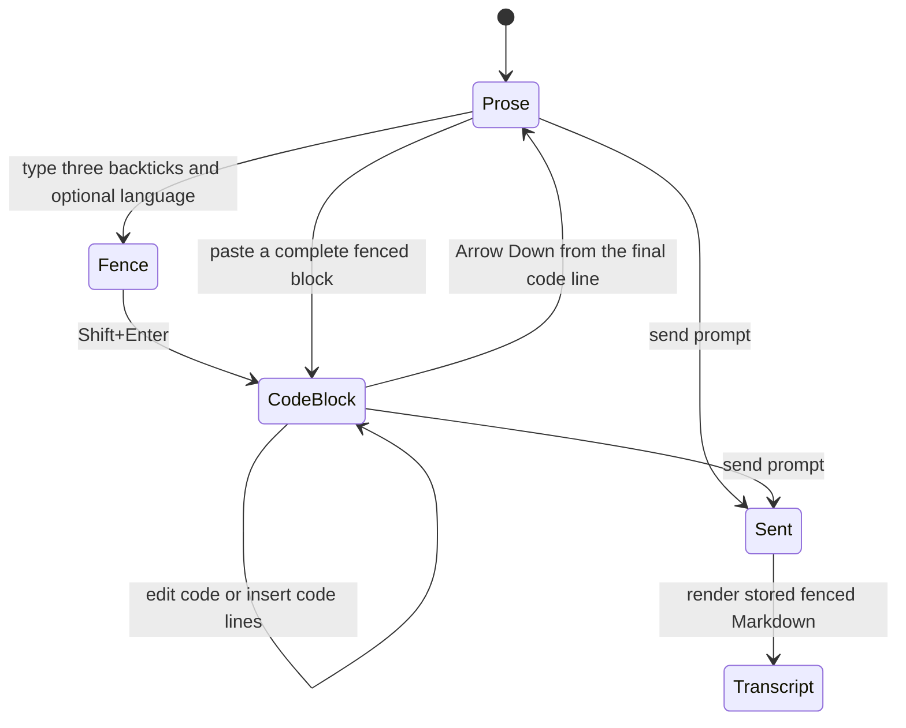

# Rich Code Blocks in the Composer

## Summary

Convert Markdown fences into editable, syntax-highlighted code blocks inside the
composer. Keep fenced Markdown as the durable draft and sent-message format, and
render user code blocks with the same treatment as assistant code blocks.

---

## Problem Frame

Forgerie highlights supported fenced code blocks after Markdown reaches the
transcript, but the composer only styles the fence markers and language name. The
code itself remains plain text. This creates a visible break between composing and
reading, and it gives no confirmation that a language tag such as `sql` was
recognized before the prompt is sent.

An already-open browser tab can also keep an older client after a local deployment.
That stale client continues to render newly sent messages with the code it loaded at
page start until the page reloads.

---

## Actors

- A1. Forgerie user: writes, pastes, edits, and sends prompts from the composer.
- A2. Pi session: receives standard Markdown text and returns conversation history for the transcript.

---

## Key Flows



- F1. Convert a typed fence
  - **Trigger:** A1 types three backticks, an optional language name, and presses `Shift+Enter`.
  - **Actors:** A1
  - **Steps:** The fence becomes one code-block editing region, its markers leave the visual editing surface, and the cursor moves into the block.
  - **Outcome:** A1 edits highlighted code without switching composer modes.
  - **Covered by:** R1-R4, R6, R7

- F2. Convert pasted Markdown
  - **Trigger:** A1 pastes one or more complete fenced code blocks.
  - **Actors:** A1
  - **Steps:** Complete fences convert in place while surrounding prose remains editable.
  - **Outcome:** Pasted Markdown uses the same code-block editing treatment as typed Markdown.
  - **Covered by:** R5, R8, R9

- F3. Leave and send a code block
  - **Trigger:** A1 presses `Arrow Down` from the final code line or sends the prompt.
  - **Actors:** A1, A2
  - **Steps:** Arrow Down moves into normal prose after the block. Sending serializes the visual block as ordinary fenced Markdown.
  - **Outcome:** A1 can continue the prompt after code, and A2 receives the established Markdown format.
  - **Covered by:** R10-R13

---

## Requirements

**Conversion and presentation**

- R1. Typing three backticks followed by an optional language name and `Shift+Enter` converts that fence into an editable code block in the same composer surface.
- R2. Conversion hides the opening and closing fence markers from the visual editing surface and places the cursor inside the code block.
- R3. A tagged block shows its language in a readable way that does not depend on token colour alone.
- R4. Languages supported by transcript highlighting receive syntax colours in the composer. Untagged and unknown languages remain editable monospaced code without guessed syntax.
- R5. Pasting complete fenced Markdown converts every complete fence while preserving prose and incomplete fences as ordinary editable text.

**Editing and durable text**

- R6. The composer keeps its current send and newline shortcuts. Inside a code block, the existing newline shortcut inserts a code line instead of leaving the block.
- R7. The fence-to-block conversion is one undoable editor action. Undo restores the exact source text and selection from before conversion.
- R8. Selection, copy, cut, paste, deletion, prompt history, dictation replacement, and plugin text insertion continue to operate through the composer’s public text contract.
- R9. Session-scoped draft persistence, draft recovery, and reconnection preserve the code block and its exact Markdown text.
- R10. `Arrow Down` from the final code line moves the cursor into normal prose after the block. If no prose follows, the composer creates an empty prose position.
- R11. Sending serializes visual code blocks as standard fenced Markdown with the original language name and code text.

**Transcript and lifecycle**

- R12. Sent user messages render fenced code through the same highlighted Markdown path as assistant messages.
- R13. Reloading a client after deployment rerenders historical user code blocks with the current supported-language set. Automatic stale-tab reload is not required.
- R14. Code-block editing survives focus changes, fold and unfold transitions, rotation, keyboard open and close, and composer movement between chat and new-session hosts.
- R15. The code block uses the existing design tokens, code typeface, border treatment, and horizontal scrolling. It adds no separate preview panel, mode toggle, or width breakpoint.
- R16. Keyboard focus, cursor position, language identity, and code boundaries remain perceivable without relying on colour alone.
- R17. The completed behavior passes repository verification and visual review in dark and light themes across all four Galaxy Z Fold 8 posture viewports.

---

## Acceptance Examples

- AE1. **Covers R1-R4, R7.** Given a prose draft ending in `````sql``, when A1 presses `Shift+Enter`, the markers disappear, an SQL-labelled code block appears, and undo restores `````sql`` exactly.
- AE2. **Covers R4, R6.** Given a converted SQL block, when A1 enters `SELECT * FROM users`, SQL keywords receive syntax colours and the newline shortcut inserts another line inside the block.
- AE3. **Covers R5, R8.** Given prose containing two pasted complete fences and one incomplete fence, when paste completes, the two complete fences become code blocks and the incomplete fence remains source text.
- AE4. **Covers R10.** Given the cursor on the final code line with no following prose, when A1 presses `Arrow Down`, the cursor moves to a new normal prose position after the block.
- AE5. **Covers R9, R11.** Given a converted `sql` block, when the draft persists, reconnects, and sends, the exact payload remains a `sql` fenced Markdown block with unchanged code.
- AE6. **Covers R4.** Given an unknown language tag, when the fence converts, the block remains editable and labelled but receives no guessed token colours.
- AE7. **Covers R12, R13.** Given a sent user SQL fence and a freshly loaded current client, when the transcript renders, the user block has the same SQL token treatment as an assistant block.
- AE8. **Covers R14-R17.** Given an open converted block, when the Fold 8 changes posture and colour scheme, the block, draft, cursor ownership, and composer composition remain intact without clipping.

---

## Success Criteria

- A1 can create a Claude.ai-style code block without leaving the composer or managing a preview mode.
- The visual editing form and the text received by A2 remain losslessly interchangeable.
- Typed, pasted, restored, and sent fences follow one behavior contract.
- Planning and implementation do not need to invent conversion, exit, serialization, or scope behavior.

---

## Scope Boundaries

- No rich-text conversion for headings, lists, emphasis, tables, links, or blockquotes.
- No split source and preview layout.
- No Edit and Preview toggle.
- No replacement of the whole composer with a general rich-text editor.
- No server, session daemon, API, message schema, or stored-draft format change.
- No automatic reload of stale browser tabs after deployment.
- No new viewport, touch-capability, user-agent, or device-model branching.

---

## Key Decisions

- Code blocks convert in place after the Claude.ai-style fence shortcut rather than through a separate preview mode.
- Pasted complete fences convert too, so copied Markdown and typed Markdown do not create different editing experiences.
- Arrow Down leaves the final code line because it preserves the existing Enter-to-send and Shift+Enter newline contract.
- Fenced Markdown remains canonical. This protects draft persistence, prompt history, plugins, the wire format, and agent-readable source. The cost is that cursor, selection, clipboard, and undo behavior around visually hidden markers need explicit coverage.
- Rich editing is limited to code blocks. Expanding this into a general WYSIWYG Markdown composer would add a second document model and much larger maintenance cost.

---

## Dependencies / Assumptions

- The current composer text API remains the source of truth for draft storage, history, dictation, plugins, and submission.
- The transcript Markdown renderer remains the source of truth for sent-message code highlighting.
- The existing supported-language set is sufficient for the first version. Unsupported tags still convert to plain code blocks.
- The acceptance target remains the measured Galaxy Z Fold 8 posture matrix in `AGENTS.md`.

---

## Outstanding Questions

### Deferred to Planning

- [Affects R1-R11][Technical] Select the smallest editor representation that can hide fence markers while preserving one canonical Markdown document, one undo history, and the current public text API.
- [Affects R4][Technical] Reuse the transcript language set without eagerly loading every language into the initial composer bundle.
- [Affects R5, R7, R8][Technical] Define transaction boundaries for multi-fence paste, conversion undo, selection mapping, and clipboard serialization.
- [Affects R10][Technical] Define the exact cursor transition when Arrow Down leaves a final line that already has following prose.
