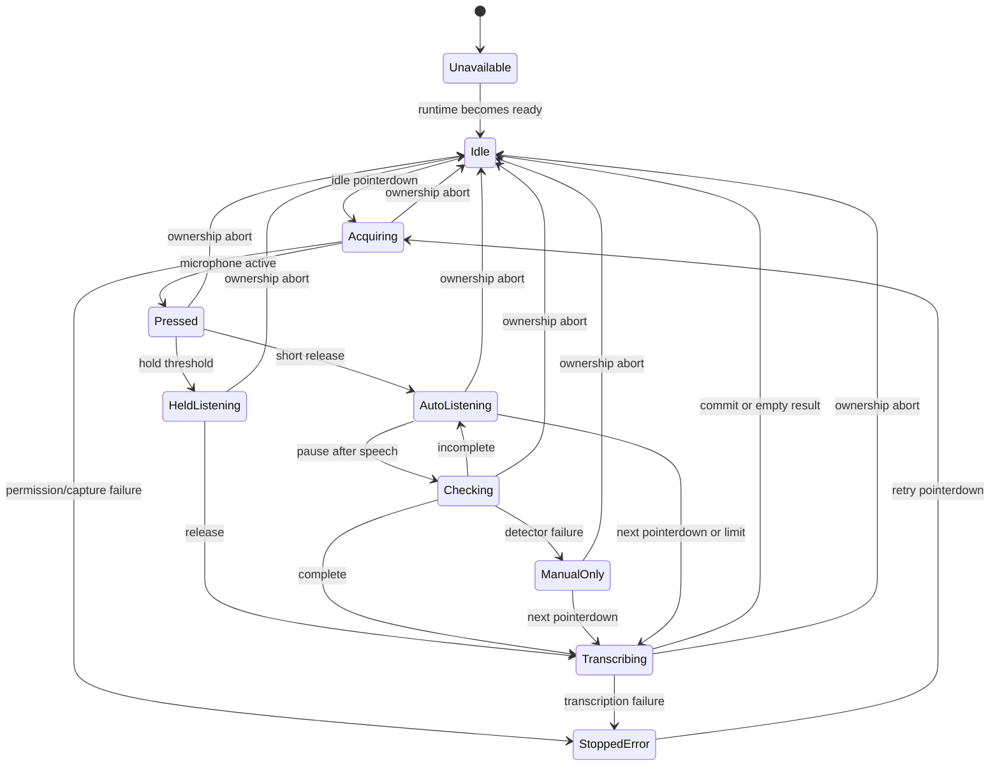

# Composer local speech dictation implementation plan

## Summary

Replace the unmerged browser Web Speech implementation with a Forgerie-owned pipeline. The browser captures bounded 16 kHz PCM, the web server owns persistent Smart Turn and whisper.cpp processes, and a composer lifecycle controller converts tap, hold, endpoint, cancellation, and transcription results into one editable draft insertion.

---

## Problem Frame

The old plan and its nine implementation commits solved keyboard-free prompting through browser Web Speech. The confirmed direction now requires local Whisper, Smart Turn endpointing, and press-duration behavior, while main has also extracted CodeMirror ownership into `ComposerDraft`. The replacement must start from current `main` and preserve the proven draft/session safety patterns semantically rather than preserving the obsolete provider API or stale component structure.

---

## Requirements

- R1. Provide one microphone control only in the message composer.
- R2. Start microphone capture on the initial press without focusing the editor or opening the keyboard.
- R3. Treat a short release as hands-free capture that Smart Turn may complete automatically.
- R4. Treat a held press as an explicit turn whose capture cannot end before release because of Smart Turn.
- R5. Complete a held turn on release and complete an active hands-free turn immediately on the next microphone press.
- R6. Capture the current draft selection and replace or insert at that selection after transcription.
- R7. Show explicit capture, completion-check, transcription, degraded, and error states without promising interim words.
- R8. Insert ordinary editable draft text and never submit, queue, steer, or reopen the keyboard automatically.
- R9. Use Smart Turn only for turn completion, never semantic interpretation.
- R10. Continue after an incomplete result and retain manual completion when Smart Turn fails.
- R11. Use local whisper.cpp rather than browser Web Speech.
- R12. Transcribe one complete bounded turn and insert its result once.
- R13. Bound silence, turn duration, body size, endpoint requests, and inference time.
- R14. Abort on ownership loss and reject every late result from a previous session or component lifetime.
- R15. Release resources and preserve the draft on permission, hardware, process, request, timeout, and empty-speech failures.
- R16. Send audio only to the Forgerie server for endpointing/transcription and never store raw audio durably.
- R17. Fit the microphone and speech states into the intrinsic composer action rail.
- R18. Preserve capture and draft ownership through foreground Fold posture transitions, with physical-device completion evidence.

**Origin actors:** A1 (Forgerie user), A2 (message composer), A3 (Forgerie speech pipeline)

**Origin flows:** F1 (tap for automatic completion), F2 (hold for explicit completion), F3 (stop, fail, or leave safely)

**Origin acceptance examples:** AE1-AE8 from the origin document, including incomplete-turn continuation, held-button suppression, selection-aware insertion, degraded manual completion, cross-session abort, finite limits, and all four Fold postures.

---

## Scope Boundaries

- No speech input outside the message composer. Active-session, opening-session, and pre-session/new-session composers expose the same dictation capability.
- No browser Web Speech path, provider selector, or fallback provider.
- No live word-by-word interim transcription.
- No automatic prompt submission, semantic intent routing, voice commands, or spoken composer actions.
- No durable raw-audio recording, playback, or second transcript store.
- No app-wide public speech API yet. Internal contracts stay reusable without exposing a plugin or agent API.
- No phone-only or offline inference requirement.
- Do not merge or preserve the old `feat/composer-live-dictation` commits wholesale. Reuse only provider-independent behavior that still fits current `main`.

### Deferred to Follow-Up Work

- Native-service installer and Docker/macOS packaging for the model runtimes: the first slice ships pinned Nix packages for the current NixOS deployment and reports speech unavailable when its named runtime commands are absent.
- Speech input in `ask_user`, settings, editors, terminals, plugins, or agent tools.
- Shared public speech capabilities for the user's larger future voice plans.

---

## Context & Research

### Relevant Code and Patterns

- `src/client/src/components/PromptEditor.ts` is the compound composer root and owns its action rail and host-declared capabilities.
- `src/client/src/components/ComposerDraft.ts` now owns CodeMirror, durable draft persistence, attachments, completion state, and submission. Dictation must use a narrow public seam rather than reaching into its `EditorView` from `PromptEditor`.
- `src/client/src/composerCapabilities.ts` is the rule for adding controls: a host declares a capability and supplies its behavior.
- `src/server/app.ts` uses dependency-injected feature services and focused `register*Routes` modules.
- `src/server/workspaceExplorerRoutes.ts` proves Fastify binary-body parsing; speech routes need a stricter feature-specific limit.
- `src/server/index.ts` is the live composition root. It can create and warm the speech runtime without making ordinary `buildApp()` tests spawn model processes.
- `src/nativeServices/servicePlan.ts` and `src/cli.ts` manage the existing web/sessiond services. Speech subprocesses remain web-owned in this slice rather than adding externally managed service IDs.
- The unmerged branch's `promptDictationController.ts` proves generation/token/owner guards and stop-versus-abort separation. Its browser-segment and interim-result model is obsolete.
- The unmerged branch's `promptEditorDictation.ts` proves selection anchoring and normal CodeMirror final edits. It must move behind `ComposerDraft` and drop provisional text.
- Comics commits `2b40e12` and `8657387` are the direct source pattern: pinned Smart Turn v3.2 and whisper.cpp model packages, a persistent JSONL Smart Turn worker, and a persistent loopback `whisper-server`.

### Institutional Learnings

- `docs/briefs/2026-08-11-bounded-session-runtime-lifecycle-brief.md` requires explicit ownership, cancellation, bounded resources, race-safe teardown, and real runtime verification for persistent processes.
- `AGENTS.md` requires intrinsic/container-driven UI and physical Galaxy Fold validation across 704×783, 932×553, 475×638, and 711×374 CSS viewports.
- `AGENTS.local.md` requires a built `dist/`, safe restart timing, and verification of the running HTTPS PWA after user-facing work lands on `main`.
- `.agents/skills/testing-guide/SKILL.md` prefers pure contract tests, configurable real implementations, real in-process servers/subprocesses where practical, happy-dom only for DOM interaction, and full `npm run verify` before integration.

### External References

- MDN `getUserMedia`: https://developer.mozilla.org/en-US/docs/Web/API/MediaDevices/getUserMedia
- MDN AudioWorklet: https://developer.mozilla.org/en-US/docs/Web/API/AudioWorklet
- MDN pointer capture: https://developer.mozilla.org/en-US/docs/Web/API/Element/setPointerCapture
- Fastify v5 content-type parsers: https://fastify.dev/docs/latest/Reference/ContentTypeParser/
- Node 22 child processes and AbortSignal: https://nodejs.org/docs/latest-v22.x/api/child_process.html
- whisper.cpp server contract: https://github.com/ggml-org/whisper.cpp/blob/master/examples/server/README.md
- Pipecat Smart Turn: https://github.com/pipecat-ai/smart-turn

---

## Key Technical Decisions

- **Server-side Smart Turn:** The browser sends the most recent bounded 16 kHz float32 PCM window only after local RMS activity detects a pause. The server-owned worker returns complete/incomplete; there is no browser ONNX runtime and no continuous WebSocket stream.
- **AudioWorklet capture:** Production uses an AudioWorklet, not deprecated `ScriptProcessorNode` or compressed `MediaRecorder` output. Capture keeps mono float32 samples, applies an anti-aliasing/downsampling path when the browser does not honor 16 kHz, and retains a bounded full-turn buffer plus the last eight seconds for Smart Turn.
- **Raw PCM browser contract:** The browser sends `application/octet-stream` float32 little-endian mono PCM at 16 kHz. The server validates byte alignment and duration before use. This is Smart Turn's native input and avoids decoding WebM/Opus.
- **WAV conversion at the server seam:** Only the whisper adapter converts validated float32 PCM to 16 kHz mono signed-16 WAV, then posts multipart form data to loopback `whisper-server`.
- **Persistent web-owned processes:** `src/server/index.ts` creates one aggregate speech runtime. It warms Smart Turn and Whisper eagerly without delaying the HTTP listener, reports component readiness separately, serializes each backend as required, restarts only through a bounded explicit recovery path, and closes both children with the web server. Whisper readiness permits manual-only dictation even when Smart Turn is warming or unavailable.
- **Pinned Nix packaging, resolved executable interface:** Forgerie semantically ports the two comics Nix packages and worker under Forgerie-owned names. At startup, the live runtime resolves named executables to trusted absolute paths; optional overrides accept absolute executable paths only. Children spawn without a shell, fixed arguments, a minimal allowlisted environment, and a non-sensitive working directory. Missing commands degrade speech only; they do not stop the web UI or session daemon.
- **Gateway-local capability:** Speech runs on the gateway serving the browser, regardless of which federated machine receives the final prompt. Speech routes are not duplicated under selected-machine proxy prefixes.
- **Schema-owned responses:** Shared TypeBox schemas define readiness, turn-decision, transcription, and discriminated error payloads. The client parses JSON through those schemas rather than trusting ad hoc objects.
- **High-level draft seam:** `ComposerDraft` owns a CodeMirror state extension and exposes begin, commit, finish, and abort operations. The extension captures/maps the original selection, locks user mutation, and commits transcript text through an ordinary history/persistence transaction. `PromptEditor` never manipulates the child editor directly.
- **One tagged lifecycle:** The controller models unavailable, idle, acquiring, pressed, auto-listening, held-listening, manual-only listening, checking, transcribing, and stopped-error states. Gesture mode, ownership, and failure recovery do not live in independent booleans.
- **Immediate second-press completion:** A pointerdown while already auto-listening or manual-only listening ends the current turn immediately. It never starts a second hold timer or a new capture.
- **Hold suppresses endpointing, not capture:** The hold threshold changes mode while the original capture continues. Complete Smart Turn responses are ignored while held; release takes precedence and transcribes the bounded full turn.
- **Stop and abort stay distinct:** Automatic completion, second press, held release, and finite limit stop capture and transcribe. Session change, true page backgrounding, disconnect, disabled/archived state, or component disposal aborts capture and drops unfinished audio.
- **Visible privacy explanation without a second consent gate:** Before capture, the microphone control has an accessible description that audio goes to the current Forgerie gateway for endpointing/transcription, not the selected machine, and is not stored as application data. The browser permission flow remains the actual first-use gate. The obsolete browser-provider disclosure and storage key are not ported.
- **Measured model lifetime:** Persistent warmth is the preferred single-host policy, but U9 must prove whole-process-tree memory and CPU headroom before U2 fixes it. If the speech runtime plus measured peak agent workload exceeds the accepted host budget, implementation must choose idle retirement or a smaller model rather than silently accepting pressure.
- **Bounded admission before serialization:** Each backend admits one active operation and at most one queued operation, with an aggregate queued-byte budget and queue-inclusive deadline selected by U9. Extra work fails fast with a typed busy response; cancelled queued work releases its PCM immediately.
- **Truthful active cancellation:** Cancelling a queued operation removes it. Cancelling an active operation detaches the caller but keeps the backend slot occupied until computation really ends. A hard deadline that cannot interrupt compute terminates and boundedly restarts the child before new work is admitted.

---

## Open Questions

### Resolved During Planning

- **Does Smart Turn run in the browser or server?** Server. The pinned Python/ONNX worker is owned by the Forgerie web runtime, matching the confirmed audio-transport requirement and the comics protocol.
- **Who owns model lifecycle?** The web composition root, not sessiond and not user sessions. Model failure affects dictation availability only.
- **How does a second press behave?** It completes the existing auto/manual turn on pointerdown; hold detection is only valid on an idle start.
- **How does dictation reach CodeMirror?** Through a new `ComposerDraft` public operation set backed by a CodeMirror extension; the parent does not reach through the child's `view` accessor.
- **Where is speech exposed?** The active/opening session composer and the pre-session/new-session modal use the same host-owned composer capability.
- **What happens when Smart Turn fails mid-turn?** Capture continues in a visible manual-only state. The next microphone press transcribes the buffered turn.
- **Does the old disclosure survive?** No. It was unmerged and describes the wrong privacy model.

### Deferred to Implementation

- **Hold duration:** U10 measures a centralized, injectable policy on the physical Fold before U6 fixes controller expectations; do not hard-code a device class rule.
- **RMS and pause policy:** Port the prototype's proven baseline (0.012 RMS, 650 ms pause, eight-second detector window), then adjust only from recorded physical-device evidence.
- **Maximum turn and request deadlines:** U9 characterizes 3-, 10-, 30-, and 60-second turns and freezes shared limits before route/client implementation. Sixty seconds is the provisional ceiling; the prototype's 180-second buffer is not the default because copies and serialized inference amplify its cost.
- **Fold lifecycle events:** Hidden, frozen, `pagehide`, screen-off, lock, and true app backgrounding must stop tracks promptly. U8 instruments the physical PWA to verify whether foreground fold/rotation emits those events. If Chrome provides no reliable distinction, report an R18 blocker rather than use an unbounded grace-period or device heuristic that can record in the background.
- **AudioWorklet resampling details:** U9 and U4 verify the target browser's actual context sample rate. The worklet performs allocation-bounded downsampling, RMS/activity classification, and audio-frame timing, then transfers 40–50 ms batches to the main thread; browser filter nodes supply anti-aliasing where required.

---

## Output Structure

```text
flake.nix
flake.lock
nix/
  smart-turn.nix
  whisper-stt.nix
speech/
  smart_turn_worker.py
scripts/
  speech-runtime-benchmark.mjs
src/shared/
  speechContracts.ts
  speechPolicy.ts
src/server/speech/
  speechAudio.ts
  smartTurnProcess.ts
  whisperProcess.ts
  speechService.ts
  speechRoutes.ts
src/client/src/
  api/speech.ts
  speechCapture.ts
  speechCaptureWorklet.ts
  speechCaptureWorklet.globals.d.ts
  controllers/promptDictationController.ts
  controllers/promptDictationGesture.ts
  components/composerDraftDictation.ts
```

This tree declares the expected ownership boundaries. Exact helper names may change if implementation reveals a deeper, smaller interface.

---

## High-Level Technical Design

> *This illustrates the intended approach and is directional guidance for review, not implementation specification. The implementing agent should treat it as context, not code to reproduce.*

```mermaid
sequenceDiagram
    participant U as User
    participant P as PromptEditor
    participant D as ComposerDraft
    participant C as Browser capture
    participant R as Forgerie speech routes
    participant S as Smart Turn worker
    participant W as whisper-server

    U->>P: pointerdown microphone
    P->>D: begin at current selection; lock mutation
    P->>C: acquire and capture PCM
    alt short release
        U->>P: pointerup before hold threshold
        P->>P: enter auto-listening
        C->>P: speech pause + recent 8s window
        P->>R: check turn
        R->>S: correlated PCM request
        S-->>R: incomplete / complete
        R-->>P: decision
    else held release
        P->>P: enter held-listening; suppress decisions
        U->>P: pointerup
    end
    P->>C: stop and finalize bounded PCM
    P->>R: transcribe complete turn
    R->>W: signed-16 WAV multipart request
    W-->>R: text
    R-->>P: validated transcription
    P->>D: commit once through ordinary draft transaction
    D-->>P: persisted editable text
```



---

## Implementation Units

### U1. Package the pinned local speech runtimes

**Goal:** Make the proven Smart Turn v3.2 worker and whisper.cpp base-English server app-owned, reproducible runtime inputs instead of machine-discovered prototype artifacts.

**Requirements:** R9, R11, R15, R16

**Dependencies:** None

**Files:**
- Create: `flake.nix`
- Create: `flake.lock`
- Create: `nix/smart-turn.nix`
- Create: `nix/whisper-stt.nix`
- Create: `speech/smart_turn_worker.py`
- Modify: `package.json`

**Approach:**
- Semantically port comics commits `2b40e12` and `8657387` under Forgerie command names.
- Pin model revisions and content hashes. Keep both model services loopback/local and offline after Nix realizes the models.
- Keep the Smart Turn protocol versioned and correlated by request ID. Keep the worker's eight-second, left-padded, latest-audio window and sequential CPU inference.
- Expose flake packages/apps for both commands and include the required Nix/worker sources in the npm package allowlist.
- Do not copy prototype book/TTS/server code or `/nix/store` discovery logic.

**Execution note:** Build and smoke the real Nix packages before adding Node adapters; packaging failures should surface before application code depends on them.

**Patterns to follow:**
- Comics Smart Turn package/worker at commit `2b40e12`.
- Comics Whisper package at commit `8657387`.
- `package.json` `files` allowlist and package smoke checks.

**Test scenarios:**
- Integration: each flake package builds on `x86_64-linux` and exposes its documented command.
- Integration: Smart Turn emits one ready record, accepts valid correlated 16 kHz float32 PCM, and returns the same request ID with a complete flag and probability.
- Error path: malformed protocol or audio produces a correlated typed error without killing the persistent worker.
- Integration: whisper-server starts loopback-only with the pinned model and accepts a small valid WAV inference request.
- Packaging: `npm pack --dry-run` includes the flake/Nix/worker sources and no fetched model binaries.

**Verification:**
- A clean checkout can realize both named runtimes reproducibly, and the package archive carries everything needed to evaluate those definitions.

---

### U9. Characterize the real models and freeze resource policy

**Goal:** Measure the pinned runtimes before server/client contracts depend on guessed turn, queue, deadline, thread, and lifetime limits.

**Requirements:** R7, R10-R13, R15; AE5, AE7

**Dependencies:** U1

**Files:**
- Create: `scripts/speech-runtime-benchmark.mjs`
- Create: `src/shared/speechPolicy.ts`
- Create: `src/shared/speechPolicy.test.ts`
- Modify: `flake.nix`

**Approach:**
- Drive the real pinned workers through cold start, representative warmup inference, and 3-, 10-, 30-, and 60-second speech fixtures.
- Record whole-process-tree RSS/CPU, first and warm inference latency, Smart Turn latency while Whisper runs, cancellation/timeout behavior, and restart overlap.
- Freeze one shared policy for PCM/sample/body limits, initial-speech timeout, endpoint interval/new-voiced-audio threshold, per-turn endpoint budget, one-active/one-queued admission, aggregate queued bytes, queue-inclusive deadlines, thread limits, restart budget/backoff, and model lifetime.
- Use a provisional 60-second maximum, 16 endpoint checks per turn, and one queued operation only until measurements justify a stricter value. Budget exhaustion degrades to manual-only capture rather than dropping audio.
- Treat readiness as complete only after a representative synthetic inference, not only process/TCP startup.
- Require measured speech peak plus measured peak agent workload to stay below 75% of physical memory before accepting persistent warmth.

**Execution note:** This is characterization-first. Commit measured policy evidence before building adapters around it.

**Patterns to follow:**
- U1 real runtime contracts.
- `docs/briefs/2026-08-11-bounded-session-runtime-lifecycle-brief.md` real stress-probe requirement.
- `src/shared/*Policy.ts` convention for centralized operational decisions.

**Test scenarios:**
- Characterization: cold start, first inference, and repeated warm inference produce stage timing and process-tree memory records without logging fixture speech text.
- Capacity: 3-, 10-, 30-, and 60-second turns identify request bytes, copy peaks, inference latency, and stable memory after at least 20 repeated turns.
- Contention: Smart Turn p95 is measured while Whisper is active and under one queued transcription.
- Cancellation: queued cancel, active disconnect, hard timeout, child termination, and restart show whether compute actually ends and whether replacement overlaps old compute.
- Policy: every selected limit is internally consistent; endpoint/body/sample limits agree and queue byte budgets cannot retain more than the declared bound.

**Verification:**
- U2-U4 can import one reviewed policy whose limits are backed by real model/host evidence, and persistent model lifetime has measured headroom.

---

### U10. Prove permission, tap/hold, and Fold lifecycle on the target

**Goal:** Resolve the physical interaction and lifecycle facts before the production controller and abort policy are fixed around assumptions.

**Requirements:** R2-R5, R7, R17-R18; AE1, AE3, AE8

**Dependencies:** U9

**Files:**
- Create: `prototypes/composer-dictation-input/index.html`
- Create: `prototypes/composer-dictation-input/NOTES.md`

**Approach:**
- Build a throwaway same-origin input harness with one composer-sized microphone control, native permission acquisition, pointer/keyboard event logging, AudioContext/sample-rate reporting, track-state reporting, and no model/network dependency.
- Measure the hold threshold, release/cancel behavior while permission or microphone acquisition is pending, keyboard-equivalent gestures, context-menu/scroll interference, rail fit, Android keyboard behavior, and lifecycle events across all four physical Fold postures.
- Latch release/cancel while acquiring. If release occurs before microphone readiness, a later successful acquisition enters auto-listening; it never invents a held turn with no captured audio. If the pointer remains held when readiness arrives and the threshold has elapsed, enter held mode. Denial/cancel unlocks and returns a recoverable state.
- Define keyboard parity from the same gesture state: Space keydown starts/holds, Space keyup releases, Enter or Space in auto/manual-only completes, repeated keydown is ignored, and Escape aborts ephemeral capture where safe.
- Fail closed on hidden/frozen/pagehide/home/lock/app-switch events. Record whether foreground fold/unfold emits any of them; do not add an unbounded grace period or device sniff.
- Use synthetic/non-sensitive sound for evidence. Never commit real microphone recordings; delete any transient calibration audio and verify removal before completing the unit.

**Execution note:** This is a disposable interaction probe, not production architecture. Record decisions in `NOTES.md`; U4/U6/U7 consume them.

**Patterns to follow:**
- `prototypes/pen-context/` for bounded interaction experiments.
- `AGENTS.md` physical Fold matrix and intrinsic layout constraints.
- Comics prototype only for PCM/capture observation, not its final UI.

**Test scenarios:**
- First permission: short release before grant, held pointer through grant, release before readiness, denial, prompt focus change, and pointercancel each settle visibly without a stuck track or draft lock.
- Pointer: short press, threshold-crossing hold, slide off/on under pointer capture, context-menu suppression, second press, and scroll-adjacent input map to one action each.
- Keyboard: Space hold/release, Enter/Space auto completion, key repeat, Escape, and focus movement have the same lifecycle outcomes as pointer input.
- Fold/privacy: each foreground posture transition records events and preserves capture when no ownership-loss event occurs; home, lock, app switch, screen off, hidden, freeze, and pagehide stop tracks promptly.
- Layout: the control and status fit 704×783, 932×553, 475×638, and 711×374 without another rail or width breakpoint.

**Verification:**
- U4/U6/U7 have recorded device facts for acquisition, gesture, accessibility, abort predicates, actual sample rate, and rail fit; no raw calibration recording remains.

---

### U2. Build the persistent server speech engine

**Goal:** Hide process startup, readiness, serialization, audio conversion, inference, cancellation, crash handling, and shutdown behind one small server contract.

**Requirements:** R9-R13, R15-R16; F1-F3

**Dependencies:** U1, U9

**Files:**
- Create: `src/server/speech/speechAudio.ts`
- Create: `src/server/speech/speechAudio.test.ts`
- Create: `src/server/speech/smartTurnProcess.ts`
- Create: `src/server/speech/smartTurnProcess.test.ts`
- Create: `src/server/speech/whisperProcess.ts`
- Create: `src/server/speech/whisperProcess.test.ts`
- Create: `src/server/speech/speechService.ts`
- Create: `src/server/speech/speechService.test.ts`

**Approach:**
- Validate one canonical PCM contract before either backend sees bytes: little-endian float32, mono, 16 kHz, finite samples, aligned length, and operation-specific duration bounds.
- Keep PCM-to-signed-16 WAV conversion pure and in memory.
- Run both native children inside the Nix package's Linux mount-namespace sandbox: read-only Nix store, private temp/home, no Pi profile or Forgerie data mounts, no sensitive inherited environment, and shared network only where loopback Whisper requires it. Treat wider-platform confinement as part of the deferred packaging work.
- Wrap Smart Turn as a persistent JSONL child with explicit ready/startup timeout, one-at-a-time request correlation, bounded stdout/stderr lines, typed process failures, and deterministic close. A cancelled active request must still drain its correlated response before the protocol admits another request.
- Wrap Whisper as a persistent child on an explicitly verified IPv4 loopback port, verify TCP/HTTP identity/readiness, serialize its global-mutex inference, send in-memory multipart WAV, and bound startup/inference time. A cancelled active request keeps the slot until the real HTTP operation settles; a hard deadline terminates and restarts a wedged child before admitting more work.
- Admit one active and one queued operation per backend under U9's queue-byte/deadline policy. Reject overload before retaining another full PCM body and remove cancelled queued work immediately.
- Aggregate component-level `warming | ready | unavailable` state. Warm eagerly when requested by the composition root, but never make web availability depend on model startup; ready Whisper with failed Smart Turn remains a manual-only capability.
- Resolve executable paths before spawn, use fixed arguments/no shell/minimal environment, bind children to loopback, and apply bounded restart backoff/budget.
- Use allowlisted structured log fields for process metadata and failures. Truncate diagnostics and never log PCM, WAV, recognized text, upstream bodies, or raw child output.
- Test process behavior with real configurable child programs and a real in-process HTTP server, not `Mock*`/`Fake*` classes.

**Execution note:** Implement audio validation/conversion test-first, then process adapters with real subprocess/in-process-server contract tests before composing them.

**Patterns to follow:**
- `src/nativeServices/serviceProbe.ts` for bounded real subprocess ownership and cleanup.
- `src/server/webSocketBridge.ts` and machine clients for AbortSignal propagation and structured transport failures.
- `docs/briefs/2026-08-11-bounded-session-runtime-lifecycle-brief.md` for ownership and race-safe teardown.

**Test scenarios:**
- Happy path: valid endpoint PCM reaches one Smart Turn request and returns complete/probability without copying unrelated prototype fields.
- Happy path: valid full-turn PCM converts to a readable 16 kHz mono signed-16 WAV and returns trimmed Whisper text once.
- Edge case: negative, positive, NaN, infinity, empty, misaligned, too-short, and over-limit samples are handled by the documented validation contract.
- Integration: concurrent Smart Turn and Whisper calls serialize per backend while callers receive their own results in request order.
- Error path: missing command, startup timeout, malformed ready line, mismatched request ID, child exit, whisper readiness failure, non-success inference response, invalid JSON, and inference timeout map to discriminated service failures.
- Cancellation: queued cancellation synchronously releases PCM/capacity; active cancellation detaches the caller but retains the backend slot until a real response, termination, or hard deadline proves compute ended.
- Overload: one active plus one queued request is accepted; the next request fails fast, aggregate PCM stays within policy, accepted order is stable, and queue time counts toward deadlines.
- Hardening: poisoned PATH, non-absolute overrides, inherited secrets, attempted reads of canary HOME/Pi/data paths, writable persistent temp, pre-bound ports, unexpected loopback responders, oversized child lines/bodies, and restart storms fail closed.
- Shutdown: service close rejects new work, settles/aborts active ownership, closes stdin, terminates children, waits for close, and escalates only after a bounded grace period without overlapping replacement children.

**Verification:**
- The web layer can use one stable service interface without knowing child protocols, ports, multipart encoding, WAV structure, or process recovery rules.

---

### U3. Publish bounded speech HTTP contracts

**Goal:** Give the browser typed readiness, endpoint-decision, and transcription operations with strict binary limits and cancellation.

**Requirements:** R9-R16; F1-F3; AE5-AE7

**Dependencies:** U2

**Files:**
- Create: `src/shared/speechContracts.ts`
- Create: `src/shared/speechContracts.test.ts`
- Create: `src/server/speech/speechRoutes.ts`
- Create: `src/server/speech/speechRoutes.test.ts`
- Modify: `src/server/app.ts`
- Modify: `src/server/index.ts`
- Modify: `src/server/app.testSupport.ts`

**Approach:**
- Define shared TypeBox schemas for status, turn decision, transcription, and discriminated errors. Keep raw PCM as the separately documented binary request contract.
- Register gateway-local routes for status, turn checking, and transcription. Do not add selected-machine proxy variants.
- Apply speech-route admission in an early hook before body parsing: cap concurrent admitted bodies, require acceptable declared lengths where present, and still enforce per-route limits for chunked/spoofed requests. Then apply operation-specific byte/sample/duration validation before inference.
- Keep the existing project security boundary explicit: all Forgerie APIs trust the Tailscale-restricted gateway rather than add app authentication. Speech adds fail-fast compute admission and same-origin Fetch Metadata/Origin checks as browser CSRF hardening, but does not mislabel those checks as authorization. Every tailnet peer allowed to reach Forgerie can otherwise invoke the API.
- Reject unsupported content encoding/media types, non-finite/out-of-range samples, oversized responses/transcripts, and schema-invalid worker output.
- Return no-store responses and stable error kinds suitable for user recovery; do not expose raw child stderr or provider payloads.
- Inject an unavailable implementation by default in `buildApp()` so ordinary app tests never spawn models. `src/server/index.ts` constructs the live service, starts warmup only after the HTTP listener succeeds, passes it into `buildApp()`, and closes it through app lifecycle. Any construction/listen failure closes a partially started speech runtime before process exit.
- Propagate request disconnect/timeout cancellation into the service operation.

**Execution note:** Start with failing real Fastify request/response tests for each public route and failure category.

**Patterns to follow:**
- `src/server/app.ts` `AppDependencies` and route registration.
- `src/server/workspaceExplorerRoutes.ts` binary parsing with a narrower speech limit.
- `src/server/app.testSupport.ts` real app fixture with injected implementations.
- `src/client/src/api/parsers.ts` style for wire parsing, with TypeBox as the new single source of truth for these contracts.

**Test scenarios:**
- Happy path: ready status, complete/incomplete endpoint results, and non-empty transcription responses validate against the shared schemas.
- Covers AE5. Detector unavailable returns a stable degraded error that lets the browser retain captured audio for manual completion.
- Covers AE7. Oversized and too-short requests fail before a model call and identify the applicable limit.
- Error path: unsupported content type/encoding, absent or spoofed length, chunked overflow, one-byte-over body, unaligned/non-finite PCM, service warming, missing runtime, child failure, oversized response/transcript, empty transcription, timeout, overload, and cancelled request map to the intended status and error kind.
- Admission: requests above concurrent-body, active, queued, or queued-byte budgets fail before model invocation and release admission on disconnect.
- Security boundary: accepted same-origin browser requests work under nested deployment prefixes; cross-origin browser requests fail Fetch Metadata/Origin policy; tests document that direct trusted-tailnet clients remain inside the project's network trust boundary.
- Privacy: route/application/reverse-proxy test logs and temp/runtime directories contain neither canary PCM nor canary transcript text across success, malformed response, timeout, cancellation, child crash, and overload.
- Integration: closing the Fastify app closes the injected live speech service exactly once.
- Regression: unrelated `buildApp()` tests remain process-free and green.

**Verification:**
- A browser client can capability-check and use both operations through stable typed contracts, while malformed or abandoned work stays bounded before reaching model code.

---

### U4. Capture bounded browser PCM and call the speech API

**Goal:** Provide a reusable browser-edge implementation that acquires the microphone, produces validated 16 kHz PCM, detects pause candidates, retains bounded windows, calls the speech routes, and releases every browser resource.

**Requirements:** R2-R5, R7, R10, R12-R16; F1-F3

**Dependencies:** U3, U10

**Files:**
- Create: `src/client/src/speechCaptureWorklet.ts`
- Create: `src/client/src/speechCaptureWorklet.globals.d.ts`
- Modify: `eslint.config.js`
- Create: `src/client/src/speechCapture.ts`
- Create: `src/client/src/speechCapture.test.ts`
- Create: `src/client/src/api/speech.ts`
- Create: `src/client/src/api/speech.test.ts`

**Approach:**
- Hide `getUserMedia`, AudioContext, AudioWorklet loading, source/filter/worklet graph, sample-rate conversion, RMS calculation, ring buffering, track stop, and context close behind a capture-session contract.
- Request mono capture with echo cancellation, noise suppression, and auto gain. Treat browser sample-rate constraints as preferences and inspect the actual AudioContext rate.
- Bundle the worklet through Vite with explicit minimal ambient declarations and an ESLint globals override for AudioWorklet-only globals; do not make the whole client type environment pretend it runs in the render thread.
- Use an AudioWorklet that always stays alive while capture owns it. Keep per-render-quantum work allocation-free; perform downsampling, RMS/activity classification, audio-frame timestamps, and the producer-side sample ceiling there, then transfer 40–50 ms buffers to the main thread with a bounded outstanding-batch policy.
- Low-pass before downsampling when the context rate exceeds 16 kHz. Keep conversion deterministic and directly testable.
- Store samples once in an O(1) chunk deque; expose the latest eight seconds as a logical view over the same storage. Flatten once for each endpoint request and once at finalization, release retained chunks after the final body owns its bytes, and avoid the prototype's shifting-array behavior.
- Emit a pause candidate only after speech energy has crossed the threshold and the pause policy has elapsed in audio-frame time, not delayed main-thread timer time.
- API calls use AbortSignal and parse every JSON response through the shared schemas. They never retry transcription implicitly.
- Acquisition starts directly from the trusted pointer event path. No network readiness check, storage write, or animation is awaited before `getUserMedia()` is requested.

**Execution note:** Implement resampling, RMS/pause selection, and bounded ring behavior test-first. Use an injected browser host for lifecycle tests; do not make happy-dom pretend to be a real audio engine.

**Patterns to follow:**
- Comics prototype capture/downsampling/generation behavior, replacing only its intentional `ScriptProcessorNode` shortcut.
- `src/client/src/api/http.ts` and `src/client/src/api/clients.test.ts` for same-origin requests and parser tests.
- `src/client/src/appUrl.ts` for reverse-proxy-prefix-safe URLs.

**Test scenarios:**
- Happy path: native 16 kHz and higher-rate mono chunks produce the expected bounded 16 kHz float32 samples in order.
- Edge case: stereo input uses one documented channel, empty worklet frames do nothing, and ring truncation keeps the newest full-turn/window samples.
- Happy path: speech above threshold followed by the configured pause emits one endpoint candidate; new speech invalidates the pending candidate and re-arms later.
- Error path: insecure/unsupported media APIs, denied permission, no device, unreadable device, worklet load failure, suspended context, and track end map to stable capture failures.
- Cleanup: stop and abort disconnect nodes, stop all tracks, close the context, revoke temporary worklet resources if any, and ignore late worklet messages.
- Backpressure: stall the main-thread consumer and scheduler; producer messages/sample retention remain within U9 policy and no post-limit audio can be uploaded.
- Memory: at least 20 maximum-policy turns plus cancellation at each stage show no monotonic browser heap growth; endpoint snapshots and finalization stay within the documented copy budget.
- API: binary bodies preserve float32 bytes and use prefix-safe URLs; timeout/user abort is distinct from server failure; schema-invalid JSON is rejected.
- Privacy: no PCM is written to storage or logged.

**Verification:**
- The controller can treat capture as a finite, cancellable source of full-turn and endpoint-window PCM without touching browser audio primitives.

---

### U5. Put dictation selection and mutation behind ComposerDraft

**Goal:** Let the composer root begin, commit, finish, and abort a dictation edit without reaching through the child component's CodeMirror ownership.

**Requirements:** R6, R8, R12, R14-R15; F1-F3; AE4, AE6

**Dependencies:** None

**Files:**
- Create: `src/client/src/components/composerDraftDictation.ts`
- Create: `src/client/src/components/composerDraftDictation.test.ts`
- Modify: `src/client/src/components/ComposerDraft.ts`
- Modify: `src/client/src/components/ComposerDraft.test.ts`
- Modify: `src/client/src/plugins/types.ts`

**Approach:**
- Port the useful selection-mapping/final-commit behavior from the unmerged branch into a CodeMirror extension owned by `ComposerDraft`; remove all interim-widget state.
- Expose a narrow high-level operation set: begin at current selection, commit one transcript, finish/unlock, and abort/unlock. Also expose lock-aware read/selection/focus/insert operations needed by the existing plugin prompt-editor bridge; remove parent/plugin reliance on the raw `EditorView` accessor rather than leave a bypass around the dictation lock.
- Lock user editing, paste/drop, attachments, completion refresh, prompt history, and submission while active, but permit the owned transcript commit.
- Commit through one ordinary CodeMirror document transaction so the existing update listener remains the sole durable draft/input-mode/edit-notification path and undo restores the replaced selection.
- Map the captured selection through any explicitly permitted owned transaction. Abort before wholesale replacement, storage owner change, reset, accepted send, or disconnect.

**Execution note:** Port behavior test-first against a real in-memory `EditorView`, then prove the public `ComposerDraft` contract through happy-dom.

**Patterns to follow:**
- Unmerged `promptEditorDictation.ts` for mapped selection and phrase-boundary logic.
- `src/client/src/components/ComposerDraft.ts` for persistence, mutation ownership, and public operations.
- `src/client/src/components/ComposerDraft.test.ts` happy-dom harness and observable draft assertions.

**Test scenarios:**
- Covers AE4. Empty selection inserts one naturally spaced transcript and selection replacement creates one undoable edit.
- Edge case: punctuation, surrounding whitespace, start/end of document, multiline selection, and empty transcript preserve document boundaries.
- Draft integrity: begin/finish without a transcript changes no document, storage, history, completion, or attachment state.
- Locking: keyboard, paste, drop, attachment picker, history navigation, completion pick, and submit cannot mutate while dictation owns the draft.
- Ownership: storage-key change, disconnect, reset, external replacement, and abort release the lock and make later commit calls no-ops.
- Integration: a successful commit updates the session-scoped saved draft and calls the ordinary edit/display callbacks once.
- Plugin/public seam: read and selection remain truthful; focus/insert/replace operations cannot bypass an active dictation lock and follow the chosen reject/defer contract without exposing `EditorView`.

**Verification:**
- `PromptEditor` can coordinate dictation entirely through `ComposerDraft`'s public contract, and no parallel persistence path exists.

---

### U6. Coordinate gestures, endpointing, transcription, and ownership

**Goal:** Convert pointer events, capture events, server decisions, timers, and owner changes into one deterministic dictation lifecycle.

**Requirements:** R2-R15; F1-F3; AE1-AE7

**Dependencies:** U4, U5, U10

**Files:**
- Create: `src/client/src/controllers/promptDictationGesture.ts`
- Create: `src/client/src/controllers/promptDictationGesture.test.ts`
- Create: `src/client/src/controllers/promptDictationController.ts`
- Create: `src/client/src/controllers/promptDictationController.test.ts`

**Approach:**
- Model lifecycle and gesture mode as tagged variants, including explicit acquisition-pending gesture facts, manual-only state after detector failure, and a bounded finalized-audio retry state after transient transcription busy/failure.
- Latch release, threshold crossing, cancel, and owner loss while permission/microphone acquisition is pending according to U10. A release before readiness becomes auto-listening after successful acquisition; it cannot become a zero-audio held completion.
- On idle pointerdown, synchronously begin the draft edit and microphone acquisition, capture the pointer, arm the hold threshold, and suppress synthetic click/context-menu behavior.
- A release before threshold enters auto mode. Threshold expiry enters held mode. Held release, automatic completion, finite limit, or second pointerdown finalizes capture and requests one transcription.
- Never run a hold timer for a second press in auto/manual-only mode; that pointerdown completes immediately.
- While held, cancel/suppress endpoint checks. While auto, coalesce so at most one check exists, require U9's minimum newly voiced audio/interval before another check, and enforce the per-turn endpoint/byte budget. Budget exhaustion enters visible manual-only mode. Speech generation and request generation reject stale decisions even when transport cancellation loses the race.
- Detector failure or endpoint overload preserves capture and enters manual-only. If transcription admission is busy or a retryable transport failure occurs after capture has ended, retain exactly one bounded finalized PCM buffer in memory under owner key and expiry, expose explicit retry/discard, and release it on success, expiry, abort, or owner loss. Non-retryable/empty results preserve the old draft and discard ephemeral audio.
- Bind every callback to generation, capture token, and owner key. AbortControllers cancel endpoint/transcription requests, but ownership checks remain authoritative when cancellation cannot stop backend work.
- Centralize hold, initial-speech, pause, max-turn, startup, endpoint, transcription, finalized-audio retry expiry, and global speech-route cooldown/token-budget limits in one injected policy.
- Pointer cancel during the initial press aborts the turn rather than leaving an invisible microphone. True owner/surface loss always aborts; ordinary resize/orientation events do nothing.

**Execution note:** Implement each public state transition with a failing controller test before UI wiring. Use injected scheduler, capture implementation, and speech service; never sleep in tests.

**Patterns to follow:**
- Unmerged `promptDictationController.ts` for generation/token/owner checks and stop/abort distinction.
- `src/client/src/appShell/panelPeekController.ts` for pointer capture, cancellation, and gesture state ownership.
- `src/client/src/controllers/*Controller.test.ts` for deterministic injected scheduling.

**Test scenarios:**
- Covers AE1. Idle pointerdown starts capture; short release enters auto; Smart Turn complete finalizes, transcribes, commits once, and returns idle.
- Acquisition: release-before-ready, hold-threshold-before-ready, pointercancel, permission prompt focus loss, denial, and owner loss follow U10's recorded contract and never create zero-audio completion or stuck lock.
- Covers AE2. An incomplete result returns to auto-listening and later speech/pause can produce another check.
- Covers AE3. Hold threshold enters held mode; a complete decision cannot stop it; release transcribes the full turn once.
- Manual completion: pointerdown in auto or manual-only completes immediately without arming a hold timer or acquiring another stream.
- Covers AE5. Detector failure keeps capture alive in manual-only; manual completion still transcribes. Permission or capture failure never begins a durable edit.
- Covers AE6. Owner/session change during capture, endpoint check, or transcription aborts resources and makes every late callback a no-op against both old and new drafts.
- Covers AE7. Initial-speech timeout returns empty/error, and max-turn expiry visibly forces one transcription even after incomplete/held states.
- Race: speech resumes while endpoint check is pending; transport is aborted, its stale complete result is ignored, capture continues, and the active backend response is drained before another check.
- Endpoint budget: a long speech/pause turn never exceeds the policy's request/byte count; exhaustion and backend busy both enter manual-only without losing buffered audio.
- Race: manual stop and Smart Turn completion occur together; exactly one finalized audio buffer and one transcription win.
- Error path: empty Whisper result, schema failure, timeout, network loss, track end, and process unavailable release lock/resources with the correct recoverability.
- Retry buffer: busy or retryable transcription failure retains at most one owner-bound finalized buffer, explicit retry commits once, expiry/discard/session change frees it, and no second capture can grow retained audio beyond policy.
- Lifecycle: disconnect, archived/disabled transition, true page hide, and component disposal abort; resize/orientation alone preserve active state.

**Verification:**
- The lifecycle can be exhaustively driven without DOM, real time, microphone hardware, network, or model processes, and no legal transition can leave the draft locked or microphone owned after settlement.

---

### U7. Integrate the microphone into the session composer

**Goal:** Expose the confirmed one-control interaction through the current composer architecture with accessible, intrinsic, space-safe states and no old-provider residue.

**Requirements:** R1-R8, R14-R18; F1-F3; AE1-AE8

**Dependencies:** U3, U6

**Files:**
- Modify: `src/client/src/composerCapabilities.ts`
- Modify: `src/client/src/components/PromptEditor.ts`
- Modify: `src/client/src/components/promptEditorIcons.ts`
- Modify: `src/client/src/components/shared.ts`
- Modify: `src/client/src/components/PiWebApp.ts`
- Modify: `src/client/src/plugins/types.ts`
- Modify: `src/client/src/components/PromptEditor.capabilities.test.ts`
- Create: `src/client/src/components/PromptEditor.dictation.test.ts`
- Create: `src/client/src/components/PiWebApp.dictation.test.ts`
- Create: `src/client/src/components/PiWebApp.pluginPromptEditor.test.ts`
- Modify: `src/client/src/components/NewSessionComposer.test.ts`
- Create: `.changeset/composer-local-dictation.md`

**Approach:**
- Add a host-declared dictation capability containing the injected capture/speech dependencies and readiness contract. `PiWebApp` supplies the same capability to active/opening session composers and `NewSessionComposer`.
- Instantiate one lifecycle controller at the `PromptEditor` root and route draft operations through `ComposerDraft`'s public seam.
- Render one microphone slot in the existing action rail. Keep one DOM control across idle, acquiring, pressed, auto, held, manual-only, checking, transcribing, retained-retry, and retryable error states.
- Use pointerdown/up/cancel with pointer capture and `touch-action`/selection rules suitable for a hold gesture. Do not bind behavior to `click`. Add the U10 keyboard contract through keydown/keyup with repeat suppression and Escape abort.
- Make the gateway privacy boundary discoverable before capture through the control's accessible description/help: audio goes to this Forgerie gateway for endpointing/transcription, not the selected machine, and raw audio is not stored as application data. Do not add a second consent click that breaks first-use hold semantics.
- Give each state truthful labels, pressed state, visible status, reduced-motion-safe treatment, and polite announcements. Capture feedback begins immediately on pointerdown; hold feedback changes when the threshold is crossed; incomplete returns to a clear listening state.
- While active, block composer mutation and send/queue/steer/attachment/model actions that could invalidate the draft anchor. Route the existing plugin prompt editor through lock-aware high-level operations so it cannot dispatch directly into CodeMirror. Keep the unrelated emergency agent-stop control available.
- Abort when the session owner changes, the session becomes archived, the composer leaves the active surface, the component disconnects, or the page genuinely backgrounds. Preserve active state through ordinary foreground fold/rotation.
- Remove every browser Web Speech import, unsupported-browser message, interim text widget/live region, provider disclosure, restart-segment policy, and obsolete changeset from the replacement branch if any were brought forward.
- Write the changeset for local tap/hold composer dictation and its local-runtime requirement.

**Execution note:** Start with happy-dom acceptance tests that drive real pointer events and public component contracts, then add styling and copy.

**Patterns to follow:**
- `src/client/src/composerCapabilities.ts` host-declared controls.
- `src/client/src/components/PromptEditor.capabilities.test.ts` for control availability.
- `src/client/src/components/ComposerDraft.test.ts` and `.agents/skills/testing-guide/SKILL.md` for real DOM interaction.
- Existing intrinsic action-rail styles in `src/client/src/components/shared.ts`; no new viewport breakpoints in the Fold range.

**Test scenarios:**
- Capability: active/opening and new-session composers render one microphone when declared; hosts without the capability render none.
- Covers AE1/AE3. Real pointerdown/up sequences distinguish short press and hold; pointer capture remains owned if the finger moves; pointercancel aborts safely; synthetic click does not duplicate actions.
- Covers AE4. Successful transcription replaces the original selection, persists as ordinary draft text, remains unsent, and leaves the keyboard closed.
- State UX: component-level warming/unavailable, acquiring, auto, held, manual-only, checking, transcribing, retained-retry, empty, and retryable failure each expose the correct label, `aria-pressed`, live status, and available action; ready Whisper plus failed Smart Turn still offers manual-only dictation.
- Accessibility: keyboard hold/release, auto/manual completion, repeat suppression, Escape, and focus behavior produce the same state transitions and announcements as pointer input.
- Privacy: the gateway/audio-retention description is available before permission/capture and names the gateway rather than implying phone-local or selected-machine inference.
- Mutation lock: send/queue/steer, attachment, model, public/plugin focus/replace/insert, keyboard, paste, and drop cannot race active dictation; emergency stop remains available.
- Covers AE6. Session navigation and component replacement abort capture; late callbacks cannot mutate the newly rendered composer.
- Covers AE8. Render-level checks prove one non-wrapping action rail and no layout mode branch keyed to the four viewport widths; physical evidence remains U8.
- Regression: ordinary composer capabilities, draft persistence, attachments, completion menus, history, model controls, and submission suites remain green.

**Verification:**
- Active/opening and new-session composers expose one understandable microphone interaction without changing non-speech draft behavior.

---

### U8. Document, deploy, and validate the real local pipeline

**Goal:** Make the pinned model prerequisites operable on zao and prove the user experience with real microphone, model, network, and Fold behavior.

**Requirements:** R11, R13, R15-R18; AE1-AE8; all success criteria

**Dependencies:** U1, U7

**Files:**
- Modify: `docs/install.html`
- Modify: `docs/config.md`
- Modify: `docs/config.html`
- Modify: `docs/faq.html`
- Modify locally: `AGENTS.local.md`

**Approach:**
- Document the two named speech runtime commands, pinned Nix path for checkout deployments, executable-path environment overrides, readiness behavior, audio privacy boundary, limits, and recovery when one model is unavailable.
- Keep README unchanged unless implementation proves the shortest supported install now requires speech prerequisites. Detailed platform/runtime setup belongs in install/config/FAQ docs.
- Update the local web systemd unit so its Nix environment exposes the Forgerie speech packages. Do not add Forgerie or the models to NixOS configuration.
- Build real outputs, restart only when no agent run is active, and verify speech status plus ordinary sessiond/web health.
- Exercise real tap, hold, second-press completion, incomplete Smart Turn continuation, detector degraded mode, Whisper failure recovery, session switch, page background, and finite-limit behavior.
- Capture all four documented headless viewports, inspect every PNG, then complete microphone/gesture/fold acceptance on the physical installed PWA. Headless evidence cannot replace the physical gate.
- Instrument lifecycle events during fold/unfold. Narrow background-abort logic if the target emits transient visibility changes; do not accept lost capture as a Fold limitation.
- Verify U9's selected policy under the deployed service environment rather than repeat the full characterization: check deployment-specific warm latency/RSS, selected p95 stage gates, queue/cancel/restart behavior, microphone cleanup, browser/Node convergence, and thermal repetition. Re-open U9 only when deployment deltas breach its policy.
- Use provisional physical gates unless U9 justifies stricter ones: endpoint RPC p95 within 500 ms of the local pause candidate, warm 10-second transcription insertion p95 within 2 seconds of completion, maximum-policy turn insertion p95 within 5 seconds, and no progressive latency over ten turns during a normal agent run.
- Use synthetic/non-sensitive fixtures for repeatable measurements. Never commit physical microphone recordings; if transient calibration audio is unavoidable, keep it outside durable project/session artifacts and verify deletion.

**Patterns to follow:**
- `AGENTS.local.md` deployment sequence and systemd unit style.
- `AGENTS.md` viewport matrix and physical acceptance requirement.
- `.agents/skills/documentation-guide/SKILL.md` canonical docs placement.
- `.agents/skills/changeset-changelog/SKILL.md` changeset-only release notes.

**Test scenarios:**
- Integration: both Nix runtime commands are visible inside the actual web service environment and the status route reaches ready after warmup.
- Happy path: tap mode completes naturally, inserts correct text, permits edit/undo/send, and never opens the Android keyboard.
- Happy path: hold mode survives long pauses and transcribes only after release; a later auto turn can be stopped by second press.
- Error path: denying permission, stopping either child, timing out inference, and returning empty text preserve the draft and end the browser microphone indicator.
- Covers AE6. Switching sessions during each asynchronous stage never moves audio/text ownership.
- Covers AE8. All four Fold postures and foreground transitions preserve the active owner, fit the control rail, and cleanly finish or abort as specified.
- Operational: web/sessiond continue serving when speech runtime commands are absent; ready Whisper with failed Smart Turn offers manual-only capture; both unavailable reports speech unavailable rather than crashing the app.
- Security/privacy: direct route flood stays within concurrent-body/queue/byte budgets; hidden/frozen/home/lock/app-switch/BFCache paths stop tracks and prohibit later upload; canary audio/text appears in neither logs nor runtime/temp files.
- Performance: p95 stage gates, 20-turn heap/RSS convergence, endpoint request/byte budget, queue overload, and no replacement-process overlap pass in the deployed service environment.
- Packaging: `npm run build`, `npm run verify`, and package-install smoke checks include the new runtime sources and client worklet asset.

**Verification:**
- The deployed HTTPS PWA uses the local pinned models end to end, all automated gates pass, every required capture was inspected, and physical Fold evidence satisfies R18.

---

## System-Wide Impact

- **Interaction graph:** Pointer events enter `PromptEditor`; the controller owns capture and requests; `ComposerDraft` owns selection/persistence; gateway routes call one web-owned speech service; Smart Turn and Whisper remain private child processes.
- **Error propagation:** Browser/media, route/schema, process/readiness, endpoint, and transcription failures become discriminated states at their owning boundary and end as concise composer recovery guidance. Raw child output never reaches the browser.
- **State lifecycle risks:** The main risks are release during permission acquisition, late request completion, double finalization, stuck pointer/hold timers, model crash, unbounded queued bodies, cancellation that outlives its caller, locked drafts, plugin mutation bypass, retained retry audio, producer-side Worklet buildup, and live tracks after navigation. Generation/token/owner checks, idempotent settlement, one-active/one-queued admission, real-compute deadlines, producer bounds, AbortSignal, and bounded close address them.
- **API surface parity:** Speech is a human input modality for the existing draft. It needs no session-daemon, plugin, agent-tool, machine-proxy, or prompt-send equivalent.
- **Integration coverage:** Unit tests cannot prove microphone permission UI, AudioWorklet scheduling, physical pointer feel, Smart Turn quality, whisper accuracy/latency, browser microphone cleanup, or fold lifecycle events. U8 supplies those gates.
- **Unchanged invariants:** Session prompt APIs, websocket protocol, durable draft storage, prompt submission, new-session submission, attachments, model controls, and agent runtime lifecycle do not change.

---

## Risks & Dependencies

| Risk | Mitigation |
|---|---|
| The old branch is stale against current ComposerDraft extraction | Start implementation from current `main`; copy no commits wholesale; port only proven semantics behind current boundaries |
| Model commands are absent outside the pinned Nix deployment | Capability/status degrades independently; document named commands and defer wider packaging without breaking the rest of Forgerie |
| First model warmup makes the microphone appear broken | Warm eagerly after web start and expose component readiness; enable manual-only capture when Whisper is ready, and enable automatic endpointing only when both Whisper and Smart Turn are ready |
| Smart Turn receives poor audio because browser sample rate differs | Inspect real AudioContext rate, low-pass/downsample to 16 kHz, and verify with physical recordings |
| RMS pause detection fires on noise or misses soft speech | Start from the measured prototype policy, use browser audio processing, expose manual completion, and tune only from device evidence |
| Smart Turn checks race resumed speech | Bind checks to speech generation and ignore stale complete responses |
| Held release and automatic completion both finalize | One controller settlement token owns capture finalization and transcription |
| Long turns consume browser memory and block single-threaded Whisper | U9 freezes a provisional 60-second maximum from copy/latency evidence; producer/client/server bounds, one-active/one-queued admission, visible forced completion, and convergence tests enforce it |
| Repeated endpoint checks amplify bandwidth/base64/CPU | Minimum newly voiced audio/interval plus a per-turn request/byte budget; exhaustion degrades to manual-only |
| Serialized inference grows an unbounded queue | Admit one active and one queued operation under aggregate byte/deadline limits; reject extra work before retaining its body |
| Caller cancellation leaves hidden compute | Keep active slots occupied until real completion; hard deadline terminates/restarts a wedged child before admitting more |
| Fold transition looks like page backgrounding | Fail closed for hidden/frozen background privacy; instrument the real device and report an R18 blocker if Chrome provides no reliable foreground distinction |
| Raw audio or transcript leaks to logs/storage | In-memory buffers only, allowlisted/truncated logs, no raw child/upstream bodies, canary checks across logs and runtime/temp files, and operator guidance for proxy/journal boundaries |
| Tailnet peers can invoke expensive speech routes | Keep the project's explicit Tailscale trust boundary, add browser Origin/Fetch Metadata checks, and enforce a U9-selected global token/cooldown budget plus admission/resource limits against sustained direct clients; do not claim unavailable per-peer identity behind tsnet |
| Child process path/port/environment is hijacked or model parser is compromised | Resolve absolute executable paths, no shell, fixed args, minimal environment, verified IPv4 loopback identity, Linux mount-namespace confinement with no home/Pi/data access, bounded diagnostics, and fail-closed startup tests |
| Child process exits or web shuts down mid-request | Component readiness, bounded restart/backoff/close, truthful active cancellation, no overlapping replacement child, and independent app availability |
| New microphone crowds the floating composer rail | Land as one intrinsic rail slot; keep the sibling floating-island requirement that already reserves room for dictation; inspect the 711×374 posture |

---

## Alternative Approaches Considered

- **Keep browser Web Speech:** Rejected by the confirmed replacement. It delegates processing/lifecycle to the browser and does not provide the local reusable foundation.
- **Offer browser and local providers:** Rejected because two capture/result models double lifecycle and test complexity without first-slice value.
- **Run Smart Turn in the browser:** Rejected for this slice because the proven worker uses pinned Python/ONNX preprocessing, the confirmed privacy contract already permits server transport, and a browser model would create a second packaging/runtime path.
- **Use compressed MediaRecorder chunks:** Rejected because Smart Turn consumes float32 PCM and would require a decode/transcode dependency before every endpoint check.
- **Use deprecated ScriptProcessorNode:** Rejected for production. The comics page marks it as a throwaway shortcut; AudioWorklet is the supported browser boundary.
- **Stream continuously over WebSocket:** Rejected because endpoint checks need only the latest eight seconds at pause boundaries. Bounded HTTP requests are simpler to cancel, test, and secure for the first slice.
- **Manage Smart Turn and Whisper as extra systemd services:** Rejected for the first slice. Web ownership keeps readiness, cancellation, ports, shutdown, and availability behind one deep app contract. Separate services remain an option if measured isolation needs justify the operational cost.
- **Lazy model startup:** Rejected because it moves cold-start delay into the user's first completed turn. Eager non-blocking warmup keeps the app available and makes readiness truthful.

---

## Success Metrics

- Tap mode completes a naturally finished turn without another action; hold mode never completes before release because of a pause or detector result.
- A successful transcription becomes one undoable, editable, unsent draft change at the captured selection.
- Permission, detector, process, request, empty-text, timeout, navigation, and shutdown failures leave no live microphone, locked editor, changed prior draft, or cross-session insertion.
- Smart Turn and Whisper remain warm and bounded under repeated turns; measured RSS and latency stabilize within accepted local-host limits.
- The installed PWA passes all four physical Fold postures and foreground transitions, with no rail overlap and no Android keyboard during dictation.
- No browser Web Speech code, interim transcript state, provider disclosure, or second provider remains in the shipped path.

---

## Documentation / Operational Notes

- Add one patch changeset; do not edit `CHANGELOG.md` directly.
- Keep detailed speech runtime setup in `docs/install.html`, environment/reference details in `docs/config.md` plus `docs/config.html`, and recovery in `docs/faq.html`.
- Keep README concise unless speech prerequisites become part of the shortest successful install.
- Start speech warmup only after the web listener succeeds, or wrap startup so every construction/listen failure closes the speech runtime before exit.
- After implementation lands on `main`, build `dist/`, update the local web unit's Nix inputs, restart only when no session is running, verify both user units, then verify the HTTPS PWA.
- The speech runtime is gateway-local. Selecting a remote machine changes where the final prompt runs, not where microphone audio is processed.

---

## Sources & References

- **Origin document:** `work/items/active/01KZKXSTMDPYHZQ2FDZJQAP5Y7-composer-live-dictation/requirements.md`
- Work metadata: `work/items/active/01KZKXSTMDPYHZQ2FDZJQAP5Y7-composer-live-dictation/work.md`
- Superseded plan/implementation: old contents of this plan and unmerged branch `feat/composer-live-dictation`
- Related composer plan: `work/items/active/01KZQD4T7N8B2K5M9V1XW3PH6C-floating-composer-island/plan.md`
- Relevant code: `src/client/src/components/PromptEditor.ts`, `src/client/src/components/ComposerDraft.ts`, `src/client/src/composerCapabilities.ts`, `src/server/app.ts`, `src/server/index.ts`
- Runtime lifecycle: `docs/briefs/2026-08-11-bounded-session-runtime-lifecycle-brief.md`
- Repository guidance: `AGENTS.md`, `AGENTS.local.md`
- Comics source commits: `2b40e12`, `8657387`
- MDN/Node/Fastify/whisper.cpp/Pipecat references listed under Context & Research
